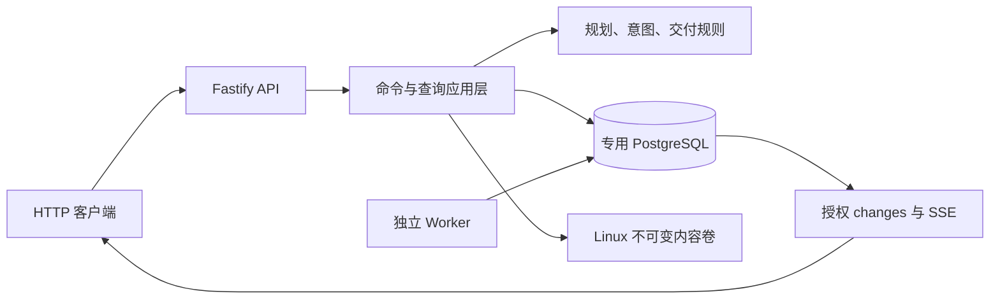

# 当前后端上下文

2026-10-16，第一阶段后端。实现位于本仓库，前端与真实执行器不属于本轮验收。

API 默认仅监听 127.0.0.1:4100。数据库使用专用 Compose project `project-management-backend`、专用卷及 127.0.0.1:55433。Worker 是独立 Node 进程，发布已提交 outbox 并维护事件保留与会话过期；它不执行 Agent、不替代审核。

数据库是业务事实与命令收据的权威来源。SSE 提供授权变更通知，客户端重新读取实体；存储中的文件必须先持久化，才能登记为成果版本。`execution.enabled=false` 表示此部署从未启用执行领域，不能用于将来绕过已有运行占位。

`/health/live` 只证明进程响应；`/health/ready` 检查数据库 schema、内容卷写入/同步、Worker 近 20 秒心跳及失败隔离事件。能力接口表示此部署启用了哪些能力，不能代替就绪检查。

服务启停仅通过本项目的 PID/startTime/cwd/入口校验操作自身进程。数据库由 Compose 管理，用户的其他项目和数据库不在本服务管理范围。
