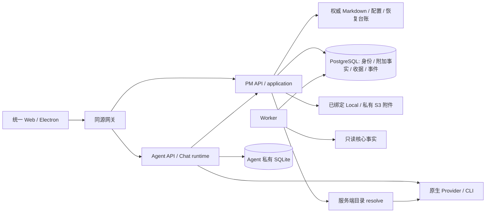

# 当前系统上下文

本页描述 Dovspace 当前源码职责，不是某次历史后端验收结论。2026-10-16 的 SQL 核心/API 布局保留在 [ADR-0001](adr/0001-project-bootstrap.md)、[ADR-0002](adr/0002-first-stage-backend.md)；后续 Markdown 权威切换见 [ADR-0003](adr/0003-markdown-core.md)。

## 运行角色

- `apps/server/pm`：认证、当前成员/项目授权、Markdown 核心唯一 API 写者、应用命令/查询、文件及 SSE。业务规则属于 `packages/domain` / `application` / `pm-core`，不由网关或前端决定。
- `apps/server/worker`：outbox/变更流、保留维护、通知、邮件和受限 Webhook；只读核心文件，不创建第二个核心 Workspace/watcher，不直接执行 Agent 或自动完成任务。
- `apps/server/agent`：统一 Chat、Provider 与原生执行、任务交付/自动化等附属记录。Chat 和 PM 侧栏是同一 Agent；不是历史规划中的通用业务 Runner/Session/Run 系统。
- `apps/server/gateway.ts`、`apps/web`：同源 HTTP/WS/SSE 与唯一 Web 产物；Electron 管理独立本地服务组，容器另用 Caddy 提供同源入口。

默认公共入口 `3224`、PM API `4194`、Agent API `4325`、Web 开发上游 `4326`、PostgreSQL `55444`。端口/PID/工作目录须在启动前核对；详细运行、卷和角色秘密见[部署手册](../../deploy/README.md)。历史副本端口和数据库不能当作新安装要求。

## 权威与安全边界

Markdown 拥有核心实体、正文与正式关系；PostgreSQL 拥有身份、授权和 PM 附加事实；Agent SQLite 拥有 Chat 及其执行附属记录，核心索引 SQLite 只是可重建投影。SQL/core/blob/Agent 不是全系统原子事务，未知结果按原操作身份核对。详见[数据所有权](data-ownership.md)及[模块契约](module-contracts.md)。

Agent 当前仅为可信本机单操作者，尚无按 PM 成员隔离的会话所有权。目录/cwd/allowedRoots 不是文件沙箱，真实 Terminal 使用服务用户权限；部分预览/任务隔离不改变整个 Provider 的边界。**会话与持久化统一设计尚未收口，当前仍暂沿用 Agent Chat。**

`/health/live` 仅证明 API 响应；`/health/ready` 检查 schema、实际内容存储、核心、Worker 与失败隔离。能力接口说明配置与实现，不证明真实模型、邮件、S3 策略或接收器已验收；PM `execution.enabled=false` 不等于独立 Chat 无执行能力，也不代表历史业务执行领域已经实现。
