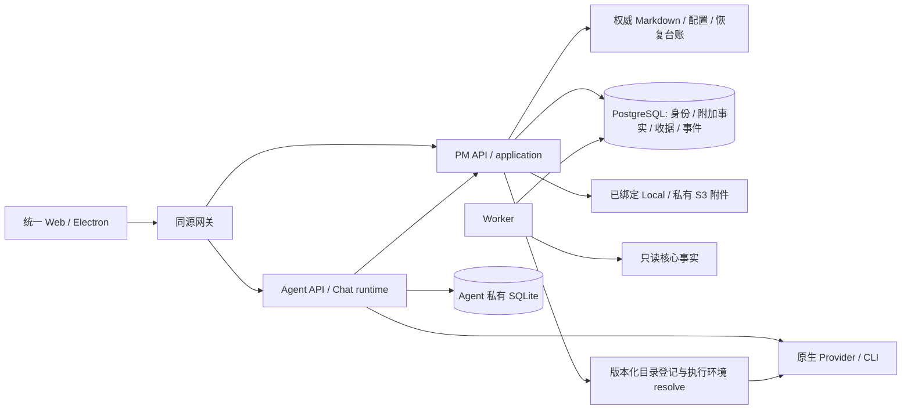

# 当前系统上下文

本页描述 Dovspace 当前源码职责，不是某次历史后端验收结论。目录职责、入口、测试与禁止边界见[仓库地图](repository-map.md)；本页只说明运行角色和权威/安全边界。2026-10-16 的 SQL 核心/API 布局保留在 [ADR-0001](adr/0001-project-bootstrap.md)、[ADR-0002](adr/0002-first-stage-backend.md)；后续 Markdown 权威切换见 [ADR-0003](adr/0003-markdown-core.md)。

## 运行角色

- `apps/server/pm`：认证、当前成员/项目授权、Markdown 核心唯一 API 写者、应用命令/查询、文件及 SSE；可选 Satori WebSocket 客户端只解析固定 IM 命令并调用同一命令入口。业务规则属于 `packages/domain` / `application` / `pm-core`，不由网关或前端决定。
- `apps/server/worker`：outbox/变更流、保留维护、通知、邮件、受限 Webhook 和可选 IM 出站投递；只读核心文件，不创建第二个核心 Workspace/watcher，不直接执行 Agent 或自动完成任务。
- `apps/server/agent`：统一 Chat、Provider 与原生执行、版本化 Agent／Team、有界业务 Run／委派，以及任务交付／自动化等附属记录。Chat 和 PM 侧栏是同一 Agent；业务 Run 显式关联 Issue 和技术 generation，不合并它们的身份，也不恢复历史完整 Runner 或自动续跑 Mission。
- `apps/server/gateway`、`apps/web`：同源 HTTP/WS/SSE 与唯一 Web 产物；Electron 管理独立本地服务组，容器另用 Caddy 提供同源入口。可选 Koishi 进程不属于本服务组，PM 只主动连接其 Satori 端口。

默认公共入口 `3224`、PM API `4194`、Agent API `4325`、Web 开发上游 `4326`、PostgreSQL `55444`。端口/PID/工作目录须在启动前核对；详细运行、卷和角色秘密见[部署手册](../../deploy/README.md)。历史副本端口和数据库不能当作新安装要求。

## 权威与安全边界

Markdown 拥有核心实体、正文与正式关系；PostgreSQL 拥有身份、授权和 PM 附加事实，包括原任务讨论中的可信 Agent 执行来源；Agent SQLite 拥有 Chat、Agent／Team 版本、Run／委派和原执行证据。核心索引 SQLite 只是可重建投影。SQL/core/blob/Agent 不是全系统原子事务，未知结果按原操作身份核对。详见[数据所有权](data-ownership.md)及[模块契约](module-contracts.md)。

PM 人类团队、显式项目参与和持久交接计划属于 PostgreSQL 附加事实，不改变 `memberships` 的能力／项目授权或 Markdown 单一负责人。人员候选由应用层按用途及当前权限读取；邀请接受在同一 SQL 事务内加入所选团队。交接通过原命令逐项修改 SQL／Markdown，各项保留版本与未知结果，不声称跨存储原子性；退出或撤权不代表外部执行停止。本人已提交退出的最小收据可在失去该工作区授权后查询，其他收据仍重新授权。见[成员协作合同](../domain-design/permissions.md#8-成员协作全流程合同)。

Agent Workspace 与 PM 工作区／项目独立：一个规范化的服务器绝对目录对应一个 Agent SQLite 登记，路径与设备/inode 身份不可改写。Session 保存 v2 目录选择并在首次受理时冻结；重命名／关闭仅改变登记元数据。PM 文档与信息通过明确目标的工具／引用访问，不是代码 cwd 回退。Files/Git/Skills/Provider/Session Terminal 使用同一服务端解析的实际执行路径；受控业务执行仍需原 PM 授权和 Worktree 收据。PTY 仅归本次 Agent 服务进程所有，不跨重启恢复。

Agent 当前仅为可信本机单操作者，尚无按 PM 成员隔离的会话所有权。目录/cwd/allowedRoots 不是文件沙箱，真实 Terminal 使用服务用户权限；部分预览/任务隔离不改变整个 Provider 的边界。**会话与持久化统一设计尚未收口，当前仍暂沿用 Agent Chat。**

统一设计的[方案与迁移验收矩阵](session-persistence-design.md)已明确采纳 D1–D4 的保守方案：可见删除与证据保留分离、未知副作用先核对、恢复历史不自动重绑执行身份、保留 Chat SQLite 并采用停机恢复集。实现与隔离验收正在进行；这不授权生产批量删除或破坏性迁移，也不代表设计已验收收口，上述提醒仍保留。

`/health/live` 仅证明 API 响应；`/health/ready` 检查 schema、实际内容存储、核心、Worker 与失败隔离。能力接口说明配置与实现，不证明真实模型、邮件、S3 策略或接收器已验收；PM `execution.enabled=false` 不等于独立 Chat 无执行能力，也不代表历史业务执行领域已经实现。
