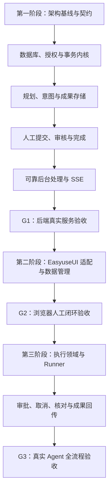

# Project Management 领域设计规范

版本：0.1 · 状态：设计提案，待业务审定 · 日期：2026-10-16

本规范依据仓库 [原始需求参考](../reference/domain-design-background.md)，面向 **Agent Workspace + Project Management**，定义业务语义、对象责任和可验证规则，供后续不同语言的后端实现共用。当前已交付可运行的人工后端核心，包括真实 PostgreSQL、内容存储、API、Worker 和 SSE。领域规范中的真实执行部分仍为第三阶段目标；实际覆盖、限制与验证见[后端实现记录](../implementation/backend-delivery.md)。

用户指定的实施顺序为：**第一阶段完成后端基础能力，第二阶段接入 EasyuseUI 展示与前端数据管理，第三阶段接入真实 Agent 执行**。完整顺序、任务及验收门槛见[第七节实施计划](#implementation-plan)。领域模型仍为 v0.1 提案，实施计划单独记录进度，不把计划登记视为开发完成。

## 1. 阅读入口

| 文档 | 回答的问题 |
| --- | --- |
| [glossary.md](glossary.md) | 各术语的确切含义是什么，哪些概念不能混用？ |
| [domain-map.md](domain-map.md) | 四个限界上下文如何分工，谁拥有事实和写入权？ |
| [entities.md](entities.md) | 实体、聚合、关系、版本与一致性边界如何定义？ |
| [invariants.md](invariants.md) | 哪些规则不能被 UI、Agent 或异步事件绕过？ |
| [workflows.md](workflows.md) | 用户场景、状态转换、审批和异常如何处理？ |
| [events.md](events.md) | 哪些命令能改变业务，事件如何消费、去重与恢复？ |
| [permissions.md](permissions.md) | 人、Agent 与系统进程分别可以做什么？ |
| [scenarios.md](scenarios.md) | 怎样把规则转成业务验收用例？ |
| [本页第七节：顺序实施计划](#implementation-plan) | 三个阶段先做什么、依赖什么、交付什么、如何判断完成？ |

建议按本表顺序阅读。`INV-*` 是规则编号，`SC-*` 是验收场景编号，跨文档使用同一标识。

## 2. 从 README 得到的边界

以下为来源要求（R），不是本文新增的产品决定。

| 编号 | 来源位置 | 要求 | 对应设计 |
| --- | --- | --- | --- |
| R-01 | 第二节「先建立领域模型」 | 意图与决策、项目与规划、Agent 执行、成果与追踪分开 | domain-map 四个上下文 |
| R-02 | 第二节业务约束示例 | Run 成功不等于 WorkItem 完成 | INV-03、INV-04；SC-03、SC-06 |
| R-03 | 第二节业务约束示例 | Session 可含多轮执行，不能等同 Project | INV-05；SC-04 |
| R-04 | 第二节业务约束示例 | 对话中的想法不必立即生成工作项 | INV-02；SC-01、SC-02 |
| R-05 | 第三节五阶段流程 | 从场景、状态和不变量推导命令、事件、权限与契约 | workflows、events、permissions、scenarios |
| R-06 | 第三节行为验证 | 覆盖运行失败、并发更新、重复事件的异常路径 | INV-03、INV-13、INV-14；SC-05、SC-12、SC-13 |
| R-07 | 第四节文档目录 | 形成可供 Agent 持续读取的设计资产 | 本目录七类核心文档与变更流程 |
| R-08 | 第二节、第五节 | 可从模块化单体开始，避免一开始引入全系统 Event Sourcing、CQRS、微服务 | 下述 P-01；domain-map 协作方式 |

## 3. 本版设计提案与取舍

README 未规定具体状态名、基数、角色或完成条件。除上表 R 项外，本文的规范性条款均为**本版提案**；“必须”表示采用本版设计时要满足的约束，不表示用户已经确认该产品策略。

| 编号 | 本版选择 | 比较的替代方案与取舍 |
| --- | --- | --- |
| P-01 | 模块化单体、当前状态持久化、可靠事件发布 | 对比微服务和全量事件溯源：先控制一致性与运维成本；保留模块契约，但不要求独立部署或事件重建 |
| P-02 | 每个 WorkItem 属于一个 Project；Workspace 是隔离边界 | 对比无项目任务收件箱：归属与授权更明确；未整理想法先保留为 Intent，跨项目任务暂不支持 |
| P-03 | 一个 Session 属于一个 Project；一个 Run 至多关联一个 WorkItem | 对比一次 Run 修改多个工作项：便于定位验收责任；复杂工作先拆解，探索型 Run 可不绑定工作项 |
| P-04 | 工作项完成需要人工通过当前版本的 Review，并显式执行 CompleteWorkItem | 对比 Run 成功自动关闭、Review 通过自动关闭：保留结果验收与业务关闭的独立语义，增加一次业务确认 |
| P-05 | 使用固定状态机；阻塞、归档是独立维度 | 对比任意自定义工作流：降低首版契约复杂度；日后引入 WorkflowDefinition 时需明确迁移规则 |
| P-06 | 一个 Session 同时最多一个未终结 Run；重试生成新 Run | 对比 Session 内并行与复用 Run：历史与恢复更清楚；并行执行使用不同 Session，并处理共享资源冲突 |
| P-07 | Approval 精确授权一次动作；未知副作用先核对，不自动重放 | 对比会话级永久许可和超时即失败：限制授权扩散，代价是需要执行凭据和核对路径 |
| P-08 | 结果按不可变版本提交；Review 绑定工作项内容版本和提交版本 | 对比“审核最新结果”动态指针：防止旧审核批准新成果，增加版本引用 |
| P-09 | 依赖采用同项目有向无环图，前置项完成才允许开始/完成 | 对比软提示依赖或跨项目依赖：语义简单但约束更强；取消前置项不视为完成 |

这些取舍是后续 ADR 的输入。第七节确定实施技术基线与分期；精确依赖版本、HTTP 路径、认证库、事务实现和部署参数在第一阶段落实，真实执行器与模型供应商在第三阶段选定。

## 4. 范围与后续问题

本版覆盖“讨论 → 接受意图 → 建立工作项 → 人或 Agent 执行 → 提交成果 → 审核 → 完成”，并包含项目、里程碑、依赖、审批、失败恢复、授权和历史追踪。人可以直接创建工作项，也可以人工完成交付，不强制所有工作经过对话或 Agent。

暂不设计 Portfolio/Initiative、Cycle/Sprint、预算、工时、资源排程、复杂风险登记、自定义字段、跨项目移动、第三方双向同步、计费、多组织继承权限及物理删除。被提及的参考产品并不意味着必须复制其全部能力。

业务审阅时优先确认：

1. 是否允许无项目工作项、跨项目依赖或一个 Run 服务多个工作项？本版按 P-02、P-03、P-09 处理。
2. 谁可以审核与完成工作项，是否必须由独立人员审核？本版允许有审核权限的人审核自己的人工交付，但不允许 Agent 审核；强制双人规则留待业务确认。
3. 哪些外部动作需要 Approval，授权多久有效？本版要求项目配置动作策略，未配置的外部写操作默认需要人工审批，不默认给予无限期授权。
4. “完成”的证据要求是否因工作项类型不同？本版至少一条验收标准、一个提交和一份通过的 Review；文本成果也可以作为 Artifact。
5. 是否需要自动验收与自定义工作流？本版均不启用；若启用，要同时修改权限、状态机和场景。

## 5. Agent 使用与维护流程

实现前读取受影响的术语、聚合、状态机、`INV-*` 和 `SC-*`，在实现任务中引用编号。领域规则变更先更新本规范的提案/决策及关联文档，再调整实现；不得用数据库便利性、UI 状态或供应商回调暗改业务语义。

后续按 README 的目录结构补充 `docs/architecture/`、ADR、`docs/contracts/openapi.yaml` 和可执行验收测试。它们是待产出资产，当前文档链接只指向实际存在的文件。正式实施前应把本目录入口加入项目级 `AGENTS.md`，同时保留已有工具与工作区约束。

验证采用与变更相称的范围：本次检查文档链接、编号、规则与场景覆盖、跨文档语义；后续实现需要聚合测试、事务/并发测试和适配器契约测试。文档检查通过不等于这些运行时验证已经通过。

## 6. 参考依据

仓库 README 是需求来源。下列一手页面于 2026-10-16 查阅，用于方法和概念校核；具体对象关系与状态机是本项目提案，不是这些资料规定的标准模型。

| 资料 | 本版使用范围 |
| --- | --- |
| [DDD Starter Modelling Process](https://github.com/ddd-crew/ddd-starter-modelling-process) | 从业务发现到边界和模型的迭代过程，避免一次性固定全部设计 |
| [DDD Reference](https://www.domainlanguage.com/ddd/reference/) | DDD 模式与术语的参考入口，不把术语词典当完整产品需求 |
| [Linear Concepts](https://linear.app/docs/conceptual-model) | 工作项、项目、里程碑、周期是不同概念；本版只采用所需概念，归属规则自行定义 |
| [arc42 Overview](https://arc42.org/overview/) | 将上下文、模块、运行场景、决策和质量要求分开记录 |

README 中的 Jira、OpenProject、OSLC、Temporal、Context Mapper、PMBOK、ISO 等链接作为后续专项研究入口，本版不声明符合这些规范或实现这些产品。README 提到的未给出标题和链接的“2026 年研究”不作为本规范的论据。

## 7. 完整顺序实施计划

计划版本：0.2 · 登记日期：2026-10-16 · 更新日期：2026-10-17 · 当前状态：**第一阶段核心后端已运行；B03/B09/B11/B13 收口与完整 G1 仍开放；第二阶段独立 `/pm` 已接真实服务并取得人工浏览器闭环证据，U07/G2 待最终回归；第三阶段未开始**。

本节是本项目实施顺序的统一入口。2026-10-16 用户指定新项目并授权用 gpt-6.1-sol / xhigh 子代理实现后端，部署独立 API、Worker 和 PostgreSQL；该批次未验收前端。2026-10-17 后续授权将现有展示接入本项目，正式 `/pm` 与显式 `/lab/pm` 隔离，未接管 EasyuseUI/Plane/既有 Agent 服务。已发生的接入工作不倒推完整 G1 通过；尚欠第一阶段门槛须继续登记，不能把局部浏览器成功等同于所有三阶段完成。

### 7.1 阶段目标与交付形态

| 阶段 | 范围 | 阶段结束后可实际使用的形态 | 不计入本阶段完成项 |
| --- | --- | --- | --- |
| 第一阶段：后端基础能力 | 后端、PostgreSQL、接口契约、SSE、后台处理、成果存储、身份与授权 | 无需前端和 Agent，使用 API 客户端即可完成项目规划、人工交付、审核、完成、归档；重启后数据和事件可恢复 | EasyuseUI 产品接入、真实模型请求、CLI/SDK 执行、Runner、外部工具派发 |
| 第二阶段：EasyuseUI 接入 | 复用现有展示、产品适配器、查询缓存、命令交互及 SSE 更新 | 浏览器操作真实后端，完成人工项目管理闭环；展示状态、权限、并发冲突与成果版本 | 将已有展示 fixture 当作真实后端；将其他项目已有 Agent 能力算成本项目接入完成 |
| 第三阶段：Agent 执行 | 执行领域持久化、Runner、执行器适配、审批、取消、重试、未知结果核对、执行界面接通 | 用户可从工作项发起真实运行，检查动作审批与成果，再人工审核和完成工作项 | 仅靠模拟执行器宣称真实执行通过；把 RunSucceeded 当作 WorkItemCompleted |

完整依赖链：

G1、G2、G3 是验证门槛，不是重复申请用户许可的步骤。未达到门槛时修复当前阶段，不能通过修改“完成”的含义跳过依赖。当前不承诺日历工期；实施时依据每步实际验证成本更新预计时间，不把未知服务能力换算成虚构完成日期。

### 7.2 技术基线与仓库边界

| 层次 | 本计划基线 | 开始实施时要固定的内容 |
| --- | --- | --- |
| 后端与领域层 | TypeScript、Node.js 24 LTS、Fastify；四个领域模块组成模块化单体 | 精确版本、模块依赖、领域对象与 HTTP/ORM 的隔离、受支持运行环境 |
| 数据库与迁移 | PostgreSQL、Drizzle、可审阅的 SQL migrations | 数据库大版本、唯一约束、索引、锁顺序、事务隔离、备份恢复与迁移策略 |
| 接口契约 | REST、OpenAPI、JSON Schema；由契约生成客户端类型 | 唯一 schema 来源、命令/查询、认证、分页、版本和错误映射；schema 与实现漂移检查 |
| 可靠后台处理 | PostgreSQL outbox/inbox、持久化 job 与 Worker | 事务边界、租约、失败重试、去重、保留期限、暂停/恢复与观测；首版无需额外消息中间件 |
| 实时更新 | 具备持久游标及重连语义的 SSE | 订阅范围、授权、流顺序、保留窗口、断点补发与快照恢复 |
| 内容存储 | 第一阶段实现本地持久化卷适配器，定义可替换的 BlobStore 接口 | 不可变 objectKey、摘要、容量/大小限制、暂存与确认、授权读取、备份；S3 适配作为后续独立扩展，不是首阶段的隐含验收项 |
| 身份与授权 | 服务端认证会话、Workspace/Project 能力授权、审计 | 采用维护中的认证库处理密码与会话，落实登录/退出及最小账号管理；测试身份不可作为生产默认身份 |
| 前端与数据管理 | 第二阶段沿用 EasyuseUI 的 React、TypeScript、TanStack Query 与现有本地状态管理；2026-10-17 起 `apps/web` 的构建基座为用户指定的 Vite 8 + React 19 + react-router 7（Tailwind v4 经 `@tailwindcss/vite`），Next.js 依赖与 App Router 目录已移除 | 复用现有受控 View 与锁文件；先核对现有页面字段与领域语义，再接入本项目的数据与命令 |
| 执行进程 | 第三阶段独立 Runner，经执行器适配协议连接真实 Agent | 首个执行器、支持能力、授权来源、操作凭据、资源隔离及恢复限制 |
| 验证与部署 | 后端 Node 内置 node:test、真实 PostgreSQL/存储集成测试、契约测试；第二阶段按 EasyuseUI 使用 Playwright；Docker Compose | 运行入口、健康检查、持久卷、配置模板、证据目录、测试隔离和重启恢复 |

本项目实际根目录为 `/data2-HDD-SATA-20T/Digital_avatar/haoweiyao/ui-examples/project-management`，拥有独立 Git 边界。已实现 `apps/api`、`apps/worker`、`packages/domain`、`packages/application`、`packages/contracts`、`packages/infrastructure`、`tests` 和 `deploy` 的第一阶段核心；后端统一编译，API/Worker 分进程运行。`apps/web` 为已接真实服务的独立 Vite SPA，构建/检查与后端分开。`apps/runner` 到第三阶段才创建。`project-management-book` 保留原始设计来源，后续实现与计划状态以本项目文档为准。

业务规则由 domain/application 层维护；HTTP、Worker、Runner 回报入口均调用同一应用服务。数据库、blob、认证属于基础设施适配。Worker 可以与 API 分进程部署，但不形成另一套业务规则或独立事实源。

EasyuseUI 根目录固定为 `/data2-HDD-SATA-20T/Digital_avatar/haoweiyao/EasyuseUI`。2026-10-16 的只读源码核对发现：

| 当前可核实入口 | 对第二阶段的影响 |
| --- | --- |
| [独立应用说明](../../../../EasyuseUI/examples/agent-workspace/README.md) 与 [package.json](../../../../EasyuseUI/examples/agent-workspace/package.json) | 当前存在独立 Next 应用，已安装 TanStack Query、Zustand、Zod；实施时复查当前版本和局部规则 |
| [PM 受控视图契约](../../../../EasyuseUI/packages/agent-workspace-views/project-management/controlled-contracts.ts) | 先复用 View 的 readModel/actions/capabilities 边界，再注入本项目的数据与命令 |
| [PM 客户端](../../../../EasyuseUI/examples/agent-workspace/src/features/pm/pm-client.tsx) | 已有查询和产品适配代码可分析，不把其服务专属身份、ID 和错误语义直接当成本项目契约 |
| [现有 native client](../../../../EasyuseUI/examples/agent-workspace/src/server/pm/native-client.ts) | 其实现仍是 NativePlaneClient；文件名 native 不代表已经存在本项目的原生后端 |
| [工作项展示](../../../../EasyuseUI/app/examples/work-items/page.tsx) 与 [PM 展示入口](../../../../EasyuseUI/examples/agent-workspace/src/features/showcase/project-management-explorer.tsx) | 展示和正式数据来源分开；优先盘点实际可复用页面，超出本版领域的控件明确标记不支持 |

上表为2026-10-16来源核对历史，不是本项目当前运行证据。2026-10-17 已再次读取来源 `PAGES-PROJECT-MANAGEMENT.md`，将其32项 Lab 设计与正式受控数据边界映射到独立应用，详见[前端移植与接入清单](../frontend-porting-manifest.md)。新后端使用独立数据、连接配置和产品适配入口；**不迁移 Plane 数据、不接管外部应用 `/pm` 的写入、不把已有 Agent Host 算作本项目执行能力**。未来迁移必须另列 ID、备份和回退范围。

### 7.3 第一阶段：后端基础能力

目标：先完成真实、持久、可恢复的人工业务闭环，再交付供 EasyuseUI 消费的稳定接口。

按表顺序执行。数据库迁移和 schema 随各业务步骤增量提交，但命令幂等记录和 outbox 必须从第一笔正式业务写入就存在。

| 步骤 | 前置 | 实施任务 | 交付物与退出条件 | 状态 |
| --- | --- | --- | --- | --- |
| B01 基线与决策 | 现有领域文档 | 固定后端技术版本、代码/Git 边界、模块接口、事务协调、认证库、存储路径与数据保留策略；把 P-01 至 P-09 中影响实施的选择写成 ADR，保留可替代方案及理由 | `docs/architecture/` 中的 context、module-contracts、data-ownership 与 ADR；每项未决问题有默认方案或明确阻塞的步骤，不阻塞无关工作 | 已完成（本轮基线） |
| B02 工程与服务骨架 | B01 | 建立 API、Worker 入口与领域/应用/契约/基础设施包；配置解析、结构化日志、requestId、健康检查、测试和本地 Compose 基础环境 | 最小 API 可启动；数据库连接失败可定位；健康/就绪检查分开；精确锁文件与环境模板可复现 | 已完成（后端工程） |
| B03 契约先行 | B02 | 定义命令、查询、认证、能力读取、分页/过滤/排序、expectedVersions、commandId、命令结果查询、错误响应、上传确认和 SSE schema；生成客户端类型 | `docs/contracts/openapi.yaml` 与 schema/示例可校验；实现接口与未启用执行接口明确分开；核心 schema 是单一来源 | 进行中（合同已交付，结果 DTO 待细化） |
| B04 数据与迁移底座 | B03 | 实现 Workspace、主体/成员、规划、意图、交付数据的增量 schema；建立命令结果、outbox/inbox、任务、变更流及存储元数据结构；定义不可变记录、索引和唯一性 | 空库初始化与前一版本升级验证；约束、项目级并发边界和版本 CAS 有真实 PostgreSQL 测试；不把内存仓储作为正式持久化 | 已完成（首版持久化） |
| B05 命令与事务内核 | B04 | 实现请求摘要、同键查询/重放、同键冲突、expectedVersions、业务状态＋命令结果＋outbox 原子提交；定义可信主体输入端口、统一事务协调与锁顺序 | 内部测试验证响应丢失后按原 commandId 找回结果、并发去重与回滚；未接通 B06 认证前不对外开放业务写入 | 已完成 |
| B06 身份、授权与审计 | B05 | 实现登录/退出、可撤销的服务端会话、最小账号/成员/角色管理及项目授权；正式成员/授权命令使用 B05 内核；认证主体从可信上下文派生；明确 CSRF、Cookie、来源/CORS 和服务身份边界 | 两个真实测试主体验证隔离、越权、撤销和错误不泄露；测试引导身份仅限显式测试环境；审计不记录秘密；成员/授权变更与结果及事件原子提交 | 已完成（首版账号与授权） |
| B07 项目与规划 | B06 | 实现 Project、WorkItem、Milestone、DependencyGraph 的命令、列表/详情、筛选和权限；无环校验、开始条件、取消/重开/归档与跨聚合协调 | 真实 API 支持规划和任务推进；依赖成环、并发编辑、非法状态转换被拒；完成命令保留 Review 守卫，直到 B10 可完成正向路径 | 已完成（核心命令） |
| B08 意图与决策 | B07 | 实现人工对话记录、提出/修订/接受/拒绝/撤回 Intent、Decision 和显式建项；保留来源及接受版本 | 消息不自动创建任务；重复转化最多一个 WorkItem；接受后建项失败可查询并恢复；此步不调用 LLM | 已完成 |
| B09 成果内容存储 | B08 | 实现 BlobStore 本地卷适配器、暂存上传、摘要/大小校验、确认登记 ArtifactVersion、授权下载、不可变定位与维护任务定义 | 上传→确认→下载字节摘要一致；拒绝越权/路径逃逸/篡改；中断可恢复；未完成的内容不能成为可验收成果 | 进行中（内容链路已验证，GC 待补） |
| B10 人工交付与审核 | B09 | 实现 Evidence、带标准全文快照的 Submission、唯一终局 Review、Return/CompleteWorkItem；完成项目与里程碑生命周期；审核与撤回/内容变更串行协调 | 无 Run 也可完整交付；旧 Review 不能关闭新内容或新提交；审核通过后仍需显式完成；SC-06/07/16/18/19 正向及竞态路径通过 | 已完成 |
| B11 可靠后台处理 | B10 | 实现 outbox 领取与发布、inbox 去重、持久 job、租约、退避/重试上限、失败隔离、可查询的恢复操作；维护读模型、变更流和安全的存储清理 | 杀掉 Worker 后恢复无永久漏事件；并行消费不重复业务效果；未处理失败可定位；不执行 Agent、不自动关闭工作项 | 进行中（事件 Worker 可用，通用任务/GC 待补） |
| B12 SSE 实时更新 | B11 | 实现授权订阅、心跳、Last-Event-ID、持久流游标、补发、游标过期快照恢复、权限撤销、背压/连接清理和多实例读取 | API/Worker 重启及断线重连后可重新收敛到正确状态；重复/乱序通知不改写权威事实；使用命令行 SSE 客户端即可验收 | 已完成（当前 SSE 契约） |
| B13 打包、恢复与 G1 验收 | B12 | 收口 API 契约/客户端样例，提供 API＋Worker＋PostgreSQL＋持久卷的 Compose 与运行手册；验证迁移、重启、备份恢复、日志/指标与人工闭环 | G1 清单全部通过；保留接口请求、数据库/文件核验、故障恢复及测试报告；交付可供第二阶段接入的版本 | 进行中（本机恢复通过，G1 待收口） |

**B09 的存储一致性要求：** 数据库事务不能回滚已经写入的文件。采用“暂存内容 → 计算并核验摘要 → 持久化不可变对象 → 同一数据库事务登记 ArtifactVersion、命令结果和 outbox”的流程。崩溃留下的暂存/孤立内容由 B11 延迟清理，清理前检查引用和上传租约；不得先删除内容再尝试提交数据库。可下载状态只在内容已持久化后开放；备份须覆盖数据库与已引用内容，并在恢复后校验摘要。

**B11/B12 的事件一致性要求：** SSE 读取已提交的持久变更流。`eventId` 用于去重，聚合内 `eventSequence` 用于单聚合排序，订阅流使用独立 `streamCursor`，三者不可混用。流游标分配与发布需保证提交顺序/安全高水位，不能因自增 ID 先分配后提交而永久漏事件。游标保留期限与失效响应在 B03/B01 固定；客户端先恢复权威快照，再从一致的水位续订，避免快照与订阅之间遗漏更新。

**第一阶段与第三阶段的接口边界：** 第一阶段保留执行上下文的类型、输入快照和模块端口，读取能力明确返回 `execution.enabled=false`。真实 Session/Run/Approval/OperationReceipt 持久化、调度、租约、审批消费和副作用记录在第三阶段实施。未启用的执行命令按契约返回 `capability_not_enabled`，不创建永远 queued 的记录；生产不提供模拟成功入口。人工成果的 sourceRunId 为空，非空来源必须引用未来已启用执行模块中的真实 Run。完成检查通过执行端口验证能力与活跃运行；无执行占位模式只适用于从未启用 Execution、没有执行历史的第一/二阶段部署，不能将“查询执行服务失败”解释为“没有活跃运行”。第三阶段上线后，即使停用新执行或关闭能力开关，已有 queued/running/outcome_unknown 等非终结 Run 仍须参与关闭检查与核对；部署生命周期记录与本次开关值分开，不能仅凭 `execution.enabled=false` 绕过占位守卫。

**G1 退出门槛：**

1. 从空数据库部署，使用真实认证主体经 HTTP 完成“创建项目 → 激活 → 建项 → 规划/依赖 → 开始 → 上传/登记成果 → 提交 → 审核 → 完成 → 项目/里程碑关闭与归档”，不依赖浏览器或 Agent。
2. 人工业务涉及的 SC-01/02/06/07/11/16/17/18/19 通过；SC-12/13/14/20 的通用并发、事件、授权和权威状态部分通过，执行相关分支保留为第三阶段待验收。
3. 真实 PostgreSQL 验证幂等、唯一约束、并发审核/撤回、依赖图竞争和跨聚合关闭；迁移失败不宣称升级成功。
4. 真实本地持久卷完成上传、下载、摘要核验、越权拒绝、崩溃恢复及带内容的备份恢复；不能用内存文本示例代替文件存储验收。
5. Worker 与 SSE 断线、重启、重复事件、游标过期、权限撤销均有实际进程/HTTP 证据；新客户端通过快照和续订可恢复一致视图。
6. OpenAPI/schema 校验、后端 lint/typecheck/build、相应单元/集成/契约测试通过；无未记录的阻塞性差异。未实现的执行能力可查询且明确关闭。

### 7.4 第二阶段：接入 EasyuseUI 展示与前端数据管理

计划进入条件仍为 G1 通过；当前已在核心服务稳定可用基础上实施独立前端接入，但完整 G1 收口未关闭，不能据此宣称阶段顺序的全部退出条件已满足。正式实现、Lab 样例和浏览器证据分别记录，新增页面只覆盖实际业务能力。

| 步骤 | 前置 | 实施任务 | 交付物与退出条件 | 状态 |
| --- | --- | --- | --- | --- |
| U01 展示与领域映射 | G1 | 复查 EasyuseUI 页面/组件与受控边界；建立页面、领域对象、查询/命令、能力和缺口映射 | Issue 映射 WorkItem；Team/邮件/Agent 不伪造；32 Lab 与正式白名单分开 | 已完成（映射见[移植清单](../frontend-porting-manifest.md)；不代表 G1 已关闭） |
| U02 独立连接与客户端 | U01 | 独立 Vite + React 宿主，同源受限代理与生成客户端；真实账号/工作区/能力 | 正式 `/pm` 不回退 fixture，不覆盖 Plane，不在浏览器放服务凭据 | 已完成（本机接入；真实登录/项目读取证据见[交付记录](../implementation/backend-delivery.md)） |
| U03 查询与本地状态 | U02 | TanStack Query 按服务/主体/成员范围隔离，完整分页；草稿与服务快照分离 | 身份切换、加载/空/失败/只读与过期快照分别处理 | 待验证（实现已接入；完整切换/失败矩阵待 U07） |
| U04 命令与冲突交互 | U03 | 规划、依赖、意图、生命周期命令携带 commandId/expectedVersions；IndexedDB 持久未知命令，查询原收据 | 不盲重发；冲突保留草稿且显式 rebase；权限不可绕过 | 待验证（丢响应后刷新核对、日期冲突已实测；全命令界面回归待 U07） |
| U05 SSE 与缓存收敛 | U04 | SSE checkpoint、续订与快照失效；身份/成员作用域清理 | 两会话实时收敛，不重复 mutation、不覆盖草稿 | 待验证（owner→reader、撤权清理、离线/刷新失败恢复已实测；完整游标失效矩阵未验收） |
| U06 成果审核闭环 | U05 | 真实上传/下载、不可变版本、Evidence、标准快照、Submission、Review、退回/完成 | 审核通过不提前 done；无 Run 人工链路完整 | 待验证（正向链路/下载摘要/刷新已实测；其余界面分支待 U07） |
| U07 产品回归与 G2 验收 | U06 | 本项目 `check:web`、Storybook、32 Lab 巡检、主题/语言/键盘/移动端与生产门禁/部署 | G2 通过；真实后端与 fixture 证据分开，不借用外部 Plane/Agent 报告 | 进行中（本机检查、32/32展示、跨视图交互及390px回归通过；完整 G2/生产部署未验收） |

展示组件仍接受受控数据和回调。Query 管服务端快照，本地状态管交互草稿，后端管权限、状态、幂等与持久化。Vite 开发/preview 的同源代理只转发，不复制领域事务；生产代理需另行部署验收。Query 缓存使用本后端 ID，不能凭名称跨后端合并。日期 metadata（可空 startDate/dueDate、inclusive due、实体版本递增但 contentRevision 不变）由生成合同与后端校验，日历/甘特不另造时间事实。个人本地白板不是服务器协作领域对象。

**G2 退出门槛：**

1. 使用 EasyuseUI 的实际页面，通过新后端完成人工项目管理闭环；真实刷新或重启后仍可查询相同对象与成果。
2. 两个不同权限的用户完成读写隔离、并发编辑冲突、实时更新、成果审核及撤销权限验证。
3. 浏览器写入响应丢失时保留原 commandId，查询收据找回结果；业务请求未被盲目重发。断线续订、游标失效和刷新失败有可见状态。
4. 既有展示/Plane 接入的受影响路径回归通过；公共组件继续独立于本后端、认证和网络。正式入口服务不可用时不加载示例数据冒充结果。
5. 受影响路径的 lint/typecheck/build 和适用 Playwright 检查通过；保存浏览器与真实服务证据，并明确人工业务验收结果。

### 7.5 第三阶段：接入真实 Agent 执行

进入条件：G2 通过。以当前领域规范中的 Session/Run/Approval/OperationReceipt 为权威模型，新增执行能力，保留已经完成的人工工作路径。

| 步骤 | 前置 | 实施任务 | 交付物与退出条件 | 状态 |
| --- | --- | --- | --- | --- |
| X01 执行器选择与协议 | G2 | 盘点可用 Agent SDK/CLI/既有 Host，选择一个首发适配器；定义创建/输入/事件/审批/取消/查询/成果接口，标注不支持的能力与租户边界 | 执行 ADR、协议 schema、能力矩阵及故障模型；现有 Host 的单用户或权限限制不得包装成多用户隔离；不一次接入所有执行器 | 未开始 |
| X02 执行领域与持久化 | X01 | 增量迁移 Session、Run、Approval、OperationReceipt、输入快照、占位、授权引用；实现执行命令、当前 epoch 校验及与任务关闭共享的事务边界 | 单会话活跃运行唯一，Run 绑定不可改；并发关闭与启动正确互斥；契约/状态机/真实数据库测试通过，真实派发仍关闭 | 未开始 |
| X03 Runner 与受信通道 | X02 | 独立 Runner 注册、服务身份、领取/租约/心跳、取消通道、资源预留；接入首个执行器；限制运行目录、文件/网络能力与凭据范围 | Runner 不直写业务表；报告可验证归属和来源；租约转移不推断旧动作已停止；先用受控无副作用任务验证协议 | 未开始 |
| X04 审批与可靠派发 | X03 | 接入动作能力策略、Request/Grant/Deny/Revoke/ExpireApproval、精确参数摘要、单次消费与派发记录；无审批动作也保留凭据 | 有效授权与审批才能派发；取消/unknown/终态禁止新动作；发送前后崩溃不会因本地状态缺失盲重放；受控外部动作证据可查询 | 未开始 |
| X05 结果、取消与核对 | X04 | 实现运行终态、实际停止确认、结果不明状态、按 operationId 查询核对、旧执行者回报拒绝与新 Run 重试；接入运行成果/证据登记 | unknown 占位且禁止危险重试；无可靠查询能力时保留 unknown；成果内容来源和摘要可核验；Run 成功不修改任务完成状态 | 未开始 |
| X06 执行界面与能力开放 | X05 | 在第二阶段产品适配器中接入 Session/Run、审批、取消、核对、重试及实时事件；按当前后端能力显示操作；将运行成果提交到既有交付流程 | 真实运行状态、审批状态和业务状态分开展示；输入版本可追踪；用户可从 Agent 成果进入 Review 与显式完成，无绕过人工验收路径 | 未开始 |
| X07 故障恢复与 G3 验收 | X06 | 验证真实执行器、外部测试工具、Runner 重启、断线、失租、重复回调、审批变化、取消竞态和未知结果；完成运行手册与部署配置 | G3 通过；Agent 真实服务证据、协议模拟测试与人工验收分别记录；只开放已验收的执行器和动作能力 | 未开始 |

第三阶段的执行调度与第一阶段 Worker 分工明确：Worker 处理持久任务和事件，Runner 执行获授权的外部动作，业务服务拥有 Run/Approval 的权威状态。即使复用现有 Agent Host，也要通过适配器确认取消、来源事件与核对语义，不能仅把“写入 CLI/PTY”当作“动作完成”。

**G3 退出门槛：**

1. 真实 Agent 完成“工作项 → 输入快照 → Run → 必要动作审批 → 成果与证据 → Submission → Review → CompleteWorkItem”；业务完成由授权人确认。
2. SC-03/04/05/08/09/10/15 的实际执行路径通过；补齐 SC-12/13/14/17/20 中的执行占位、旧 epoch、权限与恢复分支；原人工链路仍通过。
3. 外部动作已发生但响应丢失、取消请求尚未确认、审批过期/撤销及 Runner 重启均有受控故障证据；禁止未知动作自动重放。
4. 首个执行器的真实能力、限制、隔离边界和核对方法有文档；不支持能力明确拒绝，不用模型文字替代受信执行凭据。
5. 后端、Runner、前端受影响测试与部署恢复验证通过；保存真实运行、成果摘要与人工验收记录。只有上述证据完整才标记整个三阶段项目完成。

### 7.6 验收追踪与新增基础设施场景

领域规范中的 `SC-*` 保持不变，不能因分期提前全部勾选。测试报告按“场景编号＋验证层次＋实际使用的服务”记录；一个场景的部分分支通过不代表整个场景完成。

| 追踪范围 | 第一阶段 | 第二阶段 | 第三阶段 |
| --- | --- | --- | --- |
| SC-01/02/06/07/11/16/18/19 | 人工/API/数据库路径；模拟 Agent 主体只验证权限 | 同一规则经真实浏览器操作 | 人工与 Agent 产出共存回归 |
| SC-12/13/14/17/20 | 通用并发、幂等、授权、关闭及权威读取 | 浏览器冲突、实时恢复与权限状态 | 活跃 Run、epoch、外部副作用和未知结果分支 |
| SC-03/04/05/08/09/10/15 | 仅允许 schema/纯领域契约预检，标记真实执行未验收 | 能力未启用状态；不伪造成功 | 真实执行器、数据库、Runner、外部工具与浏览器全链路 |

下列 `INF-*` 补充基础设施验收，不改变领域不变量：

| 编号 | 验证场景 | 所属门槛 |
| --- | --- | --- |
| INF-01 | 空库迁移、升级失败处理、跨进程重启、数据库与内容备份恢复后同一对象/字节仍一致 | G1 |
| INF-02 | 两个 Worker 并发领取、提交后崩溃、重复投递、租约过期及失败隔离；消费效果与 inbox 一致 | G1 |
| INF-03 | SSE 断连补发、游标过期、快照/订阅竞态、重启后连续读取、授权撤销及慢客户端 | G1；G2 验证浏览器恢复 |
| INF-04 | 上传中断、确认前后崩溃、摘要错误、越权下载、路径逃逸、孤立内容清理与引用保护 | G1；G2 验证界面状态 |
| INF-05 | schema 变更与客户端生成一致、非法请求拒绝、分页完整、命令结果查询、未启用能力明确报错 | G1；G2 验证消费端兼容 |
| INF-06 | 登录/退出、会话过期与撤销、测试身份隔离、不同主体/工作区读取和事件订阅隔离 | G1；G2 验证缓存清理 |
| INF-07 | Runner 派发前后重启、旧 epoch 回调、审批消费竞态、未知结果只查询核对 | G3 |

### 7.7 文档交付与进度维护

| 产物 | 产生阶段 | 要求 |
| --- | --- | --- |
| 本页顺序计划与各领域规范 | 当前已存在；各阶段维护 | 更新任务状态、ADR 链接、受影响规则及验收结论，保留用户明确的阶段顺序 |
| 架构与 ADR | B01 起 | 记录当前选择、替代方案、边界与后果；依赖变化时更新而不是隐式绕过 |
| OpenAPI、schema、生成客户端与接口例子 | B03 起，B13 交付 | 契约可机器验证；实现支持范围明确；前端和 Runner 消费同一版本契约 |
| schema、迁移、环境模板、Compose 与运维手册 | B04 起，B13 交付 | 秘密不入库；数据库和 blob 持久数据独立于构建产物；记录升级与恢复步骤 |
| EasyuseUI 映射、产品适配及接入记录 | U01 至 U07 | 记录真实页面/组件/客户端路径、来源、缺口和验收；执行当前 EasyuseUI 的任务范围检查 |
| 执行器协议、能力矩阵、Runner 运维说明 | X01 至 X07 | 明确真实支持项、权限、资源边界、恢复路径及未知结果限制 |
| 阶段执行记录与证据索引 | 各步骤完成时 | 记录日期、变更范围、命令与结果、INV/SC/INF 覆盖、失败与未验证项；证据不得包含凭据 |

步骤状态使用“未开始 / 进行中 / 待验证 / 已完成 / 受阻”。标记已完成时必须关联变更路径与验证记录；受阻时标记原因及依赖步骤。新增能力先确定属于哪个阶段，再补契约、规则和场景，不因展示中存在按钮就扩大后端范围。

第一阶段继续收口 **B03 细粒度结果 DTO、B09 安全孤立内容清理、B11 通用持久任务管理、B13 完整 G1**。当前 Worker 以 outbox 发布标记和 events 唯一 eventId 实现单一消费者去重，没有另设无用途 inbox；通用任务、GC 不计为完成。第二阶段已接真实服务，但 **G2 的完整浏览器恢复/权限矩阵、生产 Lab 门禁与部署**仍开放；第三阶段 X01–X07/G3 全部未开始。邮件邀请、外部邮件服务与 Agent 不在当前有界功能矩阵内。

Dashboard 十二项增量见[Dashboard 补齐计划](../implementation/dashboard-backend-completion.md)；正式项目页面的收藏、封面、团队/身份、里程碑、健康/信心、预算、范围、审计与原生编辑十项见[项目补齐计划](../implementation/project-backend-completion.md)。两者复用同一健康/财务事实源，不复制 Markdown 核心。补充约束见 [DASH/PROJ 不变量](invariants.md)及[项目授权边界](permissions.md#project-page-permissions)。

各批次实际检查结果与证据边界分列在[交付记录](../implementation/backend-delivery.md)；初始化历史见[bootstrap.md](../implementation/bootstrap.md)。不得将旧82/84项历史结果当作当前全量检查，最终检查不得沿用最新修复之前的通过结果。
