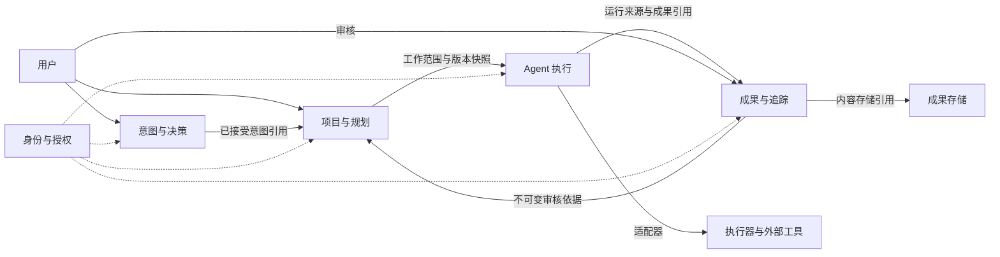

# 领域边界与协作

> 适用性：本文件保留v0.1历史提案/稳定编号，不代表完整业务Runner或旧SQL核心规则已启用。当前Markdown任务状态、审核独立性与关系语义以[已采纳ADR](../architecture/adr/0003-markdown-core.md)及[入口第七节](README.md#implementation-plan)为准；Chat thread/generation不能替代历史Session/Run模型。

本文件是 [v0.1 提案](README.md) 的限界上下文划分。上下文表示语义和写入责任，不代表独立服务。

## 1. 上下文职责

| 上下文 | 拥有的事实 | 提供的能力 | 不拥有的决定 |
| --- | --- | --- | --- |
| 意图与决策（Intent & Decision） | Conversation、Intent、Decision | 记录讨论、提出意图、接受/拒绝意图、保留决定依据 | 不因收到消息就创建任务或启动执行 |
| 项目与规划（Planning） | Project、WorkItem、Milestone、Dependency | 管理目标、工作范围、分派、依赖和业务完成 | 不推测运行结果，不生成审核结论 |
| Agent 执行（Execution） | Session、Run、Approval、OperationReceipt | 启动、审批、取消、核对、记录执行尝试 | 不写 WorkItem 状态，不判定项目完成 |
| 成果与追踪（Delivery） | Artifact、ArtifactVersion、Evidence、Submission、Review | 固定成果版本、收集证据、审核交付 | 不替代 Planning 决定工作项完成，不授权外部动作 |

Workspace、成员、主体及授权是支撑能力。认证接入、执行器、代码仓库、对象存储、通知与外部项目管理工具属于系统边界外的依赖，经适配器接入；其状态码或对象名不直接成为本系统领域语义。

图中箭头表示契约依赖，不意味着所有箭头都是异步事件，更不表示可以跨模块写表。

## 2. 跨上下文契约

| 场景 | 提供方 → 消费方 | 最小契约 | 失败语义 |
| --- | --- | --- | --- |
| 从意图建工作项 | Intent → Planning | AcceptedIntentRef：workspaceId、intentId、acceptedRevision、decisionId | 接受意图和创建任务是两个动作；后者失败时意图保持 accepted，可用同一去重键恢复 |
| 开始任务型 Run | Planning → Execution | WorkScopeSnapshot：projectId、workItemId、contentRevision、范围、验收标准、授权引用 | Planning 拒绝过期/关闭/阻塞工作；Execution 不凭陈旧看板启动 |
| 记录运行成果 | Execution → Delivery | RunSourceRef：runId、sessionId、workItemId（可空）、输入版本、来源凭据 | 成果登记失败不改变 Run 结果；可重试登记但不能再次执行外部动作 |
| 提交和审核 | Planning → Delivery | 当前工作项版本、验收标准、允许提交的状态 | 检查失败不进入审核；历史成果仍可保存 |
| 完成工作项 | Delivery → Planning | PassedReviewRef：reviewId、submissionId、workItemId、contentRevision、结论、审核人 | 缺失、过期或不匹配则拒绝完成，不能以读取失败当作通过 |

Execution 通过适配器接收执行器回报并验证身份、Run 归属和操作序号，才可形成自身事件。第三方导入未来采用防腐层：显式映射状态，无法映射的事实保留为待处理，不默认为成功。

## 3. 写入与事务原则

每个对象只有一个写入模块，模块通过应用服务暴露命令，不共享可修改的领域对象。Project 不把所有 WorkItem、Run 和 Artifact 作为内嵌对象加载；跨聚合通过稳定 ID 引用。

本版 P-01 允许共享事务基础设施，并不要求“一条命令只能改一个聚合”。需要强一致性的少数操作由应用层协调，领域规则仍由各所属模块检查：

| 一致性组 | 必须原子检查或提交的内容 |
| --- | --- |
| 接受意图 | Intent 状态与接受的 Decision 一并提交 |
| 接受意图后首次创建工作项 | 创建 WorkItem 与 `(workspaceId, intentId, acceptedRevision)` 唯一映射一并提交 |
| Session 内创建 Run | Session 可用、无活跃 Run、Run 创建及活跃占位一并提交；终结时原子释放占位 |
| 任务型 Run 启动与工作项关闭 | 锁定同一 WorkItem 执行占位边界；启动检查当前状态/版本，取消或完成检查不存在活跃 Run。`outcome_unknown` 也占位 |
| 提交成果 | Submission 创建、WorkItem 当前提交引用及状态迁移一并提交，防止内容已改变仍提交成功 |
| 记录审核 | RecordReview 在同一边界核对 WorkItem 为 in_review、当前内容版本及提交引用，并写入唯一终局 Review；与撤回、内容修改、取消串行协调 |
| 审核通过后完成 | 读取不可变 Review/Submission，核对 WorkItem 当前内容与提交版本，并原子更新 WorkItem；不会回写审核历史 |
| 依赖新增、启动和关闭 | 依赖变更在项目内串行验证无环；开始/完成工作项时在一致快照中验证前置条件 |
| 项目/里程碑关闭或归档 | 与新增/重开工作项、启动 Run、变更里程碑成员使用同一项目级并发协调边界 |

以上边界是对实现的要求，不是已实现的锁算法。若改为独立数据库，必须重新设计预留、版本凭据或流程协调，不能把强一致规则直接降为异步投影检查。

状态变更与待发布事件在同一提交边界持久化，可用事务性 outbox；消费者以 inbox/等效去重机制处理至少一次投递。不要求引入消息中间件。查询和统计可最终一致，完成、授权、无环校验和唯一性判断使用权威状态。

## 4. 数据派生与生命周期

- 看板、进度、会话列表、时间线是读模型。Run 成功率不能作为工作项完成率。
- 项目进度可展示 `done / 非 cancelled 工作项数量`，分母为零时显示“无可统计工作项”；它不触发 Project 完成。
- 取消、重开、归档均保留历史。归档不删除成果，不停止运行；必须先完成运行停止和结果核对。
- 本版无跨 Workspace 引用，无级联物理删除。未来删除策略必须独立定义保留期限、引用处理和隐私要求。

## 5. 后续架构产物

架构文档应进一步确定模块接口签名、事务实现、事件存储、执行凭据保留、授权实现和故障恢复方式。API 契约应由本规范命令推导；表名、HTTP 路径、ORM 与队列类型不反过来定义领域边界。
