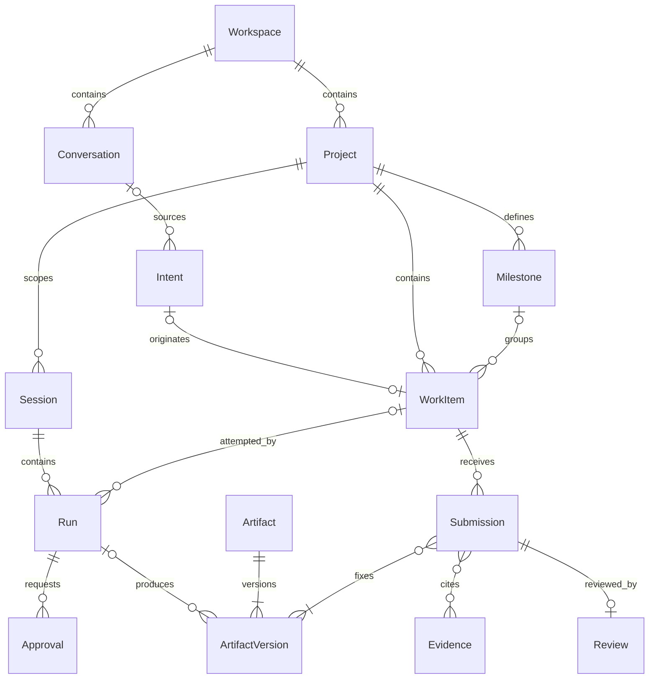

# 实体、聚合与关系

> 适用性：本文件保留v0.1历史提案/稳定编号，不代表完整业务Runner或旧SQL核心规则已启用。当前Markdown任务状态、审核独立性与关系语义以[已采纳ADR](../architecture/adr/0003-markdown-core.md)及[入口第七节](README.md#implementation-plan)为准；Chat thread/generation不能替代历史Session/Run模型。

本文件是 [v0.1 提案](README.md)。字段表示业务信息要求，不是数据库 DDL。所有身份均用不透明 ID；跨上下文只保存引用及必要快照。

## 1. 通用约束

可变聚合具备 `id、workspaceId、version、createdAt、createdBy、updatedAt`。归档对象增加 `archivedAt`。不可变记录保留创建信息，不用原地编辑伪造历史。所有引用必须验证 Workspace 一致性；Project 内引用还要验证 Project 一致性。

`version` 用于乐观并发控制，每次成功修改递增。WorkItem 另有 `contentRevision`：范围、描述或验收标准变化时递增；分派、优先级、状态变化只增加 `version`。新增依赖另做实时前置条件校验，不依靠内容版本代替它。

## 2. 聚合目录

| 上下文 / 聚合根 | 核心业务字段与内部对象 | 一致性责任 |
| --- | --- | --- |
| 意图 / Conversation | title、projectId?、消息引用；消息含作者、时间、内容版本 | 消息是讨论材料；无限增长历史可分页存储，不把全文作为单次聚合加载要求 |
| 意图 / Intent | conversationId?、sourceMessageRefs、summary、goal、revision、status、acceptedDecisionId? | 接受的是特定 revision；被接受后内容冻结，变更需求另建 Intent |
| 意图 / Decision | subjectRef、decisionType、actorId、reason、basisRefs、supersedesDecisionId? | 不可变；替代记录不撤销已经发生的外部执行或工作项 |
| 规划 / Project | name、goal、ownerId、status、completionCriteria、completionRecord? | 目标、项目状态与关闭依据；不内嵌所有任务 |
| 规划 / WorkItem | projectId、title、description、acceptanceCriteria[]、contentRevision、status、assigneeId?、milestoneId?、originIntentRef?、currentSubmissionId?、completionRecord?、manualBlockReasons[] | 范围版本、状态转换、验收依据；CompletionRecord 记录 Review 引用、完成者及时间 |
| 规划 / Milestone | projectId、title、targetDate?、criteria、status、achievementRecord? | 达成判断独立于统计；工作项成员由 milestoneId 建立，不维护第二份可写成员列表 |
| 规划 / DependencyGraph | projectId、version、edges(dependentId, prerequisiteId) | 同项目、无自环、无重复、无有向环；项目级图是概念一致性边界，可用边表持久化 |
| 执行 / Session | projectId、contextRefs、status、activeRunId? | 执行上下文及一次一个活跃 Run；历史 Run 通过 ID 查询 |
| 执行 / Run | sessionId、workItemId?、inputSnapshot、executorId、status、retryOfRunId?、resultRef?、failure?、operationReceipts[] | 一次尝试的输入和结果不可被重试覆盖；外部动作使用稳定 operationId |
| 执行 / Approval | runId、operationId、actionType、resourceRefs、payloadDigest、requesterId、expiresAt、status、decisionActorId?、reason? | 只授权所绑定动作；决定后不可修改，消费后不可复用 |
| 交付 / Artifact | projectId、kind、title、versionRefs | 稳定成果身份；发布新内容创建新 ArtifactVersion |
| 交付 / ArtifactVersion | artifactId、contentDigest、immutableLocator 或 inlineContent、sourceRunId?、producerId | 不可变内容定位；外部存储内容无法核验时不能作为可验证交付依据 |
| 交付 / Evidence | projectId、subjectRefs、method、scope、result、observedAt、producerId、sourceRunId?、artifactVersionRefs[] | 观察事实不可变；result 可为 pass/fail/inconclusive，不能覆盖为另一种结果 |
| 交付 / Submission | workItemId、contentRevision、workScopeSnapshot、artifactVersionIds[]、evidenceIds[]、submittedBy、submittedAt | 固定一次交付及当时范围/验收标准全文；至少一个成果版本，证据可为空但必须在审核中说明验证方式 |
| 交付 / Review | submissionId、workItemId、contentRevision、criterionResults[]、verdict、reviewerId、reason、reviewedAt | 不可变终局结论；每条标准有判断和依据，verdict 为 passed 或 changes_requested |

Review 首版不另设可变草稿；评审意见准备过程是 UI/协作能力，提交结论才产生领域记录。每个 Submission 最多一份终局 Review；需要再次审核时创建新的 Submission，即使复用相同成果版本，也保留独立提交身份。

## 3. 关系与基数

关系图仅展示主要引用，不表示级联保存或删除；Decision、DependencyGraph 与 OperationReceipt 的具体归属以聚合表为准。

- 首版每个已接受 Intent 最多通过意图转化入口创建一个 WorkItem。拆解可由用户另建多个工作项并引用来源 Decision，不复用 originIntentRef 的唯一映射。
- WorkItem 创建时必须有 Project；可无 assignee、Milestone、Intent 和 Run。人工工作也使用同一提交与审核流程。
- Session 内多次 Run 可分别针对同项目不同工作项，也可探索性运行；Run 创建后不能修改所绑定的 WorkItem 或输入版本。
- 不同 Session 可同时服务一个 WorkItem，但共享工作目录、分支或外部资源的并发写必须由执行适配器预留/隔离，不能因“允许多 Run”就允许冲突写入。
- ArtifactVersion、Evidence 可以不来自 Run；所有来源都要记录 producerId 和所属项目。提交引用同项目成果，且来源运行仍活跃时不能据此提交完成验收。

## 4. 关键值对象

| 值对象 | 内容 | 用途 |
| --- | --- | --- |
| WorkScopeSnapshot | workItemId、contentRevision、description、acceptanceCriteria、capturedAt | Run 保留当时输入；Submission 由服务端从当前工作项另行固定交付范围与验收标准全文，人工交付也有独立快照，不依赖可选 Run |
| CriterionResult | criterionId、result、basisRefs、explanation | Review 对每条标准给出结论；全部通过才可 passed |
| OperationReceipt | operationId、payloadDigest、providerRef?、dispatchState、outcome、evidenceRefs | dispatchState 为 prepared/dispatched；outcome 为 pending/confirmed_applied/confirmed_not_applied/unknown |
| AuthorizationRef | principalId、grantId、scope、policyVersion | 保存授权来源；执行时仍须验证授权有效性，不将快照当永久许可 |
| CompletionRecord | reviewId、submissionId、contentRevision、completedBy、completedAt | 业务关闭与审核证据的固定连接 |

OperationReceipt 中 `confirmed_applied` 只证明动作发生；业务是否符合目标由结果与审核判断。`confirmed_not_applied` 表示有证据证明未发生，不能由超时推导。若动作部分执行，应记录已知部分并保持 unknown，直到能清楚界定副作用。

## 5. 约束落点

唯一性至少包括：主体作用域内的 commandId、消费者范围内的 eventId、意图转化键、operationId、每个 Session 的活跃 Run、每个 Submission 的终局 Review。工作项及成果版本不复用已删除对象 ID。

聚合内部规则在领域方法检查；唯一性与并发规则还须由持久化约束保障。跨聚合强一致性组见 [domain-map.md](domain-map.md)。归档不打断引用，状态历史与决策记录可用于审计，但本版不要求以事件重建全部对象。
