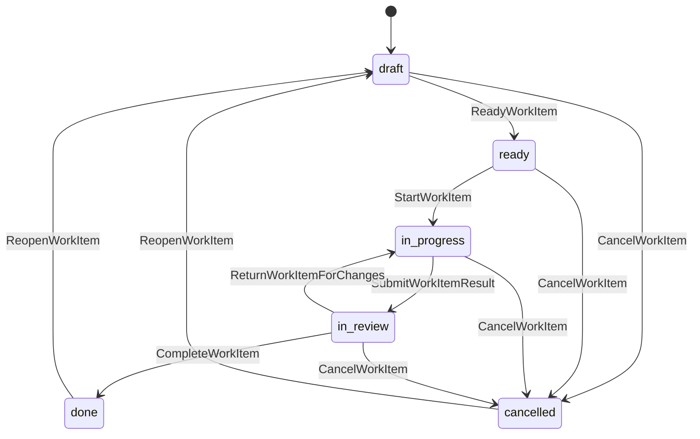

# 状态机与业务流程

> 适用性：本文件保留v0.1历史提案/稳定编号，不代表完整业务Runner或旧SQL核心规则已启用。当前Markdown任务状态、审核独立性与关系语义以[已采纳ADR](../architecture/adr/0003-markdown-core.md)及[入口第七节](README.md#implementation-plan)为准；Chat thread/generation不能替代历史Session/Run模型。

本文件定义 [v0.1 提案](README.md) 的允许转换。未列出的转换默认拒绝；所有转换还需满足权限、版本与 [不变量](invariants.md)。归档对象拒绝普通业务修改，恢复归档是单独的管理命令。

## 1. 从讨论到完成

| 步骤 | 主体与命令 | 产生的事实 | 业务含义 |
| --- | --- | --- | --- |
| 1 | 用户/Agent：AppendMessage、ProposeIntent | MessageAppended、IntentProposed | 记录问题和建议，此时没有工作承诺 |
| 2 | 有决策权限的人：AcceptIntent | IntentAccepted、DecisionRecorded | 接受特定版本的意图，不自动启动执行 |
| 3 | 规划编辑者：CreateWorkItemFromIntent | WorkItemCreated | 建立待规划的工作项；人工可直接 CreateWorkItem |
| 4 | 规划编辑者：ReadyWorkItem、StartWorkItem | WorkItemReadied、WorkItemStarted | 确认范围与标准、检查阻塞后开始工作 |
| 5 | 有执行权主体：CreateRun | RunQueued | 捕获工作项内容版本及授权范围 |
| 6 | 执行服务：StartRun；必要时请求并等待 Approval | RunStarted、ApprovalRequested 等 | 仅执行当前授权范围内动作 |
| 7 | 执行服务：RecordRunOutcome；交付主体：RegisterArtifact、RecordEvidence | RunSucceeded/RunFailed 等、ArtifactRegistered、EvidenceRecorded | 执行结果与交付物分别记录，不改变工作项进度 |
| 8 | 交付主体：SubmitWorkItemResult | SubmissionCreated、WorkItemSubmitted | 固定成果和证据，工作项进入 in_review |
| 9 | 审核人：RecordReview | ReviewPassed 或 ReviewChangesRequested | 对该次提交形成不可变结论 |
| 10 | 有完成权限的人：CompleteWorkItem | WorkItemCompleted | 重新校验当前版本及前置条件，工作项进入 done |

审核要求修改时，由具有 delivery.submit 能力的主体显式执行 ReturnWorkItemForChanges，回到 in_progress；Agent 仅可撤回自己的交付。审核事件本身不跨模块直接修改工作项；任何自动协调未来都须通过相同命令和授权检查。

## 2. Intent 与 Decision

| 原状态 | 命令 | 新状态 | 条件 |
| --- | --- | --- | --- |
| 无 | ProposeIntent | proposed | 记录目标、提出者及可选对话来源 |
| proposed | ReviseIntent | proposed | 增加 revision；未被接受 |
| proposed | AcceptIntent | accepted | 人确认当前 revision，原子记录 Decision |
| proposed | RejectIntent | rejected | 人记录拒绝理由及 Decision |
| proposed | WithdrawIntent | withdrawn | 提出者或决策者撤回，保留原因 |

accepted/rejected/withdrawn 是本版终态。接受后改变方向创建新 Intent，并以新 Decision 引用/替代旧决定。新决定不会自动取消旧 WorkItem，需要 Planning 显式处理。

## 3. WorkItem

图展示主流程；内容修改触发的状态变化以下表为准。

| 命令 | 允许原状态 | 结果与守卫 |
| --- | --- | --- |
| CreateWorkItem / CreateWorkItemFromIntent | 无 | draft；必须属于 planning/active 且未归档 Project |
| ReadyWorkItem | draft | ready；目标明确、至少一条有稳定 criterionId 的验收标准、责任人已指定 |
| StartWorkItem | ready | in_progress；Project active，无手工阻塞，所有前置项 done |
| UpdateWorkItemContent | draft/ready/in_progress/in_review | contentRevision 递增并清除 currentSubmissionId；draft 保持，ready 退回 draft，in_review 退回 in_progress，in_progress 保持；不能删除最后一条标准而让进行中的任务失去验收条件 |
| UpdateWorkItemMetadata | 所有未归档状态 | 只改负责人/优先级等非范围信息，不修改验收历史；不允许以元数据接口改项目归属、依赖或完成记录 |
| SetWorkItemBlockers | draft/ready/in_progress/in_review | 修改手工阻塞理由；不自动改变状态或停止正在运行的 Run |
| SubmitWorkItemResult | in_progress | in_review；原子创建 Submission 并设置 currentSubmissionId；至少一个可核验成果版本、当前内容版本匹配；本版要求该工作项无活跃 Run |
| ReturnWorkItemForChanges | in_review | in_progress；记录理由，清除当前提交引用，保留旧提交和审核；可引用 changes_requested Review，也可主动撤回未审核提交 |
| CompleteWorkItem | in_review | done；当前提交有 passed Review，全部标准通过；无阻塞、依赖均 done、无活跃 Run；Project active；保存 CompletionRecord |
| CancelWorkItem | draft/ready/in_progress/in_review | cancelled；必须有原因且无活跃 Run，先取消并核对运行再取消业务工作 |
| ReopenWorkItem | done/cancelled | draft；项目 active，记录原因，清除当前提交，旧完成记录进入历史；重新经 ReadyWorkItem 校验范围、标准和负责人后开始工作，须新 Submission/Review |

任务型 CreateRun 只允许 WorkItem 处于 in_progress 且无阻塞，输入版本必须匹配。RunSucceeded、RunFailed、ApprovalGranted 均无 WorkItem 状态转换。

进行中新增依赖或手工阻塞不撤销已经发生的动作；必须阻止新 Run 与完成，必要时另行请求取消现有 Run。上游工作项重开可能使下游重新阻塞，但不自动抹除下游过去的完成事实；若需返工，显式重开下游。

## 4. Session 与 Run

Session 初始 `open`，CloseSession 后为 `closed`；只有无活跃 Run 时可关闭，closed 不再接受新 Run。本版不重开 Session，后续工作新建会话。

Run 终态为 `succeeded、failed、cancelled`。其余状态（包括 `outcome_unknown`）都占用 Session 与任务的活跃执行名额。

| 原状态 | 命令 / 事实来源 | 新状态 | 守卫与含义 |
| --- | --- | --- | --- |
| 无 | CreateRun / RetryRun | queued | Session open 且空闲；项目 active；任务型运行还需满足工作项条件 |
| queued | StartRun | running | 当前执行者取得执行权，重新验证权限、范围和工作项条件；校验失败且未派发可记录 failed |
| running | RequestApproval | waiting_approval | 固定一个动作摘要；首版同一 Run 最多一个待决审批 |
| waiting_approval | ResolveApprovalWait | running | 审批 granted 才能派发原动作；denied/expired/revoked 时只能跳过该动作、选择其他合法路径或结束失败，不能执行被拒动作 |
| queued/running/waiting_approval | RequestRunCancellation | cancel_requested | 已请求停止，尚未证明停止 |
| running/waiting_approval/cancel_requested | RecordOperationUnknown / RecordRunUncertainty | outcome_unknown | 保存未知操作、最后已知状态及未解决的取消意图，不释放执行名额 |
| running | RecordRunOutcome | succeeded/failed | 有受信结果证据，全部已派发操作结果明确，无仍执行的外部动作 |
| queued | RecordRunOutcome | failed | 启动前校验失败且有证据证明从未派发；不得将派发后的超时归为此路径 |
| cancel_requested | RecordRunOutcome | cancelled | 已确认停止；全部已派发副作用已界定，取消不意味着此前副作用被撤销 |
| cancel_requested | RecordRunOutcome | succeeded/failed | 停止请求太晚且已有确定完成结果；记录竞态与实际结论 |
| outcome_unknown | ReconcileRun | running/waiting_approval/cancel_requested/succeeded/failed/cancelled | 按原 operationId 查询核对，不重放；确认仍在运行时，保留取消意图并进入 cancel_requested；无取消意图且仍有待处理审批则恢复 waiting_approval，否则按证据恢复 running 或终结 |

若排队 Run 从未派发，可由调度器证明未启动后确认取消。审批拒绝不是执行失败事件，执行器必须明确决定跳过或终止。终态不能通过迟到回调回到 running；冲突回调保留为核对材料并报警，不覆盖权威结果。

RetryRun 仅接受已确认的 failed/cancelled 运行，生成新 RunId，重新检查当前工作项版本与授权。已确认执行过的动作不可因重试重复执行；新运行需带入前次操作凭据并说明哪些步骤可安全继续。成功运行后的新增工作使用 CreateRun，不能篡改旧结果。

## 5. Approval 与操作派发

Approval：`pending → granted / denied / expired / revoked`；`granted → consumed / expired / revoked`。其余状态终结。pending/granted 过了 expiresAt 即不可用，即使过期状态尚未由后台写回，也必须在派发时拒绝。

DispatchApprovedOperation 与 DispatchOperation 只允许 Run 为 running、执行者 epoch 当前有效且无未解决的未知操作时调用；cancel_requested、outcome_unknown 和所有终态都拒绝新动作派发。审批等待必须先通过 ResolveApprovalWait 恢复 running，随后在派发事务中再次验证审批与 Run 状态。

执行服务使用 DispatchApprovedOperation，在同一本地事务中验证有效授权与精确动作摘要、消费 Approval、记录 prepared OperationReceipt 及待派发项。网络发送随后发生，发送前还要验证执行权和取消状态；取消与发送采用执行适配器的串行边界，若无法确定谁先发生则进入核对流程，不能宣称已停止。进程在发送与回执落库之间崩溃时，按 operationId 核对，不能凭“本地仍是 prepared”认定未发送。

无需人工审批的动作也必须经过 DispatchOperation，校验授权策略并记录操作凭据。消费者重复投递不再次消费授权。撤销审批只阻止尚未消费的动作，不能宣称撤销已派发动作；对已派发动作需要取消与核对流程。

没有可靠查询能力的外部工具，unknown 可以长期存在。人工核对必须提交可审计证据，不能通过“强制成功/失败”按钮抹除不确定性；无法界定副作用时继续阻止相关重试。

## 6. Submission 与 Review

Submission 创建即冻结，由服务端保存当时的工作范围和验收标准全文快照，不能只保存一个无法解析的内容版本号。RecordReview 在同一事务协调边界检查工作项为 in_review、内容版本和 currentSubmissionId 仍匹配，再写入唯一终局 Review；审核人须检查全部 criterionId、成果版本及证据范围。结论通过并不立即关闭工作项。

若上传新的 ArtifactVersion，但没有提交新版本，旧 Review 仍只覆盖旧 Submission，不自动变成审核新成果。需要替换交付内容时先 ReturnWorkItemForChanges，再提交新 Submission，禁止修改旧提交的成果列表。

人工交付可用文本 ArtifactVersion 和审核说明，不强制制造虚假 Run 或测试通过记录。证据为 fail/inconclusive 时审核必须解释与标准的关系，不得把所有证据无条件当作通过；只有每项验收标准都有充分通过依据才可 passed。

## 7. Project、Milestone 与归档

| 对象 | 转换 | 条件 |
| --- | --- | --- |
| Project | 创建 → planning → active | ActivateProject 要求目标、负责人、完成标准明确 |
| Project | active → completed | CompleteProject 显式确认项目标准；全部工作项 done/cancelled，无活跃 Run；里程碑 achieved/cancelled，取消项有说明 |
| Project | planning/active → cancelled | CancelProject 先处理未终结工作项与里程碑且无活跃 Run；不做隐式级联取消 |
| Project | completed/cancelled → active | ReopenProject 记录原因并满足 ActivateProject 的目标、负责人、标准要求；可显式携带完整 definition 修复被取消前不完整的资料或已失效负责人，同时保留 previousDefinition 历史，不自动重开子对象 |
| Milestone | 创建 → planned → achieved | AchieveMilestone 要求 Project active，自身标准满足，关联工作项均 done；允许无工作项但必须有独立达成依据 |
| Milestone | planned → cancelled | CancelMilestone 必须先显式解除工作项关联，并记录原因 |
| Milestone | achieved/cancelled → planned | ReopenMilestone 要求 Project active，记录理由，保留达成历史 |

项目 planning/active 时可管理规划内容；开始执行、提交审核和完成工作要求 Project active。AssignMilestone 只可在 WorkItem 非终态、Project 可写且目标 Milestone planned 时关联；新增成员或重开成员前应先重开已达成的里程碑。

UnassignMilestone 是单独的关系变更，允许从 planned 里程碑解除包括 done/cancelled 在内的未归档工作项，便于取消里程碑；只增加 version，不修改 contentRevision 或完成记录。已 achieved 的里程碑先重开再修改成员。解除与里程碑/项目关闭共用并发边界，不隐式重开工作项；已归档工作项先恢复归档。

Project 归档要求 completed/cancelled；WorkItem 归档要求 done/cancelled。两者均须无活跃运行；项目归档使其下属业务对象只读，但允许授权读取历史。RestoreArchivedObject 只移除归档标记，不隐含重开。本版不提供其他对象的独立归档命令。

## 节点驱动任务阶段（2026-11-01 实现增补）

按已采纳的 [Markdown ADR](../architecture/adr/0003-markdown-core.md)，执行工作流通过应用服务申请原生任务状态转换，而非执行回调直接决定业务完成（INV-15）。支持的开始开发、CI 通过后待审核边界、授权和原收据恢复见[实现说明](../guides/workflow-task-state.md)。不自动设置 done/canceled，不增加 Submission/Review 前置守卫；既有手动完成规则不变。
