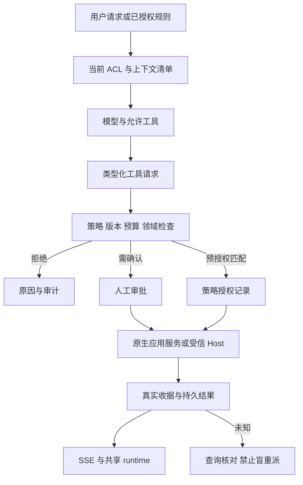

# Agent 完整能力接入计划：权限模式、运行上下文与场景组件

> 历史参考副本：保留本次收缩为 Agent Chat 范围之前的完整方案。以下“任务待启动”“后续实施”等表述属于旧版语境，不是当前任务或启动指令。业务 Session/Run、Host、主动发现、自动化及旧全场景均不属于当前接入范围。当前实施以[本次 Chat 接入计划](agent-capability-integration-plan.zh.md)和[八项任务清单](agent-capability-integration-tasks.zh.md)为准。
> 本副本保留旧版正文，仅增加此说明，并将三份旧文档之间的链接指向对应历史副本。

状态：仅完成规划与任务拆分，全部实施任务待启动。目标仓库为 `project-management-agent-v2`。本次不修改业务代码、不执行迁移、不重启服务、不创建正式 PM 工作项、不启用新权限。

配套：[可分派任务清单](agent-capability-integration-tasks.full-scope-reference.zh.md)。每个场景均有独立任务和组件，不以通用聊天页代替场景交付。

实施顺序更新：按用户最新要求，权限部分先走[固定 Full access 独立任务](agent-full-access-first-tasks.full-scope-reference.zh.md)，暂不先实现多模式/自定义策略产品。该子清单给出首批范围与推荐审批方式；本文的多模式、完整设置和默认 Propose + Ask 属于后续完整方案，不是首批前置条件。所有模式仍未启用，原业务场景范围不变。

## 1. 目标、现状与同步工作边界

目标：将当前文本聊天升级为能理解授权项目上下文、调用真实工具、提出/应用变更、执行受控 Run、主动发现与自动化的 PM Agent。用户能够在设置区域配置 Full access、Auto approve 等策略，并在每次运行中看清实际数据范围、权限、授权来源、工具动作及结果。

现状依据：[README](../../README.md)、[权限梳理](agent-access-and-edit-boundaries.zh.md)、[页面矩阵](agent-ui-entry-matrix.zh.md)。现有聊天、持久消息、流式、取消与断流核对是保留基线，不代表项目读取、提案、Host 或自动化已经接通。

**正在同步实施的 UI 迁移单独拥有以下文件，本计划不接管：**

- `apps/web/src/features/pm/agent/agent-chat-page.tsx`
- `agent-sidebar.tsx`、`agent-thread-list.tsx`、`agent-thread.tsx`、`agent-chat.module.css`
- 其依赖、锁文件及 [agent-workspace-ui-adoption.zh.md](agent-workspace-ui-adoption.zh.md)

后续由单一集成人在 UI 迁移交付后接插槽与 runtime adapter；不得复制另一套 Thread、Composer、线程存储或全局 CSS。同步任务未交付不阻塞合同、策略、上下文与后端设计/实现，但阻塞共享前端文件的接线及最终 UI 验收。

环境沿用本副本 API 4192、Web 3222、PG 55442；验收使用独立临时端口与存储。来源计划中的其他副本端口、历史 PASS 和证据不用于本副本验收。

## 2. 技术栈与复用原则

| 层 | 统一选择 | 接入要求 |
| --- | --- | --- |
| UI | React 19、TypeScript、Vite、现有 React Router | 保留 PM 宿主、工作区切换、原生任务/文档编辑器和 URL |
| 对话原语 | `@assistant-ui/react` 0.15.x | 精确版本跟随同步 UI 任务锁定结果，不独立升级 |
| 对话状态 | `useExternalStoreRuntime` | 适配 PM 持久消息和 SSE，不引入第二套消息权威 |
| Thread / Composer | 同步任务交付的 ThreadPrimitive、ComposerPrimitive | 扩展上下文、策略与工具卡片插槽，不重写聊天主体 |
| Markdown | 现有 MessageContent / streamdown | 模型文本不作为可执行 UI、权限声明或工具结果 |
| 交互与样式 | 现有 Radix、PM 主题 token、Tailwind/CSS Modules | 不引入 Base UI，不复制参考站全局样式 |
| 数据查询 | 现有 TanStack Query、同源 PM 客户端 | key 包含主体/工作区/项目范围；撤权清缓存；写入不自动重试 |
| API / 业务 | Fastify、现有 domain/application 服务 | 新工具只能调用原服务，不能直接绕过业务守卫 |
| 权威存储 | Markdown 核心 + PostgreSQL + 现有 BlobStore | 不建立 SQL/localStorage 第二份可写任务树 |
| 后台与执行 | 独立 Worker + 受信 Host 适配器 | 调度、执行和审批不依赖页面存在；不直接迁入单用户服务 |
| 协议 | Zod/现有合同生成、REST + 持久事件/SSE | 扩展现有消息协议，不为 UI 被迫切换 AI SDK 流协议 |
| 验证 | 既有 Node 测试、真实 PG/HTTP/Host、浏览器 | 场景组件有开发故事，但正式路由绝不回退故事数据 |

本计划不默认增加 `ai`、`@assistant-ui/ai-sdk`、`@assistant-ui/react-markdown`、`react-syntax-highlighter`、`@base-ui/react`、`xterm`、`@pierre/diffs`。diff 先以现有文本/代码能力实现；测试日志先为只读输出，不为展示日志开放 Terminal。未出现的新依赖须单独说明必要性。

## 3. 对旧计划的明确增量

来源：[执行计划](../../EXECUTION-PLAN.zh.md)、[场景矩阵](../../SCENARIO-MATRIX.zh.md)、[实施合同](../../IMPLEMENTATION-CONTRACT.md)、[Markdown ADR](markdown-integration-adr.zh.md)、[领域权限](../domain-design/permissions.md)。

旧计划“每次写入必须人工确认、每个工具动作人工审批、Level3 不开放”是默认审阅模式的基线。本计划按用户新要求增加**可选择的预先授权与自动批准路径**，不是继续把所有操作固定为人工点击，也不是默默删除原有审阅流程。

| 旧边界 | 新计划处理 |
| --- | --- |
| 所有建议均需逐次人工应用 | Ask 模式保留；明确授权的 Project write/Full access + Auto approve 可由策略服务批准并应用允许动作 |
| 所有受控工具逐次人工审批 | Ask 保留；预授权策略可对匹配动作逐次产生机器可审计的授权决定，模型不能自批 |
| Level1/2 不自动应用 | 保持既有含义；新增独立的 `自动应用授权`，默认关闭，不能把 Level2 静默改为自动写 |
| 模型无项目上下文 | 增加按需、授权、版本化的上下文检索与类型化工具 |
| 原代码根不得修改、无任意 shell/Git 写入 | 本计划仍保留；Full access 指选定 PM/Run 作用域，不是服务器 root 权限 |
| Run 成功不等于任务 Done | 保留；模型自报、测试绿色、自动批准工具均不能代替人类完成动作 |

实施任务先冻结上述差异和接口，再同步相关现行文档。现在不覆盖旧文件的历史记录，也不把本计划当作已启用配置。

## 4. 权限模式：访问范围与审批策略分开

### 4.1 访问模式 Access mode

| 模式 | 可请求的效果 | 不隐含的能力 |
| --- | --- | --- |
| Read only | 读取授权业务资料、搜索、总结、分析 | 不写业务对象，不派发有副作用工具 |
| Propose | Read only + 保存可编辑候选、提案、Finding | 不由模型自动应用；用户仍可用自己的原生权限确认提案 |
| Project write | 指定项目/实体内的注册规划写工具、文档/关系写工具，以及明确启用的执行工具 | 不扩展到其他项目、管理员操作或未授权文件根 |
| Full access | 在显式授权作用域内开放全部已注册、可委托且部署可用的 Agent 工具，包括 PM 写入、Run 启停、沙箱文件写入和受控测试 | 不是跨租户全权，不继承用户全部后台身份，不是全盘/任意 shell，不包含硬保护动作 |
| Custom | 按工具、字段、对象类型、项目、文件根、网络目标细化 | 未勾选、未知和后续新注册工具默认不开放 |

选择 Full access 必须展示展开后的动作清单与排除项；不能只显示名称使用户误以为获得了操作系统完全访问。作用域可明确选择当前项目、多个授权项目、或当前工作区全部授权项目；扩大作用域需显式确认，不能自动选第一个项目。项目创建属于工作区级动作，需工作区范围委托和原生创建权限。

### 4.2 审批策略 Approval policy

| 策略 | 行为 |
| --- | --- |
| Ask before changes | 允许读操作直接执行；业务写入与受控执行等待精确人工确认；模型生成候选不等于应用 |
| Auto approve safe | 自动批准显式清单内、可限定影响面的动作；默认只读与候选准备，正式写入必须逐工具/字段纳入规则 |
| Auto approve | 对委托范围内全部匹配、可委托动作自动作出授权决定并执行；未知、越界、超预算、版本冲突或硬保护动作不自动通过 |

两轴独立：Read only + Auto approve 仍不能写；Full access + Ask 仍逐次询问；Full access + Auto approve 才能在预授权边界内直接落地允许的变更。UI 提供预设并显示两轴，不以一个含糊开关掩盖区别。

默认新会话为 Propose + Ask；无上下文时退化为普通聊天，不伪造已获得项目读取能力。设置变化不得自动给历史会话、已有 Run、等待审批动作扩权。

### 4.3 自动批准不是取消授权检查

自动批准由受信策略服务完成，而非模型自行返回 `approved=true`。每次记录：委托人/执行主体、grantId、策略版本、工具版本、Run/operationId、资源、参数摘要、输入 revision、批准方式、限额占用与结果。

统一顺序：可信身份 → 当前 ACL → 委托范围 → 部署工具能力 → 硬保护/项目策略 → 当前版本/领域守卫 → 预算/并发 → 人工或策略授权 → 原键派发 → 真实收据。任一环节失败不能靠 Full access 绕过。

预授权可代替本次弹窗，但不能代替参数绑定、有限有效期、并发原子预算和收据。工具参数/对象/revision 改变时重新评估；新 Run 不复用旧操作批准；未知结果先核对，不把自动批准实现成无限自动重试。

### 4.4 硬保护与高风险动作

- 模型不得读写秘密、修改 ACL/自身策略、伪造主体、修改不可变审计/Run 输入/历史成果；不能跨工作区或越权读取私有会话。
- 明确人工控制：成果通过审核、任务 Done、取消/重开等受保护生命周期、删除/归档、跨项目迁移。可以展示建议并导航到原生人类操作，但不能通过改正文/元数据绕过这些边界。
- 启动受控 Run、普通任务创建/字段编辑、文档保存、合法关联与沙箱文件/测试，可在预授权策略内自动执行；仍遵守源版本与领域规则。
- 代码从管理员登记的非秘密源码根生成只读快照；写入仅限 Run 隔离根。任意 shell、原仓库写入、Git commit/push、远端 PR 创建/合并、生产部署不属于本接入计划的 Full access。
- 外部联网默认拒绝，模型供应商和已配置只读连接器由服务端分别允许；审批不允许模型临时新增网络白名单或凭据。

这些硬保护必须在设置预览、运行上下文和工具拒绝原因中可见，不能藏在文档里。

## 5. 设置区域与生效规则

入口统一为 `/pm/:workspaceId/settings/agent`，沿用原设置中心；页内采用 `?section=` 分区，不另建全局设置应用。

| 设置分区 | 组件（拟新增） | 内容 |
| --- | --- | --- |
| Overview | AgentSettingsOverview | 当前默认模式、模型/Host/连接器真实状态、最近验证和禁用原因 |
| Access | AgentAccessModeSettings | 模式预设、项目/对象/字段范围、独立会话与后台委托 |
| Approval | AgentApprovalPolicySettings | Ask/Auto safe/Auto approve、工具清单、规则条件、硬保护说明 |
| Context & privacy | AgentContextPrivacySettings | 默认数据类别、引用、草稿/附件是否外发、私有会话边界、保留策略 |
| Tools & runtime | AgentToolPolicySettings | 工具能力、源根的非秘密身份、沙箱限制、命令适配器、网络目标 |
| Limits | AgentBudgetSettings | 模型 token/费用预算、动作数、文件大小、执行时间、并发和每日限额 |
| Automation | AgentAutomationPolicySettings | Level1/2 与独立自动应用授权、规则主体/项目范围/有效期、总开关 |
| Grants & audit | AgentGrantManager | 当前委托、来源、到期/撤销、受影响会话/Run、批准记录与只读审计 |

权限层级为部署硬上限 → 工作区策略 → 项目收窄 → 用户有效能力 → 会话/Run/规则委托。下层只能收窄，管理策略能力不自动授予业务权限。策略管理能力的具体 capability 名称在合同任务中登记，复用既有管理体系，不由 UI 自造角色判断。

保存与生效：

1. 保存设置默认只影响后续会话/Run；保持旧运行的历史策略快照。
2. 启用 Full access 或 Auto approve，展示真实作用域、可直接写入的字段/工具、硬保护、预算和到期时间，显式确认后创建委托。
3. 会话可申请模式变化；降低权限即时约束后续派发，提升权限需新委托，已有待审动作不自动批准/重放。
4. 撤权/过期后阻止新派发；进行中的工具请求取消并核对，不能宣称副作用已回滚。只读保留收据能力用于结算。
5. 设置写入有 revision、原请求键、审计和未知恢复；支持预览某个动作会是 allow/ask/deny 的只读策略模拟，不发模型、不派发工具。
6. 会话委托默认建议 60 分钟并可由上层策略缩短；后台规则必须单独设置有效期/续期与预算，不继承某个用户的临时浏览器 Full access，也无永久“全部允许”。

## 6. 运行时上下文：用户可见与模型可见一致

### 6.1 在哪里展示

- Thread 顶部 `AgentRuntimeContextBar`：工作区/项目、Read only/Full access 等有效模式、审批策略、上下文条目数、工具可用数、预算、委托到期与 Host 状态。
- Composer 上方 `AgentContextPicker` + `AgentAccessModeControl`：明确引用/选区/草稿附件、查看当前将发送的数据、申请模式切换；不能直接修改服务端权限。
- 右侧可折叠 `AgentContextInspector`：上下文来源、版本、发送范围、工具权限矩阵、策略来源、硬保护/拒绝原因与消耗。窄屏复用 Radix 抽屉。
- 消息区 `AgentToolCallCard` / `AgentApprovalCard` / `AgentChangeCard`：实际工具名、脱敏参数、对象、授权方式（人工/策略自动）、执行中/未知/成功/失败、真实结果与收据链接。
- Run 详情 `AgentRunContextSnapshot`：冻结输入/委托快照与“当前有效策略”分栏，不用现值重写历史；提供停止、核对、关联提案/产物入口。

### 6.2 上下文与能力合同

拟新增共享 DTO，名称为设计目标，尚不是现有接口：

| DTO | 最小内容与职责 |
| --- | --- |
| AgentPolicy / AgentGrant | policyVersion、主体/委托人、作用域、工具/字段集合、approvalPolicy、预算、到期、撤销版本 |
| AgentCapabilitySnapshot | snapshotId、asOf、策略/工具注册版本；每项 available/allowed/approvalRequired/denyReason；模型配置、最近连通验证与执行就绪分开 |
| AgentContextManifest | manifestId、请求目的、scope、typedRefs、revision/hash、选区、来源事件、草稿标记、是否已加载/已发送、截断/分页/缺失原因、数据量 |
| AgentOperation | operationId、工具/参数摘要、目标、输入版本、授权决定、状态、尝试与收据；完整敏感参数只在受权存储读取 |
| AgentRunEnvelope | Run/Session/thread 关联、冻结 manifest/grant、预算预留、取消/租约/epoch 与原请求身份 |
| AgentProposal / AgentFinding | 场景编号、来源身份/版本、目标差异、状态、人工/自动应用决定、幂等结果与撤销前提 |

模型每轮收到服务端生成的能力摘要、明确上下文及当前允许的工具 schema。模型问“我能做什么”时可调用只读 `agent.capabilities`（拟定逻辑工具名），返回与界面同源的有效快照；禁用原因不能泄露无权对象存在性。

“可访问”不等于“已发送”：用户看到当前数据清单；工具追加读取按次更新 manifest 和事件。超预算、长内容或分页未全取必须标记，不把摘要当完整原文，不以截断文本覆盖源内容。私有消息被引用也须独立授权。

日志、文档和外部资料均为不可信内容，不能通过其中的指令提升权限、扩大工具范围或泄露 secrets。历史消息/缓存重用前校验当前权限，撤权后不将旧内容再次发送模型。

## 7. 执行链、持久化与接口工作

- 原聊天 API 保留；类型化工具消息/活动通过正式合同扩展，与 assistant-ui adapter 一起切换，不在正文里解析“执行成功”文字。
- 规划/文档/关系工具调用现有原生应用服务和 Markdown CAS；SQL 只保存策略、委托、消息/提案/操作/Run/Finding/自动化，不双写任务树。
- 后台工具循环不能依赖浏览器消费 SSE。取消聊天生成与取消 Host Run 是不同操作；关闭面板只释放展示，显式停止分为 requested/settling/terminal。
- 统一错误类别：权限不足、需审批、委托过期/撤销、版本冲突、预算不足、工具未配置、模型错误、执行失败、持久化失败、结果未知。用户可操作的恢复入口与模型可见错误同源。
- Host 使用受信信封、租约/epoch、独立目录/资源/日志和真实文件摘要；旧 epoch 回报拒绝，未知副作用占位核对，重试保留 retryOf 与新操作授权。
- 对原生创建保留 CreationDraft/原 Idempotency-Key；对既有命令沿用收据。多对象应用逐项结算，不假称跨文件/SQL 原子成功。

接口族由任务冻结，不在规划阶段宣布路径已上线：策略读取/预览/更新；委托创建/撤销；有效能力与上下文预览；提案生成/应用/拒绝/撤销；Session/Run/审批/取消/核对/成果；Finding 处置；规则与运行历史；持久事件/游标恢复。全部纳入当前 contracts/client/OpenAPI，不另建不兼容 SDK。

## 8. 组件组织：82 个场景各自有组件

拟新增目录，不在本轮创建源码：

- `agent/policy/`：设置、授权确认、模式控制和委托管理。
- `agent/context/`：上下文选择、清单、能力矩阵和运行快照。
- `agent/tools/`：工具调用、精确批准、结果/错误与收据展示。
- `agent/proposals/`、`agent/planning/`、`agent/execution/`、`agent/automation/`：复用业务基础 UI。
- `agent/scenarios/interaction/`：S01–S36 独立组合组件。
- `agent/scenarios/proactive/`：P01–P24 独立发现/处置组件。
- `agent/scenarios/automation/`：A01–A14 独立规则/运行交互组件。
- `agent/scenarios/journeys/`：J01–J08 独立旅程组合组件。

任务清单给出每个组件的唯一导出名，目标文件为对应目录下 `<组件名>.tsx`，配套 `<组件名>.stories.tsx` 用于隔离展示；正式交付另有真实行为验收。不是 82 个复制的聊天页，也不是一个万能组件收到 scenarioId 后只换标题。

每个场景组件必须有实际独立职责：输入/来源与场景提示、领域特定交互、策略决定与副作用预览、结果/恢复入口。纯导航/布局场景也有专属导航/恢复/分页组合组件，不为了“独立”创建无行为空壳。

共享 `AgentScenarioSurfaceProps` 的拟定字段：可信宿主提供的 workspaceId、projectId/entityRefs、conversationId/sessionId/runId、sourceRevision、manifestId/capabilitySnapshotId、returnTo、onClose/refresh；原始凭据和自报角色不可作为 props。具体命令参数仍使用各自领域 DTO，不建任意 action/payload 的万能写入口。

场景注册表只负责 lazy 组件映射、入口、所需能力与可用性；权威状态归服务端。场景组件复用同一会话 runtime、查询缓存、ProposalPreview、审批卡、来源卡、diff 和事件适配，不各自维护业务副本。

## 9. 原生页面接入与能力展示

| 页面 | 接入内容 |
| --- | --- |
| 项目/任务/文档 | 次级 Agent 入口、固定实际对象/revision、选区与草稿附加选择；原编辑器始终保留 |
| agent | 同步任务交付的侧栏/Thread/Composer + 本计划的上下文/权限/工具/场景插槽 |
| planning / proposals | 候选编辑、选择发布、逐项差异、人工确认或策略自动应用记录、冲突/安全撤销 |
| runs | 独立 Session/Run 历史、上下文快照、精确动作、真实日志/测试/成果、取消/核对 |
| pulse / automations | 独立场景 Finding、规则、预检/正式执行区分、预算、历史与自动应用授权 |
| settings/agent | 第 5 节的设置分区与当前生效范围 |
| 原通知/活动/搜索/审计 | 类型化来源链接与权限裁剪，不替换原工具层 |

布局保留同步 UI 任务决定；Agent 自身侧栏与 PM 导航不再新增第三层导航。新增菜单按真实能力开放；未交付的入口禁用且说明原因，不能把禁用项算完成。首页/Dashboard 不强塞 AI 卡片。

## 10. 分包、依赖与同步交付协议

角色为未来实施所有权，不表示本轮已启动子代理：

| 所有者 | 独占职责 | 不能修改 |
| --- | --- | --- |
| UI-MIGRATION（同步工作） | 现有左侧栏/Thread/Composer、其样式和 runtime 适配 | 本计划新增策略/场景域不由其隐式承担 |
| CONTRACT | DTO、Zod、OpenAPI/client 与迁移编号协调 | 不覆盖同步 UI 状态 |
| POLICY | 策略/委托/决策/预算后端；policy UI | 不直接落业务对象或自行改 Host 协议 |
| CONTEXT | 授权来源读取、manifest、模型工具循环；context/tools UI | 不定义第二套权限或应用写入 |
| PLANNING | 原生写入工具、提案、规划、任务/文档类场景 | 不绕过 Markdown/CAS 或修改 Run 历史 |
| EXECUTION | Host/Session/Run/收据/成果；执行类场景 | 不改原仓库、审批策略或任务完成规则 |
| AUTOMATION | 来源适配器、Finding、Worker 规则；P/A 场景 | 不继承交互会话权限、不给自己自动批准 |
| NATIVE / INTEGRATOR | 唯一 routes/shell/设置注册、旧入口插槽、共享 runtime 接线、依赖与最终验收 | 不在同一共享文件安排多写入者 |

实施阶段：

1. **合同冻结**：接收同步 UI 公开接口；冻结两轴权限、硬保护、模式差异、DTO/事件、工具清单、文件所有权和迁移编号。
2. **授权只读闭环**：身份/委托、有效能力、上下文读取、运行时可见、模型同源能力说明；未完成前不得开放任何业务写工具。
3. **规划写闭环**：提案、原生 CAS/幂等、Ask 和 Auto approve 两条路径、审计/撤销；完成其权限故障验收后开放。
4. **受控执行闭环**：Host、独立 Run、精确授权、真实文件/测试/成果、取消核对；审批模式不影响底层隔离。
5. **发现/自动化闭环**：先来源适配与 Level1/2，再单独实现后台预授权自动应用、预算和撤销；未接通来源不造 Finding。
6. **原生全场景及完整旅程**：集成全部 S/P/A/J 组件，验证每个场景默认审阅路径；可委托写入场景追加自动批准路径。
7. **交付门槛**：全量回归、真实模型/Host/Worker/浏览器、环境隔离、迁移/备份/恢复与权限清理证据，逐项登记未完成/阻塞。

这些是本计划依赖阶段，不冒用来源执行计划批次的已完成状态。可并行实施的后端/独立组件在合同冻结后并行，只有真实依赖串行；所有检查由集成阶段统一运行，避免并行覆盖。

## 11. 模式与场景的验收口径

旧场景中“确认前不写、拒绝不写、逐动作审批”继续作为 Ask/Propose 的完整验收，不能删除。对于明确可委托动作，增加 Auto approve 的对照分支：

- 用户已明确启用有效委托 → 不再出现重复确认弹窗 → 服务端逐动作授权 → 原生事实确实落地 → 工具卡显示“策略自动批准”及收据。
- 未授权、过期、预算不足、字段超界、并发版本改变 → 不写或保持 unknown，展示原因；不能用自动模式跳过冲突。
- Ask 下人工批准和 Auto 下策略批准均逐操作绑定。原计划 P24 的“不自动发布”等约束，在默认模式保留；新自动应用仅在额外明确授权的规则范围内验收，单独记录，不伪装原场景无需确认。
- 删除/生命周期/完成/成果通过审核、无权限范围及秘密等硬保护在所有模式都保持；Full access 的限制必须可被用户看见。
- 只读、草稿、预检、导航、历史、生命周期人类操作等场景标记对应模式“不增加副作用”，不能因为存在 Auto approve 就每个场景都发模型或写入。

## 12. 全局验收与交付证据

- ACL：两个主体、两个工作区、项目限制、只读用户、撤权/过期、跨项目历史、私有会话、审计/附件内容单独授权。
- 策略：全部模式组合、Full access 展开清单、未登记工具、工具升级、过期/撤销、保存不扩权、预算并发、后台委托隔离与 kill switch。
- 注入与外发：正文/日志/外部内容请求提升权限、读秘密或改变网络目标均拒绝；模型上下文与 UI manifest 一致且脱敏。
- 持久化：原键恢复、重启、SSE 丢事件/重复/乱序/提前 EOF、陈旧提案/撤销、未知工具效果、旧 epoch、两个独立 Run 及取消隔离。
- UI：1440×1000、1920×1080、390 宽度，原页面/所有面板与浮层、键盘/Esc/焦点、长文档与长消息、不抢阅读位置、草稿和同一会话往返。
- 规模：保留来源 S17/S35 的真实分页与选择验收，包括 1200 任务、240 消息、40 历史 Session/Run、120 通知及首屏 40/30/12/8/20；性能记录实际耗时，不以首屏代完整范围。
- 模型/Host/外部来源：真实模型生成与工具调用；本地模拟可测故障但不能代供应商验收；PR/CI 缺访问前提时实现完整适配器并登记外部阻塞；7/14 天真实年龄不得伪造。
- 工程：受影响 lint/typecheck/build、合同/文档检查、真实 `pnpm test:backend`、浏览器 smoke；跳过、超时、现存失败分别记录，不能称全通过。当前已有全量回归失败记录不得继承为本计划通过或简单删除测试。
- 资源：只用本副本及隔离测试资源；不读取/输出凭据，不连接来源副本服务；迁移/备份恢复先独立验证。无 commit/push 授权不执行。

每个任务交付至少包含实际文件/入口、接口/迁移、关联场景、模式分支、运行结果、真实对象/收据、已知限制与证据位置。只创建组件、禁用按钮、静态故事、生成代码或编译通过都不能标记完成。

## 13. 本轮产物与下一步

本轮只产生本文及配套任务清单；不会修改同步 UI 采用清单、根执行计划、权限梳理中的历史结论或运行中的配置。第一批可分派的是任务清单 F01–F03 的边界/合同工作；涉及共享聊天文件的接线必须等待 UI-MIGRATION 交接。全部正式实施须按任务状态推进，不能因本文存在而自动启用 Full access 或 Auto approve。
