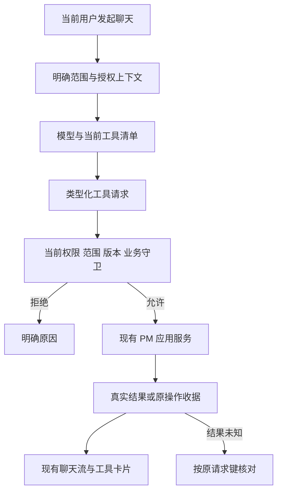

# Agent Chat 能力接入计划：本次范围

> 历史交付记录：下述 PM 独立聊天运行时、PostgreSQL 聊天历史和 Full access grant 是统一改造前的合同，不再作为当前入口/模型/会话实现。当前以 [Agent Chat ↔ PM 统一改造计划](agent-chat-pm-unification-plan.zh.md) 为准；保留本页仅用于历史证据，不恢复旧助手。

状态：CHAT01–CHAT08 本次范围已实现并完成定向验收；全仓库回归未通过，不宣称全项目封板。实际检查与本副本激活见第8节。旧完整计划副本仅供参考，未恢复其中的范围外任务。

配套：[本次任务清单](agent-capability-integration-tasks.zh.md)、[Full access 权限子任务](agent-full-access-first-tasks.zh.md)、[同步 UI 技术栈](agent-workspace-ui-adoption.zh.md)。

## 1. 范围纠正

此前将旧执行计划和场景矩阵中的业务 Session/Run、Host、主动发现、后台自动化及完整旅程纳入本次接入，是范围扩张。原先“110 项任务、82 个场景全部保留并验收”的安排撤销，不能继续作为本次依赖、任务或完成标准。

[旧执行计划](../../EXECUTION-PLAN.zh.md)和[场景矩阵](../../SCENARIO-MATRIX.zh.md)仅作为领域背景，不作为本次需求清单。既有领域规则仍有效，但不能据此要求本次建设其中全部产品能力。未来是否实施这些系统需另行确定，不能默认排入本次后续批次。

本次只做：**让现有 Agent Chat 在明确授权的 PM 范围内读取真实上下文、调用普通业务读写工具，并向用户和模型展示真实能力与工具结果。权限先固定 Full access，不先建设多模式权限产品。**

## 2. 本次做与不做

| 项目 | 本次范围 |
| --- | --- |
| 现有聊天线程、消息、流式、取消、断线恢复 | 保留并适配工具消息，不重建第二套聊天系统 |
| 项目上下文 | 当前工作区及明确选择的项目/对象；按需读取真实项目、任务、文档、评论和关系 |
| 普通 PM 读写工具 | 基于现有应用服务暴露查询、创建、普通字段/正文修改、评论及合法关系操作；不得扩大用户原生权限或绕过领域守卫 |
| Full access | 当前明确作用域内的已接通可委托工具；不是系统 root、任意文件访问或任意命令执行 |
| 审批方式 | 固定作用域内 Auto approve；默认未授权，用户明确启用后允许动作不逐次确认 |
| 运行时能力展示 | 当前数据范围、实际提供给模型的来源、有效工具、限制、调用状态和结果 |
| 精简设置 | 当前模式、作用域、真实连接/工具状态、明确启用/停用；不做多模式策略编辑器 |
| 业务 Session/Run 系统 | **不在本次范围**：不新增执行会话、运行状态机、排队、租约、epoch、Run 历史/快照/页面 |
| Host 与代码执行 | **不在本次范围**：无沙箱、终端、源码修改、测试执行、产物核验或远端 PR/CI 接入 |
| 主动发现 | **不在本次范围**：无 Finding 引擎、定期扫描、风险推送、Pulse 或对应场景组件 |
| 自动化 | **不在本次范围**：无规则、调度 Worker、新建/续接后台对话、定时报告、自动应用授权管理 |
| 旧计划全场景产品 | **不在本次范围**：不交付全部 S/P/A/J 组件、完整旅程、独立规划/提案/审核工作台 |
| 完整权限产品 | **不在本次范围**：无 Read only/Propose/Custom 切换、多层策略编辑、条件 DSL、复杂费用预算或授权中心 |

“用户在聊天中请求分析某个项目”属于按次对话；“系统自行持续扫描项目并推送发现”不属于本次。允许在当前聊天中连续调用工具，不等于交付后台自动化。

## 3. 必须区分的持久化

### 保留：聊天和工具调用的最小可靠性

- 复用现有 conversation/thread、message、聊天请求身份与流式恢复机制。
- 工具调用关联当前聊天请求、toolCallId、目标、参数摘要、输入版本和原请求键；保存实际工具结果或现有命令收据引用。
- 沿用原应用的幂等创建、版本检查和收据；刷新或丢响应后查原操作，不因模型重说一次而重复创建任务。
- 操作结果未知时如实展示并核对；取消生成不意味着已完成的业务修改被回滚。
- 只有现有结构无法表达必要信息时才增加最小字段/迁移，不能为记录一次工具调用另造通用执行平台。

### 不建设：业务执行系统

不新增 AgentRunEnvelope、业务 execution Session、Run 调度表、租约/epoch、执行目录、产物链路、运行工作台或后台恢复 Worker。既有聊天实现中同名的内部 request/run 标识可以继续使用，不因名称相似而迁移或删除；但不得把本次适配扩展成新的领域 Run 系统。

## 4. Full access 最小边界

- 复用登录身份与原生 ACL。明确绑定工作区、项目/对象范围及可用工具，不默认选第一个项目、不隐式读取整个工作区。
- 固定 `full_access` + 范围内 `auto_approve`；二者含义独立，启用说明明确允许动作直接落地。既有用户线程不会因部署自动获权。
- 上下文与权限分开：新线程可按有效项目入口/当前工作区预设并保存范围，但默认不授权；停用时保存范围仍保持停用。跨工作区创建目标工作区的新聊天，不转移旧线程、聊天历史或授权。
- 服务端每次调用检查当前权限、范围、工具参数、版本及原领域守卫；不能信任模型返回的 approved/role 字段。
- 保留有限有效期、停用和基本调用次数/大小/超时限制，不建设通用策略引擎或复杂预算 UI。
- 普通字段/正文写入使用原生应用服务；受保护生命周期、Done、审核、删除/归档、跨项目迁移仍走原生人工流程，不在本次自动工具清单内。
- 秘密、ACL、自身授权、不可变历史、其他主体私有数据不可因 Full access 而开放；模型没有数据库、服务器文件或 shell 的通用访问入口。
- 权限停用后阻止新的工具动作；已经提交的操作仍可核对真实收据，不宣称“停止”即撤销。

详细切片见权限子任务。Full access 是本次普通 PM 工具的使用方式，不暗含旧计划中执行、主动发现或自动化能力。

## 5. 接口与执行路径

保留模型配置和既有聊天 API，增加 `GET/PUT /api/v1/workspaces/:ws/agent/threads/:threadId/access`；原 SSE 增加 `capabilities`、`context`、`tool` 事件，终态仍为 `done/cancelled/error`。合同、客户端与 OpenAPI 同步维护。

上下文独立保存复用 access 接口：`enabled:false` 可附带 `scope`，使用相同原生 ACL 与 revision CAS 校验，不生成新 grant。选择 Full access 即以 `enabled:true` 授权，选择普通聊天即停用；已有 Full access 的范围变更在选择项目时以 `enabled:true` 立即更新授权，无额外保存按钮或重复勾选。模型状态增加 `reasoning` 支持档位；消息请求增加可选 `reasoningEffort`（默认 `auto`），不支持的值在消息持久化前返回400 `agent_reasoning_unsupported`，不得进入未知写入恢复循环。

必要合同仅包括：当前聊天授权绑定、有效能力摘要、上下文来源及版本、类型化工具请求/结果、错误/冲突/未知状态。身份从可信会话取得，禁止正文自报操作者。合同、客户端和服务端按现有方式统一维护。

不增加 Run、Finding、Automation、Host、审批工作台等接口族。业务写入也不强制依赖新的提案平台；直接使用已有创建/修改命令及其版本和幂等约定。

## 6. UI 与同步技术栈

复用 [UI 采用清单](agent-workspace-ui-adoption.zh.md)中的 React/TypeScript、`@assistant-ui/react`、`useExternalStoreRuntime`、现有 MessageContent/streamdown、Radix 与 PM token；依赖版本跟随同步任务锁定结果。不增加第二套认证、消息 runtime、全局样式或后端技术栈。

只为本次交互职责拆组件，不再按旧场景编号批量造组件：

| 组件职责 | 已接入组件 | 接入位置 |
| --- | --- | --- |
| 当前上下文与能力摘要 | AgentRuntimeContextBar | 输入框左下角的工作区 / 项目弹层；设置页保留摘要 |
| 工作区切换与项目范围 | AgentContextPicker | 独立上下文弹层，保存范围与启用权限分离 |
| 权限说明与启停 | AgentPermissionPicker | 独立权限弹层；固定 Full access / Auto approve |
| 模型思考程度 | AgentReasoningPicker | 同一输入框左下角的第三个入口；只显示当前模型支持的选项 |
| 工具请求、状态、错误与收据 | AgentToolCallCard | 消息流中的结构化卡片 |
| 业务特定结果 | ProjectToolResult、TaskToolResult、DocumentToolResult、CommentToolResult、RelationToolResult | 工具卡片内的独立结果组件，使用真实 DTO/对象深链，不复制聊天页 |
| 单模式说明与启停 | AgentSettingsOverview | 原设置中心 `/pm/:workspaceId/settings/agent` 的精简内容 |

模型与 UI 使用同源有效能力数据。界面区分“允许访问”与“实际已发送”，工具未接通必须显示不可用；不能仅靠提示词让模型宣称具有读写权限。

沿用同步 UI 的 Thread/Composer/sidebar、样式与依赖，由集成人统一接线；没有第二套聊天 runtime。项目/任务原编辑器、主题与手工业务流程保持不变。

## 7. 本次完成标准

- 真实模型能读取指定授权项目并解释其来源和当前可用能力，而不是仅返回泛化 PM 建议。
- 已登记的普通读写工具逐项经真实应用服务验证；创建、修改、文档/评论/关系结果可在原生 PM 页面复读确认，不能仅以模型回答判定成功。
- Full access 范围清晰，允许动作按显式授权方式执行；越界、撤权、过期、版本冲突和受保护动作不能写入。
- 用户能看到真实上下文、工具动作、结果、限制与未知状态；模型和 UI 不给出相互矛盾的能力说明。
- 原消息持久化、流式、取消、重连及手工 PM 流程不退化；工具错误和丢响应不造成重复写入。
- 按受影响范围执行 lint/typecheck/build、合同/文档检查及必要后端检查；数据库/事务/流变更按仓库要求运行真实后端测试，跳过/失败不能算通过；浏览器验证实际聊天/设置交互。
- 不要求提供 Host、业务 Run、主动发现、自动化、完整场景矩阵或后台调度的验收证据，因为它们明确不在本次范围。

## 8. 本次实现与实际验收

### 实现清单

| 场景 | 工具 | 边界 |
| --- | --- | --- |
| 查询与读取 | `pm_query`、`pm_read` | 当前项目范围、分页/正文分段、来源 revision 与截断标识 |
| 项目 | `pm_create_project`、`pm_update_project` | 创建需显式工作区授权；只改普通字段，不更改生命周期 |
| 任务 | `pm_create_task`、`pm_update_task` | 原生创建与 revision 校验；不开放 Done、迁移或保护字段 |
| 文档 | `pm_create_document`、`pm_save_document` | 正文读写保留元数据与原生守卫；完整正文回写不重复一级标题 |
| 评论 | `pm_read_comments`、`pm_create_comment` | 原任务/项目权限；真实评论及命令收据，不改 Markdown 或任务状态 |
| 关系 | `pm_read_relations`、`pm_add_relation`、`pm_remove_relation` | 双端范围与 revision、合法关系及原生循环/业务守卫 |

- 迁移 `0033_agent_chat_tools.sql` 仅扩展私有线程授权、消息来源与最小工具调用记录，不建立业务 Session/Run。
- 授权绑定当前 actor/workspace/thread，CAS 更新，60分钟有效；每轮/每次派发及原生写事务再次核验。工作区项目集合冻结，新项目不会自动扩权。
- 单回复最多20次工具调用、12轮模型请求、80,000字符工具输出；供应商空闲超时120秒。配置状态与实际工具协议验证分开。
- 同一回复的相同写入去重；断流/重启后的未知写入只查原命令或原生 HTTP 收据，证明拒绝则显示失败，无法证明仍为未知，不自动重派。
- 当前 ACL 丢失会隐藏历史业务上下文，并在向下一轮模型发送工具结果前再次检查；隐藏历史或撤权不代表已提交操作被回滚。

### 已观察的真实闭环

使用本副本 PostgreSQL 的独立随机 schema、临时 Markdown/附件目录、API4296/Web3296及临时验收账号，调用当前真实 `deepseek-chat`，不是固定响应或拦截替身：

- 13个工具逐项调用成功；项目、任务、文档、评论及关系动作返回原生结果，写入具有真实收据。
- 工具卡链接进入原生项目、任务及文档页面，确认项目描述/目标、任务普通字段、评论与文档正文；任务仍为 `todo`，未自动完成。文档使用工作区对象路由，不能误入仅接受任务的项目详情路由。
- 文档读取完整正文后保存并重读，一级标题仅保留一次；项目与评论创建通过原生写事务的授权检查。
- 设置页显式项目/工作区授权、停用及聊天共享状态已操作；冻结范围不自动包含新项目。停用后在原任务页手工发布评论，刷新后仍有原 Agent 评论与新人工评论，证明人工流程不受授权停用影响。
- 刷新恢复6张真实工具卡，没有新增消息 POST；390px 窄屏文档宽度为390px。显式停止后服务端消息为 `cancelled`，不是本地假停止。
- 停用后真实模型请求没有工具调用或业务来源；普通聊天仍可使用。历史结果被隐藏时不再以当前权限推断过去动作未执行。

### 工程检查与激活

| 检查 | 实际结果 |
| --- | --- |
| 后端 lint、类型检查、构建 | 通过 |
| `pnpm check:web` | lint、TypeScript、Vite 构建通过；保留既有大 chunk/混合导入提示 |
| 文档与合同 | 86份 Markdown 检查通过；109个命令 payload、75个 OpenAPI 路径一致 |
| 模型流、客户端、前端 store 定向测试 | 28通过，0失败、0跳过 |
| 授权、原生工具、取消定向回归 | 21通过，0失败、0取消、0跳过；包括真实 PostgreSQL、事务内撤权、原收据恢复、文档往返及跨轮权限 |
| `pnpm check` 全量命令 | 600秒超时，未完整通过；不能用上述定向结果替代全量通过 |
| `pnpm test:backend` 全仓库回归 | 已执行，后因长时间运行且出现失败而停止；邮件 Worker heartbeat 用例失败，账号找回套件120秒超时。全量未通过，未将取消/未执行项算作成功 |

首次定向授权套件的180秒总上限不足以容纳6个约35秒的隔离夹具，导致取消；将总上限改为300秒后，完整21项定向回归通过，没有删减或跳过用例。

本副本已应用 `0033_agent_chat_tools.sql`，经 PID/工作目录归属核验重启自身 API/Worker：API45604、Worker45603；保留原 Web3222 开发服务。API4192与Web3222的 `/health/ready` 均返回 ready，database/storage/worker/core 全为 true。实际打开本地登录页，并确认运行中 OpenAPI 包含私有线程授权 GET/PUT 路径；未读取用户凭据或自动启用用户线程。

隔离验收 API/Web、浏览器、随机 schema、临时 Markdown/附件目录及一次性脚本已清理。未 commit 或 push；没有修改来源副本或恢复范围外系统。
