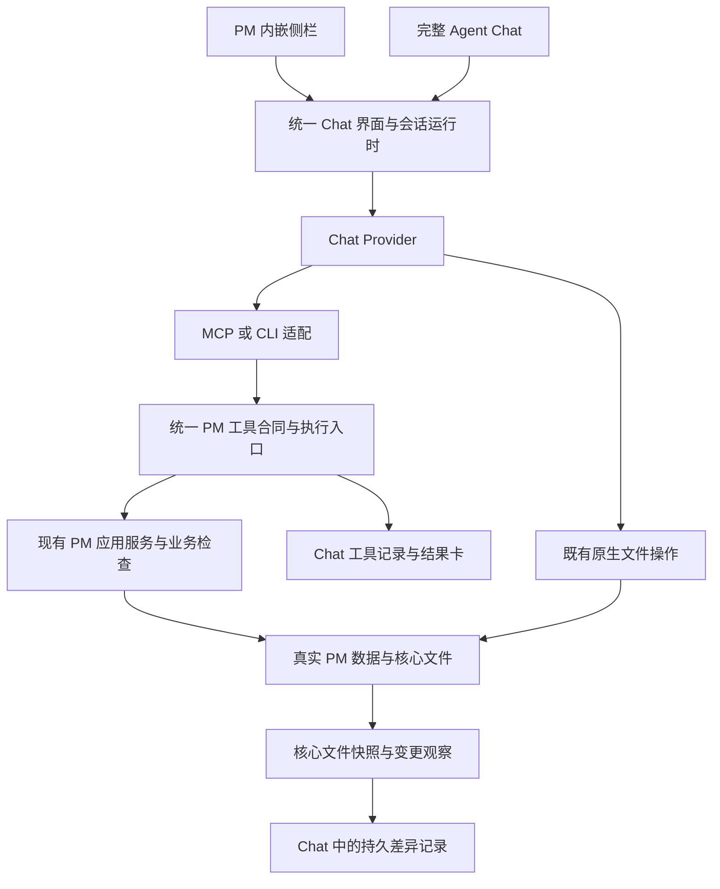

# 统一 Agent Chat 与 PM 工具接入改造计划

日期：2026-10-29。状态：**四个 gpt-6.1-terra / xhigh 子代理已完成源码切片；统一工具、界面、文件持久化与回归验收已完成，真实商业 Provider 尚未验收。** 未发布为正式 PM 任务，未部署到常驻服务。

项目：`project-management-agent-v4`。依据为本轮用户确认及当前仓库源码；没有查询 PM 现有任务清单，不宣称已完成任务去重。本文 `draft:T*` / `draft:M*` 仅为计划内引用，不是正式业务 ID。

## 1. 目标与已确认取舍

目标：**一个 Agent，使用 Agent Chat 的界面、Provider、会话和存储；PM 是业务工具及业务数据来源，PM 侧栏只是同一 Chat 的嵌入入口。** 不再建设独立 PM 聊天助手。

| 编号 | 用户决定 | 本次落实方式 |
| --- | --- | --- |
| D1 | 聊天界面使用 Agent Chat | 全页与 PM 侧栏共用 Chat 的组件、运行时、消息和草稿；业务工具前端适配也放在 Chat |
| D2 | 模型调用使用 Chat Provider | 保留现有原生 Provider 运行链路；退出旧 PM 独立模型调用及配置，不增加隐藏模型代调用 |
| D3 | 会话与持久化先按 Chat 保存 | 线程、消息、生成及相关聊天记录继续使用 Chat 现有存储；只增加本次必需的字段，不重设计持久化架构 |
| D4 | 所有 Provider 预设支持 MCP 或 CLI | 全部现有 Provider 都纳入统一工具接入范围，不先做“支持哪个”的产品筛选；使用共同工具定义和执行器，仅适配传输与启动配置 |
| D5 | 会话列表、历史、生成、输出订阅、归档删除属于 Chat | 不把这些职责搬到 PM；不把 PM 用户级会话所有权改造、多用户隔离或新权限体系设为本次前置条件 |
| D6 | 当前不考虑工具调用凭据，通过 PM 直接调用 | 沿用当前本机 PM 访问上下文和原有入口，不新增工具 token、凭据签发、会话委托票据或授权代理系统；不关闭既有 PM 登录和业务校验 |
| D7 | 记录 PM 核心文件被修改过及修改内容 | 增加持久的核心文件变更观察与差异展示，覆盖工具写入和直接文件修改；不把它包装成沙箱或完整责任审计 |
| D8 | 开发阶段丢弃旧 PM 聊天历史，升级时再考虑 | 不迁移旧 PM 线程、消息和附属聊天记录，不提供旧助手续聊兼容；切换时定向清理旧聊天数据，不删除 PM 任务、文档、审计、命令收据或现有 Chat 历史 |
| D9 | AGENTS.md 只保留持久化设计提醒 | 本计划记录其他取舍；不把这些条款再次写入 AGENTS.md |

**持续提醒：会话与持久化尚未经过统一设计。当前沿用 Chat 是临时实现选择，不是设计收口。** 涉及此部分的实现及阶段交付时，按 [AGENTS.md](../../AGENTS.md) 提醒用户；正式升级与历史迁移设计留到用户要求时再讨论。

“预设所有 Provider 支持”是本次实现范围，不是已经取得实测证据。遇到适配错误应修复 MCP/CLI 通路，不能静默删去该 Provider 或标成已验收；真实供应商不可用时如实登记验收缺口。

## 2. 现状与复用点

当前 [README](../../README.md) 和 [交互矩阵](agent-pm-interaction-matrix.zh.md) 描述的是两套助手并存的现状，不再是本次目标架构。历史计划中“保留旧 PM 模型调用、旧聊天 API”的选择由本文对应目标取代；其他无关产品范围不随之恢复。

| 当前实现 | 复用与改动 |
| --- | --- |
| `apps/web/src/features/pm/agent/agent-conversation.tsx`、`agent-panel.tsx` | 旧 PM 聊天运行时退出；保留必要的 PM 入口与返回位置，将侧栏宿主接到 Chat |
| `apps/web/src/features/agent/src/pm/chat-surface.tsx`、`chat/` | 作为统一 UI 与运行时基础，抽出可嵌入聊天表面；工具卡、来源、收据、文件差异在 Chat 内适配 |
| `apps/server/agent/src/durable/`、`packages/agent-contracts/src/chat.ts` | 沿用线程、生成、续聊、归档和存储；补齐业务引用与工具结果关联，不创建 PM 会话镜像 |
| `apps/server/agent/src/providers/` | 唯一模型调用与 Provider 配置来源，增加统一工具接线 |
| `packages/application/src/agent-chat-tools.ts`、`apps/server/pm/src/agent-chat-tools.ts` | 已有 13 个工具及应用服务是业务实现基础，不重写任务 CRUD |
| `packages/application/src/agent-chat-access.ts` | 当前直接绑定旧 PM 线程表；抽离工具调用所需的既有业务范围检查，不为复用它保留旧 PM 聊天系统，也不新增凭据体系 |
| `packages/pm-cli/index.ts` | 已有原生 PM CLI 可复用 HTTP、输入输出和错误处理经验；它还开放归档、删除、配置等命令，不能整包作为默认 Agent 工具白名单 |
| `apps/server/agent/src/inspector/git.ts` | 已能展示当前 Git 状态及 diff；尚不是独立的持久核心文件变更历史，不能直接算 D7 已完成 |
| `0032_agent_chat.sql`、`0033_agent_chat_tools.sql` | 旧线程、消息、授权字段和工具调用记录有外键耦合；切换需前向清理并解除新工具对旧表的依赖，不改写已应用迁移 |

已核对的具体接线缺口：Claude 驱动目前传入空 `mcpServers` 且有工具拒绝回调；ACP 初始化传入空 `mcpServers`。因此不能只生成一份工具说明就认定完成接入。仅调整本次工具所需配置，不顺带开放所有原生命令或解除全部保护。

## 3. 目标职责与执行路径

### 3.1 Chat 与 PM 的职责边界

- Chat 拥有：会话列表、历史、生成、输出订阅、归档删除、Provider、聊天设置及工具结果的前端呈现。
- PM 拥有：项目、任务、文档、评论、关系等业务事实及其既有应用服务、版本、幂等和生命周期校验。
- PM 页面只提供当前工作区、项目、对象引用和返回位置，不另建聊天 store、线程表或模型配置。
- 工具结果记录关联 Chat 的 thread/message/generation；PM 命令收据仍归 PM。删除聊天不级联删除真实业务对象、审计或收据。
- 不新增 PM 对 Chat 列表、历史、归档删除的业务控制，不将本次本机方案宣称为多用户隔离或公网部署方案。

### 3.2 上下文与既有业务检查

- 分开表达工作区/项目业务范围、本轮对象引用和 CLI 执行目录；多项目业务范围不能冒充多个 cwd。
- 保留项目、任务、文档入口引用；任务正文通过统一读取工具取得，携带实际 revision 和截断信息，不把只有 ID 的选择称为已加载正文。
- 统一工具复用现有 PM 访问与业务校验；不得通过更换传输绕过 revision、合法关系、防环、幂等或受保护生命周期。
- 工具调用的本机访问上下文由已有 PM 接入提供，不由模型填写“管理员身份”。本次不设计新凭据签发或流转系统，不把秘密写入提示词、工具结果、变更记录或项目文件。
- 工具校验不等于任意 shell 的文件保护。直接文件修改的风险在本次通过可见的变更记录揭示，不承诺被阻止或自动回滚。

## 4. 统一工具集与 Provider 接入

### 4.1 初始工具范围

| 工具组 | 工具 |
| --- | --- |
| 查询与读取 | `pm_query`、`pm_read` |
| 项目 | `pm_create_project`、`pm_update_project` |
| 任务 | `pm_create_task`、`pm_update_task` |
| 文档 | `pm_create_document`、`pm_save_document` |
| 评论 | `pm_read_comments`、`pm_create_comment` |
| 关系 | `pm_read_relations`、`pm_add_relation`、`pm_remove_relation` |

只迁接现有语义，不顺带扩展任务状态、删除、归档、验收标准、批量提案等能力。现有 `pm_query` 没有独立 status 参数；不能把原生 CLI 的 status 筛选当成工具已具备的能力。

### 4.2 统一合同

- 一个注册表定义工具名、说明、输入 schema、输出、错误和读写属性；MCP 与 CLI 不各维护一份业务规则。
- 建议提供 MCP 的工具发现/调用，以及 CLI 的 `tools list`、`tools call`、`tools result` 语义；精确命令名在实现时遵循现有 CLI 结构。
- CLI 以结构化 JSON 输入输出，优先 stdin 传复杂参数，避免 shell 拼接；stdout 为机器结果，诊断走 stderr。
- 写入使用稳定的原请求标识和参数摘要，结果包含对象 ID/revision、业务收据或原生结果引用、来源及错误。查询原结果是恢复接口，不是新增业务写工具。
- 传输中断保留 unknown，按原请求核对；不能改用另一传输生成新键盲重派。
- MCP/CLI 请求都经过同一执行入口，结构化结果同时送回 Provider 与 Chat。CLI 退出码或模型文字不能独自充当业务成功证明。

### 4.3 接入策略

共同 CLI 作为通用调用入口，原生 MCP 配置方便的 Provider 直接挂载同一工具集；不要求每个 Provider 同时实现两种传输。所有适配复用同一执行器和结果记录。

覆盖现有 Codex、Claude、Cursor、Grok、OpenCode、Antigravity、Muse Code、Pi、ACP Registry。每类需记录所用 MCP/CLI 通路、注入位置和实际验证证据；ACP Registry 的验证明确具体注册实例，不宣称任意第三方实现都已实测。

- 原生启动配置、环境与续聊接线保证工具在新会话和继续会话中可用；不导入全局 CLI 配置或凭据。
- 不改变隔离标题生成等无工具调用路径，不使后台标题生成获得业务写入能力。
- 不调用或重启仓库当前明确暂停的 MCP 服务。本次新建的 PM 工具接入不依赖这些服务。
- Provider 没有实际完成调用时显示真实错误；不能用另一个模型代执行来冒充该 Provider 的成功。

## 5. PM 核心文件变更记录

### 5.1 范围与实现选择

**采用持久内容快照与差异记录作为事实基础，复用 Git diff 能力和现有 Chat 差异展示；不依赖用户仓库提交。** 单纯 `git status` 无法保留历史，也可能漏掉被忽略的 `.pm` 文件或无 Git 的目录。

- 目标文件从 PM 真实登记的核心存储根和对象定位取得，覆盖项目独立核心目录及尚未迁移的共享核心目录；不能只盯当前 CLI cwd。
- 只记录 PM 托管核心文件，不扫描整个主目录，不采集凭据、Provider homes、附件字节或用户无关源码。
- 建立当前内容基线；观察到新增、修改、删除时持久保存可比较的前后内容与摘要。重命名有可靠依据时关联，否则如实记录删除与新增。
- 复用已有文件变化通知；必要时补充监听和重新扫描。启动、Chat 生成前后及显式刷新核对实际文件，补足监听遗漏；重启后继续与持久基线比较。
- 只承诺记录观察到的内容版本与差异，不承诺捕获每一次瞬时磁盘写入。进程停机期间只能显示恢复时观察到的净变化，不伪造中间过程。
- 不自动执行项目仓库的 add/commit/reset/checkout，不改变用户工作树、暂存区或分支。没有 Git、没有 HEAD、文件被忽略时仍可通过内容快照记录差异。

### 5.2 记录与界面

最小记录：稳定记录 ID、工作区/项目、对象 ID（能解析时）、核心相对路径、变更类型、观察时间、前后摘要、前后快照或可恢复差异、采集状态。

- 来自受控 PM 工具时可关联真实 operationId/收据及 Chat 消息。
- 直接文件变化显示“文件变化观察”；仅在存在可靠执行关联时显示对应生成。与生成时间重合不等于该 Agent 所为，不能把其他编辑器的修改归责于 Agent。
- Chat 显示文件列表、前后内容或 patch、来源及可用对象深链。截断与读取失败明确显示，不把缺失记录显示为“没有修改”。
- 刷新、会话切换与进程重启后仍可查记录；聊天删除不触发删除 PM 文件或业务记录。
- 核心文件无效时保留变化证据并展示 PM 原有诊断，不自动修复、提交或标记任务完成。

这不是防篡改审计、完整文件操作取证、权限沙箱或自动撤销系统。继续遵守 Run 成功不代表 WorkItem 完成的边界。

## 6. 候选工作包

用户已授权下列全部工作包实施；`draft:T*` 保留为计划内编号，不是正式 PM 工作项。来源 D1–D9 对应第 1 节；现有源码依据见第 2 节。

| 候选编号 | 目标/成果 | 范围与非目标 | 验收 | 前置依赖 | 来源 | 待确认项 |
| --- | --- | --- | --- | --- | --- | --- |
| draft:T1 | 固定统一调用与 Chat 关联合同 | 定义工具注册表、请求/结果、scope 与 Chat 关联；不设计新凭据或 PM 会话所有权 | MCP/CLI 可表达同一调用、冲突、unknown 和原结果查询；无旧 PM 线程外键前提 | 无 | D3–D6 | 无产品阻断项；字段按现有合同落实 |
| draft:T2 | 统一 PM 工具真实执行入口 | 迁接 13 个工具、PM 服务、版本与收据；解除旧聊天表依赖，不扩大业务工具清单 | 经真实 PM API 完成读写、评论及关系；旧 revision/非法关系拒绝；丢响应查询原结果不重复写 | draft:T1 | D4、D6 | 无 |
| draft:T3 | 全 Provider MCP/CLI 接入 | 共用传输适配、发现/调用/核对及原生启动接线；不复制业务实现、不额外调用其他模型 | 每类 Provider 经所选通路发现并调用同一工具集；续聊可用，无工具标题生成仍无工具 | draft:T2 | D2、D4 | 真实账号/环境仅影响实测证据，不缩小实现范围 |
| draft:T4 | Chat 内展示工具与业务上下文 | 结果卡、来源、收据、unknown 核对及 PM 页面刷新；不恢复独立 PM 聊天前端 | 原生输出与 PM 工具结果在同一消息时间线，刷新仍可读，真实对象可打开，冲突不报成功 | draft:T1 | D1、D3 | 无 |
| draft:T5 | PM 侧栏与完整 Chat 共用会话 | 使用 Chat 界面、Provider、草稿和生成；保留对象引用与返回位置，不迁入旧历史 | 侧栏发送、展开、返回、刷新仍是同一线程；不重复生成、不换模型、不丢草稿 | draft:T1 | D1、D2、D3、D5 | 无 |
| draft:T6 | 核心文件持久差异记录 | 快照/观察、Git 差异复用及 Chat 展示；非沙箱、非自动回滚、非用户仓库自动提交 | 工具写入和直接文件修改均可看到真实差异；无 Git/忽略文件/重启均有明确结果；不误归责并行修改 | draft:T1 | D7 | 无；具体存储先复用 Chat 本地方式并保留设计提醒 |
| draft:T7 | 退出旧助手并定向丢弃旧历史 | 旧 UI/store、模型配置、路由/合同、附属数据前向清理；保留 PM 业务、原收据和现有 Chat 数据 | 无旧模型请求与新旧双写；旧聊天数据清除；PM 业务、审计、收据、Chat 历史未被删除；旧入口指向统一 Chat 而非旧会话 | draft:T2、draft:T3、draft:T4、draft:T5、draft:T6 | D8、D9 | 无历史迁移设计前置条件 |
| draft:T8 | 端到端验收与文档收口 | 执行第 8 节矩阵，更新现状文档及部署配置；不宣称范围外能力完成 | 实际调用、实际文件差异、实际双入口、全部受影响检查有证据；无法实测的 Provider 单列，不假报完成 | draft:T7 | D1–D9 | 真实 Provider 验收所需环境若不可用须明确登记 |

### 关系与顺序

- `draft:T2 depends_on draft:T1`：工具执行和 UI 必须使用同一合同。
- `draft:T3 depends_on draft:T2`：Provider 需要可调用的真实业务入口。
- `draft:T4 depends_on draft:T1`；`draft:T5 depends_on draft:T1`；`draft:T6 depends_on draft:T1`：合同确定后可与后端接入并行，但各自独立完成不等于端到端验收通过。
- `draft:T7 depends_on draft:T2, draft:T3, draft:T4, draft:T5, draft:T6`：新链路可用后再移除旧链路和历史。
- `draft:T8 depends_on draft:T7`：以实际切换后的结果验收。

可并行组：T2/T4/T5/T6；T3 在 T2 后接入。T4/T5 共享 Chat UI，实施时指定同一集成人处理 `chat-surface.tsx`、运行时和共享合同，不并发覆盖。T6 的前端投影与 T4 协调同一结果展示方式。

里程碑候选：`draft:M1` 统一工具可经真实 PM 调用（T1–T3）；`draft:M2` 两入口与文件差异连通（T4–T6，并接上 M1）；`draft:M3` 旧链路退出且有实际验收（T7–T8）。不承诺日期、负责人或工期。

## 7. 旧历史丢弃与退出边界

这是当前开发阶段的明确选择，不再将旧历史迁移作为必做任务。

1. 不搬运旧 PM thread/message 到 Chat，不建立旧新 ID 映射，不保留旧助手只读产品或可发送兼容实现。
2. 先清点旧聊天表及外键：`agent_chat_threads`、`agent_chat_messages`、`agent_chat_tool_calls` 和附属授权字段。新工具记录先解除对这些表的依赖，再通过新的前向迁移清除旧数据/废弃结构。
3. 不直接修改历史迁移 0032/0033；新建数据库及既有开发数据库都应能走到统一后的结构。
4. 清理不触及 PM 核心文件、项目任务、评论、正式审计、命令收据、账号、Provider 设置及 Agent Chat 自有历史。不做广泛数据库重置或仓库 clean。
5. 退出旧 PM 模型 runtime、配置、聊天 API、客户端及只服务旧链路的组件/测试。业务工具与业务结果恢复能力迁接后保留，不因文件名带 agent-chat 而整包删除。
6. 原产品导航统一到 Chat；旧 thread 参数不伪造映射，必要时明确提示开发版旧聊天已清理。路由导航不等于保留旧执行链路。
7. 正式升级迁移、历史兼容和长期会话存储设计留待以后，不在本次追加。

本计划创建过程不执行上述删除，也不停止服务或修改业务数据。

## 8. 验收矩阵与证据

| 场景 | 必须观察到的结果 |
| --- | --- |
| 侧栏与全页连续性 | 同一 thread、模型、消息和草稿；展开/返回不重复发起请求，背景生成保持 |
| 全部 Provider 工具通路 | 每类记录实际传输与验证实例；工具输入到真实 PM 应用服务，结果回到原 Provider 和 Chat，不以提示词截图代替调用 |
| 13 工具业务闭环 | 查询/分段读取、项目和任务创建/修改、文档创建/保存、评论读写、关系读增删均经真实服务复读；不只验证一个示例工具 |
| 既有 PM 业务边界 | 未授权业务范围、旧 revision、非法关系/成环和工具不开放字段被拒；不新增 Chat 账户隔离验收要求 |
| 不确定结果 | 写入提交后丢响应，原键可查回同一结果；不重复创建，取消不撤销已落地修改 |
| 前端反馈 | 对象深链、来源/revision、真实错误和未知态可见；PM 对象视图更新，未保存草稿不被覆盖 |
| 核心文件变化 | 工具修改、原生直接编辑、外部编辑、增加/删除、无效 Markdown 均有准确观察结果及差异 |
| 文件记录边界 | 无 Git、无 HEAD、被忽略的核心文件仍可记录；生成前已有脏文件不误算本次操作；并行修改不伪造归属 |
| 重启与异常 | 快照和历史差异重启后仍可查；停机期间仅声明净变化；采集失败或截断明确可见 |
| 旧链路退出 | 不再调用旧 PM 模型或写旧线程；定向清理后 PM 业务及 Chat 自有数据保留；全新库和既有开发库升级均可用 |
| 原 Chat 功能 | 会话列表、历史、续聊、输出订阅、归档删除、Provider 设置、Usage 和 Inspector 的受影响路径不退化 |

验证使用隔离数据与临时服务，执行前核对端口、PID、工作目录，不能借真实业务项目做破坏性夹具。完成源码改造后运行受影响 lint、类型检查、构建、合同/文档检查；数据库、事务、流变化执行真实 `pnpm test:backend`，跳过项不算通过。Web 必须实际操作侧栏、完整 Chat、工具卡及差异界面；CLI/MCP 必须启动实际入口并调用真实 PM 服务。

受控 Provider 协议验证与真实供应商调用分列。真实账号/模型未可用时不能宣称该 Provider 端到端已验收，也不能将用户要求的全部 Provider 范围默默缩小。计划阶段只检查文档，不沿用旧报告宣称本次代码已通过。

## 9. 明确不做与后续提醒

- 不新增工具调用凭据体系、PM 会话所有权改造、角色权限系统、多用户/公网部署保证。
- 不新增提案/候选发布、批量修改审核、业务 Session/Run、逐动作审批、自动 Done、主动发现或后台 Agent 自动化。
- 不因 MCP/CLI 接入开放原生 CLI 的全部归档/删除/配置命令；不把文件变更观察当作这些操作的授权。
- 不迁移旧 PM 聊天历史，不设计正式升级兼容策略。
- 不修改来源仓库、不接管其他副本服务；不提交或推送代码。
- **会话与持久化尚未经过统一设计**，阶段交付继续提醒。AGENTS.md 本轮不添加其他决定。

适用的既有领域边界见 [invariants.md](../domain-design/invariants.md)：INV-03 的执行不自动完成、INV-13 的版本冲突、INV-14 的幂等、INV-15 的业务写入归属与 INV-20 的权威检查。这里只沿用相关约束，不恢复未实施的完整执行领域计划。

## 10. 文档更新与交接

实施收口时更新 [README](../../README.md)、[Agent ↔ PM 交互矩阵](agent-pm-interaction-matrix.zh.md)、[旧能力接入计划](agent-capability-integration-plan.zh.md)、[UI 入口矩阵](agent-ui-entry-matrix.zh.md)及受影响合同/部署说明：区分历史记录与统一后现状，移除仍作为目标的“两套助手”描述。能力表改为“场景、统一 Agent 能力、PM 侧栏入口、完整 Chat 入口、限制/证据”，不能把两个入口再次当成两个 Agent。

本计划复用源码能力，不创建正式 PM 工作项。若以后需要发布任务，须先查现有工作项去重，再将候选 ID 映射为真实 ID。当前已派发实现切片：PmTools（T2 与后端 T7）、ProviderBridge（T3）、ChatUi（T4/T5 与前端 T7）、CoreChanges（T6）；主执行者负责共享合同、集成、实际验收和文档收口。

本文件可直接作为实施范围基线。实施前重新检查并行改动与具体合同字段；用户已确认的取舍不反复询问，只有发现无法同时满足的实际约束时提出明确问题，不自行扩张范围。

## 11. 实施落点与已取得的实际证据

| 切片 | 实施落点 |
| --- | --- |
| T1/T2 | `apps/server/pm/src/agent-tool-routes.ts` 共用工具注册/执行/原结果核对；`packages/agent-contracts/src/pm-tool-result.ts` 保存唯一结果 schema |
| T3 | `apps/server/agent/src/pm-tools.ts`、`packages/pm-cli/agent-tools.mjs` 与 `pi-tools.ts`；当前请求认证仅留在内存，Chat 保存操作关联和展示记录 |
| T4/T5 | `features/agent/src/pm/chat-surface.tsx`、统一工具卡/调用订阅、PM 变更摘要及核心文件差异；PM 侧栏嵌入同一 Chat |
| T6 | PM `agent-core-files-routes.ts` 读取已登记核心目录；Agent `pm-core-changes/index.ts` 保存快照/差异并显示观测状态 |
| T7 | `0038_unified_agent_tools.sql` 定向删除旧 PM 聊天表，退出旧模型/聊天路由和前端组件；不删除业务审计、命令收据或 Chat 自有历史 |
| T8 | 隔离 PM API/Worker/PostgreSQL、真实 CLI/MCP 子进程、生产构建浏览器和回归检查；证据位于 `.local/evidence/unification/` |

Provider 接入方式：

| Provider | 同一工具集的接入 |
| --- | --- |
| Codex | app-server 每次运行的 MCP stdio 配置 |
| Claude | Agent SDK MCP server 与限定 PM 工具的许可回调 |
| Cursor | SDK create/resume/send 的 MCP 配置 |
| Grok / FX / Antigravity / ACP Registry | 共用 ACP new/load/resume 的 MCP server，明确识别的 PM 请求才允许单次批准 |
| OpenCode | v1/v2 原生 MCP 注册/断开，权限限定到本次 PM server |
| Muse | MSP sessionMcp 能力与 start/resume 配置、限定 PM 的单次批准 |
| Pi | 原生扩展工具注册，schema 来自同一 PM 注册表 |

CLI 与 MCP 调用同一执行入口。MCP 重复请求以“本次 transport + 有类型的 JSON-RPC ID”关联原 operationId；不同 transport 不能因 ID 相同而错误合并。Pi 使用原生工具调用 ID。核对结果不重新提交写入；标题生成与空闲压缩没有 PM bridge。

已实际观察：

- 真实 PM 服务执行全部 13 个工具，验证重复创建幂等、过期 revision 拒绝、评论/关系以及原结果核对；实际 MCP stdio 的同一请求重复发送只创建一个任务。
- 非 Git 项目内无效 Markdown 的新增、修改、删除均记录前后内容；关闭原 SQLite 后，由新 Node 进程重新打开同一数据目录，仍能读取三条差异。
- 浏览器通过 Chat Provider 的受控原生适配器启动真实 CLI，执行 `pm_read` / `pm_update_task`；模型/文本/附件/引用及同一后台生成在 PM 侧栏和全页交接。工具卡无重复，PM 侧栏摘要显示真实已应用修改。
- 实际写入完成后人为丢弃返回值，Chat 显示“结果未知”；点击“核对原操作”后显示原收据和成功状态，Provider 工具调用数保持 2，没有重派。聊天生成的失败状态不因此伪装为成功。
- 外部直接改写 PM 文件后，浏览器差异展示真实新增行；Chat 归档/恢复保留 scope、模型和工具历史，确认删除 Chat 后 PM 任务仍存在。Provider 设置、Usage 与 Files Inspector 已打开验证。

受控原生适配器用于可重复地驱动真实业务链路，**不是商业模型验收**。当前十类 Provider（含并行接入的 FX，共用 ACP 工具传输）的真实账号、供应商端 MCP 行为和商业模型仍需独立实测。会话与持久化设计提醒继续保留。

## 12. 最终验证与交付边界

| 验证 | 实际结果 |
| --- | --- |
| `pnpm check` | 文档、OpenAPI、后端 lint / 类型 / 构建通过；无数据库单测360通过、6跳过，跳过不计通过 |
| `pnpm test:agent`、`pnpm build:agent` | gateway 2、client-runtime 11、Agent server 487、desktop 5，共505通过，0失败/跳过；使用 `/dev/shm` 临时目录，未增加测试 deadline |
| `pnpm check:web`、`pnpm lint:agent` | ESLint、TypeScript、Vite 构建及 Agent lint 通过；保留既有 chunk 大小及混合导入告警 |
| 侧栏访问、PM 工具摘要、远端设置补丁回归 | 6通过，0失败/跳过；浏览器额外验证新线程保存模型后立即从侧栏展开并发送，不依赖刷新 |
| 全量后端清单 | 115/115文件执行完成：初轮800通过、1失败、15取消、7跳过；以下按真实依赖补跑覆盖全部23项，不能把初轮称为单次全绿 |
| Worker / automation / outbox 补跑 | 使用测试规定的 v4 55444 与隔离 schema，15通过、0失败/跳过 |
| SQL / 文件 / 附件真实备份恢复补跑 | 使用独立55445数据库与匹配 PostgreSQL 16 客户端，1通过；仅挂载本次测试备份目录 |
| S3 协议补跑 | 独立 MinIO 与数据库，7通过、0失败/跳过；根分区剩余比例不足曾触发507，改用容量充足的 `/dev/shm` 测试存储，不放宽产品检查 |
| 本次 PM 工具数据库定向回归 | 10通过、0失败/跳过，含旧聊天迁移保护业务收据/审计及原操作核对 |
| 真实 CLI / MCP、浏览器及新进程持久化 | 见第11节与 `.local/evidence/unification/`；不以 mock 回显或源码断言替代 |

后端823个用例已通过全量运行及上述分环境补跑取得通过证据；这不是一条命令下的823项全绿记录。验收使用临时工作区、schema、目录、端口与自有进程；不向现有业务工作区写入数据，不重启既有服务。迁移仅在隔离测试库运行，常驻环境尚未应用；未执行 commit / push。

文件观察记录实际前后内容，不宣称知道直接编辑的操作者，也不是沙箱或完整取证。**会话与持久化尚未经过统一设计**；当前按 Chat 保存，不追加正式升级兼容承诺。
