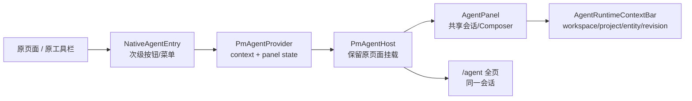

# Agent 页面区域接入计划（issues 之外）

记录日期：2026-10-26。范围：在 PM 现有页面中增加 Agent 前端组件与入口。已完成的 `/agent` 工作区（assistant-ui）、issues 工具栏入口不在本计划的实施范围；本计划处理**项目列表、项目详情、任务/对象详情、文档、设置中心**。runs/proposals/pulse/automations、Host、执行与后台自动化明确不在本次范围，也不作为后续阶段。

后续状态说明：用户另行要求实现自动化页面，已作为[独立增量交付](../../EXECUTION-PLAN.zh.md#automation-page-delivery)接入只读规则、报告和后台调度，侧栏相应新增 Agent 分组。本文件下方“不新增自动化路由 / 保留单个对话入口”是原页面接入批次的范围约束，不再描述自动化增量之后的仓库状态。

参考实现（只读）：

- `../agent-workspace`：assistant-ui 页面、Composer、Thread、左侧栏的交互与视觉来源。
- `../project-management-agent`：完整的 `PmAgentProvider`、`PmAgentNativeHost`、`NativeEntityAgentActions`、`AgentPanel`、`AgentSettingsPage` 等接入代码；可作为移植参考，但其后端/SSE/权限实现不直接复制。

配套：[Agent Chat 能力接入计划](agent-capability-integration-plan.zh.md)、[CHAT01–CHAT08 任务清单](agent-capability-integration-tasks.zh.md)、[同步 UI 采用清单](agent-workspace-ui-adoption.zh.md)。

## 0. 与 `EXECUTION-PLAN.zh.md` 的关系

- 采用其第 2 节“页面接入矩阵”中的**原页面清单、次级入口、不替换原布局**约束，以及 2.1/2.3 的侧栏与上下文规则。
- 不采用其中业务 Session/Run、Host、完整提案/规划、主动发现、自动化及 30 项/场景矩阵作为本次页面接入任务；这些已由当前 CHAT 范围修订移出，不是本计划的后续阶段。
- 旧计划中的“提案预览、运行记录、Pulse、自动化”页面如果未来另行授权，需重新立项，不能从本计划自动续接。

## 1. 当前基线与硬边界

- 本计划遵循 [Agent Chat 能力接入计划](agent-capability-integration-plan.zh.md) 的 CHAT01–CHAT08 范围，以及 [同步 UI 采用清单](agent-workspace-ui-adoption.zh.md) 的技术选择。
- **不在本次范围、也不是后续阶段**：业务 Session/Run、Host、代码执行、产物核验、主动发现、Pulse、自动化、完整规划/提案工作台。旧执行计划和场景矩阵只作为领域背景，不作为本计划的页面/验收清单。
- 当前 `/agent` 已有左侧栏、Composer、Thread；使用 `useExternalStoreRuntime` 适配 PM 现有 SSE。
- 现有 `AgentSidebar` 只是 `/agent` 会话列表栏，不是业务页面侧栏；仓库尚无 `PmAgentProvider`、`PmAgentNativeHost`、`AgentPanel` 或共享 conversation hook。
- issues 页已有 `Agent 助手`，跳转 `agent?project=…&returnTo=…`；仅显示入口上下文，模型请求不含项目/任务数据。
- 当前后端只有 `agent/status`、threads CRUD、消息 SSE/cancel；**没有**项目/任务读取工具、业务写工具、能力摘要或工具调用事件。这些由 CHAT01–CHAT05 提供，页面入口必须先按“未接通”显示，不能提前声称模型能读取或修改当前页面。
- 页面入口/面板本身可以先行实现；`AgentToolCallCard`、真实来源、能力摘要和业务结果组件必须等待 CHAT01–CHAT05 合同，不得用固定文案或示例数据冒充。

## 2. 目标组件架构

| 组件 | 职责 | 关键约束 |
| --- | --- | --- |
| `PmAgentProvider` | 保存当前项目/对象/revision/返回地址；开关面板；记录焦点、选区、滚动与未保存草稿作用域 | 按 actor/workspace/version 重建；切换工作区清空上下文 |
| `PmAgentNativeHost` | 在 PM 外层壳内保留原页面挂载，右侧挂载 `AgentPanel`；全页模式隐藏原页面但保留实例 | 不重写侧栏/顶栏；Esc 关闭并恢复焦点；关闭面板不取消生成 |
| `AgentPanel` | 紧凑版对话：上下文条、线程、Composer、工具卡、失败/未知状态 | 与 `/agent` 复用同一 conversation hook，不新建第二套消息状态 |
| `AgentRuntimeContextBar` | 显示当前工作区/项目/对象/revision、实际提供的数据来源、Full access 与工具可用性 | 名称与来源来自授权查询和 CHAT03 的真实上下文；不从 URL 猜测 |
| `AgentContextPicker` | 在 Composer 附近明确选择/移除项目、对象、引用 | 复用原对象选择能力；不默认第一个项目；选择不授权 |
| `AgentToolCallCard` | 展示工具名、目标、参数摘要、执行/成功/失败/未知、结果或收据 | 不复刻聊天页；不把模型文字当工具日志；未知先核对 |
| `ProjectToolResult` / `TaskToolResult` / `DocumentToolResult` / `CommentToolResult` / `RelationToolResult` | 工具卡内的业务结果与对象深链 | 使用真实 DTO 和原页面权限；不自行决定完成/审核 |
| `AgentSettingsOverview` | 设置中心单页：当前模式、范围、模型/工具真实状态、启停 | 只展示服务端状态；密钥不进前端；停用不撤销已提交动作 |
| `NativeAgentEntry` | 原页面的次级 `Agent 助手` 按钮/菜单 | 不替换主操作；打开不发送请求、不写业务对象 |

复用现有 `AgentChatPage` 的 SSE、thread 参数保持、重连/错误逻辑，抽出 `useAgentConversation` + `AgentConversationSurface` 后供 Panel 与全页共同使用。面板宽度建议 380px（≥1800px 可 420px），窄屏改为右侧抽屉。页面入口先生产 `AgentRuntimeContextBar`/`AgentContextPicker`；工具卡和业务结果在 CHAT01–CHAT05 合同就绪后接入。

## 3. 上下文契约

沿用参考实现的字段，但只启用当前后端能诚实支持的字段：

| 字段 | 来源 | 当前用途 |
| --- | --- | --- |
| `workspaceId` | `usePmService()` | 必填；与当前 workspace 不一致时拒绝打开 |
| `projectId` | 项目页/任务页/文档所属项目 | 固定上下文；不得在面板里静默切换项目 |
| `taskId` / `entityId` | `WorkspaceController.selected` | 固定对象；对象不属于当前项目时拒绝 |
| `sourceRevision` | `c.selected.revision` / core file revision | 显示固定 revision；CHAT03 接入后作为真实来源版本 |
| `selection` | 编辑器显式回调（正文/标题的 UTF-16 偏移） | 仅在 CHAT03 支持且用户明确选择时启用；必须基于已保存 revision |
| `unsavedContext` | `c.draft` / `c.raw` | 默认 `saved`；仅用户勾选时附加未保存草稿 |
| `returnTo` | 当前 pathname+search+hash | 返回原页面；必须限制在同一 workspace 内 |
| `capabilities` / `tools` | CHAT02/CHAT03 服务端能力摘要 | 显示 Full access 范围、允许工具、限制与实际已发送来源；未接通不显示为可用 |
| `toolCalls` | CHAT04/CHAT05 结构化事件 | `AgentToolCallCard` 的输入；未知状态必须保留并核对原请求 |

禁止：从 DOM 全局 `window.getSelection()` 猜测选区；从 URL 猜测项目名称；打开面板即把草稿发送；在面板内切换对象归属；用前端文案推断模型能力。

## 4. 页面接入计划

### 4.1 项目列表 `/projects`

| 项 | 内容 |
| --- | --- |
| 插入点 | `service-project-list.tsx` 的 `rowActions`（约 229–235，仅 table 变体）不足以覆盖全部布局；`ProjectCollectionView` 的 `headerActions` 在 compact 变体不渲染，`actions` 也可能为 `undefined`。推荐在受控契约 `ProjectCollectionViewProps` 增加 `renderProjectAction?: (project) => ReactNode`，由 `ProjectCard` / table 行 / compact 选中项统一渲染。 |
| 组件 | `NativeAgentEntry`，传 `projectId`；revision 可用 core file 读取，读取失败则显示未知 |
| 行为 | 打开共享面板/或跳转 `/agent?project=…&returnTo=…`；不改变收藏、简报、工作区视图 |
| 阶段 | Phase 1 |
| 验收 | 四种项目布局（cover/browse/table/compact）都能看到入口；行菜单键盘可达；打开面板不卸载列表；项目 ID 固定；无自动模型请求 |

禁止：只在 `headerActions` 加按钮，因为 compact 的 `actions` 恒为 `undefined`；也不要把列表入口默认绑定到“首个可见项目”。

### 4.2 项目详情 `/projects/:projectId`

| 项 | 内容 |
| --- | --- |
| 插入点 | 主入口放在 `service-project-detail.tsx` 的 `headerActions`（约 239），与收藏、简报/工作区切换并列；`service-project-layout.tsx` 的项目标题区（约 233–245）只作为可选补充，避免重复。注意项目详情 index 在布局层直接返回 `<Outlet />`，**必须改 `ServiceProjectDetail`，不能只改布局标题**。 |
| 组件 | `NativeProjectAgentAction`；传 `projectId`、当前 Markdown `source.revision`、`returnTo` |
| revision | `record.revision = entity.version` 是业务数字版本；Agent 的 `sourceRevision` 必须取 `source.revision` 或 `drafts[projectId].revision`，两者不可混用 |
| 行为 | 固定项目；项目有未保存 Markdown 草稿时提供显式“附加草稿”勾选；默认只读上下文 |
| 阶段 | Phase 1 |
| 验收 | 原项目概览/看板/文件/动态与元数据栏不变；切换视图不丢失面板；项目诊断未解决时入口仍可打开只读对话，但不写 |

### 4.3 任务/对象详情 `/entities/:id`、`/projects/:projectId/entities/:id`

| 项 | 内容 |
| --- | --- |
| 插入点 | `markdown/EntityDetail.tsx` 当前**没有 actions slot**：任务使用 `.task-detail-toolbar`（约 76，完成/关注之后），其他对象使用 `.detail-heading`（约 78–82，身份标题之后）；需扩展 `EntityDetailProps`（如 `agentActions?: ReactNode` / `agentSelection`）后由页面层注入。 |
| 共享位置 | 任务与文档共用 `EntityDetail`，在该处只实现一次；不在每种布局复制 Agent 状态。`TaskDetailSurface` 和 `DocumentContentEditor` 只上报选区/草稿，不各自维护对话。 |
| 组件 | `NativeEntityAgentActions`：单个 `Agent 助手` 入口；不在页面复制聊天或工具卡 |
| 上下文 | `entityId`、`projectId`、`sourceRevision`、`c.session.scope`，草稿 `c.draft` / `c.raw` |
| 工具门禁 | 模型工具清单来自 CHAT02/CHAT03；未接通时入口仍可打开普通聊天，但 `AgentRuntimeContextBar` 明确“当前无法读取/修改此对象”。不在页面做 rewrite/plan/execute 模式菜单 |
| 选区 | `DocumentContentEditor` 增加 `onAgentSelection` 回调；任务标题输入需显式上报标题偏移；仅当 `draft` 不存在且 revision 匹配时可用；不得从 DOM 猜测 |
| 阶段 | Phase 1 入口与上下文展示；Phase 2 接真实来源、上下文选择与工具卡 |
| 验收 | 未保存输入不卸载；打开/关闭焦点恢复；陈旧 revision 不冒充当前来源；任务状态不被聊天或工具结果自动改成完成 |

### 4.4 文档集合与文档详情 `/documents`

| 项 | 内容 |
| --- | --- |
| 详情 | 复用 4.3 的共享 `EntityDetail` 入口；`DocumentContentEditor.tsx`（约 319）当前只把选区传给 `DocumentObjectActions`，需增加 `onAgentSelection` 上抛到详情层，不能另建选区状态 |
| 集合 | `ServiceDocuments` 仅包一层 `ServiceMarkdown entityKind="document"`；集合级入口可后置，避免没有项目上下文时伪造“分析当前文档” |
| 行为 | 只解释/改写建议；不自动保存正文；实际写入只能由 CHAT05 工具走原保存命令，并经现有版本/幂等守卫 |
| 阶段 | Phase 2（选区、草稿与工具卡） |
| 验收 | 文档保存、预览、双链、附件、revision 草稿保持原样；关闭面板后正文与选区不丢；工具结果不绕过保存确认/版本检查 |

### 4.5 设置中心 `/settings/agent`

| 项 | 内容 |
| --- | --- |
| 插入点 | `settings/settings-catalog.ts` 增加页面；`settings/settings-layout.tsx` 的 `components` 映射增加 `AgentSettingsOverview` |
| 分组 | 建议 `integrations`（或 `workspace`），只增加一个子页，不新增顶级设置入口 |
| 内容 | CHAT07 单页：固定 `full_access` 模式、当前作用域、推荐 `auto_approve` 的明确说明、模型/工具真实状态与限制、启用/停用/到期恢复；不展示密钥 |
| 明确不显示 | 多模式切换、策略编辑器、执行/Run/Host/自动化状态；未接通工具不得因 `full_access` 标签显示为可用 |
| 数据 | `GET agent/status` + CHAT02/CHAT03 能力摘要；未接通时只显示模型配置与“工具未接入” |
| 阶段 | Phase 3（依赖 CHAT02/CHAT06） |
| 验收 | 模型配置、连通性、业务权限、工具可用性分开显示；停用不撤销已提交动作；原设置导航顺序不变 |

### 4.6 issues 已有入口的迁移

现有 issues 入口直接跳转 `/agent`。共享面板就绪后改为 `NativeAgentEntry` 打开面板，同时保留 URL 深链作为刷新/分享路径；不得出现按钮跳页、面板另一套状态的双实现。

### 4.7 明确不在本次范围

以下页面/系统不属于 CHAT01–CHAT08，也不是本计划的后续阶段；不注册路由、不新增侧栏入口、不生成占位组件：

| 页面/系统 | 原因 |
| --- | --- |
| `/runs`、业务 Run/Session、Host、审批工作台 | 本次只扩展现有聊天与普通工具调用，不建设执行系统 |
| `/proposals`、规划/提案工作台 | 业务写入直接走 CHAT05 的普通应用服务与版本/幂等守卫，不先建提案平台 |
| `/pulse`、主动发现 | 本次无 Finding 引擎或定期扫描 |
| `/automations` | 本次无规则、调度 Worker 或后台续接 |
| Host、终端、源码执行、产物核验 | 明确排除；不因 Full access 而开放 |

侧栏继续保留单个“Agent 对话”。如果未来另行授权这些系统，应重新开计划，不从本计划的“阶段”自动续接。

## 5. 阶段与依赖

| 阶段 | 范围 | 前置 | 完成标准 |
| --- | --- | --- | --- |
| P0 | 抽取 `useAgentConversation` / `AgentConversationSurface`；新增 `PmAgentProvider`、`PmAgentNativeHost`、`AgentPanel`、`AgentRuntimeContextBar` 骨架 | 当前 `/agent` 行为不回退 | `/agent` 与面板共享会话/SSE；关闭面板不取消；原页面保持挂载 |
| P1 | 项目列表/详情、实体/任务、文档的 `Agent 助手` 入口；上下文固定与返回地址 | P0 | 入口打开不请求模型/不写业务；原布局与主操作不变；工具未接通明确显示 |
| P2 | `AgentRuntimeContextBar` 真实来源、`AgentContextPicker`、`AgentToolCallCard` 与五类业务结果卡 | P1；CHAT01–CHAT05 合同与事件 | 模型与 UI 同源能力；调用/成功/失败/未知/收据可见；来源与已发送数据区分；切换主体不泄露 |
| P3 | `AgentSettingsOverview` + `settings/agent` | P2；CHAT02/CHAT03 | 单模式、作用域、模型/工具状态与启停真实；不显示密钥 |
| P4 | CHAT08 页面/聊天真实闭环与回归 | P1–P3；真实模型与数据库 | 原生页面可复读工具结果；版本冲突/重复/取消/权限不退化；仅本次 Chat 范围 |

不设“proposal/execution/pulse/automation 阶段”。这些系统的组件、路由和验收不在本次任务中。

### 5.1 可分配前端任务

| 任务 | 范围 | 依赖 | 验收 |
| --- | --- | --- | --- |
| UI-01 共享 Host/Panel | `PmAgentProvider`、`PmAgentNativeHost`、`AgentPanel`、焦点/选区/滚动恢复 | 当前 `/agent` 抽取 | 原页面保持挂载；关闭面板恢复焦点；不重复订阅 SSE |
| UI-02 项目列表入口 | `ProjectCollectionView` 受控 `renderProjectAction`；四种变体 | UI-01 | cover/browse/table/compact 均可见；固定 project；打开无请求 |
| UI-03 项目详情入口 | `ServiceProjectDetail.headerActions`；revision 取 Markdown source | UI-01 | 原视图/元数据栏不变；项目 index 也可见；不混用业务 version |
| UI-04 任务/对象入口 | `EntityDetail` actions slot；任务工具栏与非任务标题 | UI-01 | 任务/项目/文档详情均可见；固定 entity/project/revision |
| UI-05 文档选区 | `DocumentContentEditor` 选区回调；显式草稿勾选 | UI-04；CHAT03 选区合同 | 仅基于已保存 revision；不自动保存；关闭不丢正文 |
| UI-06 上下文与能力条 | `AgentRuntimeContextBar`、`AgentContextPicker` | CHAT02/CHAT03 | 真实来源、允许/已发送、限制分开；未接通明确不可用 |
| UI-07 工具卡与业务结果 | `AgentToolCallCard` + 五类结果组件 | CHAT04/CHAT05 | 执行/成功/失败/未知/收据；对象深链；不伪造结果 |
| UI-08 设置页 | `AgentSettingsOverview` + `settings/agent` | UI-06；CHAT02 | 单模式、范围、模型/工具状态与启停；无密钥 |
| UI-09 issues 迁移 | 现有入口改为共享 Panel，保留 URL 深链 | UI-01 | 不出现跳页/面板双实现；刷新可恢复 |

共享文件（`pm-shell.tsx`、`routes.tsx`、`EntityDetail`、`ProjectCollectionView` 契约）由单一集成人合并，避免并行代理互相覆盖。

实施进度（2026-10-26）：

- 已完成：UI-01 共享 Provider/侧栏 Host/Panel；UI-02 项目列表入口（四种布局）；UI-03 项目详情入口；UI-04 任务/对象/文档详情入口（共享 `EntityDetail`）。
- 未完成：UI-05 文档选区上报、显式草稿附加；UI-06/07 的右侧完整工作区；UI-09 issues 入口迁移到共享面板。真实工具结果已由后续 Chat 工具批次接通，不代表整个工作区计划完成。
- 后续共享对话增量：任务详情侧栏和完整 Agent 页改用同一 `AgentConversation`，删除“来源已固定”提示及旧 `sourceRevision` 入口参数。两处都有权限、项目范围、任务选择和思考程度；任务入口默认选中当前任务，可搜索、切换、清除。消息仅附加任务/项目 ID，实际数据来源仍以授权工具回报为准。展开保留线程、当前任务及草稿；新建/切换历史不继承其他线程的任务选择。实现边界与验证见[交付记录](backend-delivery.md#agent-shared-conversation)。

## 6. 文件改动地图

新增（建议）：

- `apps/web/src/features/pm/agent/context.tsx`：Provider、焦点/选区和返回快照。
- `apps/web/src/features/pm/agent/native.tsx`：Host、入口组件；不新增执行/提案导航。
- `apps/web/src/features/pm/agent/panel.tsx`：共享 Panel。
- `apps/web/src/features/pm/agent/conversation.tsx`：从 `agent-chat-page.tsx` 抽出的会话 hook/表面。
- `apps/web/src/features/pm/agent/context-bar.tsx`：`AgentRuntimeContextBar`。
- `apps/web/src/features/pm/agent/context-picker.tsx`：`AgentContextPicker`。
- `apps/web/src/features/pm/agent/tool-call.tsx`：`AgentToolCallCard` 与五类业务结果组件。
- `apps/web/src/features/pm/agent/settings/index.tsx`：`AgentSettingsOverview`。

修改：

| 文件 | 改动 |
| --- | --- |
| `pm-shell.tsx` | 在 `PmProductLayout`/`ServiceFrame` 内挂 `PmAgentNativeHost`；保留单个 Agent 对话导航，不新增执行/提案入口 |
| `routes.tsx` | `settings/agent` 由现有 `:settingsPage` 承载；不新增 runs/proposals/pulse/automations 路由 |
| `service-project-list.tsx` | `rowActions` 增加 table 变体入口；通过新的受控 `renderProjectAction` 覆盖 cover/browse/compact |
| `views/pm/project-collection.tsx` | 扩展 `ProjectCollectionViewProps`，在 `ProjectCard`、table 行、compact 选中项渲染项目入口；不篡改默认 toolbar |
| `service-project-detail.tsx` | `headerActions` 增加项目 Agent 入口 |
| `service-project-layout.tsx` | 可选项目标题区入口；详情 index 不经此标题，不能作为唯一入口 |
| `markdown/EntityDetail.tsx` | 扩展 `EntityDetailProps`，在任务工具栏/详情标题挂 `NativeEntityAgentActions`；承载 `agentSelection` state |
| `markdown/TaskDetailSurface.tsx` | 不新增 Agent 状态；仅确保标题/正文选区可上报 |
| `markdown/DocumentContentEditor.tsx` | 新增 `onAgentSelection` 回调；不改变保存/预览 |
| `settings/settings-catalog.ts`、`settings/settings-layout.tsx` | 注册 `settings/agent` → `AgentSettingsOverview` |
| `agent-chat-page.tsx`、`agent-sidebar.tsx`、`agent-thread.tsx` | 抽取共享逻辑后保持 `/agent` 外观/行为 |

## 7. 验收矩阵

| 检查 | 通过条件 |
| --- | --- |
| 布局保留 | 项目/任务/文档/设置的标题、主按钮、视图标签、草稿提示不改变 |
| 打开无副作用 | 打开面板不发模型请求、不写 Markdown、不创建/修改业务对象 |
| 任务目标一致 | 默认选中入口任务，后续以选择器为准；候选来自当前授权项目范围。选中目标失效时阻止发送，不静默替换或扩大范围 |
| 草稿 | 默认只读已保存 revision；未保存内容只有显式勾选才附加 |
| 陈旧 revision | 入口不会把旧 revision 冒充当前来源；真实工具调用由服务端版本检查拒绝旧写入 |
| 能力来源 | 模型与 UI 使用同源 CHAT02/CHAT03 能力摘要；区分“允许访问”和“实际已发送” |
| 工具卡 | 显示工具、目标、参数摘要、执行/成功/失败/未知、结果或收据；未知不显示成功 |
| 业务结果 | 五类结果卡使用真实 DTO/对象深链；写入结果可在原页面复读，不自行判定完成/审核 |
| 生命周期 | 关闭面板不取消正在生成的聊天回复；显式停止才 cancel；已提交的工具动作不被“停止”回滚 |
| 移动端 | 面板变抽屉，原页面草稿/输入不被卸载；Esc 关闭并归焦 |
| 权限 | 无 `domain.read` 不显示入口；原生 ACL/工具范围每次核验；停用阻止新动作但保留原收据核对 |
| 空/失败 | 线程/模型/上下文/工具读取失败显示原文与重试，不显示空列表冒充成功 |
| 静态检查 | `pnpm --filter @pm/web lint`、`typecheck`、`build`、`pnpm check:docs`；受影响后端合同检查 |

浏览器至少覆盖：项目列表行、项目详情、任务详情、文档详情、设置 Agent 页；每页打开/关闭/切换、移动端、刷新后 URL 恢复；工具卡出现时验证真实调用与结果深链。

## 8. 风险与待决

1. **当前后端不能接收上下文**：Phase 1 只能是“带上下文展示的对话”，不能声称模型能读取当前对象；真实读取/工具由 CHAT03–CHAT05 提供，不是 proposal 平台。
2. **面板与全页状态**：抽取共享 hook 时，必须保证切换不新建第二个 thread、不重复订阅 SSE；关闭面板不取消正在生成的回复。
3. **编辑器选区**：不要用 DOM 全局选区猜测偏移；必须由编辑器在已保存 revision 下显式上报。
4. **项目列表入口形态**：用受控 `renderProjectAction` 覆盖 cover/browse/table/compact，而不是只加 `headerActions`；避免列表页出现无项目上下文的伪 AI 卡片。
5. **设置分组**：`settings/agent` 建议放 integrations；不新增侧栏顶级设置；不显示多模式/策略编辑器。
6. **参考实现体量**：`../project-management-agent` 的 `native.tsx`/`context.tsx`/`conversation` 可作为代码来源，但其 execution/Run/proposal/pulse/automation 页面明确不在本次范围，不能整包复制后作为本次交付或后续阶段。
7. **不要重新引入旧场景组件**：本次只建 CHAT06/CHAT07 所需组件；不按 S/P/A/J 编号批量造卡片、页面或导航。
