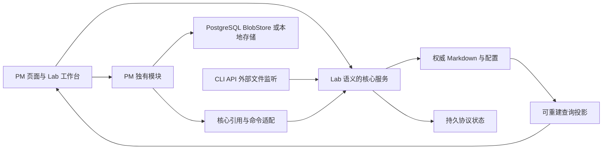

# Markdown PM 移植计划：完整 Lab 能力、PM 附加能力与取舍说明

状态：**范围与语义原则已确认；实现细节仍可修改。本轮仅修订计划，不启动代码移植或删除数据。**

本文中的 **Lab** 专指 `markdown-pm-lab`；**PM** 专指 `project-management`。PM 自己的 `/lab/pm` 是组件展示入口，不是这里要移植的 Lab。

## 1. 本次确认的目标

1. **Lab 现有相关能力全部在迁移后的 PM 中实现。** 不只搬九类模型或界面，原文编辑、外部文件监听、CLI、工作流、自定义字段、视图 DSL、生命周期、幂等、迁移/恢复等都属于必做。
2. **重叠功能按 Lab 的业务语义处理。** 原 PM 的规则与 Lab 冲突时，修改原 PM 的实现、契约、界面和测试，不反过来限制 Lab。
3. **Lab 范围内的业务以 Markdown 文件为权威。** 不能先写 PostgreSQL 业务表，再导出文件冒充文件权威。
4. **PM 独有能力单独列明，可以暂不改造成 Markdown 文件权威。** 可以继续用 PostgreSQL、BlobStore 或浏览器本地存储，但不能同时拥有 Lab 对象的另一套可写副本。
5. **旧数据可丢弃，从空业务工作区开始。** 不建设旧数据迁移、旧新 ID 映射或历史兼容链路；这不取消 Lab 已有的协议迁移工具。
6. **已有 PM 独有能力不因延期文件化而悄悄删除。** 若依赖旧任务/项目表，需要做接入适配使功能可用；“存储暂不改造”不等于保留失效按钮。
7. **直接复制 Lab 实现和行为测试优先，再适配接口形成独立模块。** 已有副本先核对复用；不从零写一套相似功能，不覆盖未经审阅的目标改动。

这修正了前版计划中的三项错误前提：

- 不再把原 PM 的“审核通过才能完成任务”等规则强加给 Lab 任务。
- 不再把外部编辑、完整 CLI、永久删除、协议迁移等 Lab 已有能力列为可选或以后再做。
- 不再要求所有 PM 独有模块本轮统一文件化，也不因保留这些模块而强制保留 Lab 业务数据库。

### 强制配套专项

[Markdown 能力全量移植专项计划](markdown-full-port-plan.zh.md)是本计划的**强制组成部分，不是可选参考**。它定义 C01–C12 源码复制清单、独立模块/宿主接口、MD01–MD24 全能力验收和 MD-P0–MD-P5 实施步骤。

**实施本计划时必须同时执行专项。专项未完成，本计划不得宣称全量移植完成，也不得进入 P7 正式切换。** 两份计划共用集成负责人和交付证据；不能以“另有专项”为由从主计划任务中省略 Markdown 能力。

### 阅读顺序

- 想知道哪些必须做：看[第 3 节 Lab 能力清单](#lab-capabilities)。
- 想逐项核对 Markdown、复制哪些代码及如何模块化：必读[Markdown 全量移植专项](markdown-full-port-plan.zh.md)。
- 想知道 PM 有什么额外能力：看[第 4 节 PM 附加能力](#pm-extras)。
- 想知道旧规则如何改：看[第 5 节语义冲突](#semantic-conflicts)。
- 想理解每个取舍：看[第 6 节逐项解释](#decisions)。
- 想调整施工顺序：看[第 8 节实施阶段](#implementation)。

### 你可以继续修改的内容

- PM 附加模块中，哪些希望提前文件化：尚未指定，默认可以保留现有介质。
- 是否在 Lab 基线之外增加个人视图、项目级配置覆盖、多实例协同等能力：尚未要求，不作为本轮门槛。
- 编辑器放在现有详情页还是新增工作台页：实施建议为复用 PM 外壳并增加原文/预览工作台，可修改。
- 正式实施与清理执行时间：尚未启动。本文件记录旧数据可丢弃的决定，不表示已经删除。

## 2. 依据、词语和范围

### 2.1 依据

以下能力对照来自当前项目文档和协议说明。本次是计划修订，不是重新执行全部功能验收。

- [Lab 使用说明与完整功能](../../../markdown-pm-lab/README.md)
- [Lab 模型协议及验收记录](../../../markdown-pm-lab/docs/model-protocol-plan.md)
- [PM 当前实现范围](../../README.md)
- [PM 前端组件、路由与日期契约](../frontend-porting-manifest.md)
- [PM 现有实体定义](../domain-design/entities.md)
- [PM 现有不变量](../domain-design/invariants.md)
- [PM 数据所有权](../architecture/data-ownership.md)
- [PM 模块契约](../architecture/module-contracts.md)

PM 的既有文档描述当前系统，不代表它们优先于本计划的新目标。实施时需要明确修订冲突规则；不能一边保留旧规范，一边悄悄改变代码。参考 Lab 仓库只用于开发对照，交付后的 PM 不应依赖另一个仓库的源码目录或常驻服务。

### 2.2 用普通话解释几个词

| 词语 | 本计划中的意思 | 例子 |
| --- | --- | --- |
| 权威数据 | 判断“现在真实是什么”的最终来源 | TASK-102 的 status 以其 Markdown 为准，不以数据库另一列为准 |
| 投影/索引 | 从权威内容整理出的查询加速数据，可以重建 | 为看板建立 SQLite 索引；删除索引后扫描文件能恢复 |
| 持久协议状态 | 不是任务正文，但不能随便删除的运行记录 | 已使用 ID、幂等创建记录、删除墓碑、迁移备份和恢复日志 |
| 业务语义 | 用户做同一动作时，系统允许什么、产生什么结果 | Lab 允许的状态转换不能因 PM 缺少 Review 而额外失败 |
| 附加模块 | 原 PM 有、Lab 没有的独立能力 | 登录、正式审核、成果上传、白板 |
| 模块分存储 | 不同种类对象分别存在文件和数据库中 | 任务在 Markdown，审核记录在 PostgreSQL，两者通过引用关联 |
| 双权威 | 同一个字段在两处都能被独立修改，无法确定谁正确 | 文件里 done，任务表里 in_progress，两处都自称真实状态；禁止这种情况 |
| 旧数据搬迁 | 把原 PM 历史项目、任务等转换到新系统 | 本次不做，因为旧数据可以丢弃 |
| 协议迁移 | 对文件格式/字段作带预览、备份和恢复的修改 | Lab 的 normalize-v1、transform；这项功能必须保留 |

## 3. Lab 全能力清单：全部必做

下列编号是实施和验收索引，不代表已经完成。实现时每项必须登记目标模块、Web/API/CLI 对应入口和真实验证证据；源 Lab 存在哪种入口，就不得只保留其中一个入口交差。

### 3.1 九类模型

| 模型 | 文件身份与主要含义 | 迁入 PM 后的规则 |
| --- | --- | --- |
| Project | PRJ；目标文本、目标引用、负责人、日期、工作流 | 使用 Lab Project，不保留另一套 PM Project 可写状态 |
| Work Item | TASK；epic/task/bug/subtask、优先级、分派、父子、阻塞及规划归属 | 使用 Lab Work Item，按配置转换状态，不默认要求提交审核 |
| Document | DOC；note/design/decision/specification | 可编辑文档，无工作流；不是 PM 的不可变 Decision |
| Cycle/Sprint | CYC；项目迭代、负责人、日期、目标 | Sprint 对应 cycle，不增加同义实体 |
| Milestone | MS；负责人、截止日期、目标、工作流 | 使用 Lab Milestone，不自动附加原 PM 的 achievementRecord 门槛 |
| Module | MOD；模块分组、同类型 parent、日期、目标 | 按 Lab 类型、项目及防环规则处理 |
| Requirement | REQ；需求、优先级、规划关系及独立工作流 | 不是原 PM 的 Intent，不要求经过意图接受才能创建 |
| Release | REL；发布规划、version、日期、目标 | 表示发布规划，不宣称已执行实际部署 |
| Goal | GOAL；目标层级、target/unit、日期 | 保留 Lab 允许的目标跨项目关系，与 Project.goal 文本区分 |

各类字段的必填/可选、类型、默认值和关系以 Lab 注册表为准，不把同一套表单字段硬套到所有模型。完整生命周期和通用入口适用于全部九类。

### 3.2 功能与验收索引

| 编号 | 必须移植的能力 | 不能缩水的验收要求 |
| --- | --- | --- |
| L01 | 九类模型与字段注册表 | 全部可创建、读取、合法修改；protocol 接口输出实体、字段、权威来源及有效配置 |
| L02 | Markdown 文件权威与稳定身份 | ID 不依赖文件名，重命名不破坏关系；新对象使用 Lab 身份规则，不能强迫核心文件改用 PM UUID |
| L03 | 原文编辑与 Draft 投影 | 编辑 YAML/正文可预览未保存效果；显式 Save/快捷键才落盘，无效草稿不能保存 |
| L04 | 属性/看板/表格写回 | 合法属性更新、状态选择和拖拽真实修改同一文件；不是只改前端状态 |
| L05 | 编辑布局与草稿恢复 | 文件导航、原文/视图区、属性区、可折叠及可调整分隔线；切换/刷新保留草稿，草稿对象结构化操作按 Lab 锁定 |
| L06 | Markdown 预览 | Wikilink 跳转、反向链接、callout、验收清单按原行写回；普通复选框不变成独立子任务 |
| L07 | 嵌入 pm-view | 项目/文档中可用实时看板、表格；创建采用嵌入视图自己的实体与项目范围 |
| L08 | 关系、树与图 | 正式及自定义引用、层级、阻塞展示、单/多选关系控件、防环和错误类型诊断完整 |
| L09 | Agent context | Web、API、CLI 能获取由已保存项目、父项、阻塞和关联文档组成的上下文；不是 Agent 自动执行 |
| L10 | 可配置工作流 | initial、states、label、category、transitions、可选 default_targets；省略使用默认，空转换表禁止转换，同状态修改允许 |
| L11 | 状态类别语义 | 完成统计和阻塞按类别计算；completed/canceled 类别按 Lab 解除下游阻塞展示，不硬编码旧 PM 状态 |
| L12 | 自定义字段 | text/number/boolean/date/select/multi_select/reference；适用实体、必填、默认、选项、目标、范围贯通表单、查询和引用保护 |
| L13 | 配置校验和修复 | 配置 revision 并发控制，验证候选工作区；无效外部配置可见并锁写，修复后可恢复，不丢本地草稿 |
| L14 | 完整 View DSL | filter/sort 简写与 all/any/not、全部 Lab 比较运算、原生类型和复杂度上限；主视图、嵌入、API、CLI 语义一致 |
| L15 | 分组和表格列 | group_by、columns、多字段 order_by；只写可编辑标量，非法 Unset 禁用，合法空文本仍能移动到有效目标 |
| L16 | 保存视图与手动排序 | 工作区文件保存，revision 冲突；显式 order 优先，保留隐藏/归档成员，不把临时过滤条件偷偷保存 |
| L17 | 过滤与默认展示 | 按实体、项目、状态、优先级等过滤；归档 exclude/include/only，默认排除归档对象 |
| L18 | 归档、恢复与永久删除 | 归档不改变状态，恢复保留状态；永久删除须已归档、无阻止删除的引用并显式确认，不级联 |
| L19 | 完整删除保护 | 正式/自定义引用、可解析 Wikilink、保存/嵌入视图 order 均检查；源文件未知或不可解析而无法证明安全时保守拒绝 |
| L20 | 外部文件编辑与 SSE | 真实监听和重新索引，自动更新界面；无效文件显示真实原文与 stale 投影，允许修复后恢复同步 |
| L21 | revision 冲突处理 | 基于 SHA-256 的陈旧写入拒绝，保留本地/磁盘双版本；用户显式合并/rebase 或选择磁盘版本，不自动覆盖 |
| L22 | 类型化诊断与未知版本 | 稳定错误码、路径/字段/目标/行信息；未知未来 schema 原文可读、写入禁用、字节不被降级改写 |
| L23 | 内容与格式保留 | 结构化修改保留正文、注释、未知字段和未改节点；原文保存提交的原始文本，不声称 YAML 空白永远逐字节相同 |
| L24 | 创建幂等及身份历史 | 同键同规范请求返回同一对象，同键不同请求冲突；重启/删投影仍有效，删除后的 ID 不复用 |
| L25 | 文件仓库与投影重建 | 安全路径、持久写入、源文件大小边界、串行命令及候选校验；cache 可重建，state 不是缓存 |
| L26 | 协议迁移预览 | normalize-v1、transform 的 set/rename/unset 与候选 config；前后原文/诊断、预览不改业务文件、身份和未来版本保护 |
| L27 | 迁移应用/历史/恢复 | 完整输入指纹、显式确认、备份校验、拒绝过期预览和覆盖后续编辑；恢复原文但不回滚身份/幂等/墓碑历史 |
| L28 | 崩溃恢复与大文件边界 | 中断恢复、冲突保守拒绝、一次性转换豁免退役、删缓存不重放、恢复数据分块与配置去重、损坏分块拒绝 |
| L29 | 完整 HTTP 与 CLI 能力 | file/protocol/context、task/entity、config、view、生命周期、migration 全链路；保留类型、revision、非零错误退出及不盲重试语义 |
| L30 | 可运行交付与安全基线 | PM 内独立安装/启动，生产静态页/API/SSE 可用；同源/Origin、路径穿越、symlink/hardlink、HTML 预览与敏感信息边界不退化 |

**不是“第一版先缺几项”。** 阶段可以分批实施，但最终交付要求 L01–L30 全部完成。实现形式允许按 PM 工程调整，不能把外部编辑换成手工导入、把 CLI 换成只有 UI、把保存视图换成仅 localStorage，或只重定向到另一个 Lab 服务。

PM 按类别执行生命周期命令时，`default_targets` 可为类别显式指定目标状态，例如 `started: in_progress`。目标必须存在且属于对应类别；当前状态已属目标类别时保持当前状态，有唯一合法目的地时使用该目的地，多个合法目的地才使用显式首选，且首选必须在当前允许的转换中。没有合法首选仍拒绝歧义，不能借此新增转换边或绕过完成、权限、版本检查。

内置 work_item 工作流声明 `default_targets: { started: in_progress }`，避免 `in_progress` 与 `review` 同属 started 时默认开始/重开歧义；已在 review 时再次开始仍保持 review。显式自定义工作流替换整份默认定义，不继承此首选；既有 YAML 不自动改写，需由配置所有者显式选择目标，或保留歧义拒绝。

## 4. 原 PM 有、Lab 没有的能力：单独保留，可延期文件化

“暂不文件化”只针对本节模块的独有对象。Project、Work Item、Milestone 等共同对象已经归入 Lab 核心，不能因为附加模块引用它们，就继续保留数据库权威副本。

### 4.1 现有能力与处理方式

| 编号 | PM 独有能力或额外实现 | 当前承载/边界 | 本轮处理建议 | 必须做的接入工作 |
| --- | --- | --- | --- | --- |
| E01 | 账号、登录会话、工作区、成员能力及项目范围授权 | PostgreSQL 身份/会话/成员数据 | 可保留现有安全存储，不要求 Markdown 化 | 适配 Lab 项目 ID 与文件读写入口；授权不能只在旧命令路由生效 |
| E02 | Conversation、Intent、接受/转化、正式 Decision 历史 | PostgreSQL；正式 Decision 不可变 | 保留独有数据与流程 | Intent 创建任务调用 Lab 创建接口并幂等关联；Requirement 不等于 Intent，Document decision 不等于正式 Decision |
| E03 | 成果上传下载、Artifact/ArtifactVersion、不可变内容摘要 | PostgreSQL 元数据 + BlobStore | 保留附件/成果存储，不把二进制塞进 Markdown | 引用 Lab 项目/任务与必要版本快照，不要求复制一份任务进数据库 |
| E04 | Evidence、Submission、Review、逐项审核及历史快照 | PostgreSQL 交付模块 | 保留正式审核能力，但成为独立/可选交付模块 | 可记录和查看审核；不能作为 Lab 任务完成、编辑或重新打开的默认门槛 |
| E05 | 日历、小时布局、周/月/季甘特与排期交互 | 前端视图 + 现有任务日期命令 | 保留视图，接入文件核心；这部分任务日期必须只有一个权威 | due 等共有字段读写 Lab 文件；Lab 未内置的排期字段使用明确扩展，不保留 SQL 日期副本；小时布局不能伪造小时事件 |
| E06 | Tiptap 富文本编辑 | 前端编辑器，现有正文写入流程 | 可保留为额外编辑方式 | 编辑同一 Markdown 正文、走同一 revision；对不支持的语法保留或提示，不能静默丢掉 pm-view、callout、扩展 |
| E07 | 命令面板、搜索导航、更多页面/集合变体 | 前端组件与服务适配 | 保留现有产品体验 | 查询/路由适配 Lab 身份与实体集合，不再从旧任务表取权威状态 |
| E08 | 仪表盘、成员工作量、活动流、额外图布局/图表 | 聚合查询、事件流、ELK/Recharts 等前端实现 | 保留展示能力 | 共有状态、关系、日期统计从文件核心获取；成员与审核统计可查附加模块，不能硬编码旧状态 |
| E09 | 个人本地 SVG 白板 | 浏览器本地数据，非服务器协作成果 | 暂不改存储，保留撤销/重做、绘图、导入导出等 | 新身份/工作区隔离正确；不把白板冒充已上传 Artifact 或多人协同 |
| E10 | 持久 outbox、Worker、连续游标、保留期、失败隔离及操作员重试 | PostgreSQL 与独立 Worker | 可保留为附加模块事件基础设施 | Lab 文件变化有自己的可靠通知；若汇入统一流，必须由已提交事件桥接，不能要求先写旧任务表 |
| E11 | 生成式 OpenAPI/客户端、健康检查、服务维护及 PostgreSQL/Blob 备份工具 | 工程与运维入口 | 保留适用部分并更新范围 | readiness 区分文件核心/附加服务；分别证明文件备份与保留数据库模块备份，不把一个结果当成全部通过 |
| E12 | PM `/lab/pm` 的展示变体及 Storybook | fixture/组件样例，不是业务后端 | 可保留开发与演示用途 | 明示样例；正式 `/pm` 不回退 fixture，不能拿展示巡检代替文件核心验收 |

其中 E05–E08 主要是“多一种界面”，不是应保留旧任务数据库的理由。它们一旦显示或修改 Lab 核心字段，就必须接入文件核心；其他独有数据才可以保留现有存储。

### 4.2 PM 文档中出现、但不能当作现成功能移植的内容

原 PM 当前尚未启用真实 Agent/Runner，也未提供真实团队/邀请、邮件和通知已读/归档、公开注册/密码找回/MFA/SSO 等完整能力。Session/Run/Approval 的领域设计不等于已有真实执行实现。

这些不属于“PM 已有、Lab 没有”的交付存量，不因为本次移植而自动加入开发范围。活动流也不等于完整通知系统，白板不等于服务器协作白板。

### 4.3 暂不文件化不等于零改动

例如，数据库中的 Submission 原来可能依赖数据库 WorkItem。现在 WorkItem 在 Markdown，因此至少需要：

- 改为引用明确的 `(workspaceId, entityId)`，必要时附带文件 revision 和不可变内容快照。
- 修改原来只接受 UUID 的核心实体路由、关系与项目授权校验；账号/工作区自身的 UUID 可以继续使用。
- 移除对旧任务表作为可写权威的依赖；如确需数据库查询镜像，它只能是只读可重建投影，不能被附加模块反向写入。
- 创建任务并关联 Intent 等跨模块动作要有稳定操作标识和可恢复结果，不能因 SQL 与文件没有共同事务而重复创建任务。
- 核心文件被修改、归档或合法删除后，附加模块展示原始快照、最新状态或“对象已删除”，不能默默恢复核心对象。

**建议的历史引用原则：** 附加审核/证据持有历史快照，不默认变成阻止 Lab 删除的隐藏外键；删除核心对象不级联删除审核历史。若以后要求某种附加关系阻止删除，应明确纳入可见的正式关系契约，不得偷偷增加一条数据库检查。

## 5. 两边冲突时，以 Lab 规则为准

下表不是重新征求是否保留旧 PM 规则，而是把“Lab 语义优先”落实到具体行为。权限和文件安全仍需保护；它们不能被用来伪装原 PM 的额外业务流程门槛。

| 冲突点 | 原 PM 行为/前版计划 | 迁移后的确定方向 |
| --- | --- | --- |
| 任务完成 | 必须通过 CompleteWorkItem，已有 passed Review 等依据 | 按 Lab 工作流及字段/关系校验允许转换；未提交或未审核不是默认拒绝理由 |
| 项目/里程碑完成 | 要求独立关闭/达成依据 | 以 Lab 各实体配置为准，不强制生成原 PM 的 completionRecord/achievementRecord |
| 状态名称和完成统计 | 固定状态及旧命令映射 | 使用 Lab 状态与 category，保留 canceled 拼写和自定义状态；不得只换显示文字而后台仍限制旧枚举 |
| 依赖跨项目 | 原 PM 禁止 | 同一工作区内按 Lab 允许跨项目 blocked_by；仍禁止缺失、错误类型、自环和循环 |
| 取消是否解除阻塞 | 原 PM 的 cancelled 不满足依赖 | 按 Lab，completed/canceled 类别的前置项不再阻塞展示/统计；不偷加原 PM 的完成门槛 |
| 已完成对象的内容修改 | 原 PM 要先显式重开 | 按 Lab 编辑/归档/版本规则；附加审核可显示依据已变化，但不能因此封锁 Lab 合法编辑 |
| 身份 | 原 PM 业务 UUID | 核心使用 Lab 稳定身份和文件协议；旧数据已放弃，不需要保留旧 UUID。内部控制 ID 不冒充核心身份 |
| 标题和正文 | 原 PM name/title/description 等业务字段 | 标题来自正文第一个一级标题；不得把数据库 title 建成另一权威；复选框不是独立子任务 |
| 负责人/分派 | 原 PM 授权成员 ID 与分派前置条件 | Lab 字段继续接受其允许的文本和类型；agent:codex 不要求先创建登录账号。执行写入的人是否有权限另行判断 |
| 需求/决策 | 容易把 Requirement 合并到 Intent、Document decision 合并到 Decision | 保持独立模型；Lab 文档可编辑，PM 正式 Decision 历史保持附加模块的不可变性 |
| 删除 | 前版建议只归档 | 必须实现 Lab 的受限永久删除、明确确认、全部引用保护与墓碑，不默认追加 PM 审核外键门槛 |
| 自定义工作流 | 前版限定不能解除旧审核流程 | 配置能力按 Lab 全量实现，不能用旧 PM 守卫把合法转换全部挡住 |
| 保存视图 | 前版推荐先个人视图 | 至少完整保留 Lab 工作区视图文件、手动排序和 revision；个人视图只能是额外扩展 |
| 迁移工具 | 容易因“不搬旧数据”而延期 | normalize-v1、transform、预览/应用/历史/备份恢复全部保留，操作的是文件协议，不是原 PM 数据搬迁 |

实施时需修订原 PM 对核心模型的相关不变量及用例，包括 INV-04、INV-12、INV-17、INV-19 等冲突部分；内容版本/提交快照等规则重新界定为附加交付模块的规则。不是删除所有校验：Lab 的类型、引用、防环、状态转换、revision、归档/删除和未知版本保护必须完整保留。

业务语义对齐以当前 Lab 的行为和回归案例为基线。若发现新的歧义，记录实际差异再决定，不凭旧 PM 设计自动补上更严格规则，也不把 Lab 的未知行为随意放宽。

## 6. 取舍决策逐项解释

### 6.1 先看哪些已经确定

| 编号 | 用普通话描述问题 | 现在的结论 | 还需要你选择吗 |
| --- | --- | --- | --- |
| D01 | 哪份数据算数？ | Lab 核心看文件；PM 独有对象可以仍看各自存储 | 只需决定哪些附加模块提前文件化，不重问核心权威 |
| D02 | 能否用编辑器直接改磁盘文件？ | 能，文件监听/诊断/冲突是 Lab 必做能力 | 不需要再选择是否提供；部署安全方式要明确 |
| D03 | 搬全部还是只搬几类？ | Lab 能力 L01–L30 全部必做 | 不需要选择子集 |
| D04 | 完成任务要不要先审核？ | 核心按 Lab；PM 审核作为附加流程 | 不需要重新选择强制旧审核 |
| D05 | 保存的视图放在哪里、给谁用？ | 必须有 Lab 工作区视图文件 | 个人视图可额外选择，本轮不必增加 |
| D06 | 改属性后是否保留原文细节？ | 按 Lab 保留正文、注释和未知内容 | 不再允许删减为粗暴重写 |
| D07 | 多文件变更中断怎么办？ | 保留 Lab 的预览、持久日志和恢复保证 | 超大批量作业是额外选项，不影响基线完成 |
| D08 | 是否允许真的删除文件？ | 按 Lab 提供受限永久删除 | 不再只做归档；附加模块策略另行区分 |
| D09 | 工作流/字段配置按哪个范围生效？ | 至少完整保留工作区级 Lab 配置 | 项目覆盖是额外选项 |
| D10 | 文件格式与 Lab 是否兼容？ | Lab 核心格式、字段和语义保持兼容 | 新增 PM 扩展如何命名是实施细节，不重建一套替代格式 |
| D11 | 原 PM 旧数据要不要搬？ | 不搬，可以丢弃；新工作区从空开始 | 不需要重新确认保留历史 |

下面每项都说明实际使用感受、技术代价，以及本计划如何处理。

### D01：文件权威与附加模块保留数据库

**在解决什么问题：** 当界面、Markdown 和数据库内容不同时，系统信谁？

**实际例子：** TASK-102 的文件是 done，旧任务表是 in_progress。新系统必须认文件，不能让旧任务表覆盖它。与此同时，一份正式 Review 还存在数据库里并不冲突，因为 Review 不是 TASK-102 的另一份状态。

**以前两个选项的区别：**

- 数据库权威：Markdown 是表单/导出格式，直接改文件不一定改变系统；这条路线已被你排除。
- 文件权威：真实任务就是文件，数据库只能为该任务提供可重建索引；这是核心确定路线。

**本轮选择：** 核心文件化，PM 独有模块可以保留现有介质。数据库不是必须整体删除，也不能因此继续拥有任务的第二套 title/status/关系。

**代价与建议：** 要做文件核心和附加模块的引用、版本及事件适配。建议先保留账号、交付记录和 BlobStore 的介质，避免本轮同时重写所有系统；但这不是缩减 Lab 能力。

### D02：直接改磁盘文件与通过网页/API 修改

**在解决什么问题：** 只能点击网页，还是也能用 VS Code、脚本等修改 Markdown？

**实际例子：** 你在编辑器把任务优先级改成 high，PM 页面应自动更新；写坏 YAML 时应显示诊断和 stale，而不是页面悄悄恢复数据库里的值。

**本轮选择：** 两种入口都要有，外部编辑不是未来可选项。API/CLI 用 revision 保护并发；外部文件变化按 Lab 重新校验、索引和通知。

**代价与边界：** 有磁盘写权限的人可以绕过网页权限，因此目录只交给受信任维护者，普通远程用户仍走授权 API。不能声称 OS 任意写入天然携带网页登录身份。沿用 Lab 的单服务进程/受信任目录边界，不宣称任意外部程序竞争写入绝对无损。

**尚可调整：** 工作区放在哪里、谁有文件系统写权限、是否提供受控编辑工具；这些决定安全部署，不允许取消监听能力。

### D03：九类模型与全部操作链路

**在解决什么问题：** “迁移 Lab”是只做个类似界面，还是把现有能力真正搬进去？

**实际例子：** Release 不能只是一个导航项；它应能创建文件、编辑 version、被任务引用、查询、归档、恢复及受限删除，也能通过现有 Lab 对应 API/CLI 操作。

**本轮选择：** L01–L30 全部实现，九类模型没有选定子集。可以按阶段施工，但不能以“先做三类”作为最终完成。

**代价与建议：** 需要逐项迁移注册表、表单、关系、命令和测试。建议复用 Lab 的共享实现，而不是在 PM 中凭印象再写一个简化版本。

### D04：Lab 状态转换与 PM 正式审核

**在解决什么问题：** 是否把“任务完成”与“正式交付审核通过”绑成同一件事？

**实际例子：** 配置允许 todo → done 时，有权限的用户可以直接改状态或拖卡片；不能突然要求先上传成果、提交 Submission、得到 passed Review。

**本轮选择：** 任务按 Lab 规则完成。正式审核仍可提交和查看，但它说明一次交付的结论，不是所有 Lab 状态变更的全局开关。

**代价与建议：** 原 PM 的 CompleteWorkItem 等旧入口需要移除冲突守卫或改为调用核心转换；旧测试和文案必须同步修改。审核通过也不自动覆盖任务状态，除非用户明确执行一个按 Lab 校验的动作。

**以后可扩展：** 若将来确实需要“受审核约束的项目模式”，应另行明确批准，不能默认启用后再说已经兼容 Lab。

### D05：工作区保存视图与个人偏好

**在解决什么问题：** 保存一个“高优先级任务看板”以后，在哪里找得到，换个入口能否继续用？

**实际例子：** `.pm/views/` 中保存查询、列和 order，CLI 与页面读取同一个定义；浏览器临时搜索或过滤不应偷偷改掉该定义。

**本轮选择：** 保留 Lab 工作区视图文件及 revision。它不是只存在某个浏览器的个人偏好，也不等于自动获得多人实时协作。

**额外选项：** 以后可增加个人私有视图或共享权限管理，代价是增加所有权、可见性、授权与并发规则。建议本轮先不加额外的个人视图模型，但不能少掉工作区视图。

**安全要求：** 视图被多人使用时，结果仍按登录用户可见范围过滤；不能因定义是工作区级而泄露对象标题、引用或计数。

### D06：原文保留到底承诺什么

**在解决什么问题：** 在看板改状态后，手写的说明、注释和自定义字段会不会消失？

**实际例子：** 修改 `status` 应保留其余 YAML 字段、说明注释和正文，不把整份文件重新生成成另一种模板。

**本轮选择：** 使用 Lab 的保留式修改方式。原文保存写入你提交的文本；属性更新通过 YAML 节点修改，正文保留。库可能规范化部分 YAML 空白，不能承诺所有字节永远不变。

**代价与建议：** 解析/序列化比简单 JSON 导出复杂，但这是已有能力，不能为了省事删除。PM 的富文本编辑器若无法保留某些 Markdown 结构，要提示或保留原片段，不能静默损坏。

### D07：多文件修改、协议迁移和恢复

**在解决什么问题：** 改配置并同时重命名多个文件里的字段，中间断电或进程退出怎么办？

**实际例子：** 将 x-estimate 改名时，先显示将改哪些文件；确认后保存备份并执行；中断后能恢复，后来别人又改过的文件不能被备份覆盖。

**本轮选择：** Lab 的 normalize-v1、transform、预览、确认、历史、备份、恢复、输入指纹及崩溃保护全要迁移。它们与“搬原 PM 旧数据”是两件事。

**技术取舍：** 多个 rename 不是一个跨文件原子事务，需要持久日志和明确可见性。建议维持有界批量和串行执行，超限明确拒绝；不要悄悄分批后只告诉用户“成功”。面向超大批量的后台作业是额外需求。

**必须保留的边界：** 单个核心源文件/配置的 4 MiB UTF-8 限制、分块备份、配置去重、一次性迁移豁免及损坏状态保守拒绝。PM 8 MiB 附件限制属于另一个模块，不能混用。

### D08：归档、恢复、永久删除与附加历史

**在解决什么问题：** “暂时不显示”与“真的移除对象”是不是同一个动作？

**实际例子：** 归档 TASK-102 不改变 status；恢复后仍是原状态。永久删除需要先归档、确认 ID，并证明没有 Lab 规则中阻止删除的引用。

**本轮选择：** 三种动作都实现，不能只保留归档。删除要检查正式/自定义引用、Wikilink、视图 order 等，并保留墓碑，不能重用 ID。

**附加模块如何处理：** 审核历史可保存任务当时的快照，在任务删除后显示“对象已删除”；不能级联抹掉审核，也不能用一个用户看不到的 SQL 外键偷偷阻止 Lab 本来合法的删除。需要额外禁止删除时另行设计可见关系规则。

**与清空旧系统的区别：** D11 是一次性舍弃旧数据，不是让新系统跳过此处的删除保护。

### D09：工作区配置与项目覆盖

**在解决什么问题：** 同一工作区所有任务用一套字段/工作流，还是每个项目各自覆盖？

**实际例子：** `.pm/config.yaml` 定义 review 状态和 x-estimate，所有适用对象按该定义校验。若以后某项目要另一套含义，就需要决定谁优先、如何查询和迁移。

**本轮选择：** 完整保留 Lab 工作区级配置与适用实体规则。配置保存有 revision，验证现有文件与视图；无效外部配置显示诊断并锁写，不悄悄使用默认值继续操作。

**额外选项与建议：** 项目级覆盖会带来继承、优先级、类型冲突及跨项目查询问题。建议暂不增加；这不影响 Lab 既有全部能力的完成。

### D10：文件格式兼容与 PM 扩展

**在解决什么问题：** 一个合法 Lab 文件进入目标工作区后，是否仍被当作同样的对象理解？

**实际例子：** 核心仍能理解 `schema: pm/v1`、TASK 身份、正文 H1 标题、related_to 和自定义字段，而不是强制换成 PM UUID、title 列和另一套 status。

**本轮选择：** 核心格式和语义兼容 Lab；工作流配置继续使用其版本契约。不能因为原 PM 字段不同就让合法核心文件失效。这里的兼容是协议能力，不表示自动导入 Lab 的示例数据。

**附加字段如何放：** 例如 PM 甘特需要 Lab Work Item 未内置的起始日期，建议使用明确注册的 `x-pm-*` 扩展或另有唯一权威的附加记录；共有 due 字段不能再复制进 SQL。若使用扩展，定义、日期语义及 UI 写入须同时实现，不能临时乱塞字段。

**代价与建议：** 某些原 PM 路由和客户端必须适配非 UUID 核心身份；旧数据可丢弃，所以不必增加历史身份兼容层。新模块内部 UUID 可保留，但不得把它强加给 Lab 文件。

### D11：旧数据可以丢弃，新系统仍要可靠

**在解决什么问题：** 是否需要把旧项目、审核、附件、账号与事件搬进新架构？

**本轮选择：** 不需要。现有项目数据可以丢弃，必要账号/工作区重新初始化，不做旧新 ID 映射、旧数据转换或双写过渡。PM 附加模块可以使用重新初始化的现有 schema，并不要求继承旧记录。

**节省的工作：** 历史兼容、数据转换、旧审核与新身份对照、旧新增量同步和旧数据恢复链路。

**不能省的工作：** Lab 的迁移工具、幂等、冲突、墓碑和崩溃恢复；新系统上线后文件核心和附加模块的新数据备份。

**删除边界：** 正式实施时先列出并核实属于本项目的数据库/schema、内容卷和进程；不能删除参考 Lab、其他项目、共享数据库实例、源码或凭据配置。本轮只改文档，不执行清空。

## 7. 按模块划分权威，不给同一对象安排两个主人

### 7.1 权威清单

| 数据 | 本轮权威位置 | 能否删除重建 |
| --- | --- | --- |
| Lab 九类对象、正文、正式关系 | Markdown 文件 | 否 |
| Lab 工作流、自定义字段、保存视图及手动 order | 工作区配置文件 | 否 |
| Lab ID 台账、幂等、墓碑、迁移备份及恢复基线 | 持久状态目录，例如 `.pm/state/` | 否 |
| Lab 解析、检索、引用与统计索引 | 可重建投影，例如 `.pm/cache/` | 是 |
| PM 账号、会话、权限、工作区管理 | 可保留 PostgreSQL | 否，不是 Lab 缓存 |
| PM Conversation/Intent/正式 Decision/交付审核对象 | 可保留 PostgreSQL | 否，属于独有模块权威 |
| PM 附件/成果字节及元数据 | 可保留 BlobStore + 对应数据库元数据 | 否 |
| PM 白板本地内容 | 原浏览器本地存储 | 否，不能假装可从核心文件恢复 |
| PM 额外界面的共有任务状态、关系、日期 | 只读核心；修改走核心文件入口 | 不能有独立 SQL 权威 |

允许保留 PostgreSQL，是因为 E01–E04 等拥有不同种类的对象，不是因为要对任务作长期双写。也不要求为“所有存储统一成文件”增加无关改造。

### 7.2 接入结构

这张图表示模块归属，不承诺文件系统与 PostgreSQL 存在一个天然共同事务。

### 7.3 接口和一致性边界

- Lab 核心 API/CLI 可以按 PM 的地址和包管理方式调整，但所有原有能力、类型、错误、revision 与幂等行为必须可用；目标客户端统一迁移，不保留两个相互冲突的写入路径。
- 原 PM 针对 Project/WorkItem/Milestone 的写命令，要么改为核心适配器，要么迁移调用方后移除；不能继续写旧业务表。
- 附加模块写自己的记录时，仍可使用自身事务、commandId、version、outbox。它调用核心时必须按当前文件 revision 和 Lab 规则执行，不能把附加模块的授权收据当作核心已成功。
- 跨模块创建与关联用稳定操作 ID、核心幂等键和可恢复步骤记录。丢失响应先核对已有结果，不能再次创建另一份任务，也不能用回滚 SQL 的方式假装文件没写过。
- 核心更新与通知由文件提交结果驱动；不要求保留原 PM 任务表才能发 SSE。附加 Worker 可继续服务独有对象，统一活动界面须区分事件来源和游标。
- 附加审核保留自己的不可变依据；核心文件发生变化时显示版本差异/依据过期，不伪造重新审核，也不阻断 Lab 合法编辑。
- 核心文件恢复不会自动倒退数据库中的审核或成果历史。跨模块整体验证恢复需要一致检查点；不能宣称“恢复文件 = 恢复整个 PM”。
- 文件核心的存储/协议验证可以独立运行；正式登录部署的授权服务不可用时仍要拒绝未能授权的请求，不能自动退回无鉴权模式。审核等附加业务模块不可用不得被设计成 Lab 状态转换的必经前置流程。

### 7.4 安全与部署边界

保留 PM 登录与项目范围授权时，所有核心读取、写入、context、查询、SSE、诊断和关系选择器都要接入授权。共享配置/视图不代表用户有权读取全部对象。

磁盘直接编辑只面对受信任文件系统操作者，不宣称网页角色能阻止 root 修改文件。Lab 的业务自由度不意味着取消 Origin、路径安全、未知版本保护、HTML 安全或用户授权。

仍按单个核心服务管理一个工作区目录设计；多人通过受控 API 并发与任意多个进程直接改文件不是同一个承诺。不要为了本次移植擅自宣称支持集群、多副本共享卷或实时协同编辑。

## 8. 分阶段实施与交付门槛

阶段顺序是实施建议，所有 Lab 项目都是最终交付门槛。PM 独有能力只延期“文件化”，不以此省略必要的关联适配。

各阶段同时受 [Markdown 专项第 7 节的阶段对应表](markdown-full-port-plan.zh.md)约束；专项不是等主计划结束后再补的后续任务。

### P0：固定核心协议、能力台账与冲突清单

- 将 L01–L30 映射到现有 Lab 模块、目标模块及未来验收场景；列出 E01–E12 的当前存储与接入负责人。
- 固定 Lab 核心身份、字段、状态、关系、文件格式及错误协议，确认无旧 PM 守卫暗中叠加。
- 记录第 5 节的领域规则修订；明确保留的 PM 专有规则只约束其所属模块。
- 明确目录、工作区命名空间、授权接入、文件状态/缓存、附加模块引用及专属资源清理范围。
- 产出：可审阅 ADR、能力覆盖表、引用/操作适配契约；不设计旧数据搬迁。
- 专项绑定：执行 MD-P0，登记 C01–C12 的源/目标差异、复制或复用方式及 MD01–MD24 的负责人和验收位置；先核对目标已存在的 pm-* 模块，不盲目覆盖。

### P1：移入完整 Lab 核心后端

- 优先直接复制或复用目标已有的 pm-schema、pm-markdown、pm-core 实现与行为测试，再适配导入、包入口和工作区接口；不通过原 PM 领域模型重新解释一遍。
- 接通九类模型、关系、工作流、自定义字段、查询、视图文件、生命周期、幂等、诊断、未来版本、索引重建和文件监听。
- 接通完整 normalize-v1/transform 迁移、备份、恢复、崩溃处理及状态分块。
- 新业务工作区从空开始；fixtures 仅在隔离验收目录显式创建。
- 门槛：核心共享逻辑在目标工程真实运行，全部操作落到权威文件，缓存删除不改变业务和协议历史；不是只复制目录或能编译。
- 专项绑定：完成 MD-P1 和 MD-P2 的文件核心部分；Markdown AST/CST、保留式写回、诊断、持久状态及恢复必须使用目标代码实际验证，不能只验九类模型。

### P2：完整 API、CLI 与安全接入

- 为 Lab 全部接口族和 CLI 子命令提供目标项目入口；更新包脚本、客户端和契约，不要求用户运行另一个 Lab 服务。
- 同时覆盖原文与属性写入、typed --set、显式 revision、生命周期确认、view/config 与 migration 操作。
- 核心身份不再被旧 PM UUID 校验拒绝；会话、角色和项目范围适配不得增加旧业务流程门槛。
- 门槛：真实 HTTP/CLI/文件/SSE 流程通过，幂等重试和错误退出与 Lab 语义一致，越权请求仍被拒绝。
- 专项绑定：完成 MD-P2 的传输接入与 MD23；保留 Lab 客户端、HTTP 处理和 CLI 的操作面，最小适配 Fastify/认证/工作区路由，SSE 与错误/revision/确认契约不能缩水。

### P3：完整 Lab 交互进入正式 PM 界面

- 增加原文/预览、草稿投影、属性、九类实体导航与创建、树/图/看板/表格及嵌入 pm-view。
- 接通自定义字段、工作流配置、完整 DSL、持久视图/排序、迁移预览/历史/确认/恢复、context、只读未知版本和冲突比较。
- 复用 PM 外壳和设计 token，但不能因布局不同丢失 Lab 操作；支持键盘、分隔线、折叠和草稿恢复。
- 门槛：真实浏览器逐项覆盖 L01–L30 的 UI 部分，尤其直接状态转换、可选项目留空、外部修改、删除保护、隐藏排序和恢复原文字节。
- 专项绑定：执行 MD-P3 和 MD-P4 的工作台部分，优先复制 App、Preview、表单、诊断、pm-views 和必要样式，适配为独立 UI 模块；MD05–MD14、MD16–MD21、MD24 的交互都需实操，不能用重写的简化页面替代。

### P4：改造原 PM 的共有视图和旧命令

- 现有项目/任务/里程碑列表、看板、表格、图、详情和统计改读核心，不保留 SQL 可写副本。
- 日历/甘特接入权威 due 及明确的扩展排期字段；富文本编辑同一正文并保留不支持结构，命令面板使用核心搜索和身份。
- 修改与 Lab 冲突的完成、依赖、取消、已完成编辑等服务端规则和界面文案，删除被替代写入路径。
- 门槛：旧界面与新工作台看到的是同一对象和版本；不会出现“新看板能改，旧详情因为没审核不让改”。
- 专项绑定：完成 MD-P4 的旧视图联动，原文/富文本/属性/嵌入视图读取同一对象；不因适配旧页面再产生第二套解析器、正文存储或状态规则。

### P5：保留 PM 附加模块并适配核心引用

- 按 E01–E12 保留已有功能；允许独有数据仍在数据库、BlobStore 或本地存储。
- 实现 Intent → 核心创建、成果/审核 → 核心引用和快照、成员授权 → 核心项目范围、活动 → 文件/数据库事件的适配。
- 审核作为独立流程可用，不自动控制 Lab 完成；历史对象不会因任务删除或文件恢复被篡改。
- 门槛：附加模块在空数据库/空业务工作区重新初始化后可真实使用，不依赖旧任务表；保留存储的部分明确登记，不能宣称全部已文件化。
- 专项绑定：通过专项第 4 节宿主接口接入附加模块，并复验受影响 MD 项；保留 SQL 的附加能力不能反向依赖或污染独立 Markdown 核心。

### P6：统一故障、备份与回归验证

- 核心验证覆盖重启、删 cache、幂等/墓碑保留、非法文件修复、无效配置锁写、迁移中断、恢复冲突、豁免退役及坏分块。
- 附加模块保留数据库/内容卷时继续验证其事务、收据、Worker 和备份；额外覆盖跨模块创建/关联中断与版本失效。
- 调整因规则明确改变而失效的旧 PM 行为测试，新增对应 Lab 语义断言；不能通过跳过整个套件掩盖缺失。
- 独立 review 检查四个维度：Lab 能力遗漏/语义偏差、文件持久化/恢复、附加模块/权限边界、Web/API/CLI 集成。
- 门槛：每个 L/E 编号有目标行为和证据；所有发现修复后复核，测试与真实运行证据分开记录。
- 专项绑定：执行 MD-P5，全部 MD01–MD24 有目标运行证据并完成独立 review；检查复制来源、接口差异、模块边界和源能力遗漏，不能引用 Lab 已通过的成绩代替。

### P7：空工作区切换与旧数据清理

- 停止旧核心写入，核实专属数据库/schema、内容卷和进程，按已获准的原则丢弃旧数据；不清理其他项目或参考 Lab。
- 新核心从空文件工作区运行；保留的 PM 附加模块可重新初始化自己的数据库/schema、账号和配置，不迁移历史记录。
- 禁止旧客户端、会话、缓存或草稿被误识别成新工作区的有效写入；更新实际启动、备份与维护说明。
- 门槛：正式 PM 独立运行完整 Lab 能力，PM 独有模块按清单可用；没有旧任务表写回、隐藏双权威或误删资源。
- 专项绑定：切换前核对[专项最终交付清单](markdown-full-port-plan.zh.md#acceptance)全部完成，部署后抽验真实 UI/API/CLI/文件链路；任何专项未完成项都阻止正式切换。

### 可延期但不能混淆的后续事项

PM 独有模块全面文件化、个人视图、项目级配置覆盖、真正多实例/多人实时协作、真实 Agent 执行等不是本轮 Lab 能力缺项。若以后实施，需要独立范围和验收；不能把 L01–L30 中任何一项塞进本列表。

## 9. 代码复用与工程边界

- **优先顺序固定为：核对已有副本 → 直接复制缺少的实现/行为测试 → 最小导入和接口适配 → 独立模块接入 → 真实行为验收。** 不是复制样式后在 PM 内重做一套相似协议；必要偏离须记录原因、行为影响和验证。
- 以专项 C01–C12 为复制清单，复用目标已存在的 pm-* 模块；前端优先复制完整工作台再抽取宿主接口，不整体覆盖 PM 应用根。模块不依赖参考 Lab 的源码/服务，也不反向依赖 PM 私有 store 或旧任务表。
- `packages/domain/application/contracts/infrastructure` 和 Web 现有分层可以继续使用，但核心模块以 Lab 语义组织。现有命令注册表不构成拒绝原文/属性更新的理由。
- 沿用目标项目 pnpm workspace、Node 24 与统一依赖版本；不复制 node_modules、锁文件、运行数据或整套全局 CSS。
- 若调整 API 路由/响应外观，同步所有目标调用方、CLI、生成契约和说明；不要长期保留两套含义不同的端点或 ID 别名。
- PM 独有数据模块可保留 SQL migrations 和现有维护工具；应删除的是被替代的核心业务写入，不是为了追求“无数据库”把仍在使用的独有模块清空。
- 正式功能进入 `/pm`，Lab/Storybook 仍只是展示工具。不能用假数据兜底，不能靠 iframe/跳转到参考仓库服务冒充接入完成。
- 实施前由主线程固定共享接口，再并行划分协议/文件核心、API/CLI、Web 工作台、PM 共有视图适配、附加模块桥接；公开类型和存储协议安排唯一集成负责人。此处只是计划，本轮不启动实现子代理。

## 10. 最终验收与可修改记录

### 10.1 完成的定义

- [ ] L01–L30 全部完成并登记目标入口；九类模型不是只完成 Schema 或页面。
- [ ] [Markdown 全量移植专项](markdown-full-port-plan.zh.md)的 C01–C12 复制/适配记录、MD01–MD24 行为验收和最终交付清单全部完成；专项未完成不得将本计划标为完成。
- [ ] 已优先复制/复用 Lab 源实现及行为测试，以明确接口形成独立模块；任何必要改写均有证据，没有用另写一套缩水能力替代移植。
- [ ] 外部文件监听、完整 CLI、工作区视图、永久删除和协议迁移没有被延期或换成缩水实现。
- [ ] 核心语义与 Lab 一致：允许的状态转换不要求 PM 审核；跨项目 blocked_by、canceled 类别、标题、分派和编辑语义按基线生效。
- [ ] PM 独有能力 E01–E12 有明确保留/接入记录，哪些仍由数据库/Blob/本地存储权威一目了然。
- [ ] 同一核心对象没有第二套 SQL 写入；PM 日历、甘特、富文本、统计与新工作台看到相同权威内容。
- [ ] 核心协议/权限/路径校验完整；Lab 业务语义优先没有变成越权或任意路径写入。
- [ ] 缓存可重建，身份、幂等、墓碑、迁移和恢复状态不随缓存删除；未知版本和损坏数据不被静默覆盖。
- [ ] 附加历史引用在核心修改/删除/恢复后有明确展示，不级联抹历史，也不把旧快照重新覆盖核心。
- [ ] 真实 API、CLI、浏览器、外部磁盘修改和重启/故障/恢复场景均有证据。
- [ ] 正式服务不依赖另一个仓库的源码/常驻服务，不回退 fixture；旧数据清理范围正确。
- [ ] review 已修复复核；规范、契约、测试、README 与实际实现一致。

### 10.2 验证方法

| 检查 | 要证明的内容 |
| --- | --- |
| 文档与契约 | `pnpm check:docs`、生成契约检查；旧规范冲突已明确修订，附加模块未被误标为文件权威 |
| 类型/构建/回归 | 目标项目后端和前端检查通过；迁入 Lab 行为用例，不以原项目已通过作为新项目通过 |
| 核心真实 smoke | 在隔离文件工作区覆盖 Lab 原有三组 smoke 的全部行为，运行目标 PM 服务与 CLI，不指向参考 Lab |
| Markdown 全量专项 | 按 MD01–MD24 记录目标证据，检查 C01–C12 复制/适配与独立模块边界；实际覆盖原文、预览、保留式修改、清单、Wikilink/callout、pm-view、Draft、冲突与协议迁移恢复 |
| 附加模块集成 | 对仍使用 PostgreSQL/BlobStore 的能力执行真实集成；未配置环境导致跳过不能算通过 |
| 浏览器 | 原文/属性双向、九类创建、关系、预览、嵌入、查询/排序、配置、生命周期、冲突、context 与迁移完整操作 |
| 语义差异专项 | 未审核的合法 Lab 完成、跨项目阻塞、取消类别、已完成编辑、稳定非 UUID 核心 ID，以及旧 PM 界面不再额外阻拦 |
| 故障与恢复 | 核心文件/状态恢复、缓存重建、坏分块、并发覆盖保护；另验证附加模块备份及跨模块中断，不把文件恢复说成全系统恢复 |

Lab 目前记录的 179 项回归和 37 项真实 smoke 是**源实现已有证据与覆盖参考**，不是目标 PM 已通过的成绩；迁入后需按行为重新验证，最终不机械追求相同用例数量。

### 10.3 用户可修改区

- 希望优先文件化的 PM 独有模块：未指定，默认本轮允许保留现有介质。
- 希望增加的 Lab 基线之外能力：未指定；不能以此替代 L01–L30。
- 编辑器/工作台入口偏好：建议集成 PM 外壳和详情导航，可修改。
- 部署方式与文件目录维护者：实施前明确，不改变外部编辑能力必做的结论。
- 阶段顺序调整：可填写；最终完成条件不因分批施工缩减。
- 正式实施与清理安排：待后续启动，本轮不执行。

## 11. 本次文档修订范围

本次完整重写计划并更新 README 入口：固定 Lab 全量能力和语义优先，列出 PM 独有能力及可延期文件化边界，逐项解释 D01–D11，重排阶段与验收。前版“强制保留旧 PM 完成审核守卫”“全部 PM 业务一律文件化”“部分 Lab 能力可选”的建议不再适用。

本轮进一步新增[Markdown 能力全量移植专项计划](markdown-full-port-plan.zh.md)，将“直接复制代码及行为测试 → 最小接口适配 → 独立模块”设为优先方式，并将专项逐阶段绑定到 P0–P7 与最终完成门槛。README 同时增加独立入口；已有目标代码只登记现状，不表示本轮移植或验收通过。

本次没有修改运行代码、数据库或文件工作区，没有删除旧数据，也未更改现有服务。PM 原有领域/架构文档暂作为现状依据保留；其冲突部分是实施阶段必须更新的明确任务，不能被继续当作新核心的默认裁决规则。
