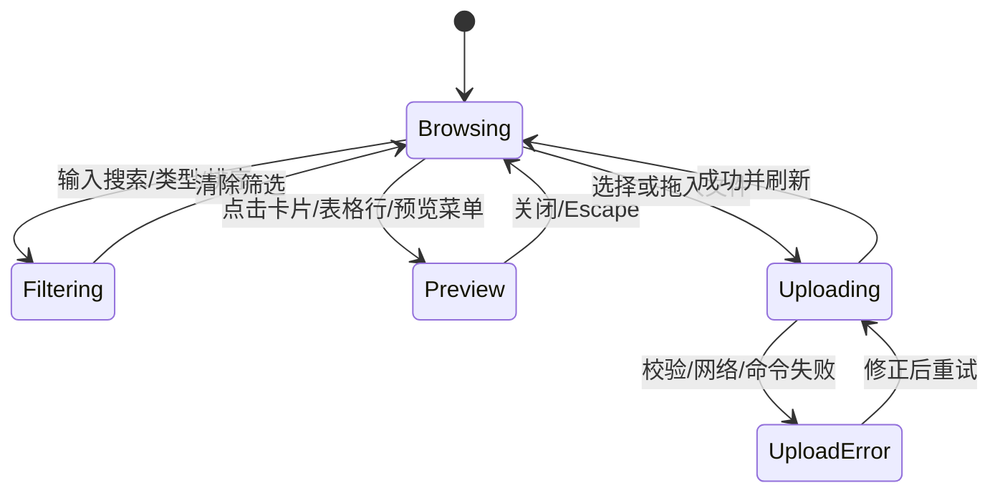
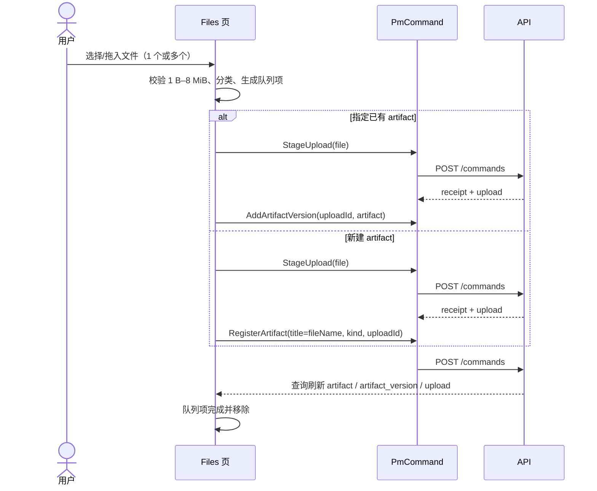
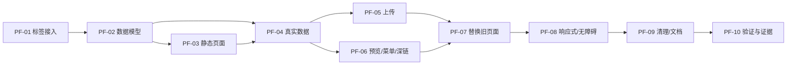

# 项目 Files 页复刻与替换计划

当前增量：显示名、软隐藏/恢复、指定版本独立复制已按 [F01–F10](service-files-lifecycle-plan.zh.md) 实现并完成隔离真实服务/S3浏览器验收。本文首期“没有 Rename/Duplicate”是历史，不表示当前缺少服务；物理删除/GC仍未实现。证据见[五包交付](service-completion-and-acceptance.zh.md#five-package-delivery)。

版本：0.3 · 日期：2026-10-23 · 状态：正式 `/pm` Files 已接真实图片/PDF/有界文本预览与原键恢复；2026-10-22 的响应拦截记录仅为历史 UI 证据，本轮真实服务验收单列第 12 节。

参考对象：`/data2-HDD-SATA-20T/Digital_avatar/haoweiyao/UI-package/gr8r-studio`（下称“参考站”）的**项目 Files 标签页**。

目标项目：本仓库正式服务前端 `/pm`，替换项目详情中现有的“附件与成果”区块（`ProjectFiles`）。`/lab/pm` 的展示样例不在本次替换范围。

本计划只使用源码与样式证据，不把参考站的演示上传进度、示例文件或菜单动作当成真实能力。所有业务数据继续来自现有 PM 服务；不可用的动作不伪造。

## 1. 结论与范围

### 1.1 目标

1. 在项目详情 `detail1`、`detail2` 两个变体中增加独立 **Files / 文件** 标签页，直接访问 `?tab=files`。
2. 按参考站复刻页面结构：工具栏（搜索、类型筛选、排序、网格/列表切换、上传）、拖放区、上传队列、文件网格、文件表格、空态、预览弹窗和文件菜单。
3. 数据只使用真实的 `artifact`、`artifact_version`、`upload` 实体与现有下载接口；删除旧 `ProjectFiles` 在概览/附件区的重复嵌入，避免同一页面出现两套文件 UI。
4. 保留现有上传合同：`StageUpload` 与 `RegisterArtifact` / `AddArtifactVersion` 仍是两个显式命令；UI 可以表现为一个连续流程，但失败、未知结果和暂存文件必须可区分。
5. 保持本仓库既有主题、国际化、权限、查询缓存、Radix 弹层与 44px 触控目标规范。

### 1.2 非目标

- 不修改 `/lab/pm` 的 fixture 页面，不把真实上传接到 Lab。
- 不新增后端命令、数据库字段、迁移或 OpenAPI 合同。当前没有重命名、复制、删除成果/版本的命令，首期不显示这些菜单项。
- 不把参考站的 250 MB 文案照搬。服务端 `MAX_BLOB_BYTES` 为 8 MiB，界面必须如实标注。
- 不模拟上传百分比。参考站的进度条是演示计时器；本页只显示真实的阶段与失败信息。
- 不做服务端缩略图。卡片继续用类型示意图；打开版本后通过当前会话读取真实内容，图片/PDF/有界纯文本按第 12 节安全策略预览。
- 不把文件关联到任务。`artifact_version` 没有任务外键；除非后续从 submission/evidence 派生，否则不显示参考站的 task 徽标。
- 不替换 `/pm/<workspace>/documents`（Markdown 文档集合），两者语义不同。

### 1.3 “原来的页面”与替换口径

当前正式项目详情没有 Files 标签页，文件入口是 `ProjectFiles` 组件：

- 组件：`apps/web/src/features/pm/service/service-project-detail-panels.tsx:88-139`。
- 嵌入位置：`service-project-detail.tsx:158`（`files` 变量）与 `:223`（`regions.attachments` / `overview`）。
- 展示：`artifact_version` 的纵向列表、下载按钮、可展开详情、两阶段上传表单。

替换后：

- `ProjectFiles` 组件删除，能力迁移到新的 Files 页面组件。
- `overview` / 简报不再嵌入文件列表。
- `regions.attachments` 不再由正式服务提供；新页面使用 `regions.files`。
- `readModel.attachments`、`ControlledAttachments` 保留给 Lab fixture 与 Issue 详情等既有消费者，不做无关删除。

## 2. 参考实现拆解

### 2.1 入口与整体结构

参考文件：`src/pages/project.js:18-25`、`src/views/files.js`。

项目标签顺序固定为 Overview、Board、List、Table、Calendar、Timeline、**Files**、Activity；Files 使用 `paperclip` 图标。页面分为：

1. 项目头：项目名、状态、成员、操作按钮、标签栏。
2. 文件工具栏：横跨内容宽度，底部边框。
3. `.page.wide` 内容区：拖放区、上传队列、网格或表格、空态。

工具栏与内容区共享 `var(--gutter)` 水平边距；工具栏 `min-height: 44px`，内容区顶部额外 16px。

### 2.2 工具栏

参考文件：`src/views/files.js:16-39`、`src/styles/views/board.css:211-220`、`src/styles/components.css:284-305,403-433`。

| 元素 | 参考行为 |
| --- | --- |
| 搜索 | 200×28px 输入框，左侧搜索图标；`data-in="fileQ"`，每次输入重新渲染；不区分大小写，只匹配文件名 |
| 类型筛选 | 原生 select，26px 高；选项为全部类型加 Figma/PDF/Archive/Image/Spreadsheet/Document/Code，故意不提供 `other` |
| 排序 | 原生 select：Newest（默认，按时间倒序）、Name、Type |
| 视图切换 | 胶囊分段控件：`layout-grid` / `list`，只有图标 |
| 上传 | 主色小按钮，内含隐藏的 `<input type="file" multiple>`；可多选 |
| 布局 | 元素间 4px，自动换行；`sp` 把视图切换与上传推到右侧 |

筛选、排序、视图状态保存在页面 UI store（`S.ui.fileQ/fileType/fileSort/fileView`），不是服务端偏好。

### 2.3 拖放与上传

参考文件：`src/views/files.js:40-42`、`src/actions/actions.js:805-841`、`src/actions/drag-drop.js:88-112`、`src/ui/helpers.js:108-111`。

- 拖放区：虚线边框、圆角、居中 `upload-cloud` 图标与说明文字；悬停或拖入时使用强调色浅底。
- 拖入文件后读取 `data-dropzone` 的项目 ID，创建上传项。
- 上传项显示文件类型图标、文件名、百分比和进度条。
- 演示实现用 220ms 定时器把进度随机增加 9–31%，完成后写入 `D().files`；这不是真实上传。
- 大于或等于 100% 时创建文件记录，记录 `name/type/size/by/at/project/task`，并重新渲染。
- 离线时显示错误 toast，不启动上传。

复刻时必须保留“选择文件 → 暂存 → 登记”的真实语义，不能使用随机进度。

### 2.4 网格卡片

参考文件：`src/views/files.js:52`、`src/styles/views/projects-files.css:175-305`、`src/ui/helpers.js:100-124`。

- 网格：`repeat(auto-fill, minmax(180px, 1fr))`，间距 12px。
- 卡片：1px 边框、10px 圆角、surface 背景；悬停只改变边框颜色。
- 预览区：16/10 比例、sunken 背景、下边框；按类型生成示意图：
  - 图片：渐变山景 SVG；
  - 表格：4 列网格单元；
  - Figma：两栏线框；
  - 压缩包：文件夹图标；
  - 其他：文档线条。
- 右下角扩展名徽标：等宽 11px、类型色背景、白色文字、大写。
- 信息区：文件名（12.5px/500）、`大小 · 上传者名 · 相对时间`（11px，弱化色）。
- 右上角更多按钮默认透明，悬停显示。

### 2.5 列表表格

参考文件：`src/views/files.js:53`、`src/styles/pages/settings.css:143-160`、`src/styles/panels.css:4-8`。

- 外层 `panel` 可横向滚动；表格 `min-width: 680px`。
- 列：Name、Type、Size、Uploaded by、Date、操作。
- Name 列：28px 类型图标 + 文件名 + 可选任务徽标（文件关联任务时）。
- Uploaded by：小头像 + 完整姓名。
- 行支持右键菜单；末列为省略号按钮。

### 2.6 空态、预览与菜单

参考文件：`src/views/files.js:44-51`、`src/ui/helpers.js:58-60`、`src/overlays/modals.js:283-290`、`src/overlays/context-menu.js:75-85`、`src/actions/actions.js:790-803,1613-1658`。

- 无文件：`folder-open` 图标、标题“No files yet”、说明上传设计/文档/资产。
- 有筛选但无结果：`search-x` 图标、标题“No results found”、说明没有匹配文件；不提供清除按钮。
- 预览弹窗：大尺寸、标题为文件名，副标题为类型 · 大小 · 上传者 · 相对时间；正文是放大的类型示意图；若文件关联任务，底部提供任务链接；页脚为“Copy link”和“Close”。
- 右键/省略号菜单：Preview、Rename、Copy link、Duplicate、Delete（最后一项危险色）。
- 搜索命令面板也把文件作为一类结果，点击打开预览。

### 2.7 交互状态



### 2.8 视觉规格

参考值来自 `src/styles/tokens.css`、`src/styles/views/projects-files.css`、`src/styles/components.css`、`src/styles/shell.css` 与 `src/styles/views/board.css`。

| 项 | 参考值 | 本仓库映射建议 |
| --- | --- | --- |
| 内容最大宽度 | `.page.wide` 无上限 | 沿用项目详情内容宽度；表格允许横向滚动 |
| 水平边距 | `--gutter: 24px` | 复用项目详情的 `--gutter`/面板内边距 |
| 工具栏 | 高 44px，padding 8×24，底部 1px 边框 | 使用 `--border`、`--motion-hover` |
| 搜索 | 200×28，图标左 9px，输入左内边距 30px | `Input` + 搜索图标；窄屏占满一行 |
| 原生选择 | 26px 高，12px 字号 | `NativeSelect`，鼠标 28px；粗指针 44px |
| 分段控件 | 外框 2px 内边距，按钮 24px 高，选中白底+边框阴影 | `Segmented`/两个 icon button + `aria-pressed` |
| 拖放区 | 1.5px 虚线，10px 圆角，18px 内边距 | `--radius-module-value`、`--accent-soft`、`--accent` |
| 网格 | minmax(180px, 1fr)，gap 12 | 沿用；窄屏 minmax(150px, 1fr) |
| 卡片 | 10px 圆角，16/10 预览，信息 padding 9×10 | `--radius-popover-value`，`--surface`，`--surface-raised` |
| 列表 | 最小 680px，行 padding 9×8，1px 分隔线 | `--divider`/`--border` |
| 类型图标 | 28×28，6px 圆角，13% 类型色浅底 | 见 4.6 的 `--file-*` Token |
| 扩展名徽标 | 等宽 11px，2×5 内边距，4px 圆角，白字 | `--font-mono` |
| 空态 | 上下 56px，图标 22px，标题 14.5/600，说明 12.5 | 复用 `Empty` 组件并调整间距 |
| 动效 | 140ms，边框/背景过渡 | `--motion-hover`；`prefers-reduced-motion` 下关闭 |

## 3. 本仓库现状与真实能力

### 3.1 现有实现

| 路径 | 现状 |
| --- | --- |
| `apps/web/src/features/pm/service/service-project-detail-panels.tsx:88-139` | `ProjectFiles`：`artifact_version` 列表、下载、详情、两阶段上传表单 |
| `apps/web/src/features/pm/service/service-project-detail.tsx:48,158,223,228` | 查询 `artifact_version`；在概览与 `attachments` 区域重复渲染同一个 `ProjectFiles` |
| `apps/web/src/views/pm/controlled-contracts.ts:156,165` | 标签联合类型与 `regions` 映射，目前没有 `files` |
| `apps/web/src/views/pm/project-detail.tsx:19,48,75-96` | 默认标签、标签文案与 fallback 附件列表；Lab 也使用该组件 |
| `apps/web/src/features/pm/service/service-project-detail.module.css:54-72` | 旧文件列表与上传面板样式 |
| `apps/web/src/views/pm/projects-views.module.css:261-299` | `fileList/fileRow/fileName/fileSize/fileActions`，Lab fallback 也在使用 |

现有页面没有搜索、类型筛选、排序、网格/列表切换、类型图标、拖放、上传队列、预览或文件菜单；上传限制已标注 8 MiB，并明确“上传和登记是两个明确操作”。

### 3.2 后端合同与数据

依据：`packages/application/src/delivery.ts:100-170`、`packages/contracts/src/client.ts:34,70,102,256`、`packages/infrastructure/src/blobs.ts:8`、`apps/api/src/app.ts:335-339`。

| 能力 | 真实行为 |
| --- | --- |
| `StageUpload` | 入参 `contentBase64/fileName/mediaType`；解码后最大 8 MiB，HTTP body 最大 12 MiB；需要 `delivery.write` 且项目可写；创建 `upload` 实体，1 小时过期，只能被本人消费一次 |
| `RegisterArtifact` | 入参 `title/kind/uploadId`；创建 `artifact` 与第一个不可变 `artifact_version`；消费暂存上传 |
| `AddArtifactVersion` | 目标为已有 `artifact`；追加不可变版本，更新 `versionRefs/latestVersionId`；消费暂存上传 |
| 下载 | `GET /api/v1/workspaces/{workspaceId}/artifact-versions/{id}/content`；鉴权；响应固定 `application/octet-stream` 与 attachment disposition |
| 读取 | `usePmEntities("artifact" \| "artifact_version" \| "upload", projectId)`；需要 `domain.read` |
| 不存在 | 重命名、复制、删除、归档成果/版本；服务端缩略图；任务反向关联；250 MB 上传。客户端真实内容预览见第 12 节 |

`artifact_version` 可用数据：`artifactId`、`uploadId`、`objectKey`、`contentDigest`、`sha256`、`size`、`mediaType`、`fileName`、`sourceRunId`、`producerId`，以及实体级 `createdAt/updatedAt/createdBy`。`artifact` 可用数据：`title`、`kind`、`versionRefs`、`latestVersionId`。

### 3.3 差异与决策

| 参考站 | 本仓库 | 决策 |
| --- | --- | --- |
| 一个文件记录，无版本 | `artifact` + 不可变 `artifact_version` | 以 `artifact` 聚合为“文件”，默认显示最新版本；弹窗内列出历史版本 |
| 上传即完成，模拟进度 | 暂存与登记分离 | UI 串联两个命令，但保留暂存失败/登记失败/未知结果状态 |
| 250 MB | 8 MiB | 界面与服务端统一 8 MiB；不修改存储上限 |
| Rename/Duplicate/Delete | 无命令 | 首期隐藏；不提供假按钮 |
| Preview 为类型示意图 | 授权下载 + 不可变元数据 | 卡片保留示意图；弹窗按第 12 节显示真实图片/PDF/纯文本，不把示意图当内容 |
| task 徽标 | 无直接关联 | 首期不显示；后续可从 submission/evidence 派生 |
| `by` 来自演示成员表 | `producerId` + 项目身份目录 | 用 `useProjectDirectory().identities` 映射姓名；缺失时显示保守占位 |
| 搜索、筛选、排序、视图为内存状态 | 页面状态 | 使用 `useDraftState` 按项目/会话保留，不写入服务端 |

## 4. 复刻方案

### 4.1 信息架构与路由

- 扩展 `ProjectDetailViewProps["interaction"]["tab"]`，加入 `"files"`。
- 正式服务标签：
  - `detail2`：`overview, board, list, table, calendar, timeline, graph, files, activity, comments`
  - `detail1`：`overview, board, list, table, calendar, timeline, graph, files, activity`
- 旧 URL `?tab=tasks|issues|dependencies` 分别映射到 `board`、`list`/`table`、`graph`；`taskView` 继续用于旧链接。
- 任务视图共享一个工具栏（搜索、状态筛选、排序、新建任务），由 `ProjectDetailView` 在标签栏下方渲染；看板/列表/表格不再各自重复工具栏。
- `ProjectDetailView` 的默认 `workspaceTabs` 保持不变，避免 Lab 多出无数据的 Files 标签；只在 `labels` 与 `regions` 类型中加入 `files`。
- `service-project-detail.tsx` 传入包含 `files` 的 `tabs`，并只提供 `regions.files`。
- URL：`/pm/<workspaceSlug>/projects/<id>?view=detail1|detail2&tab=files`。
- 深链：`?tab=files&file=<artifact_version id>` 打开对应版本预览；关闭时移除 `file` 参数，保留 `tab=files`。
- 概览页不再嵌入文件区。指标卡“附件版本”可保留，但点击时切换到 Files 标签，避免在同一页复制文件列表。

### 4.2 组件拆分

新增目录：`apps/web/src/features/pm/service/project-files/`。

| 组件/模块 | 职责 |
| --- | --- |
| `ProjectFilesPage.tsx` | 页面容器：查询、权限、筛选状态、上传对话框、预览深链 |
| `files-model.ts` | 纯函数：类型分类、大小/相对时间格式化、按 artifact 聚合版本、筛选、排序 |
| `FilesToolbar.tsx` | 搜索、类型筛选、排序、视图切换、上传入口 |
| `FilesDropzone.tsx` | 拖放目标、键盘可访问的“浏览”按钮、悬停/拖入状态 |
| `UploadQueue.tsx` | 本地上传项、阶段、失败/未知状态；不显示虚假百分比 |
| `FileGrid.tsx` / `FileCard.tsx` | 网格卡片、类型预览图、更多菜单 |
| `FileTable.tsx` | 表格视图、类型/大小/上传者/日期、行菜单 |
| `FileTypeIcon.tsx` | 28px 类型图标与颜色 |
| `FilePreviewArt.tsx` | 图片/表格/Figma/压缩包/文档的类型示意图 |
| `FilePreviewDialog.tsx` | Radix Dialog：标题、元数据、版本列表、下载、复制链接 |
| `project-files.module.css` | 页面级样式与 `--file-*` 类型色 Token |

复用现有组件：`Button`、`Input`、`NativeSelect`、`Segmented`（或两个 `icon` 按钮）、`DropdownMenu`、`Dialog`、`Badge`、`Empty`、`Avatar`、`Skeleton`、`QueryNotice`、`Tooltip`、`useDraftState`、`useText`、`useDisplayDateTime`。

卡片可访问结构不要照搬参考站的“div role=button 内嵌 button”：

```tsx
<li>
  <article className={styles.card}>
    <button type="button" className={styles.cardMain} onClick={openPreview}>
      <FilePreviewArt ... />
      <span className={styles.fileName}>{name}</span>
      <span className={styles.fileMeta}>{meta}</span>
    </button>
    <DropdownMenu>
      <DropdownMenuTrigger asChild>
        <Button variant="ghost" size="icon" aria-label={t("文件操作", "File actions")}>…</Button>
      </DropdownMenuTrigger>
      …
    </DropdownMenu>
  </article>
</li>
```

### 4.3 数据模型与派生

```ts
type FileEntry = {
  id: string                  // artifact id；孤立版本使用 version id
  artifactId: string | null
  name: string                // latestVersion.fileName || artifact.title || id
  kind: FileKind              // fig/pdf/zip/img/sheet/doc/code/other
  mediaType: string
  size: number | null
  uploaderId: string
  updatedAt: string | null    // latestVersion.createdAt
  versions: Entity[]          // 新到旧；按 artifact.versionRefs/latestVersionId 排序
  latest: Entity
}
```

派生规则：

1. 以 `artifact_version.artifactId` 分组；`artifact` 的 `versionRefs` 顺序为权威顺序，`latestVersionId` 必须排第一。
2. 没有对应 `artifact` 的孤立版本仍显示为独立条目，不丢弃；`artifactId` 置空。
3. 没有版本的 `artifact` 不伪造文件；显示“版本不可用”的错误条目，或从列表排除并记录查询诊断。首期选择排除并显示非阻断提示。
4. 文件名、大小、类型、上传者、时间均来自最新版本；版本数量用 `vN` 徽标提示。
5. 上传者：`producerId === actor.id` 时显示本人姓名；否则查项目身份目录。目录未加载或找不到时显示“—”，并用 `title` 暴露原始 ID；不猜测姓名。
6. 时间：卡片显示相对时间（just now / 3m / 2h / 4d，超过 7 天显示本地化绝对日期），`title` 显示偏好格式的完整日期时间。
7. 筛选：大小写不敏感的文件名子串匹配；类型为精确分类；排序 `newest` 按 `updatedAt` 倒序，`name` 使用 `localeCompare`，`type` 按分类名排序。
8. 空态区分“项目没有文件”和“筛选无结果”；查询失败使用 `QueryNotice`，不显示成空列表。

### 4.4 上传流程



实现约束：

- 快速拖放默认“每个文件新建一个 artifact”；对话框允许选择已有 artifact，此时只接受一个文件，避免版本顺序歧义。
- 多文件顺序执行，每个文件独立收据；不做批量原子承诺。部分成功时逐项显示结果。
- 队列阶段：`reading`、`staging`、`registering`、`done`、`failed`、`unknown`。只显示阶段文字和不确定进度条（`role="progressbar"` + `aria-valuetext`），不显示百分比。
- `StageUpload` 成功、`RegisterArtifact` 失败时保留 uploadId 与暂存实体，队列项显示“已暂存，登记失败”，允许在 1 小时内重试登记；不自动重新上传。
- 命令结果未知时使用现有 `CommandNotice`/`action.reconcile` 核对；在核对完成前禁用该文件的再次提交，不盲目重试。
- 客户端先校验 8 MiB 与空文件，服务端仍是最终权威；错误显示原始可读消息，不吞掉 413。
- 没有 `delivery.write`、项目已归档或项目不可写时，上传按钮与拖放区禁用，并显示原因；已有文件仍可按 `domain.read` 下载。
- 上传队列使用 `useDraftState` 按项目保留，切换标签再返回仍能看到未完成的阶段；不把本地队列伪装成服务端事实。

### 4.5 动作映射

| 参考动作 | 本页行为 | 依据 |
| --- | --- | --- |
| Preview | 打开类型示意图弹窗，展示真实文件名/类型/大小/上传者/时间/版本 | 本地数据 |
| Download | 逐版本下载真实内容 | `downloadArtifactVersion` |
| Copy link | 复制 `?tab=files&file=<versionId>` 的绝对 URL | 本地路由 |
| Rename | 首期不提供 | 无命令 |
| Duplicate | 首期不提供 | 无命令；客户端无法复制 Blob |
| Delete | 首期不提供 | 不可变版本；无命令 |
| Upload | 打开“上传 / 新版本”对话框；工具栏与拖放区共用 | `StageUpload` + `RegisterArtifact` / `AddArtifactVersion` |
| Search/Filter/Sort/View | 本地状态 | 无服务端写入 |
| Task 徽标 | 首期不显示 | 无直接关联 |

如果产品要求补齐 Rename/Duplicate/Delete，必须另立后端计划：新增命令、权限、审计与不可变内容删除/保留策略；本计划不把客户端按钮接到不存在的合同。

### 4.6 样式与主题

新增 `project-files.module.css`，只在 Files 页面使用，避免污染全局。

- 布局、间距、圆角优先使用现有语义 Token：`--border`、`--divider`、`--surface`、`--surface-raised`、`--text-secondary`、`--text-muted`、`--accent`、`--radius-popover-value`、`--motion-hover`。
- 类型色是参考站的视觉标识，定义为一组页面级 Token，并提供 dark 覆盖：

```css
.root {
  --file-fig: #8662c9;
  --file-pdf: #c4473a;
  --file-zip: #6b7280;
  --file-img: #23918a;
  --file-sheet: #3d8e5f;
  --file-doc: #3b82c4;
  --file-code: #c48a1e;
  --file-other: #6b7280;
}
:global(.dark) .root {
  --file-fig: #b9a2ea;
  --file-pdf: #e08a80;
  --file-img: #6cc9c3;
  --file-sheet: #7fce9c;
  --file-doc: #8ab8ea;
  --file-code: #e6bc6a;
  --file-zip: #a1a1aa;
  --file-other: #a1a1aa;
}
```

- 类型图标底色使用 `color-mix(in srgb, var(--file-c) 13%, transparent)`；文字/图标使用 `var(--file-c)`。
- 网格：`repeat(auto-fill, minmax(180px, 1fr))`；≤767px 改为 `minmax(150px, 1fr)`。
- 表格：外层 `overflow-x: auto`，表格 `min-width: 680px`；窄屏不压缩列，允许横向滚动。
- 工具栏：`flex-wrap: wrap`；≤767px 搜索独占一行，其余控件下一行；上传按钮保持可见。
- 触控：粗指针下按钮/菜单项至少 44px 高；鼠标环境保持参考站的紧凑尺寸。
- 动效：只过渡边框与背景；`prefers-reduced-motion: reduce` 下移除过渡与拖放区动画。
- 长文件名：`overflow-wrap: anywhere`，卡片与表格都不能撑破布局。

### 4.7 可访问性与国际化

- 工具栏所有输入/选择都有可见或 `aria-label` 名称；搜索框有 `aria-label`。
- 视图切换使用 `aria-pressed` 或 radio group；当前视图明确。
- 拖放区既支持拖放，也支持点击/键盘打开文件选择；拖入时使用 `aria-live` 提示。
- 文件卡片主体与“更多”按钮是两个独立可聚焦控件，避免嵌套按钮。
- 文件表格使用真实 `<table>`、`<th scope="col">`；排序按钮暴露 `aria-sort`（或使用 select，语义一致）。
- 预览使用 Radix Dialog：焦点进入、Escape 关闭、焦点返回触发元素；标题与描述关联。
- 上传状态用 `role="status"`/`aria-live="polite"`；错误用 `role="alert"`。
- 所有文案走 `useText(zh, en)`；类型名、相对时间、空态、错误、按钮、菜单全部双语。
- 文件名与纯文本预览均作为 React 文本；拒绝 HTML/SVG/XML 主动内容格式，图片仅安全栅格 MIME/签名，PDF 复用编辑器 canvas-only PDF.js，不执行脚本/表单/链接。

## 5. 工作包

| 编号 | 范围 | 主要路径 | 退出条件 | 依赖 |
| --- | --- | --- | --- | --- |
| PF-01 | 标签与合同接入 | `controlled-contracts.ts`、`project-detail.tsx`、`service-project-detail.tsx` | `?tab=files` 可达；detail1/detail2 均显示；Lab 标签不变 | — |
| PF-02 | 纯数据模型 | `project-files/files-model.ts` | 类型分类、大小、相对时间、版本聚合、筛选/排序有确定性输出；缺失数据有回退 | — |
| PF-03 | 静态页面与样式 | `ProjectFilesPage`、工具栏、网格、表格、空态、CSS Module | 用真实结构渲染；light/dark、390/768/1280 宽度无溢出 | PF-01/02 |
| PF-04 | 真实数据接入 | 查询 `artifact`/`artifact_version`/`upload`、身份目录、权限 | 列表来自真实实体；数量/名称/上传者/时间正确；无 fixture 回退 | PF-02/03 |
| PF-05 | 上传流程 | `FilesToolbar`、`FilesDropzone`、`UploadQueue`、上传对话框 | 新文件与新版本均成功；8 MiB/空文件/权限/归档/失败/未知结果可区分；无假百分比 | PF-04 |
| PF-06 | 预览、菜单与深链 | `FilePreviewDialog`、`DropdownMenu`、复制链接 | 预览打开/关闭/焦点返回；深链打开指定版本；只显示真实可用动作 | PF-04 |
| PF-07 | 替换旧页面 | 删除 `ProjectFiles`；移除概览/简报嵌入；更新 `regions.attachments` | 页面只有一套文件 UI；旧组件无引用；Lab fallback 不受影响 | PF-03/04 |
| PF-08 | 响应式、主题与无障碍 | CSS、焦点、键盘、ARIA、双语文案 | 4.6/4.7 清单通过 | PF-03–07 |
| PF-09 | 清理与文档 | 删除死样式/死导入；更新 README 文档链接 | 无未使用导出/样式；文档链接通过 `check:docs` | PF-07 |
| PF-10 | 验证与证据 | 构建、浏览器闭环、证据记录 | 第 6/7 节全部通过；记录真实服务与视口证据 | PF-01–09 |

实施前用 LSP references/`grep` 枚举 `ProjectFiles`、`attachments`、`workspaceTabs`、`briefTabs`、`regions` 的全部消费者，确认 Lab 与 Issue 详情不被误改。中途不运行全量 build/lint/test；集成完成后统一检查。

## 6. 验收清单

### 6.1 功能

- [ ] `/pm/<workspace>/projects/<id>?tab=files` 直接可访问；detail1/detail2 切换后仍停留或正确回退。
- [ ] 标签顺序与参考站一致：Files 位于 Timeline 之后、Activity 之前（简报视图按自身顺序）。
- [ ] 概览/简报不再出现旧文件列表；页面只有一套文件 UI。
- [ ] 文件数量、名称、类型、大小、上传者、时间与真实 `artifact_version` 一致。
- [ ] 同一 artifact 的多个版本聚合为一个文件条目，显示 `vN`；弹窗可查看/下载各版本。
- [ ] 搜索只匹配文件名，大小写不敏感；类型筛选无 `other` 选项；三种排序结果正确。
- [ ] 网格/列表切换保留筛选与滚动位置；空项目与筛选无结果是不同空态。
- [ ] 上传新文件成功；上传新版本成功；多文件逐项显示结果。
- [ ] 8 MiB、0 字节、无 `delivery.write`、归档项目、断网/5xx 均有明确错误；不显示假进度。
- [ ] `StageUpload` 成功而登记失败时保留暂存文件并可重试登记；未知结果先核对，不自动重传。
- [ ] 下载真实内容；复制链接可重新打开对应版本预览。
- [ ] 弹窗预览真实安全图片/PDF/有界 UTF-8 纯文本；不支持/主动内容明确拒绝；卡片类型图与真实内容区分；长文件名不溢出。
- [ ] 不显示 Rename/Duplicate/Delete 等未实现动作。

### 6.2 视觉与响应式

- [ ] 工具栏、拖放区、网格、表格、空态、弹窗的层级与参考站一致。
- [ ] 类型色、预览示意图、扩展名徽标、悬停更多按钮与参考站一致。
- [ ] Light/Dark 均通过对比度检查；不出现白底白字或不可读的类型色。
- [ ] 390px、768px、1280px 无页面横向溢出；表格自身可横向滚动。
- [ ] `prefers-reduced-motion` 下无多余动画。

### 6.3 可访问性与国际化

- [ ] Tab 可到达搜索、筛选、排序、视图切换、上传、每个卡片、每个菜单项、预览关闭。
- [ ] 预览打开后焦点进入弹窗，Escape 关闭，焦点返回原卡片。
- [ ] 上传状态/错误被屏幕阅读器播报；表格表头语义正确。
- [ ] 中文/英文文案完整；相对时间与类型名本地化。
- [ ] 粗指针设备主要操作目标 ≥44px。

### 6.4 数据与边界

- [ ] 只读用户可浏览/下载，不能上传；提示说明原因。
- [ ] 项目归档或不可写时不能上传；已有文件仍可下载。
- [ ] 孤立版本、缺失 artifact、缺失文件名/大小/上传者有保守回退，不崩溃。
- [ ] 查询失败显示 `QueryNotice`，不显示成“暂无文件”。
- [ ] 不读取凭据、不打印秘密；测试使用临时端口与独立项目。

## 7. 验证

纯文档阶段：

```bash
pnpm check:docs
```

实现阶段（按受影响范围）：

```bash
pnpm --filter @pm/web lint
pnpm --filter @pm/web build
pnpm check:web
```

未修改后端时不需要 `pnpm test:backend`；若最终方案新增了后端命令，则必须补真实 PostgreSQL/HTTP 测试并运行 `pnpm test:backend`，跳过的测试不算通过。

真实浏览器闭环：

1. 使用 `node --env-file=.env` 消费数据库配置，为本轮创建随机 PostgreSQL schema、临时 Markdown/blob 根目录与自有 API/Web 端口；不得重启常驻服务。
2. 使用隔离夹具新建 owner 与受限 reader 登录，绝不读取或输出真实账号、密码、cookie、数据库 URL。
3. 准备小于 8 MiB 的图片、PDF、文本/代码、压缩包各一个，验证类型分类与图标。
4. 验证新上传、新版本、同 artifact 多版本、下载、复制链接、深链、刷新后一致性。
5. 验证无权限/归档项目、空项目、筛选无结果、网络失败、未知命令恢复。
6. 在 390/768/1280 宽度与 light/dark 下截图；记录到 `.local/evidence/project-files/`（gitignored）。
7. 检查浏览器控制台无错误；确认没有 fixture 数据或假上传进度。

## 8. 风险与取舍

| 风险 | 影响 | 处理 |
| --- | --- | --- |
| 参考站菜单动作无后端 | 复刻不完整 | 首期隐藏；另立后端计划，不伪造 |
| 250 MB 文案与 8 MiB 限制冲突 | 用户误判 | 统一显示 8 MiB；不修改存储/HTTP 限制 |
| 暂存与登记是两个命令 | 可能出现“已暂存未登记” | 队列明确阶段；保留 uploadId 在 1 小时内重试；未知先核对 |
| 版本与文件语义不同 | 列表重复或丢失最新版本 | 以 artifact 聚合，`versionRefs/latestVersionId` 排序，孤立版本兜底 |
| 主动内容/伪造 MIME | XSS、外部网络与凭据泄漏 | HTML/SVG/XML 不预览；版本元数据需重新授权，大小/SHA-256/签名一致后才解码；PDF 仅 canvas，无外链层 |
| `producerId` 目录缺失 | 上传者显示为空 | 本人直接显示；其他缺失显示“—”，不猜测 |
| 多文件上传部分失败 | 用户以为全部成功 | 逐项状态与结果，不承诺批量原子性 |
| 大列表/长文件名 | 布局与性能 | 横向滚动、`overflow-wrap:anywhere`；必要时虚拟化留给后续 |
| 旧样式/组件残留 | 维护成本与双份 UI | PF-07/PF-09 清理并用 references 确认无消费者 |

## 9. 实施顺序



建议先合并 PF-01–PF-04 形成可浏览的真实只读 Files 页，再接入 PF-05/PF-06；最后删除旧组件。这样每一步都能独立复核，且不会把未完成的菜单动作暴露给用户。

## 10. 文档与证据

- 本计划：`docs/implementation/project-files-replication-plan.zh.md`。
- 相关既有文档：[项目补齐计划](project-backend-completion.md)、[后端交付记录](backend-delivery.md)、[领域实施计划](../domain-design/README.md#implementation-plan)。
- 实现完成后更新 README 的 `/pm/<workspace>/projects/<id>` 条目，并记录真实浏览器证据；未实现前 README 只登记本计划，不宣称已交付。
- 本轮浏览器证据：`.local/evidence/project-files/`（gitignored）。

## 11. 实施记录（2026-10-22）

### 11.1 已落地

| 区域 | 结果 |
| --- | --- |
| 标签接入 | `detail1`、`detail2` 均加入 **文件** 标签；`?tab=files` 可直达，文件标签位于时间线之后、动态之前；Lab 默认标签未改变 |
| 页面 | 新增 `features/pm/service/project-files/`：页面、模型、类型图标/示意图、上传对话框、预览对话框与 CSS Module |
| 数据 | 只读真实 `artifact` / `artifact_version` / `upload`；按 artifact 聚合版本，`versionRefs`/`latestVersionId` 排序，孤立版本保留 |
| 工具栏 | 搜索、类型筛选、最新/名称/类型排序、网格/列表切换、上传入口 |
| 上传 | `StageUpload` → `RegisterArtifact` / `AddArtifactVersion` 两阶段流程；多文件顺序提交；暂存文件恢复；8 MiB 上限；无假百分比；失败/登记失败/结果未知可区分 |
| 预览 | 类型示意图、真实元数据、版本历史与逐版本下载；复制链接与 `?file=<versionId>` 深链 |
| 替换 | 删除旧 `ProjectFiles`；概览/简报不再嵌入文件列表；旧 CSS 清理；`readModel.attachments` 与 `ControlledAttachments` 保留给 Lab/Issue 详情 |
| 动作边界 | 未实现 Rename/Duplicate/Delete；菜单只提供预览、下载、复制链接；task 徽标不显示 |

### 11.2 验证

已运行：

```bash
pnpm --filter @pm/web typecheck
pnpm --filter @pm/web lint
pnpm --filter @pm/web build
pnpm check:docs
```

浏览器验收使用 Vite 开发页与实际 Chromium，API 由 `setRequestInterception` 注入固定响应，未读取 `.local/access.json` 或任何账号凭据。覆盖：

- 1280px 浅色：9 个 artifact 聚合行、版本徽标、上传者姓名、相对时间。
- 列表/网格切换、搜索 `brand`、PDF 类型筛选、名称排序。
- 双击版本前打开预览；v2/v1 切换后大小、上传者、时间与版本号同步。
- 深链 `?tab=files&file=<versionId>` 直接打开预览；关闭后移除 `file` 并保留 `tab=files`。
- 复制链接后预览内显示“链接已复制”。
- 上传对话框：8 MiB 文案、目标成果选择、文件输入、成果类型；提交后命令数为 2（StageUpload + RegisterArtifact），队列显示“已完成”。
- 深色主题（`--file-img` 切换为 dark 值）与 390px 视口无页面横向溢出。

证据文件：

- `.local/evidence/project-files/project-files-preview.png`
- `.local/evidence/project-files/project-files-upload.png`
- `.local/evidence/project-files/project-files-dark.png`
- `.local/evidence/project-files/project-files-mobile.png`
- `.local/evidence/project-files/project-files-mobile-closed.png`

限制：本轮未用真实账号连接真实后端执行上传；命令成功路径由浏览器拦截验证。真实服务下的文件内容下载、权限拒绝与 PostgreSQL 一致性仍需按第 7 节在具备授权账号的环境复验。

## 12. 真实预览与 Files 验收补齐（2026-10-23）

### 12.1 实现与安全边界

- 弹窗新增 `FileContentPreview.tsx` / `preview-model.ts`，复用编辑器 `registeredAttachmentMediaType` 的不可变版本校验与 `PdfPreview`。服务端仍按 `domain.read` 和当前项目范围分别授权元数据及下载，前端不信任文件名、外部 URL 或下载响应 MIME 来选择解码器。
- 真实图片限已登记的 PNG/JPEG/GIF/WebP/AVIF/BMP，核对 MIME 对应字节签名、登记大小和 SHA-256，再生成本地 Blob URL；图片解码失败原位报错。PDF 要有 `%PDF-` 签名，并复用已禁用注释、外链、表单、XFA 和脚本的 PDF.js canvas 分页；只允许软件包内固定资源且 `credentials: omit`，不抓取 PDF 提供的 URL。
- 文本仅 `text/plain`、Markdown、CSV、TSV、JSON，最多 256 KiB、严格 UTF-8、拒绝二进制控制字符；以 React `<pre>` 字面显示，不解析 Markdown/HTML，不自动链接，不加载图片。其余预览上限仍为 8 MiB。HTML/SVG/XML/JS 等主动格式或相应文件扩展名明确拒绝，不嵌入 iframe/object/embed。允许下载不表示已判定文件安全。
- 切换版本、关闭弹窗、账号/工作区/成员授权版本变化即取消旧请求；旧结果按授权 scope 隔离，撤销 Blob URL，PDF 组件卸载销毁 Worker/文档/render task/canvas。网络、权限、内容摘要/签名、文本格式与 PDF 解码错误不伪装成预览成功。
- Files 为每阶段保留原 `commandId` 和阶段；现有 IndexedDB 命令 journal 是请求权威，sessionStorage 只保存当前上传的非字节恢复意图。页面刷新可重建对应队列，核对同键收据；暂存确认后显式继续登记，不重新上传；登记确认后只更新列表。全局“核对命令”与队列“核对”都能消费匹配收据，不凭其他命令结果标成功。恢复存储写失败时不发送本阶段命令。
- 未新增后端合同、迁移或共享编辑器状态链。`preview-model.test.ts` 增补主动格式/伪造 MIME/UTF-8/256 KiB 边界回归，交由集成 owner 统一执行。

### 12.2 不可变历史与需要用户决定的问题

依据 INV-01/10/13/14/20、SC-07/13/14/16、INF-04/05/06 及 Markdown ADR：Artifact 是可变身份聚合，`versionRefs/latestVersionId` 可追加；ArtifactVersion、Evidence、Submission、Review 是不可变引用历史。新版本不能悄悄把既有 Evidence 或提交改成“最新版本”。

| 待讨论问题 | 当前安全默认 | 决策影响 |
| --- | --- | --- |
| 重命名修改显示标题还是历史下载名？ | 已采用独立 `artifact.data.title`、原 CAS 与安全事件；历史 filename/摘要不变，服务与浏览器已验证 | 批准合同已实施，不再作为开工前待讨论项 |
| 复制是否生成独立对象、选哪个版本、是否跨项目？ | 明确所选不可变版本、新 artifact/version/upload/objectKey；同工作区跨项目须双侧授权，来源受控；不复制 Evidence/Submission/Review | 批准合同已实施；跨工作区和计费另议 |
| 删除是隐藏还是物理清理？ | 可恢复软隐藏已实现，保留授权历史下载与不可变引用；不物理删除已登记 blob/历史行 | 物理保留/GC、审批及法律清理仍需决定，不阻塞软隐藏/恢复 |
| 暂存过期/孤立 blob 的运营保留多久，哪个受审计角色可清理？ | 现有 1 小时暂存租约只限制登记；过期不等于允许立即删除内容 | 需要引用/租约检查和延迟清理合同；本轮不宣称自动 GC 完成 |

### 12.3 验收口径

真实验收必须使用新建隔离 schema 与实际 HTTP/浏览器：上传→登记→追加版本→逐版本下载与 SHA-256→刷新→受限角色写入/超范围下载拒绝→实际提交后丢响应→原键暂存/登记恢复→SQL 的 artifact/version/upload/Evidence/receipt/outbox 引用核对。不使用固定成功拦截响应。390px 与主题截图仅为浏览器仿真，不是真机/生产/公网验收。

### 12.4 本轮真实服务证据

使用独立随机 PostgreSQL schema（包含本轮 0020–0023）、临时 Markdown/blob 根目录、自有 API/HTTP 故障代理/Web 3365 与真实 Chromium。owner 使用 `pm-files.localhost`，reader 使用 `pm-files-reader.localhost`，避免同一浏览器在不同端口共享 `127.0.0.1` Cookie。初段是开发服务，集成 owner 完成生产构建后已切为同端口 `vite preview`；没有成功响应 mock，没有读取真实账号凭据或修改真实业务文件。

| 场景 | 实际结果 |
| --- | --- |
| 上传与登记 | 浏览器原文件输入上传 `first.txt`，真实 StageUpload → RegisterArtifact；首次真实路径发现旧 UI 缺少 upload CAS 版本导致 409，现登记前授权读取 upload，并同时携带 upload / artifact 的 expectedVersions |
| 追加与逐版本下载 | 浏览器上传对话框选择原成果并追加 `second.txt`，同一 artifact 两个不可变版本；v1/v2 下载按钮得到不同真实字节，刷新后仍聚合为 v2，历史 v1 可打开 |
| v1 摘要 | 91 字节，SHA-256 `a0938831e38b55a73a7789dbd73f8e3e8f267c35071c60651b9d531147fec78a` |
| v2 摘要 | 76 字节，SHA-256 `84bc069ed9c0132086f6f836eadd60432c616bb659451944a991ba8519626003` |
| 图片/PDF/文本 | 真实 68 字节 PNG 解码为 1×1；1006 字节两页 PDF 用 canvas 显示并翻至第 2 页，翻页未新增内容下载；中文与 `<script>` 以字面纯文本显示 |
| 主动内容与边界 | 实际上传 SVG/HTML 后明确拒绝预览；256 KiB+1 的文本真实提示超限。带恶意 OpenAction 的 PDF、HTML/SVG 和纯文本脚本场景共观察 8 个实际请求，外部请求为 0，pageerror 为 0 |
| 版本取消与资源释放 | CDP 延迟真实旧版本 content 请求后切到 v1，Network.loadingFailed 确认旧请求 canceled=true，v1 正确显示；图片 Blob 关闭前可读 68 字节、关闭后读取失败，PDF Worker 从 1 降为 0 |
| 暂存响应未知 | 故障代理只在真实 StageUpload 已 committed 后截断响应；刷新恢复原 key，队列核对同键收据，再显式登记；该 StageUpload 只向服务端转发 1 次 |
| 登记响应未知 | 同样在 RegisterArtifact committed 后截断响应；刷新后按原 key 核对，恢复 done，未生成替代登记；原命令只转发 1 次 |
| 受限 reader | 浏览器上传入口 disabled 且有权限提示；浏览器会话直接提交 StageUpload/RegisterArtifact/AddArtifactVersion 均 403 permission_denied；本项目下载 200/76 字节，另一项目版本下载 404 not_found_or_forbidden；越界深链显示“未找到该文件或无权访问” |
| SQL 引用 | 9 artifact、10 version、10 upload、1 Evidence、42 outbox 事件；逐版 HTTP 摘要/大小与 SQL 的 sha256/contentDigest 匹配，upload 消费指针/objectKey、artifact.versionRefs、Evidence 的两版本引用、outbox 对应 committed 收据均核对一致 |
| 仿真截图 | 1280px 浅色与 390px 深色，文档 scrollWidth=390；移动属性抽屉按真实入口关闭后可操作文件。只记录浏览器仿真，不当作触摸真机、物理缩放、生产公网或完整 G2 证明 |

机器证据与截图位于 `.local/evidence/project-files-real/`：`browser-evidence.json`、`sql-http-evidence.json`、逐版本/图片/PDF/reader 权限与稳定 bundle 截图。检查由父线程统一执行，本 slice 没有运行 build/lint/tests/formatters。共享 PDF CSS 要求 `.markdown-preview` 宿主，390px 实测后已在 Files 的 PDF 分支复用该宿主，避免独立预览丢失缩放/工具栏样式。

最终集成 bundle 的 390px PDF 已复验：`.markdown-preview` 宿主生效、工具栏为 flex、预览宽 308 CSS px、canvas 宽 270 CSS px，页面 scrollWidth=390；截图已替换为真实缩放后的最终结果。验收结束已关闭本 slice 两个浏览器标签、自有 dev/preview/API/故障代理/发布循环，夹具退出码 0；随机 schema、Markdown/blob 临时根目录、样本文件、下载目录与自建冒烟脚本全部清理。失败的首个夹具也已按唯一 staged-upload ID 精确定位并清理；没有清理其他代理资源。`cleanup.json` 保留清理结果；必要截图与无秘密 JSON 证据保留。

