# 真实验收与缺失服务能力补齐

本文记录“真实验收有缺口”与“已有页面但服务缺失”的连续交付。第一、二、五、六节是上一批八包的历史记录；**本次五个明确工作包的当前结果见第九节**。均按用户要求使用 `gpt-6.1-sol / xhigh / priority`（fast 服务档）并行实施；外部服务、生产策略和真实设备门禁单列，不以假接口、空开关或模拟成功结案。

## 一、实现合同

| 工作包 | 实现边界 | 不包含 |
| --- | --- | --- |
| 工作区资料 | 真实名称、受控图标/颜色、独立 identity_version、命令收据/CAS、工作区选择与外壳同步；修改要求无限制工作区 access.manage | 自定义 URL、停用、删除 |
| 账号安全 | 本人改密、真实会话列表/撤销、持久限流；改密撤销其他会话，旧密码登录在锁内再次核对；账号级原 actionId 查询及取消围栏 | MFA、密码找回、SSO、没有来源的设备/IP/位置推断 |
| 站内活动 | 当前授权事件的本人已读/未读、归档/取消归档，独立 CAS、分页快照/保留边界、actor-private 状态事件 | 接收人规则、邮件/Push、通知订阅偏好、截止提醒 Worker |
| 任务评论 | 真实创建/编辑/软删除/恢复及不可变版本历史；读要求 domain.read，写要求 intent.propose，修改已有评论另要求本人作者；检测任务跨项目迁移并拒绝静默扩大历史读者 | 提及投递、实时合编、删除即物理擦除、未经决定的历史授权迁移 |
| Files | 真实上传注册、不可变版本和下载；受权栅格图/PDF.js/UTF-8 文本内容预览；大小/SHA/类型验证；原上传/注册结果恢复 | 活动 HTML/SVG/XML 执行、重命名、复制、删除/GC |
| 日历/时间线 | 现有全天任务日期写入及原 revision 冲突保护，实际服务与权限验收 | 小时排期、重复规则、自动混入会议 |
| 恢复/身份 | actor/tab 隔离未知命令日志；退出清理可见数据但保留原请求恢复依据；工作区全局原收据恢复入口；SSE/权限矩阵 | 自动重发未知副作用、绕过当前授权、以新 commandId 冒充恢复 |
| 发布 | build 默认关闭 Lab、HTTP 层拒绝 Lab；API/Worker/Web 镜像、同源 Caddy/SSE、明确单 API 本地卷部署 | 公网 DNS/TLS 切换、HA、分布式核心锁、未经测量的容量保证 |

Markdown 仍是九类核心实体、配置、关系和状态的权威。工作区资料、账号安全、活动个人状态及评论属于 PM 独有 SQL 附属数据，不增加 SQL 任务副本，也不改变任务完成与独立审核规则。

能力迁移为 `0020_workspace_identity.sql`、`0021_account_security.sql`、`0022_activity_state.sql`、`0023_task_comments.sql`；真实恢复演练另补 `0024_project_audit_restore_scope.sql`。账号安全不是工作区命令：会话所属用户由认证确定，密码/摘要/token 不进入命令、事件、收据或恢复存储。普通命令合同新增工作区资料、活动状态及评论七项命令；生成合同为 99 个命令 payload、43 个 OpenAPI 路径。

## 二、真实验收发现的问题

- Files 的 RegisterArtifact/AddArtifactVersion 原来没有携带 upload 实体版本，真实服务返回 409；现在读取真实 upload 并提交正确的 CAS 条件，不放宽后端版本校验。
- 日历保存适配器曾用最新查询结果替换编辑起点 FileRecord，抹掉应触发冲突的原 revision；现在保留原编辑基线。
- 原未知命令日志在退出/身份刷新时可能失去恢复依据；现在清理私有可见状态与保留 actor/tab 隔离恢复记录分别处理。
- 命令已提交但响应丢失后，刷新到对象默认内容页原来没有可见恢复按钮；现在工作区外壳提供唯一原 ID 恢复入口，本地成功/错误提示不重复显示未知恢复控件。
- 真实撤销会话后，核心 SSE 曾在下一次 15 秒心跳前继续发送变化；现在每条事件发送前重新核对实际会话与当前项目范围，关闭状态阻止延迟授权结果重新写流。旧会话不再收到新事件，保留会话仍正常收到核心与 PM 事件。
- 代理上游断开但下游连接未关闭时，事件客户端曾无限等待读取并继续显示在线；现在每次读取有 45 秒无字节截止，注释心跳也算流量，超时取消实际连接，由原恢复流程按旧游标重连，不自动重发业务命令。
- SSE 410 后的权威快照读取曾被并行取消而误报成功；现在逐个实际获取活动查询，失败/取消均不推进游标、不宣称恢复在线。
- 真实 pg_restore 在空 search_path 下恢复非空 project_audit 时找不到白名单 helper。`0024` 将该检查函数固定到 pg_catalog 与其实际所属 schema，不改历史迁移摘要、不放宽 CHECK。本机备份同时明确只含 public 业务 schema，排除并行验收临时 schema。
- 全量回归发现5个实际请求约10秒被 socket idle timeout 切断。独立真实 HTTP 复现为10,025ms断开，修复后同一11秒处理返回200。API现在用120秒限制接收请求，不用空闲连接计时截断已经接收完的合法持久处理；未增加自动重试，未知副作用规则不变。

验收只在隔离 PostgreSQL schema、临时 Markdown/blob 根和自有服务中建立夹具。HTTP 结果、浏览器交互、测试与部署演练分别记录；HTTP setup 不等于点击通过，窄屏仿真不等于真实触摸硬件通过。

## 三、决策与实施状态总表

D01–D15 是原始范围编号，保留用于追踪，**不是“仍有15项必须先讨论才能开工”**。当前分类为：**5项明确子范围已实现并完成隔离真实验收、3项默认已定而扩展另议、5项新增能力仍需产品决策、2项目标环境/实机输入与验收待定**。五包未擅自升级既有业务实例，外部生产启用门禁仍保留；范围分类不等于整个 D 编号全部关闭。

| 编号 | 当前主要状态 | 已确定、可以沿用或进入实施的部分 | 仍需讨论或提供的输入 |
| --- | --- | --- | --- |
| D01 工作区 URL | 当前默认已定；扩展另议 | 保留 UUID 稳定路由、授权 ID 和核心目录；名称/icon/color 独立修改，不再为普通改名等待 URL 决策。 | 只有新增友好 slug、旧地址别名/重定向、自定义域名时，才需另定产品规则。 |
| D02 工作区停用/删除 | 新增能力待产品决策 | 不级联物理抹除 Markdown、成果、审核和备份；冻结、隐藏、恢复与物理清理必须分开。 | 谁能停用/恢复、冻结后谁能读写、保留期、审批及引用/备份保留。不能把安全禁删默认算作删除服务已实现。 |
| D03 账号身份 | 可信邮箱/找回已实现并隔离验收 | [R01–R10](service-password-recovery-plan.zh.md)：独立验证/换绑/解绑、单次令牌、匿名统一响应、重置撤销全部会话；真实 SMTP、Worker、HTTP 与浏览器闭环已执行。 | 生产 SMTP/HTTPS/受控收件箱需目标环境验收；失联人工恢复、旧备份凭据重新开放仍需决定。MFA/SSO/IdP、恢复码与外部账号绑定另议。 |
| D04 通知 | 站内定向通知与共享事实已实现并隔离验收 | [N01–N10](service-notification-routing-plan.zh.md)：显式关注、本次提及、本人排除/去重、当前授权、持久事实及旧状态迁移；真实 Worker 和通知状态页面已执行。 | 团队展开、受派即通知、邮件/Push、频控/安静时段及物理保留策略另议；业务实例升级需停写窗口。 |
| D05 重复任务 | 新增能力待产品决策 | 保留独立规则生成新任务、来源与幂等键的方向，不原地重开旧任务。 | 日历触发还是完成触发、时区/DST、补漏上限、字段/关系继承、暂停/删除与已生成实例的关系。尚未形成完整实施包。 |
| D06 小时排期 | 当前默认已定；扩展另议 | 保持全天日期权威与日粒度甘特，不将日期偷偷转换为 UTC 午夜。现有日期功能不等小时决策。 | 真要新增小时区间时，仍需明确补充还是替代全天日期、时区/DST、跨日、模式切换及工期关系；小时功能未规划完成。 |
| D07 跨项目历史 | 当前默认已定；扩展另议 | 评论保留原项目历史，检测迁移返回 `task_comment_project_changed`；不静默扩大历史读者。 | 若要支持跨项目历史迁移，仍需选择历史读者是否迁移、源读/目标写授权与审计规则；当前保护行为不等于已支持移动。 |
| D08 合编/批注 | 新增能力待产品决策 | 保留显式保存与 revision 冲突保护，不称逐键实时合编。Yjs/Hocuspocus 只是候选技术。 | 共享草稿还是自动保存、Markdown/CRDT 权威、离线合并、独立批注及锚点迁移/删除；改变权威须另行 ADR。 |
| D09 计费 | 新增能力待产品决策 | 无真实商户与策略时不接扣款、不展示支付成功。 | 商户主体、支付供应商、币种/税务、套餐授权、退款/发票规则。尚无可直接实施的完整支付包。 |
| D10 外部集成 | 受限 Webhook 已实现并隔离验收 | [W01–W09](service-webhook-plan.zh.md)：批准目标、最小历史事实、强制签名、SSRF 防护、原 deliveryId 与认证核对；真实 TLS 接收器持久接受且效果一次。 | 生产接收器协议/账本、精确目标、密钥与出境授权是启用门禁；供应商连接器/OAuth/同步冲突/动态插件仍另议。 |
| D11 S3/多实例 | 私有 S3 与维护/备份已实现并隔离验收 | [S01–S08](service-s3-blobstore-plan.zh.md)：真实 MinIO、授权下载、绑定/迁移、全部引用字节核验及实际新库恢复；仍单 API 管理核心目录。 | 目标供应商/桶/区域/身份、加密/备份与 RPO/RTO 需配置及演练；Markdown 多写、故障转移和 HA 不由 S3 解决。 |
| D12 协作白板 | 新增能力待产品决策 | 个人白板保持本地私有，不自动上传既有草稿。 | 是否团队共享、共享范围、快照/操作日志权威、权限、并发与离线合并。尚未形成共享服务实施包。 |
| D13 Files 操作 | 生命周期与独立复制已实现并隔离验收 | [F01–F10](service-files-lifecycle-plan.zh.md)：显示名、软隐藏/恢复、指定旧版本独立复制和受控来源；真实 S3 浏览器操作及下载字节已验证。 | 物理清理/保留期、引用感知 GC 与审批仍未决定；不阻塞已经实现的无 GC 路径。 |
| D14 生产部署 | 目标环境与验收输入待定 | 沿用职责分离、同源代理及隔离演练；不擅自修改 DNS、发送公网邮件或宣称 HA/容量通过。 | 主机/平台、域名/TLS、RPO/RTO、SLO/并发及外部服务配置；需要目标环境上的真实演练，不只是继续写技术方案。 |
| D15 物理设备 | 实机矩阵与验收待定 | 浏览器仿真明确只记仿真，不伪造物理设备通过。 | 目标 OS/浏览器/中文输入法/触摸/缩放组合，以及可访问的真实设备与实际操作证据。 |

**本次实施的是 D03、D04、D10、D11、D13 的已明确子范围。** 现在不能再把这五包统称为“规划完成、待实施”；同时不能把隔离验收等同生产启用，或因此关闭每个编号内尚未选择的扩展。

依据与追踪：[Plane 源码对照](#plane-source-decisions)、[五包实施规划及共享依赖](#clear-capability-plans)。当前禁用状态继续保持可解释；未实现或未验收部分不通过改标题、删编号或隐藏入口假装完成。

### 3.1 集中决策登记与状态规则（2026-10-24）

本节吸收补充审查，区分**既有合同、建议草案、实际交付、生产启用**，不重新编排五包实施，也不把转交建议视为用户已经批准全部产品政策。D01–D15 保持原编号；C01–C04 是跨模块索引，不是新增四个独立产品工作包。

- 第三节总表记录 D 编号的当前范围和合同；下表补充跨模块决策，统一包含 ID、状态、范围、已选行为、排除项、重启条件和证据。后续变更在原编号更新，不另造一套同名状态。
- 决策状态使用“已确定 / 已暂缓 / 待产品决定 / 待外部资源 / 待真实验收”；交付状态另记“未实施 / 已实现 / 已隔离验收 / 已在目标环境验收”。规则确定不等于实现完成，配置存在不等于上线验收通过。
- “四条可沿用边界”是 D01、D06、D07 与 D11 的单 API 原则；D11 同时属于五个已交付子范围。因此不能用 `4+5+5+2` 当作互斥的 D 编号计数，仍沿用上方 `3+5+5+2=15` 的主分类。
- 补充审查中的“五包待实施”已由第九节实际交付取代。结构化提及、恢复邮箱换绑/解绑的当前密码校验、Webhook 发送前失败预算/换钥、S3 新写入后的回退边界均已有子合同，不重新列为尚未设计。

### 3.2 跨模块决策登记

| ID | 状态 | Scope | Chosen behavior | Explicitly excluded | Revisit trigger | Acceptance evidence |
| --- | --- | --- | --- | --- | --- | --- |
| C01 恢复后的认证与副作用围栏 | 隔离/围栏已确定并隔离验收；凭据重新开放待产品/安全决定 | D03/D04/D10/D11；账号、安全与运维负责人 | 仅向新目标恢复；撤销目标会话/令牌、围栏通知及邮件/Webhook。unknown 保留原身份核对，不自动重投。未经批准的凭据信任处置不得对公网开放认证。 | 不因存储恢复成功而接受旧凭据；不以新 deliveryId 重做未知效果；不修改源库 | 首次生产恢复或改变身份恢复渠道前，明确身份核验、批准人、凭据轮换和无法核验者处置 | 已有目标围栏及新库恢复证据见第九节；仍需证明旧密码/旧邮箱信任不能绕过重新开放流程，以及历史外部效果不会重发 |
| C02 数据保留分类 | 现有无 blob GC 边界已确定；统一期限/配额待产品、法务与运维决定 | Files、业务历史、通知、安全记录、日志和备份 | 按下方六类登记；保留现有各模块已定 TTL/失效语义；新清理政策须单独批准并核对引用和恢复要求 | 不统一永久保存、不统一到期删除；不把隐藏当擦除；不顺带关闭既有有限保留维护 | 公开服务、容量压力、保留/擦除要求或拟新增清理任务前 | 需保留矩阵、引用/防重保护和清理后的恢复验证；完整孤儿统计与告警未取得本批验收证据 |
| C03 自动化动作身份 | 领域权限边界已有；真实 Agent 接入未实施，具体委托协议待后续立项 | 人、Agent、后台服务；第三阶段身份/执行合同 | 沿用 [权限定义](../domain-design/permissions.md)：区分主体和委托人，权限取交集，后台动作限定用途；将 run/原 command/委托来源关联列入执行接入验收 | 不冒充人类 actor；不接受 Agent 自报角色；不授予 Agent `access.manage`；不把 Worker 已运行算作真实 Agent 接入 | 首次允许 Agent 写评论、文件或任务前，确定委托生命周期及审计字段合同 | 需真实主体、委托撤销、越权拒绝及原操作关联证据；现有领域设计不是端到端执行证明 |
| C04 存储切换与回退 | 合同已确定；目标环境演练待真实验收 | D11/D13；停写维护和存储绑定 | 沿用 [S 第6.4节](service-s3-blobstore-plan.zh.md)：无新写时核验后 CAS 回切；有新写优先前向恢复，必须回退则停写并迁移当前全部引用、全量核验后切换 | 不只改配置指回旧 Local；不回滚旧库/核心快照丢弃新事实；不永久 dual-read 掩盖缺失 | 每次目标切换或回退前，按是否已有新写选择流程 | 隔离存储/迁移/恢复证据见第九节；生产需含切换后新文件的完整反向迁移和授权下载证据 |

**C01 特别限制：清除 sessions/token 并不使备份内旧 password hash 自动失效；备份中的旧“已验证邮箱”也不自动成为当前可信渠道。** 当前隔离恢复和外发围栏已交付，但“账号自动冻结、可信身份重建、批准后重新开放”的完整生产流程不能据此标成已实现。没有可执行批准方案时保持恢复环境隔离，不提供未经验证的管理员重置后门。

#### C02 的六类保留登记

| 类别 | 当前可沿用边界 | 仍需明确 |
| --- | --- | --- |
| 不可变业务历史 | 成果版本、Evidence、审核、评论版本及来源/收据保持原身份与引用；五包不新增自动物理清理 | 法定保留、擦除例外、备份与防重身份的联动 |
| 用户个人状态 | 通知已读/归档不是业务历史删除；不能借 SSE 清理删除持久通知事实 | 个人状态和通知事实各自期限、注销/撤权后的处理 |
| 临时上传与孤立对象 | 租约到期是不可再登记，不代表字节已删除；失败后可能保留无 SQL 引用的对象 | 对象清单权限、孤儿/未绑定字节口径、配额和安全回收条件 |
| 安全秘密 | 令牌按用途过期/撤销，队列密文按发送状态清除；防重和原结果记录不是可重用秘密 | 安全记录与 tombstone 保留、密钥轮换、备份中秘密的失效政策 |
| 操作日志 | SSE 流、业务审计、安全记录和运维日志不混为一类；保留已有脱敏和有限维护规则 | 各类期限、访问权限、告警阈值；不扩大正文/凭据日志 |
| 备份 | 保留一致检查点与恢复验证；不自动删除既有备份 | 独立位置、保留数量/期限、加密、销毁审批及恢复后的身份处置 |

**C02-O1 容量观测建议单列，尚未批准为新的实现包。** 应核对孤儿对象数量、未绑定字节、总占用、采集成本/权限和告警责任；不能把 SQL 已登记 upload 的汇总冒充整个 provider 的完整清单。该建议不是现有“五包已完成”的一部分，公开服务前需落实方案或明确限制开放范围；本次登记不新增监测服务或扩大 S3 权限。

### 3.3 新增能力的重新讨论条件

以下是待采纳的范围建议，不代表已经批准开发或永久放弃。未另行选择前保留第三节的当前行为；D01/D06/D07 的扩展条件已在原行记录。

| 编号 | 候选最小方向 | 重新讨论触发条件 |
| --- | --- | --- |
| D02 | 优先评估归档/冻结，不做物理删除；须先确定冻结后的读写权限 | 出现真实停用工作区管理需求 |
| D05 | 优先评估按日历生成独立任务实例，不原地重开历史任务 | 有可描述的重复业务样例、时区与补漏要求 |
| D08 | 继续显式保存与 revision/CAS；实时草稿/批注另立合同 | 多人编辑冲突成为高频问题，或明确要求独立批注 |
| D09 | 无商户和 entitlement 政策时不提供扣款 | 决定商业收费并提供商户、税务、套餐和退款要求 |
| D12 | 保持个人本地白板，不自动上传草稿 | 明确多人共享范围、权限和并发需求 |

### 3.4 上线门禁：批准、资源和实测分开登记

每项门禁分别登记责任人、批准记录、非秘密资源标识、验收日期/证据和失败处置；凭据不写入本表。下列均未由隔离测试代替目标环境验收。

| 范围 | 需要批准的政策 | 需要提供的真实资源 | 放行证据 |
| --- | --- | --- | --- |
| D03 / C01 | 恢复后凭据重新确立、无可信渠道者处置与批准权 | SMTP、可信 HTTPS origin、受控邮箱 | 目标邮箱收信、过期/重复消费拒绝、会话撤销；旧备份凭据不能绕过恢复门禁 |
| D11 / C04 | 驻留/加密、切换授权、维护窗口与回退责任 | 供应商、区域、私有桶/前缀、最小身份、独立恢复目标 | 真实 SHA-256 字节验证而非 ETag；目标供应商迁移、新写后回退/恢复及授权下载 |
| D10 / C01 | 数据出境范围、目标批准、去重保留与换钥责任 | HTTPS 接收器、端点密钥、原 deliveryId 持久账本及核对接口 | DNS/socket pinning、签名与当前授权、丢响应核对、接收效果去重；无可信接收器则不启用 |
| D14 | 维护授权、RPO/RTO 与容量/SLO 目标先确定 | 单 API 主机、持久卷、同源代理、域名/TLS、独立备份位置 | 在目标环境计时的故障/恢复演练和负载证据；沿用单写约束，不引入 HA 或未测量承诺 |
| D15 | 目标 OS/浏览器/中文输入法/触摸/缩放矩阵 | 可访问的真实设备与操作人员 | 逐项真实输入/触摸证据；390px 视口模拟不能替代 |

本次只核对现有文档合同与既有验收记录并补充决策管理，不重新验收源码、供应商、外部邮件或真实设备。第九节的676项结果仍是原交付批次证据，不是2026-10-24再次运行的结果。

## 四、相关实施记录

- [工作区与设置](settings-completion-plan.zh.md)
- [站内活动个人状态](activity-inbox-delivery.zh.md)
- [Markdown 核心与任务详情](markdown-core-delivery.zh.md)
- [Files](project-files-replication-plan.zh.md)
- [项目视图](project-view-arrangement.zh.md)
- [部署与运行边界](../../deploy/README.md)
- [累计后端交付记录](backend-delivery.md)

## 五、本轮真实证据索引

| 工作包 | 已观察的关键结果 | 安全证据目录 |
| --- | --- | --- |
| 工作区资料 | 保存/刷新、受限只读、外壳实时更新、完整草稿冲突/rebase、原收据跨刷新恢复；仅新增一个资料版本及一条事件 | `.local/evidence/workspace-identity/` |
| 账号安全 | 改密/单个与批量撤销、旧密码401/新密码200、错误密码拒绝、malformed 2xx/丢响应的原 actionId 恢复；撤销前后旧核心流泄漏的 fail-before/pass-after | `.local/evidence/account-security/` |
| 站内活动 | inbox3/4 实际已读/归档恢复、双账号隔离、跨标签页 SSE、旧 CAS409、提交后丢响应恢复、撤权、保留期级联与真实事务回滚 | `.local/evidence/activity-inbox/` |
| 任务评论 | 实际发布、编辑冲突、隐藏/历史/恢复、原 commandId 核对、全页/抽屉草稿连续、非作者403/越权404/迁移历史409；核心原文/revision/状态未变 | `.local/evidence/task-comments/` |
| Files | 两个不可变版本上传/下载 SHA 与 SQL 一致、Evidence 引用、读写权限、暂存/登记丢响应、真实图片/PDF/字面文本预览、旧请求取消与 Blob/Worker 清理 | `.local/evidence/project-files-real/` |
| 日期排期 | detail1/detail2 的日历/时间线范围写入与清空；跨月/年/闰日、DST/UTC+14、旧 revision 冲突与权限；丢响应后读取核对未重发 | `.local/evidence/calendar-acceptance/` |
| 身份/恢复 | Owner→Reader→Owner、工作区切换隔离；SQL 与原生创建原 ID/key 恢复；真实静默断流后旧游标重连；410＋持续503期间不误报在线，恢复后才推进游标 | `.local/evidence/recovery-acceptance/` |

上述工作包均使用真实数据库和 HTTP，故障注入发生在真实请求/提交上，不合成成功结果。390px 截图是浏览器仿真。完整 G2 全命令/全原生操作分支矩阵、全部路由与物理设备输入、慢客户端负载及公网/HA仍不能由本轮有界证据代替；恢复矩阵详见[客户端真实验收](client-recovery-acceptance.zh.md)。

### 迁移前备份与恢复缺陷处理

默认 API/Worker 停写后，迁移前原备份位于 `.local/backups/2026-10-22T18-11-21.753Z-a644e235`。该备份带旧函数元数据，不能假称原始单步 pg_restore 成功。已在独立新数据库按 **pre-data → 仅应用0024函数作用域修复 → data → post-data** 恢复，未修改原 dump、未禁用 CHECK 或触发器来掩盖错误。实际核对：2用户、1工作区、4审计行、58原收据、1成果版本及12份核心文件；恢复库全部约束 validated，成果 SHA/大小与停写核心原始字节一致，验证后删除自有恢复库。

迁移前历史备份若含非空审计历史，需要上述分段恢复；在全新目标数据库使用迁移文件原文修复函数元数据后，再恢复数据和后置约束。不能修改 dump 中的业务行或覆盖当前数据库。应用0024后生成的新备份会携带函数作用域，不再需要该修复步骤。本机 `backup:verify` 的 `--clean --if-exists` 仅针对工具刚创建的随机恢复数据库，用于处理其空 public schema，不作用于原业务库。

### 本机激活

迁移至0024后，常规新备份 `.local/backups/2026-10-22T18-16-16.739Z-dfc36926` 已单步 `backup:verify` 通过，无需旧备份元数据修复。核对6个PM实体、58收据、50事件、1成果版本、12核心文件；打开5个核心对象，0不支持文件、0错误。

最终 API10424/Worker10410 已在核对归属、停止旧进程后启动。API4100和Web3220同源 readiness 为200，database/storage/worker/core均true、quarantinedEvents=0。实际默认登录页面可用，公开合同43路径包含新增身份、活动及评论接口，未认证安全读取401；未读取或提交用户凭据。安全机器记录为 `.local/evidence/service-completion-activation.json`。没有commit或push。

### 容器发布与新库/新卷恢复

最终 API/Web 镜像已实际构建并在独立 PostgreSQL、API、Worker、Caddy 中运行。先停写并确认旧容器全部退出，再 force-recreate，未重叠运行两个核心进程。新数据库及新 core/blob 卷恢复后，5条非空审计、3份原收据、Markdown SHA与70字节成果 SHA保持；全部约束 validated，未绕过 CHECK。最终包含请求超时修复的 API 再次切换后，readiness、原事实、两路真实 SSE、Origin403与退出后401均已验证，实际浏览器完成登录/工作区/项目导航/退出。

生产构建不注册 Lab，实际 Caddy 对 `/lab` 及其子路径返回404。真实运行发现的 Caddy filecap/`cap_drop ALL` 冲突通过移除非特权8080端口不需要的 filecap 修复，未扩大容器权限。所有自有容器、卷、网络、导出镜像、临时配置与浏览器标签已按清单删除；共享基础镜像/构建缓存及默认服务保留，没有全局 prune。

有界测量仅为本机热态、串行、同源已认证工作区查询，不代表并发容量或 SLO。一次临时 caretaker 的 Node13退出保留为失败事实；最终有限切换与显式清理均exit0，不以健康服务掩盖该脚本退出。详细运行、测量、异常及清理证据见[部署实际验收](../../deploy/README.md#release-acceptance-evidence)和 `.local/evidence/release-acceptance/`。

## 六、上一批统一检查（迁移至 0024）

| 检查 | 最终结果 |
| --- | --- |
| `CHOKIDAR_USEPOLLING=true pnpm test:backend` | **584通过，30 suites，0失败，0取消，0跳过**；包含慢处理传输、静默事件流、账号安全、活动状态、评论、工作区资料及审计恢复回归 |
| `pnpm typecheck`、`pnpm lint`、`pnpm build` | 通过；最终已激活编译后的 API/Worker |
| `pnpm check:web` | 前端lint、全量TypeScript、生产Vite构建通过；保留大chunk与混合导入提示，不冒充性能优化 |
| Files安全预览专项 | 3通过，0失败，0跳过；格式/签名、字面UTF-8与大小边界 |
| `pnpm contracts:check` | 99个命令payload、43个路径一致 |
| `pnpm check:docs` | 76份Markdown、27个计划步骤及领域引用；14个仓库外可选链接不计入可移植检查 |
| 本机及容器真实运行 | 见上方逐项证据；默认服务ready，迁移前后备份及独立容器新库/新卷恢复均已实际完成 |

首轮全量回归的5个传输失败未通过重试或缩小测试范围掩盖：先独立复现10秒socket截断，修改正确的超时边界，再原样重跑完整 `test:backend` 得到上述零失败结果。所有八包已结束，临时验收资源已清理，既有业务数据未作测试夹具。

## 七、Plane 源码对照：可收敛的决定

### 研究边界

参考 `/data2-HDD-SATA-20T/Digital_avatar/haoweiyao/plane` 当前本地工作树，HEAD 标识为 `bab49bb978ccb56af1d78dec6c6d54dfe8d03c1c`；不声称工作树纯净或结论覆盖所有 Plane 商业版本。本地树还包含 `apps/api/plane/easyuse/` 扩展，其实现与原生 CE 路径分开判断。

仅研究源码并更新本讨论记录，未修改 Plane 或 PM 业务源码、未启动/重启服务、未读取凭据、未进行支付或外部投递。已执行原始 `_get_content_disposition` 纯函数的隔离探针：中文文件名正确编码，CR/LF 编码为 `%0D%0A`；只通过 AST 抽取原方法，不加载 SDK、数据库或网络。这不是 Plane 整套服务、S3 或通知投递验收。

Plane 文件标注 [AGPL-3.0-only](../../../../plane/LICENSE.txt)。本轮借鉴机制，不复制实现；后续若复制或改编源码，应先核对许可证履约要求，不能默认沿用本项目许可。

### D01–D15 对照结论

表中的“建议”是本项目适配结论，不是假称 Plane 原有行为。仍遵守 [Markdown 权威 ADR](markdown-integration-adr.zh.md)、INV-09/10/13/14/20、INF-01/03/04/06：文件权威、历史不可变、CAS、原请求恢复、当前授权及引用保护。

| 决策 | 当前 Plane 源码事实 | 本项目可收敛的方案与未决边界 |
| --- | --- | --- |
| D01 工作区地址 | 名称与 slug 分开；[序列化器:61–83](../../../../plane/apps/api/plane/app/serializers/workspace.py#L61)没有把 slug 设只读。前端正常改名不提交 slug，但没有找到旧 slug 别名/重定向实现。 | **继续 UUID 稳定路由、授权 ID 和核心目录，名称独立修改**，无需为普通改名新增地址迁移。友好 slug、旧别名保留和自定义域名仍是额外产品要求，不能借“前端不改”推定服务端不可改。 |
| D02 工作区删除 | [关联恢复函数:113–114](../../../../plane/apps/api/plane/bgtasks/deletion_task.py#L113)只有 `pass`；同文件:140起真实物理清理超期对象。[工作区删除:156–174](../../../../plane/apps/api/plane/db/models/workspace.py#L156)还会改 slug 以释放旧地址。 | **冻结、软隐藏、恢复、物理清理应是不同能力**。不能把软删除当成可恢复，更不能套用级联删除到 Markdown、Evidence 和审核。谁可读/恢复、保留期及审批仍需决定。 |
| D03 找回与身份 | [密码管理:38–160](../../../../plane/apps/api/plane/authentication/views/app/password_management.py#L38)有真实 SMTP 门禁、重置 token、校验与改密；[Google provider:103–125](../../../../plane/apps/api/plane/authentication/provider/oauth/google.py#L103)校验已验证邮箱。未找到企业 SAML/OIDC、TOTP/WebAuthn、恢复码执行链；邮箱验证码登录不是第二因素。 | **把邮件找回独立于 MFA/SSO 实施**：绑定已验证邮箱、短期单次 token、限流、统一对外响应、成功后撤销旧会话。PM 不照搬账号不存在的差异响应，也不只凭相同邮箱自动合并外部账号。尚需可信投递配置、邮箱信任/失联恢复及 IdP 策略。 |
| D04 通知 | [通知生成:278–347](../../../../plane/apps/api/plane/bgtasks/notification_task.py#L278)对活跃项目成员中的订阅人生成通知，排除操作者和本次提及者，邮件偏好确实被消费；另有自动订阅和邮件聚合。[邮件 Worker](../../../../plane/apps/api/plane/bgtasks/email_notification_task.py#L47)不是仅有设置 UI。 | **拆分事件、接收人、渠道、投递状态**；候选接收人最终与当前实体授权取交集，排除本人并去重，读取及发送时再次授权。建议提及只触发本次通知、持续关注显式订阅，不自动照搬“提及/参与即长期订阅”。还需事件矩阵、团队展开和渠道/频控策略；现有 SQL 活动不因此变成完整 Markdown 通知源。 |
| D05 重复任务 | [Celery 调度:44–98](../../../../plane/apps/api/plane/celery.py#L44)的 recurring 注释指系统定时任务；在后端、前端、共享 types/constants 中未找到 recurrence/rrule 模型、规则 API 或实例生成器。 | **源码不能替用户决定重复语义**。保留独立规则生成新任务及来源/幂等键方向；日历触发还是完成触发、时区/DST、补漏、字段继承仍需讨论，不能把复制任务当成重复任务。 |
| D06 小时排期 | [任务模型:147–148](../../../../plane/apps/api/plane/db/models/issue.py#L147)明确为 `DateField`；甘特用纯日期和天数，不是小时区间。 | **保持现有全天日期和日粒度甘特**。小时排期若需要，新增有明确时区的时间区间，不把已有日期改为 UTC 午夜；跨日、全天/小时切换与工期关系仍无 Plane 答案。 |
| D07 跨项目评论 | [任务序列化器:100–113](../../../../plane/apps/api/plane/app/serializers/issue.py#L100)把 project 设只读；[评论查询:36–61](../../../../plane/apps/api/plane/app/views/issue/comment.py#L36)独立过滤项目及成员。未找到连同评论/附件一起跨项目迁移的真实事务；easyuse 的 move 是原项目看板移动。 | **保留当前项目变化报错与旧历史范围**。未来必须显式定义源读/目标写、历史读者是否迁移及审计；不能只改 task.project 后默认所有历史自动获得正确权限。 |
| D08 实时合编/批注 | [协作持久化:26–91](../../../../plane/apps/live/src/extensions/database.ts#L26)加载/保存二进制状态并派生 HTML/JSON；[Yjs 转换:160–177](../../../../plane/packages/editor/src/helpers/yjs-utils.ts#L160)实际使用 Y.Doc；[页面模型:30–35](../../../../plane/apps/api/plane/db/models/page.py#L30)将这些格式存 SQL。 | **Yjs + Hocuspocus 可作技术候选，不能直接替换 Markdown 权威**。若继续显式保存，可评估“共享协作草稿→原 revision 发布”，外部文件变更必须冲突/重新合基线；要自动保存或持久 CRDT 权威则需另行 ADR。当前树未发现独立线程批注的完整服务与锚点迁移链。 |
| D09 计费 | [BillingRoot:20–70](../../../../plane/apps/web/components/workspace/billing/root.tsx#L20)展示 Community 和套餐比较；升级是外链引导。未找到本地扣款、支付回调、退款/发票完整链路，Stripe 文案不是后端证据。 | **仍需商户、供应商、币税、套餐授权和退款策略**。仅可借鉴套餐展示与真实 entitlement 分离，不能据此启用付款或宣称已购买。 |
| D10 外部集成 | [Webhook:267–340](../../../../plane/apps/api/plane/bgtasks/webhook_task.py#L267)有 delivery ID、可选 HMAC、受限外联和日志；GitHub OAuth 登录存在，但集成服务类/弹窗没有对应的本地仓库同步闭环。未发现动态业务插件安装/签名/沙箱。 | **把身份登录、供应商连接器、Webhook 和动态插件拆开**。通用 Webhook 可先作为集成边界候选；具体供应商优先级、scope、回调、双向冲突仍需选择。未知业务写不因借鉴 Webhook 而自动重发。 |
| D11 S3/多实例 | [S3Storage:19–158](../../../../plane/apps/api/plane/settings/storage.py#L19)支持 S3/MinIO、签名和 HEAD；本地 [easyuse 附件:149–179](../../../../plane/apps/api/plane/easyuse/attachments.py#L149)进一步 GET 实际字节验证长度/类型/SHA，而非信任 ETag。[下载:306–319](../../../../plane/apps/api/plane/easyuse/attachments.py#L306)支持服务端读取与条件匹配。 | **可确定为私有 S3 兼容 BlobStore，保留授权 API 下载、真实字节摘要和暂存→确认协议**；适配器与服务部署分开。首选不向浏览器暴露长期 GET 签名地址，保留请求时撤权检查。目标桶/区域/凭据仍需配置；S3 不解决 Markdown 多写，继续单 API。 |
| D12 协作白板 | 在 apps/packages 的 TS/TSX/Python 源码检索 whiteboard/excalidraw/tldraw，仅见 PDF 图标注释，未发现协作白板数据模型/API/同步实现。页面合编不是白板服务。 | **本地个人白板继续保持私有**。共享范围、服务器快照/操作日志、并发与离线合并需独立决定；不自动上传个人旧草稿，也不把在线页面引擎当成白板现成实现。 |
| D13 Files 操作 | [复制:816–865](../../../../plane/apps/api/plane/app/views/asset/v2.py#L816)创建新 ID/对象 key 并复制 S3 字节；当前附件名称是属性，没有等价于 PM 的不可变多版本/Evidence 模型。[easyuse 删除:239–247、322–342](../../../../plane/apps/api/plane/easyuse/attachments.py#L239)有删除意图/outbox/状态，但直接删对象，非引用感知 GC。 | **显示名独立于历史 filename；删除先软隐藏；复制采用新身份、独立存储对象并记录来源版本**，不复制原审核/证据身份。不能照搬无引用检查的物理清理。具体恢复期、隐藏后历史链接可见性及清理审批仍需决定。 |
| D14 生产部署 | [Compose](../../../../plane/docker-compose.yml#L37)区分 API/Worker/beat/live/数据库/缓存/对象存储；[Caddy](../../../../plane/apps/proxy/Caddyfile.ce#L12)分发 API、协作和存储。 | **只借鉴职责分离和同源代理，不照搬整套依赖**；本项目已有 PostgreSQL Worker，无需为模仿 Plane 增加 RabbitMQ/Redis。公网域名/TLS、RPO/RTO、SLO 和 HA 仍要目标环境与实际演练；也不照抄任意来源代理信任。 |
| D15 真实设备 | 源码与自动化配置无法证明目标触摸硬件、中文输入法或缩放组合的真实表现。 | **不能由 Plane 源码关闭**；仍需列明设备矩阵并实际操作，不把浏览器仿真记成物理设备验收。 |

### 不能照搬的三个边界

1. **通知不是生成时鉴权一次就结束。** Plane 原生通知列表/邮件发送路径没有覆盖本项目要求的每次项目权限重查；`property_change` 兜底还可能覆盖其他分类开关。PM 应让事件类别互斥解析、订阅与指派分开、每次读取/投递重查权限，SMTP 接受与收件人送达分开记录；未知发送不得自动创建新投递身份。此为源码边界分析，未作动态漏洞验证。
2. **附件三条生命周期不能混算。** 原生旧附件路径会删对象，V2 主要软删，本地 easyuse 扩展通过 outbox 删对象；它们都不等于 PM 的不可变版本与 Evidence 引用保护。原生复制调用后即置 uploaded，本项目仍须验证对象复制结果并可按原请求恢复。原生 GET 签名默认有效期3600秒，[下载路由返回重定向](../../../../plane/apps/api/plane/app/views/asset/v2.py#L461)；[INFERENCE] 已签发地址在有效期内可绕过后续应用权限撤销，因此不能替代当前授权 API 下载。
3. **CRDT、多副本与文件权威不是同一个问题。** [Redis 协作扩展](../../../../plane/apps/live/src/extensions/redis.ts#L24)解决协作节点传播，不提供本项目 Markdown 文件写锁、外部编辑协调或跨文件/SQL 一致恢复。不能因 Plane 有 live/Redis 就宣布本项目可多实例运行。

### 推荐实施顺序与仍需讨论的最小集合

- **无需改变既有产品语义即可保留的默认**：D01 稳定 UUID；D06 全天日期；D07 跨项目历史不自动迁移；D11 单 API 核心写入。这些已有边界不再因“参考 Plane”而反复悬置。
- **最适合下一批明确立项**：D13 显示名/软隐藏/新身份复制；D04 站内接收人规则及显式关注；D03 邮件找回；D11 私有 S3 BlobStore。后两项在取得各自真实配置前不得开放服务。该顺序是建议，不表示已经实施。
- **真正需要用户决策**：删除/恢复与证据保留策略；通知事件及渠道策略；重复任务及小时排期语义；跨项目历史是否迁移；合编保存/权威模型；MFA/IdP；商户与集成供应商；团队白板范围；生产目标与真实设备矩阵。

负面结论均限当前树：重复任务检索 API/Web/types/constants 的 recurrence/rrule 等；跨项目迁移检索 target/destination/new project、move/transfer 并读实际 task/comment 路径；计费检索 API/服务的 checkout/payment/refund/invoice；插件检索后端路由、服务和安装/沙箱实现；批注/白板检索 apps/packages 的相关模型、编辑器与同步源码。不是“Plane 全产品没有这些能力”的断言。

本次检查：`pnpm check:docs` 通过（76份Markdown、27个计划步骤；40个仓库外可选链接不计入可移植检查）。另在本机逐项核对本节26个 Plane 源码引用，涉及23个文件，路径与行号全部有效；D01–D15 各有一行对照结论。未运行本轮未改动的业务测试，也未把上一批584项回归当作 Plane 功能的运行证明。

## 八、明确方案的并行实施规划

本节保留五包规划阶段的范围和共享所有权。规划由五个 `pm-capability-builder` 子代理以 `gpt-6.1-sol / xhigh / priority` 完成；随后用户授权实施，当前源码和实际验收结果已更新至第九节。规划阶段未启用外联的记录不再代表当前只有文档。

### 8.1 可执行工作包

| 工作包 | 实施计划与稳定步骤 | 已选定的实施范围 | 不能混算为完成的条件 |
| --- | --- | --- | --- |
| D13 Files | [Files 生命周期](service-files-lifecycle-plan.zh.md)，F01–F10 | `artifact.data.title` 显示名；可恢复软隐藏；指定不可变版本复制为独立对象与新身份；来源按双侧权限读取。 | 不改历史 filename/Evidence；隐藏不撤销既有授权历史下载；不做物理删除/GC。 |
| D04 站内通知 | [通知接收与路由](service-notification-routing-plan.zh.md)，N01–N10 | 显式关注与本次提及；排除本人、去重、逐次当前授权；真实持久事实源；迁入仍存在且已保存个人状态的旧活动。 | 不自动长期订阅、扩团队、发邮件/Push；不伪造旧隐含未读或停机期间全部历史。 |
| D03 邮件找回 | [可信邮箱与找回](service-password-recovery-plan.zh.md)，R01–R10 | 独立已验证恢复邮箱；登记/换绑/解绑；匿名统一响应；单用途 token；重置原子撤销全部会话；原结果查询/取消围栏。 | 历史登录邮箱/邀请不算验证；不做 MFA/SSO、账号合并或无证明人工接管；真实外部收信另验。 |
| D11 私有 S3 | [BlobStore 与迁移](service-s3-blobstore-plan.zh.md)，S01–S08 | 原四方法接口与授权 API 下载；字节摘要核验；部署绑定；停写全量迁移；provider 感知备份及新桶恢复。 | 不开放长期直链、隐式 Local 回退、永久双读或自动清理；隔离 MinIO 不替代目标供应商，S3 不等于核心多写/HA。 |
| D10 通用 Webhook | [安全出站与核对](service-webhook-plan.zh.md)，W01–W09 | 运营批准目标；三类对象最小历史事实；强制签名；持久 deliveryId；SSRF 防护；认证收据及原投递核对。 | 不是供应商连接器/OAuth/动态插件；接收器不支持持久去重及核对屏障则不可启用；接收成功不改变 PM 业务。 |

步骤编号是稳定追踪身份，不重编号；实现及已执行证据见第九节与各包末尾。第七节研究建议已由这些具体合同收敛，未列入五包的剩余范围不随之关闭。

### 8.2 实施依赖与共享所有权

```mermaid
flowchart TD
  C["冻结共享合同与迁移所有权"] --> F["Files：先以 Local 闭环"]
  C --> R["账号恢复：独立身份与邮件流程"]
  C --> S["S3：适配器、绑定、迁移与恢复"]
  C --> E["共享核心事实：N01–N04"]
  E --> N["站内接收人、迁移与真实页面"]
  E --> W["Webhook 入队、出站与核对"]
  F --> FS["Files × S3 同行为验收"]
  S --> FS
  FS --> V["集成检查与各包真实场景"]
  R --> V
  N --> V
  W --> V
  V --> G["按能力逐项检查启用门禁"]
```

Webhook 配置/传输可在 W01 冻结后与事实包并行开发，但真实入队与发送必须等待持久来源；不需要等待通知 UI 完成。Files 不等待 S3，通知、找回和 Webhook 也不依赖 S3。

| 共享位置/合同 | 唯一集成责任与不可分叉的规则 |
| --- | --- |
| `service_fact_events`、核心 mutation journal/观测 ledger | N01–N04 的共享事实 owner 实现一套；受控写及有效外部观测覆盖 project/work_item/milestone。N 仅路由任务/内部评论矩阵；W 按自己的严格白名单投影；两者独立消费状态。账号认证与邮件秘密不进入此源。 |
| 当前权限与 Worker core 访问 | N 的 routed 通知需要真实当前任务/评论检查，部署须给 Worker 所需 core 根**只读**访问；不初始化第二个 Workspace/watcher/state。W 本包按固定历史范围最小元数据授权，复核当前管理/domain.read/audit.read，不冒充当前对象授权，也不为 W 新增核心写者。 |
| BlobStore、registry、API 注入 | S owner 负责去除 Local 具体类型和所有构造调用迁移；F 只依赖既有 read+put，不能另加 copy/delete。S 的绑定要求同时覆盖默认 Local 新安装/旧库 adopt 路径，不可只让 S3 能启动。 |
| SMTP 与账号安全 | R owner 提取唯一 SMTP 传输，邀请/找回保持独立功能门禁及队列；保持原邀请密文兼容性与发送语义。身份协议无 workspace 依赖；不将认证收据改为普通命令收据。 |
| schema/迁移、contracts/OpenAPI/client、app/registry/kernel | 集成 owner 统一分配迁移序号、文件编辑权及导出引用迁移。各包提交精确字段/命令/权限分类，不各自占同一序号或重复建立类型/别名。 |
| Worker main、runtime config、compose | 一次统一注册独立有界循环与真实状态；外联不能堵塞 outbox/SSE/心跳。Worker 不获得 S3 凭据；Webhook secret 仅 Worker 读取；账号邮件密钥按 API/Worker 实际需求分配，不给 Web。 |
| backup、部署说明、README 与能力索引 | 合并 SQL/core `.pm/state`/blob 的一致恢复清单；保留账号令牌围栏和外部投递 unknown，恢复不得重发历史。按实际验收记录更新能力，不因新卡片或配置存在写“已就绪”。 |

旧活动迁移与新定向通知不能混为一种受众：只迁真实保存过的状态，保留原版本/时间/私有归属；非任务 legacy 不伪造 taskId，无法验证导航目标时不提供假跳转。迁入记录不再随 SSE events 清理自动消失；这是一项明确的保留行为变化，物理保留期限仍未选定，不宣称永久无限保存。

### 8.3 未决事项与实施/启用的边界

- **不阻塞隔离实施的外部门禁**：真实 SMTP/HTTPS origin/受控收件箱；目标 S3 服务商、私有桶、最小权限/加密/备份配置；Webhook 接收器归属、数据出境授权、精确目标、密钥及接收器协议。未经实际配置与验收，对应生产能力保持禁用。
- **政策仍需讨论**：证据/文件/通知/安全记录的物理清理与保留；无可信邮箱且已失联账号的人工恢复；旧备份恢复后凭据重新开放政策；通知矩阵扩展、跨项目历史迁移、Webhook 更多字段/供应商兼容模式。默认不清理、不扩大授权、不提供隐蔽恢复旁路。
- **不在本批的原决策**：工作区删除、重复任务、小时排期、实时合编权威模型、MFA/IdP、计费、团队白板、生产 HA/SLO 和真实设备验收。没有因为五份规划完成而关闭这些项。

### 8.4 检查与证据边界

本轮仅做源码/合同静态核实、五份规划交叉核对与文档检查。未来代码实施须按各包矩阵执行受影响 lint/typecheck/build、合同与真实数据库检查，再以真实 HTTP、浏览器、Worker、文件/对象存储及故障恢复证明行为；跳过、mock 成功、健康检查或旧测试通过数都不能替代验收。生产外部门禁逐项记录，未通过则只交付隔离验证结果，不声称已上线。

本轮检查结果：`pnpm check:docs` 通过，覆盖81份 Markdown、27个原领域计划步骤及领域引用，40个仓库外可选链接仍不计入可移植检查；另对五份新规划核对 F/N/R/S/W 共47个实施步骤，编号连续、无重复，并校验新文档的 Markdown 表格分隔。上述结果只证明规划文档检查，不是47项功能已实现或服务已验收。

## 九、五工作包实际交付（2026-10-22）

五个实现子代理分别拥有 F/N/R/S/W；集成负责人完成共享 schema、迁移 `0025`–`0029`、API/Worker/客户端/OpenAPI、恢复围栏、角色环境及运维入口。两个后续回归子代理定位核心缓存刷新与真实 S3 冲突连接问题。没有修改 Plane、读取既有凭据或迁移/重启当前业务实例；新增能力不改变 Markdown 权威及任务完成规则。

| 工作包 | 已执行的真实行为 | 边界 |
| --- | --- | --- |
| Files | 浏览器改名、隐藏/恢复同一 artifact；明确选择 v1 而非最新 v2，跨项目复制为新 artifact/version/upload/objectKey；授权下载恰为原 v1 的31字节，来源仍指向原版本。 | 未改历史 filename/Evidence；不是物理删除/GC或跨工作区复制。 |
| 站内通知 | 实际 API/独立编译 Worker 路由 watch+mention 为一条；浏览器已读、归档及取消归档，版本推进至4且已读时间保留。另一浏览器场景通过真实候选选择成员、发布评论并换收件人登录，得到一条仅 mention 的通知，processing=current；390px 下显式已读后 SQL 状态为v2。 | 初始旧进程的 capture error 如实展示；修复后真实浏览器/API 达到 current。打开通知本身不标已读；不是完整离线历史或邮件/Push。 |
| 可信邮箱/找回 | 无工作区账号页发起验证；从真实 SMTP 两封邮件消费 fragment；验证后申请找回并重置，旧会话 `auth/me=401`、新密码普通登录 `200`；fragment清空且 token 未写浏览器存储。 | Loopback SMTP 接收不等于公网邮箱送达；没有 MFA/SSO/人工接管后门。 |
| 私有 S3/恢复 | 真实 MinIO 条件 PUT、冲突/丢响应/断流/摘要/绑定/迁移；实际 `backup.mjs --verify --stopped` 导出3个引用对象与9份核心文件，恢复到新库、新核心根和新 Local 身份，epoch1→2；真实 API 匿名拒绝且3份授权下载字节全部一致，4个核心对象无错误。 | 只在目标库设置认证、通知与外发围栏；`productionCredentialPolicyApproved=false`。目标供应商最小权限/加密/生产恢复未因此验收。 |
| Webhook | 浏览器从批准 targetKey 创建 paused 端点，配置其独立密钥后显式启用；真实核心命令触发 HTTPS，独立 PostgreSQL inbox 记录 accepted 且 effect_count=1，页面显示“接收器已持久接受”；出站仅严格最小事实。后续内部提及评论没有新增外发。 | 另一夹具实际错配 keyId 得到401，保持 unknown、零接收效果且未自动重投。TLS/解析注入仅限自有接收器，不放宽生产 SSRF；生产接收器/账本和出境授权仍是门禁。 |

### 集成发现并修复的真实问题

- 已有 Files 数据回填留下延迟 FK 触发器，导致0025后续 DDL 被 PostgreSQL 拒绝；按已有迁移约定排空指定约束后执行 DDL，再恢复延迟检查，未关闭约束。
- 原生工作区被后台提前初始化后，缓存 get 会漏掉 watcher 防抖前的新文件/坏源；现在等待串行刷新，合法读取200、坏源规划409、陈旧源码写409，磁盘不被覆盖。
- 观测 ledger 使用独占创建代替 CAS、importer SQL bigint/text 参数推断冲突分别导致扫描/捕获失败；已保持原文件 revision 和显式 bigint 比较，实际导入达到 current。
- MinIO 初始化健康200不能证明 S3 CreateBucket 已可用；仅测试夹具增加真实认证读取屏障。另一次507确为临时盘不足，改用有空间的自有临时根，未降低存储保护。
- MinIO 的412响应可能在未声明 close 时关闭连接；错误响应读完即退役该 socket，正常连接仍复用，不增加重试或第二次 PUT。真实同实例冲突后立即读取及显式离线核验通过。
- 独立账号路由缺少服务 provider，真实页面500；改为不依赖工作区的共享 provider。Caddy 账号路径的 no-store/no-referrer/CSP 与错误日志查询串探针已实际验证。
- 真实默认配置工作区没有 `.pm/config.yaml`，备份原先误当损坏；现在保留合法缺省，仍拒绝缺失 state、符号链接和摘要变化，保留 failing-before/passing-after 回归。新恢复库预置 public schema 的冲突通过仅对工具刚创建的随机库使用 `pg_restore --clean --if-exists` 修复，不作用于源库。
- 通知 inbox3 的43%桌面列表宽度被带入窄屏，390px 下实际只剩168px并裁切控件；现在仅在窄屏纵向排列、列表满宽及有界高度，详情可滚动。真实390px截图、已读命令和1440px桌面回看通过，未改 inbox4 或共享页面布局。

### 统一检查

| 检查 | 实际结果 |
| --- | --- |
| 全部后端测试（隔离 PostgreSQL + 强制真实 MinIO） | 676 tests / 35 suites；676 passed，0 failed，0 cancelled，0 skipped。 |
| 受影响后端 lint、`pnpm typecheck`、`pnpm build`、备份脚本语法 | 通过。 |
| `pnpm contracts:check` | OpenAPI3.1；109个命令 payload 类型、60条路径一致。 |
| `pnpm check:web` | 正式前端 lint、TypeScript 与 Vite 生产构建通过；现有大 chunk 和混合静态/动态 import 警告仍保留。 |
| 真实运维/恢复 | 新安装分角色启动、ready/登录、自有进程停止，以及 S3 源备份到隔离 Local 恢复通过；不是对现有业务执行升级。 |
| Docker backend/web targets | 均构建通过。最终 web 镜像以只读文件系统、`cap_drop=ALL` 真实启动；账号页及其引用资源200，Lab404；缺席 API 如实502，错误日志存在且不含查询凭据探针。 |
| `pnpm check:docs` | 81份 Markdown、27个计划步骤及领域引用通过；40个仓库外可选链接不纳入便携检查。 |

脱敏截图和备份核验摘录保留于 `.local/evidence/five-capabilities/`。已关闭验收标签、API/Worker/SMTP/MinIO/接收器及自有容器，删除隔离源库、临时备份/密钥/环境文件和三个一次性脚本；未停止既有业务。保留构建产物 `pm-five-backend:712e`（`06f19da26cc6`）和 `pm-five-web:712e`（`73a2ffa4e6d7`），不自动部署。

### 运维与剩余启用条件

新安装脚本已实际证明：私有 `.env`/`.env.worker` 分离、旧文件不覆盖、显式编译 storage CLI、真实编译 API/Worker、Worker 不继承 API 云身份；ready 四项全 true、隔离数0、真实登录200，随后只停自有进程。维护/恢复步骤见[部署手册](../../deploy/README.md)。

既有业务实例升级仍需操作者批准停写窗口、一致备份与新迁移/绑定；生产 SMTP/HTTPS/收件箱、S3 供应商身份/加密、Webhook 接收器/持久账本/密钥/出境授权及旧备份凭据信任政策未擅自决定。实机输入、公网/HA、容量/SLO及其余新增产品范围仍按第三节保留。
