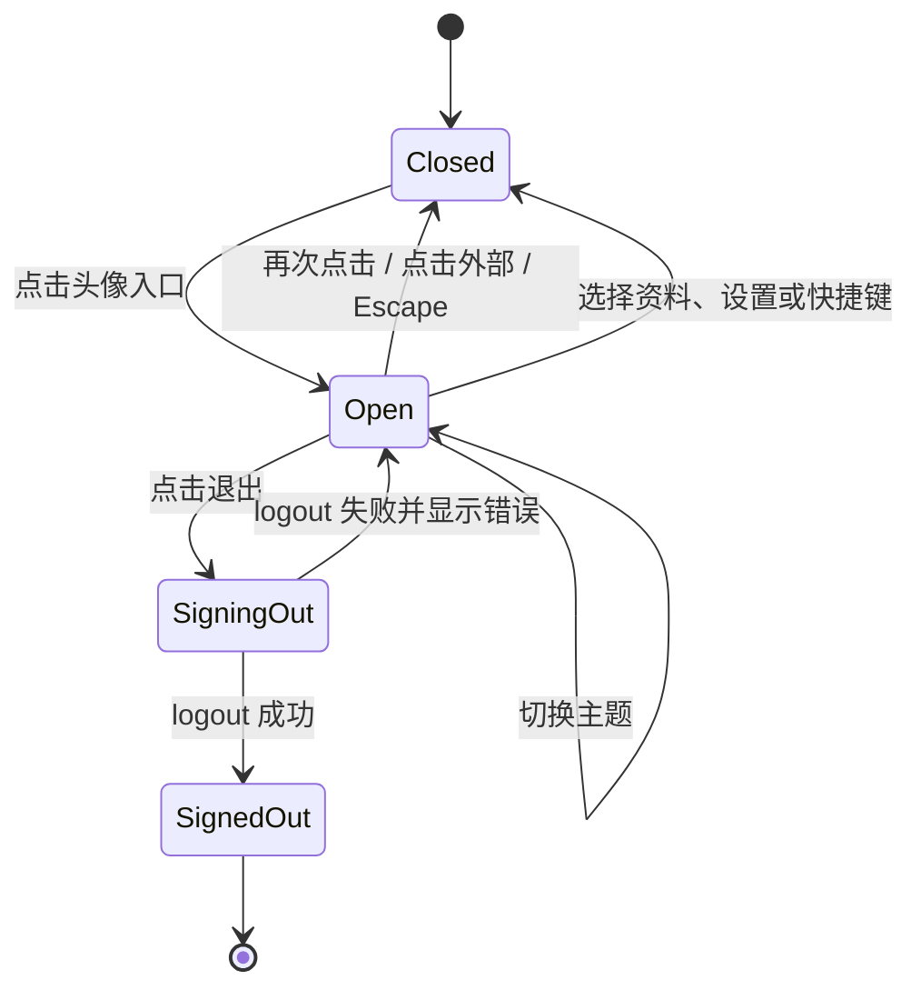

# 侧栏底部头像用户菜单复刻计划

版本：0.2 · 日期：2026-10-21 · 状态：正式 `/pm` 已实现并通过前端检查与真实浏览器验收；presence 点与 `?` 键帽按计划保留为有意差异

参考对象：`/data2-HDD-SATA-20T/Digital_avatar/haoweiyao/UI-package/gr8r-studio`（下称“参考站”）。
目标项目：本仓库正式服务前端 `/pm`。

本计划只复刻参考站左下方“头像 + 姓名”触发区和点击后出现的账户卡片。参考站的实现证据是源码与样式，不是运行截图；本计划中的视觉数值均来自下列文件，不把参考站的演示状态当成业务能力。

## 1. 目标与边界

### 1.1 目标

1. 在正式 `/pm` 工作区侧栏底部增加常驻用户入口：头像、姓名、展开指示。
2. 点击后在触发区上方打开账户卡片，包含：身份头、个人资料/账号设置入口、主题切换、键盘快捷键入口、退出登录。
3. 所有数据与动作使用现有真实来源：
   - 身份：`PmService.actor`（`id`、`name`、`email`）。
   - 头像：`GET /api/v1/workspaces/{workspaceId}/dashboard/personal` 返回的 `profile.avatarDataUrl`；未加载或未上传时使用姓名首字母。
   - 主题：现有 `useWorkspaceStore().theme` / `setTheme`，继续保存在当前浏览器。
   - 退出：现有 `PmService.logout()`。
4. 保持参考站的内容层级和克制材质，同时遵守本仓库的语义 Token、44px 触控目标和焦点规则。

### 1.2 非目标

- 不修改 `/lab/pm`。参考站的 Lab 是演示会话，退出、个人资料和账号设置没有真实语义；在 Lab 复制会制造假入口。
- 不新增后端接口、数据库字段或合同。头像读取复用现有个人工作台接口。
- 不伪造在线状态绿点。当前没有轻量、独立的本人 presence 读取；`TimeDashboard` 虽然包含 presence，但同时返回计时、工时和成员目录，不适合只为一个装饰点常驻请求。第一阶段不显示绿点。
- 不显示未绑定的键盘提示。参考卡片的“Keyboard shortcuts”右侧有 `?` 键帽；本项目的 `?` 仍未绑定（见 `settings-shortcuts.tsx`），因此卡片只保留入口，不显示 `?`。
- 不新增全局快捷键、不做账号切换、不做主题跨设备同步。

## 2. 参考实现拆解

### 2.1 触发区

参考文件：`src/shell/layout.js:154-158`。

```html
<button class="sitem" data-a="pop" data-pop="user" style="height:36px">
  <span class="av presence">TI</span>
  <span class="trunc">Tanjim Islam</span>
  <span class="ct">chevrons-up-down</span>
</button>
```

| 项 | 参考值 |
| --- | --- |
| 位置 | 侧栏最底部 `side-bot`，位于 Help、Settings 之后 |
| 行高 | 36px |
| 头像 | 22px 圆形首字母，右下角 30% 绿色在线点，外描边 2px surface |
| 姓名 | 13px 左右、500 字重，截断 |
| 右侧 | `chevrons-up-down` 13px，弱化色 |
| 折叠侧栏 | 只显示头像，悬停/无障碍名称“Profile” |
| 交互 | 点击打开/再次点击关闭；点击外部关闭 |

### 2.2 卡片内容

参考文件：`src/overlays/popovers.js:228-243`。卡片宽度 260px，按以下顺序渲染：

| 顺序 | 内容 | 参考行为 |
| --- | --- | --- |
| 1 | 36px 头像 + 姓名（600）+ 邮箱（12px、弱化、截断） | 纯展示 |
| 2 | 分隔线 | — |
| 3 | `View profile`（user 图标） | 跳到本人成员页 |
| 4 | `Account settings`（settings 图标） | 跳到设置的个人资料区 |
| 5 | 分隔线 | — |
| 6 | 小标题 `Theme` | 全大写、弱化、字间距 |
| 7 | 浅色 / 深色 / 跟随系统 三段选择器 | 立即改主题，卡片保持打开 |
| 8 | 分隔线 | — |
| 9 | `Keyboard shortcuts`（keyboard 图标）+ 右侧 `?` | 关闭卡片并打开快捷键帮助 |
| 10 | `Sign out`（log-out 图标） | 关闭卡片并退出 |

### 2.3 交互状态



参考站的卡片是 `position: fixed` 浮层，打开时优先向下 4px；空间不足时翻到触发区上方。本项目使用 Radix Popover 的碰撞检测，侧栏底部固定使用 `side="top"`，由 Radix 在窄视口/抽屉内自动调整。

### 2.4 视觉规格

参考样式：`src/styles/overlays.css:445-540`、`src/styles/components.css:404-430,611-668`、`src/styles/shell.css:241-244`。

| 角色 | 参考值 | 本项目映射 |
| --- | --- | --- |
| 卡片宽度 | 260px | `w-[260px]`，`max-w-[calc(100vw-16px)]` |
| 卡片内边距 | 4px | `p-1` |
| 卡片圆角 | `--r-lg` | `rounded-popover`（8px） |
| 卡片背景/边界 | `surface` + 1px 边界 | `bg-surface` + `border-border` |
| 卡片阴影 | `--shadow-pop` | `shadow-[var(--shadow-floating)]` |
| 身份头 | `8px 8px 10px`，gap 10 | 同值，头像 36px |
| 菜单行 | 最小 30px，左右 8px，gap 9 | 32px（触屏 44px），`rounded-control` |
| hover | `surface-2` | `hover:bg-surface-hover` |
| 小标题 | 11px 大写、0.06em、`text-3` | 12px（本项目元数据下限），`text-muted-foreground` |
| 分段控件 | `surface-3` 槽，选中 `surface` + 1px 边界 + 轻阴影 | `Segmented` / `SegmentedItem` + 现有 Token |
| 分隔线 | 1px，左右 -4px | 1px `bg-border`，左右 -4px |
| 动效 | 160ms 淡入 + 4px 位移 + 0.97 缩放 | 180ms `--motion-popover`，减少动效时由全局规则折叠 |

## 3. 当前项目差距与映射

| 参考能力 | 当前 `/pm` 现状 | 本计划决定 |
| --- | --- | --- |
| 左下方头像入口 | 无；侧栏底部只有连接状态和说明文字 | 新增 |
| 身份头姓名/邮箱 | 工具栏显示 `actor.name`；邮箱不在壳层展示 | 姓名用 `actor.name`，资料加载后优先 `profile.name`；邮箱用 `actor.email` |
| 头像图片 | `Avatar` 支持图片，成员页/个人资料已使用 | 卡片打开时懒加载个人工作台资料；失败/未上传时首字母 |
| 在线状态点 | `TimeDashboard` 有真实 presence；`PersonalDashboard` 没有 | 第一阶段不加点，避免无意义的重请求或假状态 |
| View profile | 成员页有“本人资料”对话框，但没有深链 | 增加 `?profile=me`，从卡片直接打开本人资料对话框 |
| Account settings | 已有 `/settings/profile` | 直接链接 |
| Theme | 已有三态主题和浏览器持久化 | 复用 `Segmented`，调用 `setTheme` |
| Keyboard shortcuts | 已有 `/settings/shortcuts` 说明页；`?` 未绑定 | 链接到说明页；不显示 `?` 键帽 |
| Sign out | 工具栏文字按钮；服务首页登录后也有退出 | 移入用户卡片，保留服务首页退出；失败在卡片内提示 |
| 折叠侧栏 | `WorkspaceShell` 支持折叠到 56px | 用 `workspace-navigation` 容器查询隐藏姓名/箭头 |
| 移动端 | 侧栏变为 Dialog 抽屉 | 卡片通过现有 `ThemePortalScope` 进入抽屉 DOM，验证不被 inert/裁切 |

## 4. 实施方案

### Phase 0：基线与决策

- 确认只改正式 `/pm`；`/lab/pm` 不动。
- 确认不新增后端合同；头像使用现有 `usePersonalDashboard()`，仅在卡片挂载时请求，失败回退首字母。
- 确认不伪造 presence，不显示未绑定的 `?` 键帽。
- 基线检查：记录 `pnpm services:status`、当前 `/pm` 侧栏截图和 390px 抽屉状态，避免与并行修改冲突。

### Phase 1：头像与用户菜单组件

新增：

- `apps/web/src/features/pm/service/pm-user-menu.tsx`
- `apps/web/src/features/pm/service/pm-user-menu.module.css`

组件职责：

```tsx
export function PmUserMenu() {
  const { actor, workspace, logout } = usePmService()
  const navigate = useNavigate()
  const { theme, setTheme } = useWorkspaceStore(state => state)
  const t = useText()
  // ...
}
```

结构：

```tsx
<Popover>
  <PopoverTrigger render={<button className={styles.trigger} aria-label={...} title={...} />}>
    <Avatar name={actor.name} src={avatarDataUrl} size={24} />
    <span className={styles.name}>{displayName}</span>
    <ChevronsUpDown aria-hidden="true" />
  </PopoverTrigger>
  <PopoverContent side="top" align="start" sideOffset={8} className={styles.card}>
    <PopoverTitle className="sr-only">{t("账户菜单", "Account menu")}</PopoverTitle>
    <div className={styles.identity}>
      <Avatar name={displayName} src={avatarDataUrl} size={36} />
      <div className={styles.identityText}>
        <span className={styles.displayName}>{displayName}</span>
        <span className={styles.email} title={actor.email}>{actor.email}</span>
      </div>
    </div>
    <div className={styles.separator} />
    <Link className={styles.item} to={`/pm/${workspace.id}/members?profile=me`}>
      <UserRound aria-hidden="true" />{t("查看个人资料", "View profile")}
    </Link>
    <Link className={styles.item} to={`/pm/${workspace.id}/settings/profile`}>
      <SettingsIcon aria-hidden="true" />{t("账号设置", "Account settings")}
    </Link>
    <div className={styles.separator} />
    <div className={styles.sectionLabel}>{t("主题", "Theme")}</div>
    <Segmented className={styles.theme} value={theme} onValueChange={setTheme} aria-label={t("主题", "Theme")}>
      <SegmentedItem value="light" className={styles.themeItem}><Sun />{t("浅色", "Light")}</SegmentedItem>
      <SegmentedItem value="dark" className={styles.themeItem}><Moon />{t("深色", "Dark")}</SegmentedItem>
      <SegmentedItem value="system" className={styles.themeItem}><Monitor />{t("跟随系统", "System")}</SegmentedItem>
    </Segmented>
    <div className={styles.separator} />
    <Link className={styles.item} to={`/pm/${workspace.id}/settings/shortcuts`}>
      <Keyboard aria-hidden="true" />{t("键盘快捷键", "Keyboard shortcuts")}
    </Link>
    <button type="button" className={styles.item} disabled={signingOut} onClick={signOut}>
      <LogOut aria-hidden="true" />{signingOut ? t("正在退出…", "Signing out…") : t("退出登录", "Sign out")}
    </button>
    {logoutError && <p role="alert" className={styles.error}>{logoutError}</p>}
  </PopoverContent>
</Popover>
```

数据与失败规则：

- `usePersonalDashboard()` 只在 `PopoverContent` 挂载时执行；TanStack Query 在同一工作区缓存结果，重复打开不重复请求。
- `displayName = profile?.profile.name ?? actor.name`；`email = actor.email`。
- `avatarDataUrl = profile?.profile.avatarDataUrl ?? undefined`。仅使用服务返回的 data URL，不接受外部 URL。
- 资料读取失败不显示阻断页，也不把头像替换成他人；保持姓名首字母，卡片其他功能仍可用。
- `workspace` 为空时隐藏“查看个人资料”和“账号设置”，避免死链；身份头、主题、快捷键、退出仍可用。

退出规则：

- 点击后设置 `signingOut`，调用 `logout()`。
- 成功：`navigate("/pm")`，卡片随页面卸载。
- 失败：保持卡片打开，`role="alert"` 显示现有错误文案；不重试、不假装已退出。
- 不在卡片外重复显示退出错误。

头像尺寸：

- 扩展 `apps/web/src/components/ui/avatar.tsx` 的 `size` 类型到 `20 | 24 | 32 | 36 | 40`，卡片头部使用 36；触发区使用 24。不新增颜色字段，颜色继续沿用现有中性表面。

样式要点：

- 触发区：`display:flex; width:100%; min-height:36px; padding:0 8px; gap:8px; border-radius:var(--control-radius); color:var(--foreground)`；hover `background:var(--surface-hover)`；焦点环由全局 `:focus-visible` 提供。
- 姓名：13px/20px、500，`min-width:0; overflow:hidden; text-overflow:ellipsis; white-space:nowrap`。
- 箭头：13px，`color:var(--text-muted)`，`margin-left:auto`。
- 折叠：`.trigger { justify-content:center; padding-inline:4px }`；`@container workspace-navigation (max-width:120px) { .name, .chevron { display:none } }`。
- 卡片：260px；`max-width:calc(100vw - 16px)`；`padding:4px`；`border:1px solid var(--border)`；`border-radius:var(--radius-popover-value)`；`background:var(--surface)`；`box-shadow:var(--shadow-floating)`。
- 菜单行：`min-height:32px; padding:0 8px; gap:9px; border-radius:var(--control-radius); font-size:14px`；触屏 `min-height:44px`；图标 15px，弱化色。
- 分隔线：`height:1px; margin:4px -4px; background:var(--border)`。
- 小标题：12px、600、大写、`letter-spacing:.06em`、`color:var(--text-muted)`、`padding:8px 8px 4px`。
- 主题槽：`display:flex; width:100%; padding:2px; gap:2px; border-radius:var(--control-radius); background:var(--surface-raised)`；选项 `flex:1; height:28px; justify-content:center; font-size:12px`；选中 `background:var(--surface); box-shadow:0 0 0 1px var(--border)`。
- 进入动效：`.card[data-state="open"] { animation: userMenuIn var(--motion-popover) var(--motion-ease-out) both }`；`@keyframes` 使用 4px 位移 + 0.98 缩放；`prefers-reduced-motion` 由 `index.css` 全局折叠。

### Phase 2：接入正式工作区外壳

修改：`apps/web/src/features/pm/pm-shell.tsx`。

1. 侧栏底部改为固定区：
   - 内层导航滚动：工作区名称、导航链接、任务范围子链接。
   - 底部 `shrink-0 border-t` 区：现有连接状态/说明文字在上，`<PmUserMenu />` 在最下。
   - 保证 `nav` 使用 `flex h-full min-h-0 flex-col overflow-hidden p-3`，内容区 `min-h-0 flex-1 overflow-y-auto`，底部不随内容滚动。
2. 只在 `actor` 存在时渲染 `<PmUserMenu />`。
3. 移除工具栏中重复的 `actor.name` 和“退出”文字按钮（`pm-shell.tsx:505-507`），保留命令菜单、`Preferences` 和页面版本切换。
4. 服务首页（`isServiceHome`）的退出按钮与错误提示保留不动；本次只改变工作区壳层。
5. 桌面折叠、移动端 Dialog 抽屉都复用同一 `sidebar` 内容，不另写移动端菜单。

验收：侧栏底部入口在 256px、56px 折叠、200–360px 拖动宽度和 390px 抽屉下都可见；导航内容过长时只滚动列表，不把入口顶出视口。

### Phase 3：资料深链

修改：`apps/web/src/features/pm/service/pm-members.tsx`。

- 使用 `useSearchParams()` 的 setter 读取 `profile=me`。
- 当参数存在且成员目录已加载时打开现有“本人资料”对话框。
- 关闭对话框时用 `replace` 删除 `profile` 参数，避免返回键重新打开。
- 没有读取权限或目录失败时，不打开空对话框；保持现有 `ServiceGuard` 与禁用规则。
- 卡片链接：`/pm/${encodeURIComponent(workspace.id)}/members?profile=me`。

验收：直接访问该 URL 会打开本人资料对话框；关闭后 URL 恢复为 `/members`；刷新不会再次弹出；无权限用户看不到伪造内容。

### Phase 4：文档与证据

- 在本计划文档中追加实现结果与浏览器证据。
- 在 `docs/frontend-design-adoption.md` 第 5/6 节登记：新增侧栏底部用户菜单，复用语义 Token；presence 点与 `?` 键帽为有意差异；桌面/折叠/移动端证据。
- 在 `README.md` 的 `/pm` 能力行补充“侧栏账户菜单（资料、主题、快捷键、退出）”。
- 不修改领域设计、合同或后端文档。

## 5. 验收标准

### 5.1 功能

- [ ] 正式 `/pm` 任意工作区页面左下角显示头像、姓名、展开箭头。
- [ ] 点击打开卡片；再次点击、点击外部、按 Escape 关闭。
- [ ] 卡片出现在触发区上方，未被侧栏/视口裁切；窄屏由碰撞检测调整。
- [ ] 身份头显示真实姓名和邮箱；上传过头像时显示真实图片，否则显示姓名首字母。
- [ ] “查看个人资料”打开本人资料对话框；“账号设置”打开 `/settings/profile`。
- [ ] 三段主题立即生效，刷新后仍保持；选择“跟随系统”响应系统深浅色变化。
- [ ] “键盘快捷键”打开 `/settings/shortcuts`，卡片关闭；不显示未绑定的 `?`。
- [ ] “退出登录”成功回到 `/pm`；失败时卡片内显示错误且不假装成功。
- [ ] 工具栏不再重复显示姓名和退出按钮；服务首页退出路径不受影响。

### 5.2 布局与无障碍

- [ ] 触发区在折叠侧栏只显示头像，`aria-label`/`title` 仍可识别。
- [ ] 卡片有可访问名称；Tab 顺序为：资料 → 账号设置 → 主题组 → 快捷键 → 退出。
- [ ] 键盘焦点使用现有 2px 焦点环；关闭后焦点回到触发区。
- [ ] 触屏下菜单行和主题选项不小于 44px 可点击高度。
- [ ] `prefers-reduced-motion` 下不依赖位移动效传达状态。
- [ ] 390×844 抽屉内可打开卡片，无 `document.scrollWidth > clientWidth`，无 inert/焦点逃逸问题。

### 5.3 数据与边界

- [ ] 只请求已有个人工作台接口；打开卡片才请求，重复打开命中缓存。
- [ ] 资料接口失败时首字母回退，不显示他人头像、不阻塞退出/主题。
- [ ] 不显示假在线点；不新增未绑定快捷键。
- [ ] 没有工作区时隐藏资料/设置链接，不生成死链。
- [ ] 无后端、合同、数据库或 Markdown 工作区改动。

### 5.4 验证命令

```bash
pnpm check:docs
pnpm check:web
```

浏览器证据必须来自真实服务：现有 API/Worker 未启动时按 README 启动，不重复占用端口；记录浅色/深色、256px/56px、390px 抽屉、资料读取失败和退出失败场景。

## 6. 风险与回退

| 风险 | 影响 | 缓解 |
| --- | --- | --- |
| `usePersonalDashboard` 返回 notes/meetings 等多余字段 | 打开卡片时有一次较重请求 | 仅在卡片挂载时请求；后续如需优化，再评估轻量本人资料端点，不在本次改合同 |
| 侧栏改为内层滚动 | 长导航在矮视口可能双滚动 | `nav` 固定高度、内层单一 `overflow-y-auto`；在 480px 高视口实测 |
| 移动端 Popover 在 Dialog 内被 inert | 抽屉内卡片不可操作 | 现有 `DialogContent` 已提供 `ThemePortalScope`；实现后必须在 390px 实际点击验证 |
| 深链参数与草稿状态冲突 | 关闭后参数残留或返回键重开 | 关闭时 `setSearchParams(..., { replace: true })`；直接访问/刷新/返回键各测一次 |
| 退出失败无提示 | 用户误以为已退出 | 卡片内 `role="alert"` 显示现有错误；保持会话与页面 |
| 主题切换导致卡片关闭 | 与参考行为不一致 | `Segmented` 使用 `type="button"`，不触发 Popover 关闭；实测点击后卡片仍开 |

回退方式：删除 `pm-user-menu.tsx` / `pm-user-menu.module.css`，恢复 `pm-shell.tsx` 工具栏姓名与退出按钮，撤销 `pm-members.tsx` 的 `profile=me` 分支和 `avatar.tsx` 的 36px 尺寸。无数据迁移，无后端回退。

## 7. 实施清单

| 文件 | 操作 |
| --- | --- |
| `apps/web/src/features/pm/service/pm-user-menu.tsx` | 新增组件、数据读取、主题、退出 |
| `apps/web/src/features/pm/service/pm-user-menu.module.css` | 新增触发区与卡片样式 |
| `apps/web/src/features/pm/pm-shell.tsx` | 侧栏底部分区、接入组件、移除重复工具栏退出 |
| `apps/web/src/components/ui/avatar.tsx` | 增加 36px 尺寸 |
| `apps/web/src/features/pm/service/pm-members.tsx` | `profile=me` 深链打开本人资料 |
| `apps/web/src/features/pm/service/pm-service.tsx` | 为 `usePersonalDashboard` 增加可选 `enabled`，首次打开卡片前不请求 |
| `README.md` | `/pm` 能力行补充账户菜单 |
| `docs/frontend-design-adoption.md` | 登记采用范围、差异与证据 |
| 本文件 | 追加实现与验收结果 |

## 8. 实现与验收结果（2026-10-21）

### 8.1 已实现

- 新增 `PmUserMenu`：侧栏底部头像 + 姓名触发区，Radix Popover 向上打开 260px 账户卡片。
- 卡片内容：身份头、查看个人资料、账号设置、浅色/深色/跟随系统、键盘快捷键、退出登录。
- 头像在首次打开卡片时通过 `usePersonalDashboard(true)` 读取；未打开前不请求。读取失败或未上传时回退姓名首字母。
- “查看个人资料”使用 `/members?profile=me` 打开现有本人资料对话框；关闭时 `replace` 清除参数。
- “账号设置”链接 `/settings/profile`；“键盘快捷键”链接 `/settings/shortcuts`。
- 退出调用真实 `logout()`；失败时卡片内 `role="alert"` 显示错误并保留会话。
- 侧栏改为导航区独立滚动、底部状态与用户入口固定；移除工具栏重复的姓名和退出按钮。
- 折叠侧栏通过 `workspace-navigation` 容器查询只保留头像；移动端抽屉复用同一入口。
- `/lab/pm` 未修改；无后端、合同或数据库改动。

### 8.2 检查

| 检查 | 结果 |
| --- | --- |
| `pnpm check:docs` | 64 份 Markdown、27 步计划与领域引用通过 |
| `pnpm check:web` | ESLint、`tsc --noEmit`、Vite build 全部通过；仅保留既有大 chunk 提示 |
| 浏览器：桌面 1440×900 | 入口位于左下角；卡片 260×289，底边距触发区 8px；主题切换后卡片保持打开；Escape/外部点击关闭并交还焦点；资料深链打开本人资料对话框，关闭后 `profile` 参数清除；账号设置与快捷键路由正确 |
| 浏览器：折叠侧栏 | 姓名和箭头隐藏，仅头像；卡片仍可打开 |
| 浏览器：390×844 | 抽屉内卡片打开；`document.scrollWidth == innerWidth == 390` |
| 主题持久化 | 选深色后重载仍为深色；选浅色即时生效 |
| 懒加载 | `/settings/shortcuts` 载入后 `/dashboard/personal` 请求数为 0；打开卡片后为 1 次 `200` |
| 退出 | `POST /api/v1/auth/logout` 返回 200，跳转 `/pm` 登录页 |

### 8.3 保留差异

- 不显示参考站头像右下角在线绿点：当前无轻量本人 presence 来源，不用 `TimeDashboard` 的额外工作台查询冒充实装饰状态。
- “键盘快捷键”不显示 `?` 键帽：本项目尚未绑定该全局键，避免假提示。
- 头像查询复用 `PersonalDashboard`，会返回 notes/meetings 等本卡片不用的字段；仅在首次打开卡片时请求，后续命中缓存。若后续要求进一步减负，再评估独立本人资料端点，不在本次改合同。
