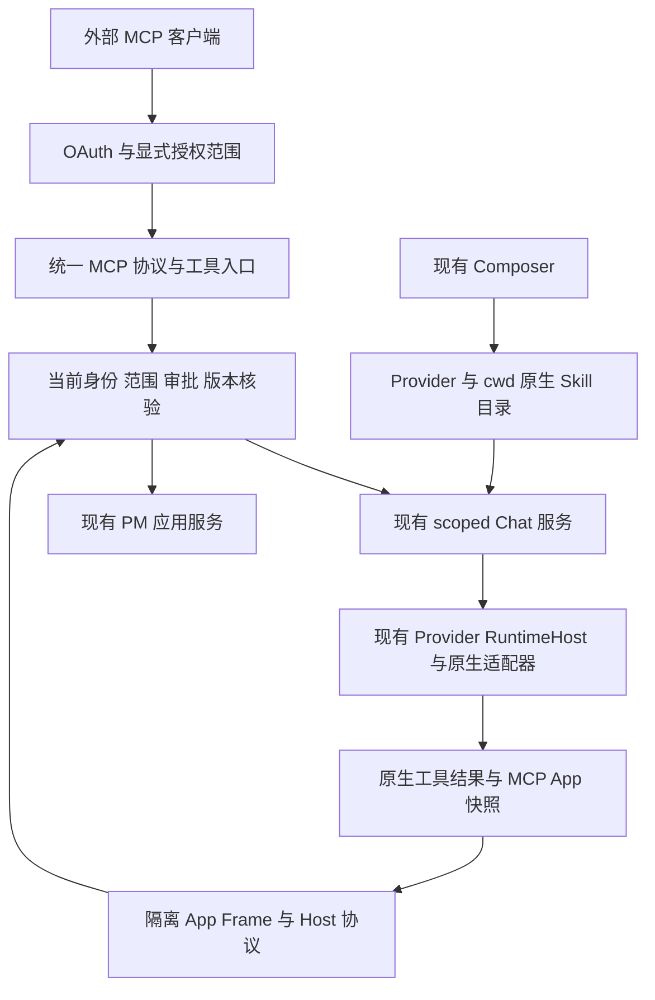

# t3code MCP / Skills 完整复制与宿主适配计划

日期：2026-11-03。目标项目：`project-management-agent-v4`。

状态：**已接受范围并完成本轮功能接线，正在主集成验收；不是全绿完成或生产发布声明。** 已先复制固定来源，再适配现有宿主；当前逐标准证据与剩余门槛见第10节。`draft:T*` / `draft:M*` 保留为本文局部计划编号，不是已创建的 PM 业务任务 ID；没有负责人容量或工期承诺。

## 1. 用户目标与完整性口径

本轮需求逐项保留：

1. 在本项目复刻上一轮调查的 MCP 与 Skill 能力，而不是只做 UI、类型或能编译的接口。
2. **先完整复制所有相关文件，再在复制文件上提取、适配。** 不先重写近似实现，再补来源说明。
3. 接入当前项目已有的 Provider、Chat、Composer、工具授权、输出、文件与持久化链路。
4. 明确最终可用功能、Provider 差异、验收标准和安全／产品边界。

“完整”指下列四条端到端链路：**对外 MCP 服务、向原生 Provider 注入应用工具、MCP Apps 交互、Provider Skills 发现与调用。** 不是迁入整个 t3code 产品，也不把源码附带的每一个业务工具、移动端、远程连接服务自动变成本项目需求。

完成条件：来源支持且本次范围内的行为均有本项目实际入口和运行证据；现有 PM 补丁阻断了某条上游支持的链路时，须解决授权与适配，不得把“当前未接通”改写为“上游不支持”。真实原生不支持的能力则准确声明不可用，不能以通用提示词、另一个 Provider 或假成功代替。

## 2. 已核对基线与现状

### 2.1 两个源码版本不能混为一个

- 用户指定目录：`/data2-HDD-SATA-20T/Digital_avatar/haoweiyao/t3code`。
- 实际 HEAD：`d53873b6a4799e87afd63c8d288ef0089f5a3748`；本次观察到该目录仅 `pnpm-lock.yaml` 有未提交修改。复制基线采用固定 commit 的原始文件，不能把工作区改动伪装成该 commit 内容。
- 本项目现有 vendor 基线：`30eb7e7bb1ef103fdd6f54081b6a4acf66b3ee4c`，另有 PM 适配补丁及本项目 OMP 实现。已通过 Git 祖先检查确认 `d53873b6a4` 是 `30eb7e7bb1` 的祖先。
- 因而**不能用指定目录整包覆盖当前 vendor**。先复制指定来源作为不可变输入，再与现有较新基线及宿主补丁逐文件比对；相同实现复用，冲突显式合并，不降级 Provider、认证、Usage 或自动化功能。
- 当前工作区有大量并行修改，尤其 README、Web 组件和 PM 文档源功能。实施保留无关修改；本计划及交付文档按本轮实际证据更新，不据此取得其他文件或生产服务的变更授权。

来源与既有约定：[Provider 模块移植计划](t3code-provider-module-migration-plan.zh.md)、[vendor 同步合同](../../vendor/t3code/SYNC.md)、[源码清单](../../vendor/t3code/source-manifest.json)。

### 2.2 不是从零建设

| 开工前观察到的实现 | 当时缺口 / 本轮处理（现状见第10节） | 代码证据 |
| --- | --- | --- |
| generation 级 PM 工具桥、stdio MCP、当前身份／scope／cwd 复核、破坏性工具审批 | 保留为权威工具执行路径；不能另建一条绕开审批的 MCP 写入口 | [pm-tools.ts](../../apps/server/agent/src/pm-tools.ts)、[runtime-host.ts](../../apps/server/agent/src/providers/t3code/runtime-host.ts)、[PM 工具路由](../../apps/server/pm/src/agent-tool-routes.ts) |
| Provider 原包已有 Skill 类型、原生发现、cwd 快照及部分原生调用适配 | PM 的公开 Provider DTO 和投影没有传出这些目录，Composer 缺少完整选择／刷新链路 | [Provider 合同](../../packages/agent-contracts/src/provider.ts)、[management.ts](../../apps/server/agent/src/providers/t3code/management.ts)、[上游 Skill schema](../../vendor/t3code/packages/contracts/src/server.ts) |
| Codex 已能捕获 MCP App HTML，注入 CSP，登记私有附件 | 当前输出仍主要串行化为文本；没有完整交互 frame、请求桥和模型上下文接线 | [mcp-app-snapshot.ts](../../apps/server/agent/src/providers/t3code/upstream-services/mcp-app-snapshot.ts)、[输出 UI](../../apps/web/src/features/agent/src/chat/output-timeline.tsx) |
| `WorkspaceSkill {id,name,instructions}` 已有会话内 CRUD／Agent 引用 | 这是保存的指令块，不是 Provider 原生 Skills；数据、ID、引用及既有功能保持，不混用 | [workspace.ts](../../packages/agent-contracts/src/workspace.ts)、[旧技能面板](../../apps/web/src/features/agent/src/workspace/skills-panel.tsx)、[指令组装](../../apps/web/src/features/agent/src/workspace/storage.ts) |
| PM Studio 已有执行级 MCP connectors；多类 Provider 已接原生运行时 | 各 Provider 注入方式和 unattended admission 有差异，不能按“支持 MCP”一个布尔值承诺全部能力 | [provider-tools.ts](../../apps/server/agent/src/automation-execution/provider-tools.ts)、[connectors.ts](../../apps/server/agent/src/automation-execution/connectors.ts) |
| 公共网关转发 PM API 和 `/agent/api/*` | 当前没有对外 `/mcp`、MCP OAuth 发现／同意／撤销与对应页面入口 | [gateway.ts](../../apps/server/gateway.ts) |

会话与持久化仍暂沿用 Agent Chat，**统一设计尚未收口**；本次仅增加功能必要的客户端授权、App 上下文等字段，不迁入 t3code 数据库或借此重建会话体系。

## 3. 最终交付的功能

以下为已接受的目标与验收口径；实现已接线，是否满足完整标准须以第10节的证据和缺口逐项判断。

| 编号 | 实现后用户能够做什么 | 必须保留的限制 |
| --- | --- | --- |
| F1 对外 MCP | 从连接设置复制本项目 `/mcp` 地址；支持 HTTP MCP 的外部 Agent 完成 OAuth 授权码／S256 接入；查看及撤销已授权客户端 | 默认只读；外部客户端不是浏览器登录账号，不取得通用 PM API／Agent API 凭据；公网可达性由部署环境提供 |
| F2 外部操作 Chat / PM | 在明确授予的工作区／项目／线程范围内，发现可用 Provider／模型、读取允许的项目与 Chat 信息，创建／发送／停止允许的 Chat；通过现有 PM 工具执行允许的业务动作 | 每个工具都需映射当前业务服务和权限；不全局枚举历史，不把取消当回滚，不绕过破坏性动作审批 |
| F3 原生 Agent 工具 | 现有 Provider 通过其原生 MCP／ACP／SDK／Host Tools 机制使用应用提供的已授权工具；保留现有 PM 与自动化工具链 | 只使用受信任的服务端绑定；单 transport 的 Provider 需正确复用入口，不虚构任意多 Server 支持 |
| F4 Skills 目录 | 随 Provider 实例及当前受核验的 cwd 展示原生 Skills、名称／描述／来源／可调用状态；刷新目录，区分加载、失败、空目录和陈旧快照 | 不能直接相信浏览器 cwd；未发现不等于没有；后台发现不得额外打开可执行 hooks／MCP／登录的原生会话 |
| F5 Skills 使用 | Composer 输入 `$` 搜索／选择；按来源支持在 `/` 菜单展示；插入引用并通过现有消息链调用，保留原生参数和调用限制 | 禁用及 `userInvocable:false` 不可从用户菜单调用；选中 Skill 不增加工具或 PM 权限 |
| F6 Skills 更新与旧数据 | 用户在 Provider 原生位置安装／修改 Skill 后刷新目录，必要时显式重启 Agent session；已有指令块继续可编辑使用 | 不新增跨 Provider Skill 安装／删除／启停平台；旧指令块不能冒充原生 `SKILL.md` 或被自动写入全局目录 |
| F7 MCP Apps | 支持该能力的 Provider 返回 App 时，在消息内显示隔离交互界面；完成协议初始化、工具结果通知、工具调用、资源读取、模型上下文更新、发消息、链接、下载、尺寸／全屏／关闭 | App 只能访问产生它的已核验 Server；交互不能隐式启动付费 turn、跨线程或提升权限；不支持的 Provider 保留可读工具结果 |
| F8 状态与连续性 | 全页 Chat 与 PM 内嵌 Chat 共用上述能力；工具错误、审批、拒绝、过期、撤销、session 停止、恢复及历史结果均有真实状态 | 不新增第二套 Chat runtime、登录体系或业务 Run；不兼容状态明确失效，不自动重放未知写入 |

现有四个仓库 PM 分析 Skill 纳入目录／调用验收样本。是否被某个 Provider 原生发现，取决于该 Provider 实际支持的目录和命名规则；不得仅因 `.agents/skills` 存在就声明所有 Provider 已加载，也不暗中复制到用户全局 Skill 目录。

### 3.1 “完整接口”与“完整 t3code 工具产品”的边界

所有相关 Toolkit 源码都复制、建账；**复制不等于自动注册为可调用工具**。注册目录必须来自已完成的宿主映射，并同时提供逐项能力说明。下列业务语义不能因同名而直接照搬：

| 上游工具族 | 本项目接入策略 |
| --- | --- |
| Provider / 模型能力、项目读取、thread 读取／创建／发送／停止 | 本轮必须接入已有 PM 目录册及 scoped Chat 服务，覆盖 F2；PM Project 与 t3 repository project 的 ID／路径显式映射 |
| PM 普通读写与受保护动作 | 统一进入现有 PM 工具权威；新传输不得跳过 `pending_approval`、revision、operationId 和原收据 |
| 上游 delegation、task status/cancel、批量建 thread | 源码和依赖完整留存；当前 fork 不等于完整委派平台。本轮不新建 t3 Orchestrator；未映射的方法不发布，不以占位工具返回假成功 |
| 上游 scheduler / environment preferences | 只映射本项目已有、相同语义且已授权的服务；没有等价能力的部分不发布，不重新启用无 PM 主体约束的旧 scheduler |
| Preview 浏览器自动化、Device、HTML 渲染、Worktree / PR 写工具 | 保留来源和依赖；本次不新建完整浏览器自动化／设备／通用 worktree 产品。已有隔离 App preview 或交付 worktree 不是上游全能力的等价替代，不能冒充已复刻 |

因此最终可以声明“四条 MCP／Skills 接入链路完整”，**不能声明 t3code 全部业务工具、设备、浏览器与跨 Provider 委派产品已完整复制上线**。若目标包含这些产品本身，须另行扩大范围和验收；本计划不把它们藏入 MCP 接入的技术依赖。

## 4. 先复制、后适配的强制流程

### 4.1 两层目录及单一生产实现

1. 原始复制输入建议保存到 `.ref/t3code-mcp-skills/<完整commit>/`，保持来源相对路径和原始字节；此目录已被本仓忽略，只作本地来源快照，不加入 workspace、不编译、不供运行时读取。
2. 原始文件的版本、SHA-256、Git blob、字节数、模式、依赖、许可证及出处写入可提交的功能来源清单；原始副本可离线重建，不依赖开发机绝对路径。
3. 生产实现继续使用 `vendor/t3code/`，宿主适配进入当前 `apps/server/agent`、`packages/agent-*` 与现有 Web。**不能同时创建第二套可执行 t3code MCP／Provider 包。**
4. 指定来源与现有 `30eb...` 文件相同：记录已复制、比对后复用；不同：记录版本选择及 PM 适配差异。缺失模块从已复制源码引入；现有较新实现不被旧文件直接覆盖。
5. 当前同步工具按单一固定 commit 校验。新增来源必须显式扩展来源记录／确定性配方，或为新增来源提供独立校验记录；不能只改一个 commit 字符串让旧哈希看似有效。
6. 发布包只包含实际使用的一份生产实现及许可证／来源记录；不带 `.ref`、测试凭据、来源 `.git` 或上游运行数据。

### 4.2 必须完整复制的源文件组

下表路径相对用户指定 t3code。它是种子清单，不是已完成的精确文件 manifest；精确闭包由 `draft:T1` 在实施前产出，**不得先猜一个文件数作为完成标准**。

| 组 | 原始文件范围 | 在副本上提取／适配的职责 |
| --- | --- | --- |
| C1 MCP Server | `apps/server/src/mcp/**`，含所有 Toolkit、Context、Access、SessionRegistry、HTTP、stdio bridge、broker、测试及 fixtures | 复用协议和工具注册／访问检查结构；业务服务接 PM／Chat，非等价功能只保留来源，不生产注册 |
| C2 MCP OAuth / 客户端 | `apps/server/src/auth/McpOAuth.ts`、`mcpOAuthHttp.ts`、`mcpOAuthHtml.ts`，以及实际引用的 auth/session/secret/policy、客户端管理和授权页面闭包、测试 | 保留协议校验；身份、同意、会话、撤销与 issuer 接本项目，不能复制一套环境账号体系 |
| C3 MCP Apps 服务端 | `apps/server/src/mcpApps/**`、App 附件／资源访问／上下文存储相关实现、迁移参考及测试 | 生产项与 Server 绑定、资源快照、受限读取／调用、上下文替换／清除；存储映射现有 Agent SQLite |
| C4 共享合同和纯逻辑 | `packages/contracts` 中 MCP／auth／server／provider／RPC 相关文件、`packages/shared` 中 `mcpApp`、`mcpResponsePayloads`、`inlineSkills`、`composerInlineTokens`、tool output／presentation 及其依赖／测试 | 保留原始结构与字段语义，对接本项目公开 DTO；不为引入类型启动外来业务模块 |
| C5 Provider / 协议 | 完整相关 `provider-core`、原生 Provider 包、`effect-acp`、`effect-codex-app-server`，以及包外 Codex／Claude／Antigravity 的 Skill 发现、分派、MCP Adapter 与测试闭包 | 先与已有完整原包比对，复用原生发现／调用，必要时适配现有 Host 授权；不重写每家协议 |
| C6 客户端 runtime | `packages/client-runtime/src/providerSkills.ts`、`mcpApps/**`、`state/mcpApps.ts` 及选中模块的实际依赖／测试 | 抽取目录过滤、cwd 选择、App host 协议与通信；传输换成现有客户端，不引入完整多环境 Atom/WS 系统 |
| C7 Web | `providerSkillSearch`、`SkillInlineText`、`McpAppFrame`、`useProviderWorkspaceSnapshotRefresh`、`ChatComposer`、相关 menu/editor/timeline、`state/mcpApps`、授权／连接页面及其依赖／测试／样式资源 | **先复制完整源文件**，再在副本中提取接入现有 assistant-ui Composer、消息时间线与设置页；不替换现有前端 |
| C8 构建、文档和测试支持 | 对应 package manifests、固定 commit 原始 lockfile、生成 schema／资源、相关补丁、许可证、MCP／Composer／Provider 用户文档和行为 fixtures | 提供离线重建、版本兼容、行为对照与分发依据；不复制源项目账号、Home、数据库、日志或实际环境文件 |

闭包检查必须覆盖静态 import/export、类型导入、字面量 dynamic import、`createRequire`、`import.meta.url` 资源、worker／扩展生成文件、样式、协议代码及测试 fixtures。运行时计算路径单独登记，不因 AST 没有发现就视作没有依赖。

每个闭包文件只有明确一种处置：**原样生产复用、带可重建补丁生产适配、宿主服务替代、仅原始来源／测试参考**。后两类须写明原因和消费者，不允许无解释漏文件。外来完整 Orchestrator／数据库依赖可以作为原始参考复制，但不得因此启动第二套事实源。

**复制门槛：** 原始副本哈希、闭包、许可及版本比对全部签收后，才开始提取、删减或改接生产实现。提取必须在本仓副本进行，不修改来源仓库，不以 symlink 或开发机绝对 import 充当复制。

## 5. 宿主合同与安全边界

### 5.1 责任分层



### 5.2 开工前冻结的接口约定

- **身份与授权：** 新的 MCP 客户端凭据是传输委托，不是新业务角色。绑定批准人、允许的工作区／项目／线程及权限上限；每次读取、发消息、调用工具时取当前 PM 权限交集。外部 token 只在 `/mcp` 使用，不能用于普通 PM／Agent HTTP／WS 接口。
- **OAuth：** 复用授权码／S256、注册与重定向校验、发现元数据、一次性 code、过期／撤销行为；不自行加源实现没有的 refresh-token grant。批准必须来自真实 PM 登录主体；不以共享 Agent access cookie、自动化 grant 或 Provider 凭据冒充个人批准。issuer 与代理信任配置明确，不能盲信任任意 Host／Forwarded。
- **外部 Chat 访问：** 现有 Chat 未完成多成员所有权统一设计。默认只交付本机单操作者模式，且客户端只读显式授予／本客户端创建的 thread 集合；不能仅因同一项目就枚举全部历史。无 scope 旧历史不猜归属。多用户公网开放不在本次就绪声明内。
- **工具执行权威：** 复用并必要时提取现有 PM 工具审批／执行服务，供原生 MCP、外部 MCP、MCP Apps 共用；不能直接调用更低层 `/agent-tools/call` 而跳过 Agent 的破坏性审批。Full access 是上限，不是所有动作自动批准；readOnlyHint、App UI 确认、Skill frontmatter 都不是授权。
- **Provider 目录：** 对外 DTO 增加原生 Skills、commands、cwd 快照与可用状态；cwd 由 PM scope resolve 得到，不接受浏览器任意绝对目录。失效实例／配置变更／切换项目使旧目录不能误用，刷新失败不冒充空目录。
- **Skill 语义：** 直接复用原生发现与 dispatch；保留 Claude 单次最后一个 Skill 原生展开、OpenCode 2 结构化 IDs、ACP 等其他来源的差异。`path` 可能是虚拟 URI，不总是可读 `SKILL.md`；不提供任意路径读取／编辑 API。
- **Provider 工具绑定：** 保留 generation / instance / thread / executionId 生命周期和 `deny-ungranted`。技术性标题、压缩、只读 PM 分析不能因接入 MCP／Skills 意外获得 native hooks、plugins、MCP 或工具权限。
- **App 请求：** 从持久化的产生项解析 Provider／Server／session，不相信 iframe 提供的 Server；只在支持且有效的现有 session 请求，不为打开 App 新启动模型。跨 Server、跨 thread、stopped session、撤权与陈旧 item 必须拒绝。
- **App 内容与资产：** HTML 只从私有登记资产按权限读取；保留 CSP、sandbox、来源窗口校验、导航失效、消息／并发／下载大小边界和 teardown。不得加 `allow-same-origin` 来绕过集成问题；App 不能取得 PM Cookie、OAuth／Provider token 或任意主机文件。
- **模型上下文：** App context 采用按产生项／会话的替换和清除语义，携带范围／版本，不把旧上下文重复追加；在既有 Agent SQLite 增加必要记录，撤权后不继续发给模型。
- **写入恢复：** operationId、参数摘要、当前 revision、审批和原收据沿用现有约定；网络断开与取消不能触发自动重复写入，不把 unknown 当失败重派。遵守现行 INV-03、INV-08、INV-09、INV-13、INV-14、INV-15、INV-20 的相关语义；完成及跨项目规则以已采纳 ADR／现行应用服务为准，不恢复历史规则。

参照：[当前交互矩阵](agent-pm-interaction-matrix.zh.md)、[业务不变量](../domain-design/invariants.md)、[已采纳 Markdown ADR](markdown-integration-adr.zh.md)。

## 6. 分阶段候选任务

下表保留接受时的任务分解及验收门槛，执行状态以第10节为准。原包已复制不等于本轮已验收；来源测试通过也不能代替宿主链路。

| 候选编号 | 目标／成果与范围（含非目标） | 验收 | 前置依赖 | 来源 | 待确认项／门槛 |
| --- | --- | --- | --- | --- | --- |
| draft:T1 | 固定来源、AST／资源／测试闭包、双版本差异、精确复制清单、逐 Toolkit 能力账；不改变生产代码 | 每个相关文件／工具有处置；无漏依赖、降级覆盖或伪造原始哈希 | 无 | 第2、4节 | 实施前重新观察实际修改，冲突保留用户文件 |
| draft:T2 | 冻结第5节合同、公开 DTO／端点、PM 身份同意与 token audience、App 上下文存储、Provider 支持矩阵及文件所有权；不新建权限体系 | 每个调用方有确定的输入输出／拒绝／unknown 行为；无全局 Chat 访问捷径 | 无 | 第2、3、5节 | 原生账号、TLS／外网等实际环境前提登记，不推测就绪 |
| draft:T3 | 按 T1 复制全部相关原始源码／文档／资源／测试，记录许可证、hash 与依赖版本；不在复制阶段开始改代码 | 原始副本逐文件一致、离线可重建；与现有 vendor 的复用／冲突表完整 | T1、T2 | C1—C8 | 本阶段全量复制签收后才进入适配 |
| draft:T4 | 从副本接入共享合同、纯逻辑、协议／App host 和依赖；保留 Node24／现有 Effect 与 workspace 约定 | 本仓独立解析／构建；无外部源码路径；无第二份 Effect 身份和完整外来 state runtime | T3 | C4—C6 | 不通过整体升级 Node／pnpm／React 规避适配 |
| draft:T5 | 接通 Provider Skills／commands 的公开 DTO、服务端 scope→cwd 刷新、快照缓存和配置失效 | 项目／实例切换不串目录；enabled／invocable／失败／陈旧状态保真；未接支持不假报 | T4 | C4—C6 | 复用原生扫描器；不编写通用文件插件引擎 |
| draft:T6 | 从完整 Web 副本提取 Skill 搜索、`$`／`/` 菜单、chip、刷新及显式 session restart 到当前 Composer | 全页／PM 内嵌、键盘／IME／窄屏、实际 Provider 调用可观察；旧指令块功能不丢 | T5 | C7 | 不替换 assistant-ui、不恢复旧整站 UI |
| draft:T7 | 适配统一内部 MCP 注册／注入和共用工具权威；保持现有 PM／自动化 transport 与审批 | 各原生家族调用现有工具、拒绝／撤销／取消正确；来源支持的适配缺口修复；技术无工具路径无扩权 | T4 | C1、C5 | 单 transport／Host Tools Provider 在原生机制内接通，不能统一假报 |
| draft:T8 | 适配 OAuth、客户端同意／范围／管理／撤销、网关发现及 `/mcp` 路由与页面 | 真正标准客户端可注册／授权／初始化；只读默认、错误重定向／code重用／过期／撤销／跨 audience 拒绝 | T4 | C1、C2、C4、C7 | 独立绑定 PM 主体，不复用共享 token 代表成员 |
| draft:T9 | MCP 工具外观接当前 scoped Chat、PM 项目与工具服务；只注册本轮能力目录 | 外部客户端发现模型、读授权对象、建／发／停允许的 Chat；写入走同一审批和收据，越界无副作用 | T7、T8 | C1、第3.1节 | 不把 fork／preview／旧 scheduler 冒充全上游工具 |
| draft:T10 | 适配 MCP Apps 请求、产生项解析、私有资产、Provider live session、上下文持久化 | 正常调用／读资源／替换清除上下文成立；跨源／停止／撤权拒绝；不隐式新起模型 | T4 | C3—C6 | SQLite 只加必要字段，历史字符串输出仍可读 |
| draft:T11 | 接入隔离 App Frame、host bridge、工具确认／发消息／链接／下载、主题／尺寸／全屏／关闭 | 实际 iframe 与真实 MCP App 协议交互；CSP／sandbox／来源／导航失效有效；全页与内嵌共用 | T10 | C6、C7 | 不能用截图或静态 HTML 冒充活交互 |
| draft:T12 | 完成所有生产调用点切换与历史连续性、备份／恢复映射；移除被替代的重复实现 | 现有实例／消息／指令块／原生游标／工具收据保持；无双写、旧驱动 fallback 或无 scope 猜归属 | T6、T7、T9、T11 | 当前 Chat 合同、第5节 | 不迁入 t3 数据库，不重设计统一会话所有权 |
| draft:T13 | 扩展已有来源清单、确定性补丁、离线同步与打包闭包；验证单一生产实现可独立部署 | 同源重复导入无差异，冲突拒绝；移动构建产物后无源目录依赖；许可及新增 worker／扩展资源完整 | T6、T7、T9、T11 | C8、现有 SYNC | 新来源须显式校验，不能破坏现有30eb记录 |
| draft:T14 | 主集成执行第8节全链路／安全／逐 Provider 验收并形成证据账 | 源码、协议、真实账号、UI、发布状态分别记录；未执行／跳过不算通过；范围内缺口未完成不得封板 | T12、T13 | F1—F8、第8节 | 真实 Provider／平台／额度缺失明确阻塞对应格 |
| draft:T15 | 发布准备与本副本受控发布、发布后核对和可回退构建／相容数据快照 | 检查 PID／cwd／活跃运行和备份；仅变更本仓所需服务；真实公共入口复验 | T14 | 当前部署合同 | 计划不是启动／重启／commit／push 授权 |

### 6.1 里程碑与依赖

- `draft:M0`：T1、T2 签收，范围、来源及宿主合同固定。
- `draft:M1`：T3 全量原始复制签收；在此之前不修改生产实现。
- `draft:M2`：T4 公共接入可运行，随后可并行三条功能线。
- `draft:M3`：T5/T6 Skills、T7/T8/T9 MCP、T10/T11 Apps 均完成真实接线。
- `draft:M4`：T12/T13 完成数据连续性、单一实现及可重建性。
- `draft:M5`：T14 全部必需验收格有证据；缺失项不能静默移出。
- `draft:M6`：T15 获授权执行后完成实际发布核对；未发布时源码交付与运行实例分开标识。

`A depends_on B` 表示先完成 B：

```text
draft:T3 depends_on draft:T1,draft:T2
draft:T4 depends_on draft:T3
draft:T5 depends_on draft:T4
draft:T6 depends_on draft:T5
draft:T7 depends_on draft:T4
draft:T8 depends_on draft:T4
draft:T9 depends_on draft:T7,draft:T8
draft:T10 depends_on draft:T4
draft:T11 depends_on draft:T10
draft:T12 depends_on draft:T6,draft:T7,draft:T9,draft:T11
draft:T13 depends_on draft:T6,draft:T7,draft:T9,draft:T11
draft:T14 depends_on draft:T12,draft:T13
draft:T15 depends_on draft:T14
```

### 6.2 并行实施与唯一所有权

- 主集成者拥有顶层设计、共享合同、公共注册、网关／主路由、workspace／锁文件／构建、来源清单整合、数据库迁移整合与最终验收；不委托多个切片各自决定权限。
- T1/T2 的独立调查可并行；T3 是共同前置，不能边复制边猜接口。
- T4 完成后，Skills 后端、内部 MCP、外部 OAuth、Apps 后端可按文件所有权并行；各 UI 切片等其真实 DTO／请求合同固定后接线，不写 mock façade 占位。
- Composer 与消息时间线可能共享父组件，须由一名 Web 集成者合入共享改动；不让两个切片同时修改同一入口。
- 独立原生家族的适配在共享 Host 合同稳定后同批开展。当前只剩一项可执行工作时由主线程推进，不制造机械子代理。
- 实施代理不在共享工作树中途运行 build/lint/tests/formatters、安装依赖或重启服务；主集成在整合后执行相应检查。

## 7. Provider 验收矩阵的规则

必须逐一登记 Codex、Claude、Cursor、Grok、FX、OpenCode 1/2、Antigravity、Muse、Pi、ACP Registry，以及本项目新增的 OMP。不能只验证一家后宣称所有家族可用。

每行至少有：原生版本／模式、Skill 发现、用户可调用性、实际 Skill dispatch、内部工具注入、MCP Apps、普通 Chat／取消／续聊、当前 PM 拒绝行为、真实账号验证状态。

- Codex：验证 cwd 原生 `skills/list`、文本 mention、MCP 结果与 App 完整链路。
- Claude：验证原生目录／插件及 frontmatter；最后一个 Skill 的原生展开与较早 user-only Skill 的来源语义；修复审批衔接而不是放行全部 `mcp__*`。
- OpenCode：区分 1.x 文本／命令语义和 2.x 结构化 Skill IDs；验证单 host transport、多 thread 隔离及外部服务归属。
- Cursor／Pi／Muse／ACP 家族：按来源实际 MCP／Host Tools／扩展机制接入，保留各自命令与 Skill 解释方式，不能以一个通用适配器假装完全相同。
- OMP：已有原生发现，但发现不等于可调用；来源 t3code 没有该驱动，不以其他 Provider 代调用。保留原生不支持的明确限制；支持矩阵若发现本项目可接能力则完成真实适配，不能凭现有 `supportsMcpTools` 推断支持 MCP Apps。
- 任一上游／原生确定不支持的格注明依据与用户行为；账号／设备／额度缺失标“未实测／阻塞”，不能标“原生不支持”。

## 8. 验收与证据

### 8.1 复制及可重建

- 原始文件、完整依赖／资源／测试、固定 commit、哈希、许可逐项一致；离线重建不读上游 Home 或运行数据。
- `d538...`、`30eb...` 与 PM 补丁来源可区分；目标有未知改动时拒绝覆盖。
- 生产 artifact 从无源码目录的独立 cwd 启动，新增扩展／worker／静态资源可读，不加载 `.ref` 或开发机绝对路径。

### 8.2 外部 MCP 真正可用

- 在临时端口，用真实标准 MCP 客户端完成 OAuth 发现、注册、用户批准、授权码交换、initialize、tools/list、允许的 tools/call、session 终止与撤销。
- 实际读回授权项目／Chat；创建／发送／停止 Chat 通过既有运行时，历史可重读，停止不声称撤销已完成动作。
- read-only 对直接写工具和“先发 Chat 再让 Agent 写”的间接路径都不能获得超出上限的权限。
- 错误 audience、假 scope、跨 workspace/thread、code 重用／过期、客户端撤销、原批准人撤权、假代理 Host、未知写入／丢响应均覆盖；不得产生越权副作用。
- 受保护 PM 动作只进入原审批；浏览器／外部客户端均不能批准自己发起的受保护动作。

### 8.3 Skills 真正被使用

- 两项目／两实例切换及目录更新后，菜单不会串数据；disabled／agent-only 不可被用户选择；加载失败与空集合有区别。
- 用临时原生 Skill 约束可观察的特定输出／行为，经真实 Provider 触发并验证行为，不以名称出现在菜单或响应非空作为成功。
- 验证参数、多个 mentions、未知名称、重复命名优先级、虚拟 URI、原生不支持状态，以及已有四个 PM Skill 的实际可用组合。
- 技术无工具生成不会因 Skill 发现或 prompt 解释启动 MCP／hooks／plugins；旧指令块保存、引用、fork 和历史不丢。

### 8.4 MCP Apps 真正交互

- 使用实际 MCP Server／App HTML／协议，完成初始化、工具输入／结果展示、一次读资源、一次允许的工具交互及一次明确拒绝；用浏览器观察真实 frame，不能拦截成静态样例。
- 替换／清除模型上下文后，下一轮只收到当前授权内容；刷新／历史／session 停止按真实状态恢复，不自发运行模型。
- 同时验证 server 伪造、跨 item/thread、CSP／sandbox、伪造 postMessage、导航后调用、重复销毁、下载／链接确认及拒绝；不支持的 Provider 显示真实工具结果和限制。
- 桌面与390px窄屏、PM内嵌与独立Chat、主题、键盘与关闭／全屏均从实际页面操作。

### 8.5 工程与发布

- 受影响 lint、类型检查、合同检查、Agent／Web 构建、既有受影响行为测试和 `pnpm check:docs`。
- 数据库、事务或持久流变更执行 `pnpm test:backend`，其中跳过不算通过；测试失败按归属登记，不掩盖不相关并行修改。
- 先运行功能场景，观测真实 HTTP／MCP／Provider／UI 和数据库／文件结果；测试通过不能代替运行证明。永久测试只保留可捕获真实边界／状态／错误的消费者行为，不测试复制文本、纯转发或源码形状。
- 证据账分开记录：来源复制、协议／受控子进程、真实 Provider 账号、浏览器、独立打包、常驻发布。没有账号／平台设备的格不宣布通过。
- 发布前核对本仓端口／PID／cwd、活跃 generation 和备份；只重启确需变更的本副本服务，不接管来源／其他项目。未知写入先核对。commit 与 push 仍须分别授权。

## 9. 明确不交付与不能承诺的边界

1. **不新增跨 Provider 的 MCP Server 配置 CRUD、Skill 商店／安装／编辑／启停中心或统一插件 ABI。** 上游没有该统一管理能力；原生安装配置仍由各 Provider 管理。本次也不自动安装第三方 Server、CLI 或 Skill。
2. 不复制或读取源仓库／全局账号凭据，不导入源数据库／会话／Provider Home，不把 MCP token／PM Cookie／Provider token 发给 iframe 或写入日志。
3. 不替换现有 PM／Agent 前端、Chat runtime、身份体系和业务规则，不启动完整 t3code Orchestrator／数据库；第3.1节不等价的工具产品不冒充已接通。
4. 不把 Skill 文字、MCP 连接成功、Provider 健康检查或一次模型成功视为授权／业务完成。WorkItem 状态继续由当前已授权应用动作决定。
5. 不提供操作系统沙箱。cwd／文件区域绑定不是文件或网络隔离；本地原生 CLI／第三方 MCP Server 可能执行代码、读文件或访问网络，仍受现有运行策略与宿主能力限制。
6. 不自动开放公网、不搭建 T3 Connect／隧道、不承诺云端客户端在没有可达 HTTPS 地址时能连接；不宣称现有单操作者 Chat 已成为多用户安全隔离产品。
7. 不承诺所有 Provider 的 Skill 语法、多 Skill 调用、MCP Apps、多个 Server 注入及平台能力一致；必须保留真实差异，但不能借此省略可完成的适配。
8. **会话与持久化设计仍未统一收口。** 本次必要记录沿用现有 Agent Chat；多用户所有权、完整业务 Session/Run 与统一持久化设计不被本计划隐式决定。

## 10. 实施交接与当前证据账（2026-11-04）

### 10.1 基线、已接线入口与配置

本节执行结果由主集成提供，文档代理未重跑测试或浏览器。基线为本轮未提交工作树，不虚构交付 commit。已先将固定 `d53873b6a4799e87afd63c8d288ef0089f5a3748` 的 **28,234 文件／322,429,299 字节**复制到第4节原始目录；主集成报告不可变来源检查 PASS 28,234。既有 `30eb7e7bb1ef103fdd6f54081b6a4acf66b3ee4c` vendor 基线保留，不以旧快照覆盖新 Provider。来源闭包、生产补丁及可部署独立产物的最终收口仍须各自有证据，文件总数不能替代这些标准。

| 已实现入口 | 用户行为与服务端边界 |
| --- | --- |
| `/agent/settings/mcp-clients`、`/connect-agent`、`/mcp` | 复制地址、PM 主体同意、明确 workspace／可选 project／thread 范围、默认只读、OAuth code／S256、客户端查看和撤销；无 refresh grant，外部 token 只在 `/mcp` 使用 |
| 外部 scoped Chat／PM 工具 | 已接当前 Provider／模型、授权项目／线程读取及允许的创建／发送／停止；只注册已映射工具，不发布完整上游 Orchestrator、设备或调度产品 |
| 原生 PM 工具注入 | 延续 generation／instance／thread 绑定，经原生 MCP／ACP／SDK／Host Tools 使用同一 PM 应用服务与审批，不凭 Full access 或 Skill frontmatter 扩权 |
| Composer `$`、`/`、chip、目录刷新、显式 restart | scope 由 PM 解出 cwd；快照固定 instance／revision／cwd，pending／失败／空集合不混淆；restart 保留历史、废弃 continuation，既有 WorkspaceSkill 指令块独立保留 |
| 消息时间线 MCP App | typed producing identity、私有 HTML 资产、标准 SDK bridge、原 Server 工具／资源请求、按项替换／清除 model context；全页和内嵌共用实现，浏览器实际覆盖见下表 |

部署必须设置固定可信 `MCP_PUBLIC_ORIGIN`；PM 的私有 Agent 回调使用 `PM_MCP_AGENT_URL`，仅回退既有 `PM_AUTOMATION_AGENT_URL`，不猜 localhost。两端复用服务端 `PM_AUTOMATION_SERVICE_SECRET`，以 `pm-mcp-service-v1` 域分离签名／audience 作短期内部委托，并进行实时 grant／主体／scope／能力核验；秘密不向浏览器、iframe、外部客户端或 `VITE_*` 发放。网关仅显式暴露 MCP／OAuth 发现和授权路径，不公开内部 introspection。真实外网还需可信 HTTPS、可达地址及受控部署；配置存在不等于生产可用。

撤销不宣称 SQLite／PostgreSQL 跨库原子提交，取消不回滚已提交业务动作；unknown 仍按原操作核对。备份 `--secrets exclude` 与 `include` **均使导出副本**中的 MCP grants／tokens／consent 和 App model context 失效，源数据库不受此导出处理影响；恢复须重新授权，不恢复 live session。停止、配置／范围变更、显式 restart、撤权与 shutdown 关闭／失效相应 App 能力，历史工具文本仍可读；App 打开／读取不会偷偷开启新模型 turn。现有审批、PM 应用规则及“不以 Chat 成功完成 WorkItem”保持；会话与持久化仍为临时沿用 Agent Chat，统一设计未被本轮接受或收口。

### 10.2 Provider 实现支持矩阵

下表说明当前原生语义及禁用边界，**不是逐家账号验收通过表**。所有工具调用仍受原 PM 授权；未配置／不支持／失效不能降级到另一 Provider 或通用 Skill 解释器。

| Provider | Skills／commands 实现语义 | 原生 PM 工具及额外 transport 限制 | MCP Apps |
| --- | --- | --- | --- |
| Codex existing／managed | 原生 cwd `skills/list`、文本 mention；managed 仍须自身有效认证 | 原生 Codex 工具桥，保留无工具技术生成策略 | 当前有原生 live adapter，须有效 producing session |
| Claude | 原生目录／插件与 frontmatter；最后一个 Skill 原生展开，保留 earlier user-only 语义 | SDK／MCP 注入，不放行全部 `mcp__*` | 未提供 live App adapter，保留工具结果 |
| Cursor | 原生目录与 mention 重写；disabled／非 userInvocable 不可选 | 原生 MCP 注入 | 未提供 live App adapter |
| Grok | 原生 inspect 目录及 leading mention | 原生 ACP／MCP 注入 | 未提供 live App adapter |
| FX | 原生目录扫描与分派 | 原生 ACP／MCP 注入 | 未提供 live App adapter |
| OpenCode 1.x | 原生文本／命令；发现只借用匹配的已授权 live Chat，不额外启动服务 | 单 generation host transport；普通 prompt 已占 PM 桥时不能另加 connector | 未提供 live App adapter |
| OpenCode 2.x | 保留结构化 Skill IDs；同样不为发现启动插件／MCP；无匹配 session 为 pending／safe_discovery_unavailable | 同一原生单 host transport 边界 | 未提供 live App adapter |
| Antigravity | 原生 cwd 目录发现／分派及实际 commands | 原生 ACP／MCP 注入 | 未提供 live App adapter |
| Muse Code | 不提供独立 Skill 调用，公布实际原生 commands | 原生 MCP 注入 | 未提供 live App adapter |
| Pi | 原生目录／命令和 leading mention；仅借用已授权能力进行发现 | generation-owned `pm_tools` 扩展；额外 automation connector／scratch descriptor 禁用 | 未提供 live App adapter |
| ACP Registry | 消费匹配当前 live session 公布的 commands；独立 Skill invocation 禁用，虚拟 URI 不当本地文件 | Registry 原生 ACP 工具接线，能力仍由实际 agent 宣告 | 未提供 live App adapter |
| OMP | 原生发现目录不等于调用支持；Skill invocation 禁用，commands 仅既有 `session` 白名单 | 单 legacy `pm_tools` loopback／Host Tools；额外 automation connector／scratch descriptor 禁用 | 未提供 live App adapter |

真实 codex-cli 0.163.0 的隔离发现证明的是该版本／目录下 `skills/list` 行为；不是 managed OAuth、实际 Skill 模型执行或其他 Provider 的通过证据。四个仓库 PM Skills 的每家实际发现／行为组合、各平台账号／额度仍按第7节逐格补证，不能用名称可见替代调用成功。

### 10.3 逐标准证据与未完成门槛

局部证据编号 `E1`—`E9` 仅用于本账，不是业务 criterion ID。判断针对第8节完整标准：部分已证实不把整行涂绿。

| 编号／对应标准 | 当前结论 | 主集成已观察事实 | 剩余证据／限制 |
| --- | --- | --- | --- |
| E1／8.1 来源与重建 | 最终重建及迁址runtime已证实 | 不可变来源PASS28,234；post-lifecycle bg42最终recapture：补充88 outputs、基线164 patches／1214 outputs；imports1295文件／7715 edges／18 packages。最终离线重建／repeat-no-diff／pristine／conflict／mode／symlink／wrong-source／tool drift拒绝检查均true（1296files）；最终Agent＋隔离Web linux-x64包167 packages／22001 files／292 links。迁址bg46在无关cwd `/tmp`运行PASS | 最终七项artifactHashesAndInternalLinks、diskSdkImports、nativePtyLoad、oneEffectSingleton、documentWorker、productionClaudeHistoryDispatch、apiOnlyProductionHttp均true，取代修正前bg40产物证据；T13完成，不代表付费推理或生产发布 |
| E2／8.2 OAuth／外部 session | 正向及撤销已证实，完整标准待核实 | 实际浏览器同意页默认 readonly，显式 workspace／thread；callback＋S256 交换200；active MCP session200，UI revoke200，同 session 随后401 | 完整标准客户端工具目录／允许调用、建／发／停与历史读回、全部拒绝矩阵仍须对应记录 |
| E2a／8.2 官方SDK互操作 | 限定互操作已证实 | bg49 PASS：官方MCP SDK1.32.2 `Client`＋`StreamableHTTPClientTransport`连接真实loopback HTTP；initialize、readonly目录不含send／launch／interrupt、允许thread读取、ping、terminateSession、重连session在grant撤销后拒绝 | 使用预批准synthetic grant及受控PM HTTP catalog，独立于真实PM浏览器OAuth证据，不是完整SDK auth-provider OAuth流程；此前两次失败为fixture目录shape及可选isError断言错误，未修改生产 |
| E3／8.2 权限／安全 | 有界自动化安全回归已证实，完整外部攻击标准待核实 | bg43安全回归全通过（主集成观察`artifact225:2790-2876`）：redirect约束／固定issuer拒绝hostileHost；sharedcookie／foreignOrigin／forgedclient／missingstate拒绝；CSRF scope＋thread；S256失败／resource mismatch消耗code、成功code单次；expiredgrant／unsignedintrospection；actor-scoped管理＋CSRF；readonly提权拒绝；饱和时保留撤销；HTTP session跨越／terminate／shutdown；工具scope／readonly／原子创建／receipt／撤权后的延迟批准 | 这是有界自动化证据，不推及全部真实PM外部攻击或unknown副作用场景；真实浏览器授权／撤销与App攻击证据另列 |
| E4／8.3 Skills 发现 | 限定发现已证实，完整使用标准待核实 | 实际安装codex-cli0.163.0在隔离HOME通过`skills/list`发现真实scoped `SKILL.md`；未启动MCP或模型turn | 未证明付费／真实账号Skill行为；两项目两实例、参数／多mentions／重名／虚拟URI、四个PM Skill逐家组合待补证 |
| E5／8.3 Composer／连续性 | 部分已证实 | 浏览器菜单／选择／chip／显式restart保留草稿与历史，无额外turn；内嵌菜单白色对比度已修复并截图核对。390×844实际视口document.scrollWidth390，无横向溢出且Composer／Skills控件可见；`$`菜单ArrowDown＋Enter选Smoke Skill chip、Escape关闭，native turn仍2。Chromium CDP原生IME composition产生实际Enter／keyCode229／isComposing=true，中文草稿保留且POST/chat为0 | 不推及全部实例／scope切换、错误状态、旧指令块／fork连续性或实体输入法设备；菜单可见不是模型调用通过 |
| E6／8.4 Apps 正向／生命周期 | 部分已证实，内嵌初始化修正已复验 | 原Codex adapter＋受控native CLI实际渲染，标准SDK初始化／resource read／tool call／context update成功；sandbox恰为`allow-scripts allow-forms`。移除原pagehide/unload通知以隔离port attestation：同opaque origin、同WindowProxy导航，扣留image响应并在iframe load前发context/resource/tool三请求；fresh-port约2秒超时失效，后端三类POST均0、迟到回复0、context sentinel仍revision1，native日志无额外tool/read/turn。正常pagehide亦立即失效；内嵌初始化、交互与无额外turn重开证据见下文与E6b | 受控协议不是付费Provider turn；剩余context替换／清除、历史／停止／撤权、伪造消息／server／跨item、链接／下载／销毁、窄屏／主题／键盘矩阵未由上述局部证据全部覆盖 |
| E6a／8.4 原始grant撤销与context | 限定清除行为已证实 | 认证浏览器API核对原App的full grant仍active；SQLite对应namespace恰有一条revision1记录，grant与sentinel匹配。携带当前CSRF撤销返回200，同namespace随后为0条 | 证明原始grant撤销清除已保存model context，不只是bearer session拒绝；不扩大为跨库原子撤销或所有生命周期通过 |
| E6b／8.4 内嵌App交互 | 限定交互已证实 | 原生tool返回`structuredContent.clicked=true`及native text；resource read返回原native session数据；Set model context返回`{}`；全屏／退出全屏实看。显式Close App→“重新读取 App”→重新初始化通过；native fixture日志`rpc.method === 'turn/start'`计数前后均2，无额外原生turn。截图`.tmp/omp-sshots-15bfe177ac813cf1.webp`、`.tmp/omp-sshots-15bfe18ea3813cf2.webp` | 不替代付费模型或全部UI／安全矩阵 |
| E6c／8.4 真实迟到响应隔离 | 限定攻击防护已证实 | fixture6通过CDP response stage扣留原App真实resources/read HTTP200，仅移除原pagehide/unload通知以隔离port binding；导航同iframe后，替换页沿用同WindowProxy，在image阻塞load期间发context/resource/tool候选及伪造port。原200在攻击开始后、frame失效／load前释放：替换页JSON-RPC回复0，后端仅原合法resource POST1次，无攻击者context/tool/read POST；frame失效且load未触发 | 未替换认证或mock响应；这是实际迟到回复不泄漏证据，与E6的pre-load候选拦截独立，不宣称全部安全矩阵通过 |
| E6d／8.4 攻击后状态核对 | 限定不变性已证实 | 迟到响应攻击后context仍为revision1 sentinel；native日志累计2 turns／4 resource reads（原始捕获资源及合法点击）／1合法tool call | 合法原请求及合法点击与攻击者请求分别计数；不扩展为所有状态／安全组合通过 |
| E7／8.4 原生 terminal 输出 | 限定回归已证实 | 原 Codex execution pending-output 回归43/43通过；包含 terminal 后两项 completed-only Apps，保留 native tools，只有一个模型 turn | 这是原 adapter＋受控原生协议行为，不是所有 Provider live App 支持或真实账号验收 |
| E8／8.5 工程 | 部分已证实；全套非全绿 | 最终post-lifecycle bg42 PASS：typecheck:agent、lint:agent、Web tsc、隔离Vite build；PM定向ESLint bg45 exit0。此前lint15项既有automation warnings；client-runtime18/18、contracts112命令／143路径、docs150 Markdown／27计划通过。原vendor311/312文件通过，Claude修正后定向241/241通过 | 完整Agent bg43 bounded concurrency2：996total／994pass／0fail／1cancel／1skip，628.6秒、exit1；backend1027项：967pass／6fail／7skip／47cancel。取消／跳过不算通过，不称全套全绿 |
| E9／8.5 部署与环境 | 未发布；对应门槛未满足 | 生产DB55444不可用，自有临时PG16端口32768被仅接受55444的guard拒绝；未连接其他项目库。另有缺少`pg_dump16`、不安全TMPDIR Git根、Web filter模型迁移／project-audit失败及S3不可用阻塞 | root类型检查的无关Web错误未变；无生产部署／重启或真实凭据导入授权，TLS／公网／平台／付费模型／逐Provider真实账号不在通过声明内 |

完整Agent历史994项为991pass／1fail／1cancel／1skip：unscoped draft config在`chat.ts`修正，ten-turn的30秒deadline改90秒；两项定向及最新bg43完整运行均通过。bg43取消的是既有Claude `beforeCacheExpires` compaction（`chat-runtime.test.ts:640`），10秒deadline在10941ms触发；随后测试deadline改30秒、行为断言不变，onReturn／beforeCacheExpires定向2/2通过（2.85秒／2.72秒）。没有之后完整全绿结果，bg43取消及真实Linux sandbox skip保留。backend本轮actorId断言修正后仅定向6/6通过，其他环境／无关阻塞及47取消保留。此前root unit459pass／2个旧OpenAPI失败／6 DBskip及Agent strip-only TS／过时mocks均为历史，不抹去失败。结果由主集成提供，文档代理未重跑；检查只覆盖对应执行版本。

内嵌lifecycle修正及复验：取消snapshot授权请求不再错误关闭保留lease，并增加generation完成后的UI gating。此前同场景持续409，但旧trace不能区分readiness与取消授权检查丢失lease，不能单因归因；两处均已修正并回归覆盖。新的隔离fixture6选原生Skill、新建项目线程POST/chat200、原生turn完成、snapshot GET200，App无需刷新即初始化，lifecycle trace无失败／取消请求。execution＋App requests定向55/55通过，包含取消保留仍获授权lease、取消仍撤销已拒绝authority；不代表完整Agent suite重跑通过。后续tool/resource/context、全屏／关闭及重新打开无额外turn结果见E6b。

### 10.4 计划状态与最终交接槽

- T1—T13按上述有界证据完成：先复制后适配、功能接入、最终来源／离线重建／拒绝／打包与bg46迁址runtime均有记录；这不是全Provider验收通过。T14受尚缺的真实Provider／账号／平台矩阵及backend环境／无关失败阻塞，M5不封板。
- 完整Agent bg43保持上述非全绿计数；Claude compaction deadline修正后仅定向2/2通过，不能替换完整结果。bg42／bg46及bg49限定SDK互操作已通过；剩余真实PM安全／UI组合、完整SDK OAuth、真实账号／付费模型及backend环境／无关阻塞独立保留，M5／M6不关闭。
- T15／M6 未执行，源码交付与生产运行分开；本计划不是部署、重启、commit、push或导入凭据的授权。业务任务未创建，局部计划编号不自动变成真实 PM ID；如需业务任务须按既有授权与重复核对流程处理。
- 历史草稿文档检查曾为150份Markdown及15任务／22依赖无环，仅证明当时计划文档，不作为本轮代码／最新文档全绿证据。
- 最终源码＋产物交付位于`.local/mcp-skills-artifact-HWjm8O/agent`，仅Agent＋Web，不是整套PM／DB部署；从已通过迁址验证的包复制并保留相对symlink。保留副本bg50在cwd `/tmp`、linux-x64下通过与E1／bg46相同的七项runtime验证；最终docs／contract／import检查通过：150份Markdown／27计划、112命令／143路径、1295文件／7715 imports／18 packages，bg43完整测试结果以E8为准。临时构建／打包／Web／迁址／source-checkout目录已清理，保留交付产物及不可变`.ref`。
- 主集成已移除自有smoke脚本5个、服务／临时数据库／浏览器及测试数据；生产未触及。T15未授权、未执行，清理与源码／产物交付不关闭M5／M6。
