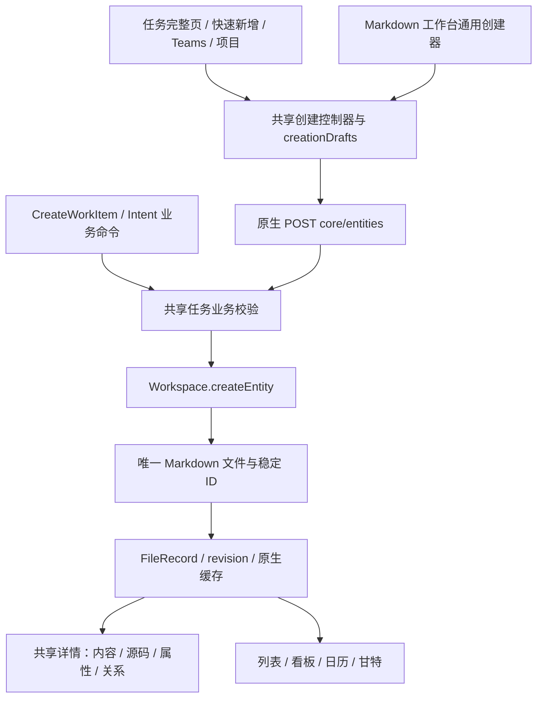

# 任务五页与 Markdown 工作台统一创建：计划与交付

状态：前后端已实施，TC-A01–TC-A12 已完成本机真实服务与浏览器验收；具体证据和硬件覆盖边界见第 8 节。日期：2026-10-21。实现采用 `gpt-6.1-sol / xhigh` 子代理分工，主执行者负责集成、故障注入与最终复验。

## 1. 目标与实施边界

最初参照 [全部任务](https://shadcnblocks-admin.vercel.app/todo)、[新建任务](https://shadcnblocks-admin.vercel.app/todo/tasks/new)、[今天](https://shadcnblocks-admin.vercel.app/todo/today)、[即将到来](https://shadcnblocks-admin.vercel.app/todo/upcoming)、[重要任务](https://shadcnblocks-admin.vercel.app/todo/important) 接入 PM 任务模块。当前今天/即将到来已按 gr8r-studio My Tasks 合并为“我的任务”；全部、我的任务、重要三个集合范围、快速新增、完整创建页与 Markdown 工作台使用相同实体、创建草稿、校验和持久化内核。

采用参考站的信息层级，不移植演示账号、样例项目、通知数量或 Next.js 外壳。保留本项目 Vite、React、Radix、主题和既有路由。

依据：[领域计划第七节](../domain-design/README.md#implementation-plan)、[后端交付记录](backend-delivery.md)、[Markdown 权威 ADR](markdown-integration-adr.zh.md)、[Markdown 全量移植要求](markdown-full-port-plan.zh.md)、[Teams 创建入口](teams-backend-completion.md)。适用 INV-01/13/14/15/16/20、SC-12/13/14/16/20、INF-03/05/06；旧提案的固定状态机、审核前置完成限制等，以已采纳 Markdown ADR 为准，不借新页面恢复旧规则。

### 范围决定

- 任务继续是 `work_item`，文件继续是权威；不创建 Todo 表、Todo ID 或第二套任务 store。
- 日期仍为全天日期，不保存小时。Date 明确适配为开始日期，Deadline 为截止日期。
- Important 明确命名为“重要 / 我关注的”，复用个人 WatchTask，不等同高优先级，也不承诺通知投递。
- 正式子任务使用 `kind=subtask` 和 `parent`；正文 checklist 与验收标准不能被当成独立子任务或自动完成依据。
- Location 作为可选文本元数据纳入本计划；不含定位、地图或位置提醒。
- Reminders 显示禁用原因；可靠提醒与小时级排期不在本次交付范围，不模拟成功。将来开放须另行定义 Worker 调度、时区、投递与恢复合同。
- 不新增 Agent/Runner 行为；不重启或接管外部项目。

## 2. 实施前代码事实与方案修正

| 现有路径 | 已核对行为 | 对本计划的影响 |
| --- | --- | --- |
| `apps/web/src/features/pm/markdown/WorkspaceEditors.tsx` 的 CreateEntityForm | 基于 fieldRegistry、configuration、自定义字段和 EntityFields 创建九类对象；正文为 Markdown | 不能用只有几个固定字段的任务表单替换整个创建器 |
| `markdown/controller.ts` 的 openCreate/createTask | 调用 api.createEntity，创建成功接收 FileRecord 并选中；创建键保存在 useRef，重新打开会换键 | 需要把创建草稿和原请求键移到持久、作用域隔离的共享创建状态 |
| `markdown/session.tsx` | 已保存实体草稿是 `{raw, revision}`，按来源/工作区/账号隔离，缓存还包含成员版本与 actor epoch | 无 ID 的新建草稿不能冒充带 revision 的已保存对象 |
| `markdown/api.ts` | POST `/core/entities`，通过 Idempotency-Key 创建；PUT 原文和 PATCH 属性使用 revision | 新建页应直接复用原生创建协议，保存后进入既有编辑协议 |
| `apps/api/src/core-routes.ts`、`core-journal.ts` | 原生写入已有授权、文件/SQL 审计协调及 http_pending/http_completed journal；不是 PM CommandReceipt | 必须补可查询的原生创建结果，不能伪造命令收据或把 pending 当失败 |
| `packages/pm-core/index.ts`、`state.ts` | Workspace.createEntity 分配 ID、校验协议/关系并写文件，持久记录幂等键和事务恢复信息 | 不重写 Markdown 创建引擎；复用其恢复事实 |
| `service/team-task-actions.tsx` | Teams 通过 CreateWorkItem 命令创建；已有合法项目、成员、未知写入守卫 | 迁移到共享表单时必须保留这些规则与已有未确认命令恢复入口 |
| `apps/api/src/core-adapter.ts` | CreateWorkItem 映射到同一 Workspace.createEntity；现有命令只承载标题、描述、验收标准、负责人、优先级 | 命令入口继续服务显式业务命令，但不能成为原生工作台全部字段的有损中转 |

**修正上一版“只扩展 CreateWorkItem 后统一走命令”的建议：采用原生创建协议作为新 UI 的主路径，命令入口与原生入口共享后端规则和核心存储。** 两种传输有不同的收据语义，但不得维护不同的任务模型。这样既适配现有 Markdown 工作台，也不需要把高级字段塞进一个不受控 JSON 包。

## 3. 后端实施工作包

下列工作包已落地。第 8 节记录本轮实际执行结果，不以源码存在、初始化健康检查或历史测试代替验收。

| 编号 | 目标路径 | 修改内容 | 退出条件 |
| --- | --- | --- | --- |
| TC-B01 | `packages/pm-schema/index.ts`、`packages/pm-markdown/index.ts` | 复用现有 title/body/project/kind/parent/priority/assignee/labels/due/关系字段；补齐任务 x-pm-start 的注册、真实日历校验及与 due 的范围约束；登记可空清除的文本位置 x-pm-location；沿用 x-pm-estimate | 表单、源码、创建、PATCH 和解析使用同一字段语义；没有同一日期的第二份存储 |
| TC-B02 | `packages/application/src/`、`apps/api/src/core-routes.ts`、`apps/api/src/core-adapter.ts` | 抽取任务创建与属性变更的共享业务规则，通过端口读取当前项目/成员/配置；原生和命令适配器都调用。检查项目可写、成员可分派、父项同项目、合法关系、有效配置和受保护元数据；在实际写入锁范围重查权威事实 | 从任一 HTTP 创建入口、原文或属性变更入口都不能绕过相同的授权与成员/关系约束；保留历史失效受派人的读取，不因无关编辑强制改派 |
| TC-B03 | `apps/api/src/core-routes.ts`、`core-journal.ts`、`packages/pm-core/index.ts`/`state.ts` | 在既有原生 journal 上增加按原请求键查询创建结果；与核心幂等/恢复事实核对，不重新执行创建。完善进程中断后可核对结果及审计恢复 | 丢响应、刷新和重启后能找到原实体；不能根据标题猜匹配；未解决 pending 保持未知 |
| TC-B04 | `packages/application/src/planning.ts`、`apps/api/src/core-adapter.ts`、`packages/contracts`、`docs/contracts/openapi.yaml` | 给 CreateWorkItem 增加本次需要的显式可选字段：startDate/dueDate、labels、kind/parentId、estimatePoints、location。转换为核心字段后进入 TC-B02 和现有创建引擎；检查共享 schema 对 CreateWorkItemFromIntent 的影响并同步所有消费者 | 不存在创建后补写基础属性的半成功窗口；生成合同与实现一致；不改变 Intent 接受与唯一转化规则 |
| TC-B05 | 既有 core query 与个人 dashboard 查询/命令 | 三个范围基于已授权任务和真实个人关注；我的任务严格按当前受派人过滤，重要复用 WatchTask/UnwatchTask。日历日期由个人时区推导，过滤和计数同一口径；现有查询 DSL 能表达时不新增重复列表 API | 仅返回有权读取的任务与关注记录；负责人及重要标记按 actor 隔离；空列表不同于读取失败 |
| TC-B06 | 对应 API、application、pm-core 行为测试与合同测试 | 覆盖完整字段写入、跨入口规则一致、幂等冲突、pending 恢复、父项关系、撤权、子任务部分成功、日期边界；使用真实文件与数据库验证审计边界 | 不跳过数据库测试，不使用 mock 返回替代文件持久化结果 |

### 3.1 原生创建接口与结果核对

继续使用：

- `POST /api/v1/workspaces/:workspaceId/core/entities`，请求头 `Idempotency-Key`；任务传 `entity: work_item`，其他实体继续原协议。
- 成功仍返回现有 `FileRecord`，含服务分配 ID、raw、entity、revision，不为了 UI 另造 TaskRecord。
- 已新增 `GET /api/v1/workspaces/:workspaceId/core/creation-attempts/:key`。只查询原生 CreateCoreEntity；scope 由可信账号与工作区决定，不接受客户端指定 actor。
- 查询 DTO 为 `not_found | pending | rejected | committed`；`pending.reason` 为 `write_unconfirmed | audit_pending`。`committed` 保留原 `entityId/revision`，另列 `current.status=present` 及当前 `record`，或 `deleted | missing | unavailable`。当前文件变化不否定原提交事实；`not_found` 不证明请求从未到达，不能据此释放新键。
- 每次查询重新校验当前权限；不得借请求键泄露越权实体或源文。结果 DTO 不返回完整 journal、未授权文件路径或秘密。
- 文件成功但 SQL 审计未完成时，由恢复流程补齐审计；在全部必需事实核对前保持待核对。GET 不重新创建对象，也不通过查询触发新的业务写入。
- 已新增 `POST /api/v1/workspaces/:workspaceId/core/creation-attempts/:key/recover`，请求体 `{}`。仅显式核对原写入并恢复缺失审计，不重新调用创建。客户端与 OpenAPI 同步提供原生结果 DTO，并保留原生错误及 PM 错误两种合法响应形状。
- 原生记录不能作为 `/commands` 的 CommandReceipt 使用。现有 PM 命令仍查询自身 commandId；两个恢复入口在 UI 中明确区分。

底层幂等键的历史语义和已有 journal 不做破坏性改写。若实现需要扩展 journal schema，应可读取既有条目并覆盖历史 pending/已删除实体恢复测试。不能通过删除 pending 条目解除阻塞。

### 3.2 单实体与多实体的一致性

单个任务的标题、正文、日期、标签、关系、位置和估算一次提交至同一个 Markdown 文件，不在前端串行 PATCH 补齐基础字段。

父任务、子任务和个人关注是不同对象，不宣称跨文件及 SQL 的原子事务。提交前校验整组可预检输入；先确认父任务，再逐项创建子任务，每个子项保留固定请求键；最后按显式选择执行关注命令。父任务成功而子项失败时展示分项结果，只恢复未完成子项，不重建父项，不自动删除已成功对象。任一未知结果先核对，暂停后续关联写入。

### 3.3 存储、身份与状态边界

- 不增加 SQL 任务内容表、不迁移现有任务文件、不重分配 TASK ID；个人关注与审计继续各自原存储。
- `x-pm-start` 为本次沿用的任务开始日期，不能同时写入 `start` 制造双权威；项目等其他实体继续自己的 start 字段。
- 现有同名自定义字段/不合法历史扩展值先诊断，不能静默覆盖或自动批量改写。新增位置字段须定义 trim、长度、空值删除和保留式编码规则；具体上限在 TC-B01 合同中固定。
- 默认使用配置工作流 initial。来自看板列或高级模式的显式状态按已有能力和配置校验；创建不附带自动 Start/Complete 命令，不以子项勾选率决定完成。
- 服务端分配 schema/id，创建 UI 不接受伪造身份；创建者、命令 ID 等服务端保留元数据不能由高级属性绕写。

## 4. 前端实施工作包

| 编号 | 目标路径 | 修改内容 | 退出条件 |
| --- | --- | --- | --- |
| TC-F01 | `apps/web/src/routes.tsx`、`features/pm/pm-shell.tsx`、现有任务页面入口 | `/pm/:workspaceSlug/issues/new`；全部/我的任务/我关注的复用 issues，以 `scope=all/mine/important` 区分；view 继续独立控制布局 | 不新增独立 Todo 壳，不恢复已移除的 /markdown 应用；侧栏、面包屑和命令面板统一入口，所有链接可直接访问与返回 |
| TC-F02 | `features/pm/markdown/` 内新增共享创建表单与创建控制器 | 共享创建状态、校验、提交、恢复，提供 compact/dialog/page 三种展示；完整页左侧标题/Markdown正文/子项，右侧属性 | 从快速输入展开完整页、进入工作台高级属性，草稿和请求键保持一致 |
| TC-F03 | `markdown/session.tsx`、`markdown/controller.ts`、`markdown/api.ts` | 增加独立 creationDrafts，持久化请求快照与幂等键；对接原生结果查询；沿用作用域隔离与会话撤销处理 | 刷新可恢复；持久化失败时不能宣称可恢复，也不发送无法记录的创建请求 |
| TC-F04 | `markdown/WorkspaceEditors.tsx`、`WorkspaceDialogs.tsx`、`EntityFields.tsx`、`page.tsx`、`workspace.tsx` | 任务专用展示接同一创建控制器；通用创建器保留九类对象与高级字段；工作台来源项目/状态传入草稿，不在切换视图时覆盖用户输入 | 新界面不损失原工作台的自定义字段、类型关系、工作流选择、正文与诊断能力 |
| TC-F05 | `service/team-task-actions.tsx`、项目/日历/命令面板及其他已定位的任务新增入口 | 迁移正式 UI 到共享原生创建；团队入口只提供负责人和项目上下文，保留权限与未确认命令处理。实施时先用 LSP references 枚举全部创建入口，不只改已列文件 | 不再维护另一份 Teams 创建表单；已有未知 CreateWorkItem 命令先恢复，不能改走新协议再提交一次 |
| TC-F06 | 原生集合、列表/看板/日历适配器、个人关注接入 | 同一授权快照派生 scope；共享搜索/筛选/计数；看板可按优先级分组，拖动只改该字段；使用配置完成类别与已完成折叠区 | 切换布局不改变任务集合和草稿；删除/归档/取消/完成语义不混淆 |
| TC-F07 | 现有主题、国际化、Dialog/Popover/输入组件 | 采用参考站双栏结构，窄屏纵向排列；按钮有可访问名称，输入错误关联字段，中文 IME、键盘、焦点返回与 reduced-motion 使用已有规范 | 390px 无页面横向溢出；创建中阻止重复提交；只读/错误/空态/离线/待核对均可区分 |

### 4.1 创建表单与字段映射

| UI 字段 | 原生提交/存储 | 适配约束 |
| --- | --- | --- |
| 标题 | title → Markdown H1 | 标题和正文不能产生两个相互竞争的任务标题 |
| 描述 | body | 创建阶段使用保真 Markdown 源码输入，保存后复用共享详情预览与源码编辑；不引入另一份富文本权威副本 |
| 项目 | project | 显示真实名与 ID；全局创建要求明确选择，不默选首个项目 |
| 负责人 | assignee | 显示真实成员名，存储身份值；原生与命令式分派接受同一服务端校验 |
| 优先级 | low/medium/high/urgent | UI 统一中文文案；命令 normal 与核心 medium 的转换只在既有适配边界发生 |
| 开始 / 截止 | x-pm-start / due | YYYY-MM-DD；截止含当天；允许单边日期；不提供小时控件 |
| 标签 | labels | 搜索、多选、新输入、清空均落同一字段 |
| 子任务 | 独立 work_item，kind=subtask，parent=父任务 ID | 与父项同项目；未保存子项用本地 draftId，不伪造正式 TASK ID |
| 验收标准 / 正文检查项 | 既有 Markdown 正文表达 | 当前 core-adapter 会从 checklist 投影标准；不能默认把“子任务”写成 checklist。标准编辑必须保留其他正文检查项，不以勾选表示 Review 通过 |
| 估算 | x-pm-estimate | 空为未知，0 为明确零 |
| 位置 | x-pm-location | 已注册的可选纯文本，去除首尾空白、最多 1000 字符；空白/null 清除，不自动定位 |
| 高级属性 | 配置驱动的标准关系与自定义字段 | 复用 EntityFields，不复制一份硬编码字段注册表 |
| 重要 | WatchTask（个人记录） | 显式选择后在任务确认创建之后执行；关注失败不意味着任务创建失败 |
| 提醒 | 不提交 | 禁用并说明尚未接入可靠投递 |

对于富文本编辑器无法无损表达的合法 Markdown，使用源码模式并保持原文；不能为了进入富文本模式丢弃 pm-view、双链、代码块或扩展语法。

### 4.2 三个范围的明确口径

- all：当前授权范围内、默认未归档的工作项；未完成与已完成分区，取消单独辨识。
- mine：当前登录人作为 assignee 的可见任务，按个人时区分为逾期、今天、即将到来（所有未来日期及未排期）、已完成；已完成默认折叠，取消不视为完成。身份或个人日期未知时不伪造集合与计数；仅创建过、未分派或分派给他人的任务不属于本人任务。
- important：本人有效关注记录与当前可见任务的交集；默认开放任务，已完成使用折叠区，不把 priority 当星标。
- scope 与项目/搜索/筛选组合时取交集，计数来自相同集合。项目路由固定项目并使用 all，不受个人 scope 查询影响；旧 today/upcoming 不再是有效 scope，按既有无效参数规则回到 all。授权应先裁剪，不显示不可见总数。关注读取失败不能显示为“没有重要任务”。
- 我的任务新增默认分派本人；今天组预填个人今日截止日期，即将到来组预填三天后，逾期组不捏造过去日期。已完成组使用配置完成状态，多目标显式选择；选定项目后仍检查原生创建及生命周期能力。完整创建页继承 `scope=mine` 或安全的我的任务返回路径；显式负责人及恢复草稿优先于入口默认值，项目路由不隐式分派本人。重要页新增保留“创建后加入我的关注”选项；创建后若不符合当前筛选，提示已创建但不在当前范围并提供打开链接。
- 日期跨午夜、时区修改、SSE、重新聚焦或服务刷新时重新计算，不持久化一份会过期的 Today 任务列表。
- 不把个人关注 ID 集合保存到共享工作区视图定义；有权限保存的共享视图仍沿用原 ViewConfig 和 revision。

## 5. 与现有 Markdown 工作台的接入契约

### 5.1 三种表面、一份创建意图

非 work_item 对象走其原有核心规则，不强行套用任务的负责人和项目关闭规则。两种传输分别保留原生 journal 与 PM 命令收据，图中共享的是业务规则和持久化内核，不是收据格式。

### 5.2 创建前：创建草稿不是文件草稿

`CreationDraft` 保存 `draftId/kind/values/body/children/initial`；提交后记录 `attempt.key/request/phase` 及原提交事实，个人关注另有 `watchAttempt.command/phase`。按现有 host/workspace/actor 命名空间隔离，使用持久存储与 Web Locks 协调同源标签页；持久化或锁能力不可用时禁止派发。成员版本变化重新校验，不复用旧权限，也不把未保存内容写进 URL。

- 未提交：字段可编辑，默认值只在草稿初始化时应用。
- 提交中：先成功记录原请求，再发送；禁止改写这次请求的参数。
- 已拒绝：保留草稿与诊断，确认无副作用后可编辑并发起新创建意图。
- 结果未知：冻结原请求键与参数，关闭、刷新、换页面都不解除；先核对，禁止换键再创建。
- 父项已确认：保留原 ID/revision；只有整组所选动作全部确认后才清除此创建意图，不清除其他源码草稿。另一个已挂载表面观察到意图被清除时，不以同一 draftId 自动重建空白意图。
- 子项部分成功：成功 ID 和未完成子项共存，不能用一次总成功提示掩盖失败。

复用 PM 命令 pending/unknown 和原生编辑 unknown 守卫作为共同写入可用性输入，但不混用它们的恢复协议。无权限时清除可见私有内容，草稿恢复只允许相同账号重新获得授权后执行。

### 5.3 创建成功：交给既有工作台，而不是另开新详情

1. 接收服务返回的真实 FileRecord，通过现有 acceptRecord 等价路径更新 CoreSession.queryKey 对应的缓存。
2. 刷新受影响的 PM 投影、Teams 工作量和个人关注查询；SSE 再收敛，不手造第二个任务对象。
3. 工作台弹窗创建沿用 select(file.id)，保留集合布局/滚动/筛选；完整页打开 `/pm/:workspaceSlug/entities/:id` 或返回安全的同工作区来源 URL。
4. 保存后的内容/源码/属性/关系/图仍使用既有 EntityDetail 与 Draft `{raw, revision}`；不再保留一份可独立提交的“创建表单副本”。
5. 往返工作台和详情共享同一 revision。源码脏草稿存在时，结构化编辑沿用现有锁定与显式解决策略，不能由属性表单静默覆盖源码。

### 5.4 原有能力与数据保留

- 九类对象继续可创建；非任务表单保留 EntityFields、配置默认值、自定义字段和 Diagnostics。
- 工作台中的 work_item 使用任务友好表面，但高级属性继续暴露适用字段及关系；用户切换模式不丢隐藏字段。
- 已保存对象的原文编辑、保留式 Markdown/YAML 写回、revision 冲突、文件监听、归档/删除防护、迁移与恢复保持原路径。
- 新建前仅提供 Markdown 正文源码和元数据预览，不伪造带正式 ID 的完整文件。完整文件源码编辑在服务确认创建后使用现有工作台；模板复制须剥离身份和服务端保留元数据。
- 合法的自定义字段、双链、嵌入 pm-view 和其他实体关系不能因“简化创建”而删除。
- 旧 `?create=1` 等现有入口统一进入新的创建控制器；不保留另一套重复表单。已有未确认命令/草稿以原协议完成恢复，不将其转换为新写入。

## 6. 实施顺序与切换门槛

| 阶段 | 工作包 | 依赖与完成标准 |
| --- | --- | --- |
| 1：合同与字段 | TC-B01、TC-B02、TC-B04 的合同部分 | 先冻结原生字段/命令映射、规则边界和错误 DTO，再开发 UI；检查所有导出符号引用与消费者 |
| 2：持久化与恢复 | TC-B03、TC-B04 实现、TC-B06 后端回归 | 原生结果查询与文件/审计恢复有真实故障证据；原有创建 API 仍可用 |
| 3：统一创建表面 | TC-F02、TC-F03、TC-F04 | 先在现有工作台完成创建、刷新恢复、原文读回闭环；未过门槛不切换全部入口 |
| 4：入口与集合 | TC-F01、TC-F05、TC-B05、TC-F06、TC-F07 | 新建页与四范围接入；现有任务新增入口逐一迁移后删除重复实现，保持其他实体创建能力 |
| 5：端到端验收 | 第七节全部检查 | 真实服务/浏览器、权限、并发、恢复、跨视图与窄屏通过；更新交付记录后才标记实现完成 |

实施按上述依赖完成。没有修改全部任务文件、清空用户缓存或新增新旧 UI 双写过渡层；既有未确认 PM 命令仍按原 commandId 恢复。

## 7. 验收矩阵与验证命令

| 编号 | 场景 | 必须观察到的结果 |
| --- | --- | --- |
| TC-A01 | 完整页创建含日期/标签/负责人/位置/估算的任务 | 同一真实 ID、一个 Markdown 文件；刷新后属性和正文一致 |
| TC-A02 | 工作台创建自定义字段任务及其他八类对象 | 类型与字段能力不缩水；关系/配置错误有准确诊断 |
| TC-A03 | 快速新增 → 完整页 → 工作台高级属性 → 刷新 | 草稿、来源和请求键保持；已保存实体草稿不受影响 |
| TC-A04 | 提交成功后丢响应、关闭页、刷新；另测 API 进程中断 | 原键查询找到原任务或保持明确未知，绝不新增重复任务；审计恢复可证明 |
| TC-A05 | 同键同参数/同键不同参数/原实体已更新或删除 | 返回可核对原结果或明确冲突；不重建被删除实体，不把新 revision 当原提交 revision |
| TC-A06 | 父任务成功、某子项失败或 unknown、个人关注失败 | 分项显示准确，只恢复未完成动作，不重复父项，不伪称整组原子提交 |
| TC-A07 | 创建后工作台改源码，再从列表/看板/日历读取 | 同一 FileRecord 与 revision；未保存源码不被外部更新覆盖 |
| TC-A08 | 两标签页冲突、外部文件修改、SSE 重连 | 保留草稿并显式解决；计数和视图重新收敛 |
| TC-A09 | 只读、受限项目、撤权、非法受派人、关闭或归档项目 | UI 与原生/命令 API 一致拒绝；结果查询不能泄露越权对象 |
| TC-A10 | 午夜、时区切换、月底、闰日、单边日期、逾期 | 今天/七天边界和全天显示一致；没有隐式 UTC 日期偏移或虚构小时 |
| TC-A11 | 重要范围、优先级看板、子项与完成 | 个人关注隔离；拖动优先级不改状态；父任务不按子项自动完成 |
| TC-A12 | 390px、键盘、中文 IME、主题与离线 | 无页面横溢；可聚焦与恢复；不可用提醒明确禁用；失败不回退样例 |

实施后的检查：受影响 lint/typecheck/build、`pnpm check`、`pnpm test:backend`（真实数据库、零跳过）、`pnpm check:web`，以及临时隔离端口/工作区中的真实浏览器与 API 烟测。运行前核对端口、PID、工作目录；不读取或打印凭据，不把默认用户工作区作为验收数据集。若全库检查有无关并行失败，应记录并完成本次受影响范围验证，不修改无关模块来凑通过。

最终更新 README、现有前端接入清单、Markdown 交付记录和后端交付记录；证据分别记录后端、原生工作台、新页面与失败恢复，不能把文档检查通过写成上述功能已验收。

## 8. 实施与验收记录（2026-10-21）

### 8.1 实际交付

- 五个正式入口为 `/pm/:workspaceSlug/issues`、`?scope=today`、`?scope=upcoming`、`?scope=important` 和 `/issues/new`。`view` 独立控制列表、看板、表格、日历、甘特、树与关系图，不改变 scope 的含义。
- `creation-model/store/controller`、`EntityCreationSurface` 与 `CoreSession.creationDrafts` 统一快速新增、弹窗、完整页和通用创建；项目、Teams、日历与命令面板迁移到同一入口。旧的独立创建表单已移除。
- `core-task-creation.ts` 在原生创建、属性、源码和命令适配器间共享任务规则；SQL 工作区锁与文件串行写入守卫内重查版本和当前项目/成员事实。新任务必须有合法项目，历史无项目任务仍可按既有能力显式完成。
- `x-pm-start/due/x-pm-location/x-pm-estimate`、正文、自定义字段与关系一次写入 Markdown。`CreateWorkItem`/Intent 转换支持显式可选字段；返回的 `TASK-…-AC-…` 验收项标识可再次用于内容编辑，不再被 UUID-only 校验拒绝。
- 个人时区决定日期范围及日历“今天”；本人 WatchTask 决定重要范围。优先级看板只修改 priority，完成/取消按配置类别分区。
- 已核对参考站五页及新建交互。参考站 Today/Upcoming 在观察时为空态；本项目有数据分组是本计划设计，不冒充参考站有数据页面的实测复刻。

### 8.2 本轮检查

| 检查 | 实际结果 |
| --- | --- |
| `pnpm check` | 通过：文档/合同、后端 lint、类型检查、295 项测试及后端构建；0 失败、0 跳过 |
| `pnpm test:backend` | 通过：真实 PostgreSQL、文件、HTTP、SSE 与独立 Worker；466 项测试、25 suites；0 失败、0 跳过 |
| `pnpm check:web` | 通过：受影响前端 ESLint、TypeScript、Vite 生产构建 |
| 生成合同 | OpenAPI 3.1.0，92 个命令 payload、34 条路径；包含原生结果查询/恢复 |

前端构建仍提示既有大 chunk 和 `workflow-canvas.tsx` 动态/静态导入混用；本轮不宣称解决包体性能。前次数据库全套中的两处失败已修正并先单独复验：内容编辑接受真实投影的验收项标识；历史未知受派人测试改为真实外部文件输入，不再要求受保护的 HTTP 分派接口接受非法新分派。随后完整数据库套件零跳过通过。

### 8.3 真实浏览器与故障证据

使用独立 PostgreSQL schema、Markdown/Blob 根目录、生成账号与隔离浏览器上下文，临时 API `4151`、投递故障代理 `4152`、Web `3351`。响应丢失发生在真实上游成功之后；没有以 mock 成功响应替代写入。以下文件均保留在本机 `.local/evidence/task-creation/`，不包含账号密码或会话 cookie。

| 场景 | 实际观察与证据 |
| --- | --- |
| TC-A01 | 浏览器创建 `TASK-017`，真实负责人、日期、标签、零估算、位置、自定义字段及中文/代码/checklist/双链/pm-view 保留；`TC-A01-browser-file.json` |
| TC-A02 | 通用工作台逐一创建另外八类实体；自定义文档字段保留。反向日期与跨项目父项均关联到字段诊断，未派发创建；`TC-A02-generic-ui-records.json`、`TC-A02-validation.json`、`TC-A02-relation-diagnostic.json` |
| TC-A03 | 快速新增展开完整页、高级字段与刷新保持同一意图；独立 `{raw,revision}` 源码草稿仍在；`TC-A03-draft-continuity.json` |
| TC-A04 | `TASK-018` 成功响应丢失后按原键核对；另在 `http_completed` 已 fsync、SQL 审计未提交时中断自有 API，重启后显式恢复 `TASK-019`。原键只有一次创建 POST、一个文件、一份恢复审计，无伪造 PM 收据；`durable-recovery.json`、`TC-A04-crash-recovered-ui.json` |
| TC-A05 | 同键重放不分配新 ID，异参冲突；后续源码保存不改原提交 revision；删除 `TASK-016` 后结果为 committed/current.deleted，不重建；`api-exercise.json`、`exercise-file-proof.json` |
| TC-A06 | 父项 `TASK-020` 确认后首子项响应丢失，第二子项暂停；恢复后只补剩余项，最终子项为 `TASK-021/022`。`TASK-023` 的关注响应丢失通过原 WatchTask 收据恢复；`TC-A06-child-result.json`、`TC-A06-watch-recovery.json` |
| TC-A07 | `TASK-017` 在同一共享详情保存源码并保留扩展字段；列表、优先级看板和日历读取同一文件；`TC-A07-source-save.json` |
| TC-A08 | 双标签页保留不同源码，冲突显示本地/磁盘两版；人工合并、变基后仍需显式保存。外部编辑 `TASK-012` 经 watcher/SSE 自动出现；离线重连不丢 `TASK-017` 脏草稿；`TC-A08-explicit-merge.json`、`TC-A08-external-ui.json`、`TC-A08-reconnect-source.json` |
| TC-A09 | reader 不可创建；受限成员仅有 `PRJ-001` 及合法身份。撤销 revocable 后私有内容隐藏、原创建结果查询 404；已确认父项不改判失败，无法读取关注收据时保留 unknown；`TC-A09-role-surfaces.json`、`TC-A09-revoked-watch-denial.json` |
| TC-A10 | 真实设置将 Asia/Shanghai 改为 America/Los_Angeles，今天从 21 日变为 20 日，日历不跟随浏览器的上海时区。另以浏览器主世界 Date 注入验证 2028 闰日与月末跨午夜；单边日期、截止包含当天、无小时标签；`TC-A10-real-timezone-change.json`、`TC-A10-instrumented-midnights.json`、`TC-A10-leap-calendar.json` |
| TC-A11 | owner/reader 关注集合不同；高优先级本身不进入重要范围。真实拖动 `TASK-003` urgent→low，status 仍 todo；显式完成 `TASK-021` 后父项 `TASK-020` 仍 todo；`TC-A11-priority-drag.json`、`TC-A11-child-not-parent.json` |
| TC-A12 | 390×844 的完整页、弹窗与共享详情均无页面横溢；浅色中文/深色英文、Tab、Escape 焦点返回、reduced-motion 和字段错误已操作。离线输入保留且 Enter 不派发；恢复后创建 `TASK-025`；`TC-A12-mobile-created.json`、`TC-A12-dialog-focus-fixed.json`、`TC-A12-mobile-composition.json` |

### 8.4 验收中发现并关闭的问题

- 并发命令在等待工作区锁前取旧版本，可能双双成功：改为锁内及文件守卫内核对，真实并发结果为一个成功、一个冲突。
- 历史原生键重放可能把编辑后的 revision 当作原提交 revision：无法证明原结果时返回明确冲突，不重建或改写原提交事实。
- 另一标签页完成意图后，已挂载表面会重新创建同 ID 空白草稿：初始化只执行一次，完成后显示意图已结束。
- 工作台重复打开原生 SSE，使双标签页耗尽 HTTP/1.1 连接：复用会话 provider 的原生流；两页真实源码读取恢复，单次工作区请求实测约 20ms。未据此宣称多用户负载能力。
- 离线事件未及时更新按钮：创建控制器订阅 online/offline；仍在实际派发前重新检查网络。
- 原生 dialog 卸载后焦点回到 body：关闭时恢复 opener，Escape 后回到原新建按钮。
- 个人数据读取失败时，逾期范围可能出现虚假 0：没有可用个人日期时计数为未知。重要/逾期请求被真实浏览器网络阻断后均显示错误，不显示无关任务；解除故障并点击重试后恢复正确集合，见 `TC-A10-A11-personal-read-failure.json`。

### 8.5 边界与清理

- 中文输入覆盖 Chrome CDP 产生的 compositionstart/update/end 和实际表单持久化，**不等于物理操作系统 IME 或触摸设备验收**。跨午夜是明确标记的浏览器时钟注入，不是等待真实午夜，也未修改宿主/服务端时钟。
- 可靠提醒、小时级排期、真实 Agent/Runner、公开互联网部署仍未开放；UI 明确禁用相应能力，不模拟通知成功。
- 最终文件/审计快照、命令检查和截图已保留；自有浏览器上下文、API/Worker/Web/代理、隔离 schema、临时目录与生成凭据均已清理。清理凭据为 `cleanup-4764b466bc2444449fd55a2225eab49c.json`；临时运行脚本已删除。
- 未重启或接管原有常驻服务，未 commit/push。本次是代码与隔离环境验收，不宣称现有常驻 API 已加载新代码或完成生产发布。

## 9. 文档优先新建页重构（2026-10-27）

新建任务页改为单列 Document-first 布局，创建与详情共用标题控件；创建草稿、幂等创建、子任务部分失败恢复和权限校验继续由原创建控制器持有，没有新增第二套任务事实源。

### 9.1 表面结构

- `apps/web/src/features/pm/markdown/TaskCreationSurface.tsx`：`mode="page"` 使用 `task-document-form`；删除页内返回按钮、页面标题和右侧固定属性栏。工具栏只保留显式“创建任务”、真实 loading 与本地草稿提示；`Cmd/Ctrl+S` 继续触发表单提交按钮的现有禁用判断。
- `TaskDocumentFields.tsx`：共享大标题（无边框、自动增长、创建页自动聚焦）、内联属性芯片（状态/负责人/优先级，`+ 属性` 追加日期、标签、估算、位置）、内联正式子任务（完成切换、标题、描述、负责人、删除、Enter 新增并聚焦）。
- `MarkdownBodyEditor.tsx`：默认可视化 Markdown，保留源码模式；编辑器按内容增长，不再使用 320px 固定高度。源码模式保留完整 Markdown 能力。
- `TaskDetailSurface.tsx`：改用同一 `TaskTitleField`，详情标题仍保持 19px 与既有 `task-title-input` 样式。
- 属性与子任务仍调用 `useEntityCreation` 的 `changeFields`、`changeBody`、`addChild`、`changeChild`、`removeChild`、`submit`；创建父项后按原顺序创建 `kind=subtask`、`parent=<父项>` 的独立工作项，并保留原请求键与部分失败核对入口。

### 9.2 单一事实与安全边界

- 标题只写入结构化 `title`；服务端继续在正文前生成唯一 H1，Markdown 正文编辑器不编辑标题或 YAML 运行时元数据。
- 属性更新继续经过工作区快照、成员目录、配置工作流、项目可写与 `creationFieldIssues` 校验；不在前端直接改数据库或拼装第二份属性真相。
- 正文 checklist 不自动转换为正式子任务；内联子任务明确标注“正式工作项”，仍创建独立 `work_item` 并经过同一创建协议。
- 完全空白的子任务行在提交前移除，不参与校验或创建；只填写正文/负责人的行仍以缺少标题阻止提交，避免静默丢弃用户内容。
- 可视化编辑器只覆盖可无损往返的常见 Markdown 子集。检测到表格、图片、任务清单、Wiki 链接、原始 HTML、数学、脚注、带语言代码块或 callout 时，自动保留源码模式并禁用可视化切换，避免切换造成正文丢失。
- 父项已提交但子任务部分失败时，标题/属性/正文保持冻结，子任务仍可在核对原状态后继续编辑；已冻结或结果未知的草稿必须先在原恢复入口核对。

### 9.3 本轮验证

- `pnpm --filter @pm/web typecheck`、`pnpm --filter @pm/web lint`、`pnpm --filter @pm/web build` 通过。
- 浏览器 1440×1000 浅色/深色与 390×844 移动视口：标题自动聚焦、无页内重复标题、无右侧属性栏、无横向溢出；源码编辑器随 12 行内容增长。
- 真实服务创建 `TASK-010`（标题、正文、状态、负责人、优先级、截止日期），子任务 `TASK-011`（完成、负责人、描述）与 `TASK-012` 按 `parent=TASK-010` 创建；列表、看板、表格、日历、时间线均可读取。
- 表格/图片内容在源码模式保持原样，可视化按钮被禁用并显示原因；正式子任务完成切换与草稿刷新恢复已实际操作。
- 回归：仅添加一个空子任务行后创建 `TASK-013`，未出现 `children.0.title` 错误，也未创建空子项；`creation-child.test.ts` 覆盖空白行、仅正文、仅负责人和已冻结尝试。
- 以上为本地示例工作区验证数据，不作为真实交付或生产验收证据。

## 10. Agent 入口、统一新建页与 review 看板列（2026-10-27）

### 10.1 新建任务统一入口

- 新建任务页工具栏在“创建任务”左侧增加 `Agent` 按钮：导航到工作区 Agent 对话，并携带当前 `project` 与 `returnTo`；未保存草稿仍保存在浏览器恢复存储中。
- Markdown 工作台控制器在 `scope.kind === 'work_item'` 且存在 `onCreatePage` 时，统一跳转 `issues/new`，不再按项目上下文分流到内联对话框。
- 删除列表/看板的“快速新增任务”内联面板；列表、看板列、日历、我的任务、任务详情关联创建等入口全部经过同一 `openCreate → onCreatePage` 路径。
- 删除集合底部横跨整栏的“新建任务”按钮；保留顶部任务工具栏按钮、看板每列底部按钮和看板列头“+”入口。
- `onCreatePage` 跳过空参数，避免生成 `project=`；`initial.status/project/assignee/due/priority/watch` 继续进入创建页。
- 空白且未改动的恢复草稿可采纳本次入口的状态/项目等初始值；已有标题、正文、子任务、关注或任何属性修改的草稿不会被覆盖。新增 `creationDraftIsPristine` 与本机回归测试。
- Teams 成员“添加任务”仍保留命令收据恢复对话框：未知 `CreateWorkItem` 必须先在原入口核对，不能借统一页面绕过。

### 10.2 review 状态与看板

- `packages/pm-schema/index.ts` 的默认 `work_item` 工作流增加 `review`（category `started`），初始状态仍为 `todo`；默认状态顺序为 `todo → in_progress → review → done → canceled`。
- 看板直接从工作流配置生成列，因此无需第二套列定义；`review` 不会被视为完成，列表/我的任务仍归入未完成范围。
- 本地示例工作区没有显式 `.pm/config.yaml`，其有效配置曾按旧默认值投影。已通过既有 `PUT /core/config` 保存新状态集与全部合法转换（revision `f4347f23…`）。其它既有工作区若保存了显式配置，需在设置中保存相同的 `review` 状态；代码默认只对未保存显式配置的新工作区生效。
- 任务创建页状态 Popover、看板列、筛选下拉和看板列底部“新建任务”均直接读取该配置。

### 10.3 2560 × 1440 看板填充

- 看板外层增加 `task-collection-board`，纵向 `height: 100%`，列容器 `align-items: stretch`；列改为 `flex: 1 1 0` 且 `min-width: 220px`，不再固定 284px。
- 2560×1440 实测：5 列各 442px，看板 2300×1140，底部 1360px，基本占满内容区；1440×900 下 5 列各 220px，无页面横向溢出。
- 窄屏仍保留最小列宽与横向滚动，不压缩卡片至不可读。

### 10.4 本轮验证

- `pnpm typecheck`、`pnpm --filter @pm/web typecheck`、`pnpm --filter @pm/web lint`、`pnpm build` 通过。
- `tests/task-collection.test.ts` 新增 review lane 测试；`apps/web/src/features/pm/markdown/*.test.ts` 全量通过。
- 浏览器验证：工作区与项目“新建任务”、看板列底按钮、review 列“新建任务”均进入统一页面；review 列传入 `status=review` 并在空白草稿上生效；Agent 按钮进入 `/agent?project=PRJ-001&returnTo=…`。
- 仍存在边界：已有显式工作流配置不会自动获得 review；Teams 成员任务对话框保留命令恢复语义；触摸设备与真实 2560 显示器未做物理验收。

