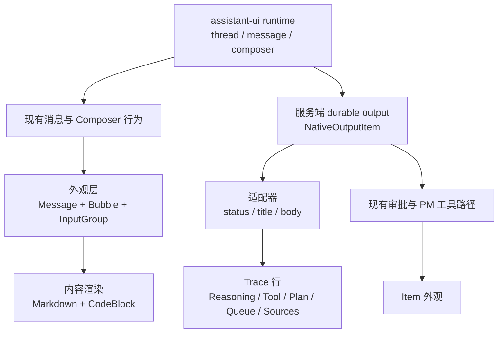

# Agent Chat 与 shadcn AI Elements 映射 / 迁移评估

本文件评估当前 Agent Chat 设计组件与 shadcn AI Elements 的对应关系、可复用范围和迁移风险。本文只做源码与文档评估，不表示已实施迁移，也不把 shadcn 示例当作本项目的运行时合同。

## 评估基线

| 项目 | 基线 |
| --- | --- |
| 当前 Agent Chat | assistant-ui `0.15.28` + `@assistant-ui/ai-sdk` + React `19.3.0`；服务端持久生成时间线 |
| 当前 UI 基元 | Base UI `^1.8.0`、Radix 共享控件、Tailwind CSS `4.3.3`、CVA |
| shadcn 本地检出 | `6ea0900`，该工作树尚未包含 AI Elements |
| shadcn 评估来源 | `origin/main` `42f3bb63b46a69e52a24bd005cdc9ec15ba7a7b9` 的 `apps/v4/content/docs/ai-elements/**` 与 `apps/v4/registry/bases/base/ui/**` |
| shadcn 基线 | Base UI `1.6.0`，AI SDK `useChat` 示例；AI Elements 为复制进项目的组合模式，没有统一 npm 包 |
| 许可 | shadcn/ui 为 MIT；复制代码仍需保留适用声明并遵守本项目第三方素材规则 |

> 本地 shadcn 工作树停在 `6ea0900` 时没有 `ai-elements` 目录；本评估读取了该仓库 `origin/main` 的 `42f3bb6`。不修改 shadcn 工作树源码。
>
> 迁移评估保留为源码参考；Design System 预览页面已从 Agent 设置中移除。

## 结论

1. **不建议整体迁移到 shadcn AI Elements。** 当前 Agent Chat 的核心不只是 UI：assistant-ui 持有 thread/message/composer 交互，服务端持有生成、持久化、审批、PM 工具调用和恢复语义。AI Elements 主要提供展示层组合，不替代这些运行时合同。
2. **建议引入 `Trace` 作为统一“步骤行”展示层。** Reasoning、Tool、Plan、Queue、Subagent、Sources、Terminal、Stack Trace、Test Results 在 shadcn 中都复用 `Trace`；当前 Agent Chat 的时间线、推理、工具和审批也适合收敛到同一形状。
3. **优先复用无状态组件。** `Message` / `Bubble`、`CodeBlock`、`InputGroup`、`Attachment`、`Item`、`Suggestion`、`Marker`、`HoverCard`、`Progress` 可以直接借鉴；涉及协议和持久化的组件只借鉴外观。
4. **不要替换 Model Selector、Terminal、Diff 和审批协议。** 当前实现比 shadcn 示例更完整，替换会丢失 Provider 侧栏/搜索/收藏、xterm 流式输出、`@pierre/diffs` 和 PM 收据/审批。
5. **需要服务端合同才能落地的元素：** Context、Checkpoint、Task、Inline Citation、Test Results、Stack Trace、Chain of Thought 分组。当前 `NativeOutputItem` 没有对应字段，先做客户端展示无法得到可信数据。

## 架构差异

| 维度 | 当前 Agent Chat | shadcn AI Elements |
| --- | --- | --- |
| 运行时所有权 | assistant-ui runtime；服务端 thread/generation 合同 | 组件本身无运行时；示例使用 AI SDK `useChat` 或 `createChat()` |
| 消息 | `MessagePrimitive`、`ActionBarPrimitive`、`BranchPickerPrimitive` | `Message` + `Bubble` + `MessageFooter` |
| 步骤 | `ToolFallback`、`OutputTimeline`、`NativeOutputItem` | `Trace` 统一行，按 AI SDK part 手工映射 |
| 审批 | assistant-ui 审批协议 + PM 工具审批/收据 + native interaction | `Item` + `Button`，调用 `addToolApprovalResponse` |
| 滚动 | `ThreadPrimitive.Viewport` + `turnAnchor` + 固定 Composer | `MessageScroller` + `scrollAnchor` |
| 状态来源 | 服务端 thread settings、generation output、PM 工具合同 | 组件 props / AI SDK message parts |
| 样式 | PM 语义令牌、Tailwind、CSS Modules | shadcn `base-rhea` 令牌 + Tailwind |
| 安装方式 | 现有依赖 | 复制组件或 `shadcn add`，没有 AI Elements 包 |

## 组件映射

状态说明：

- **等价复用**：展示职责基本一致，可直接借鉴或包裹。
- **外观替换**：保留当前行为，只替换行/容器/排版。
- **部分等价**：有对应模式，但当前数据或交互更复杂。
- **需要合同**：缺少服务端字段或稳定 ID，不能只靠前端迁移。
- **保留现有**：不建议替换。

| shadcn AI Element / 基元 | 当前实现 | 映射状态 | 评估与建议 |
| --- | --- | --- | --- |
| Chat | [`Thread`](../../apps/web/src/features/agent/components/assistant-ui/elements/thread.aui.tsx)、`ThreadPrimitive.Viewport` | 保留现有 | 当前 viewport 已处理历史加载、错误暂停发送、`turnAnchor`、固定 Composer。不要为了 `MessageScroller` 替换 assistant-ui thread runtime。 |
| Message | `UserMessage`、`AssistantMessage`、`MessagePrimitive` | 外观替换 | 用 `Message`/`Bubble`/`MessageFooter` 重排用户气泡和回复底部动作；保留 assistant-ui message primitives、分支和动作。 |
| Prompt Input | `Composer`、`ComposerPrimitive` | 外观替换 | 采用 `InputGroup` + `Attachment` 的壳层；保留附件、引用、Skill 菜单、输入法、停止/发送门禁和 `/usage-limits` 拦截。 |
| Model Selector | `ComposerModelPicker`、`ComposerTraitsPicker` | 保留现有 | 当前有 Provider 侧栏、搜索、收藏、模型能力与 revision 保存；shadcn 两枚下拉菜单明显更弱。只借用 `InputGroupButton` 触发器样式。 |
| Reasoning | live `Collapsible`；durable `OutputRow` | 外观替换 | 用 `Trace`/`TraceCollapsible` 统一“Thinking/Thought”行；保留流式状态和时长字段。live 路径当前是纯文本，可继续使用现有文本或逐步接 Markdown。 |
| Tool | `ToolFallback`、`PmToolCard` | 部分等价 | 用 `Trace` 行 + `CodeBlock` 展示 args/result；**保留** assistant-ui 工具协议、审批子步骤、PM 收据、`part.toolUI` 和 `respondToApproval`。 |
| Confirmation | `ToolFallbackApproval`、`PmToolCard`、native `Interaction` | 部分等价 | 用 `Item` + `Button` 统一待审批的视觉；保留三条协议路径，不能合并成只调用 `addToolApprovalResponse` 的简单按钮。 |
| Plan | `proposed_plan` + `steps`；plan 模式 | 外观替换 | `NativeOutputItem.steps` 已具备 `pending/running/completed/cancelled`，可直接映射到 `TraceLine`；不改变 plan/default 模式或执行流程。 |
| Queue | `todo_list` + `steps` | 外观替换 | 按 To do / Completed 分组；`in_progress` 仅在生成运行中显示 running。不要新增消息 outbox，当前 queued 只是生成状态。 |
| Task | 无稳定 task 分组 | 需要合同 | 需要 task ID/步骤归属才能把 durable items 分组。当前 `parentItemId` 不足以表达任务生命周期；暂缓。 |
| Subagent | `NativeOutputItem.subagent`（模型、子会话 ID、文本/原始输出） | 部分等价 | 可先采用 `Trace` 行 + 详情；嵌套工具调用和结果需要子会话/嵌套 items 数据，当前合同不足。 |
| Terminal | xterm + SSE `command.output`；`TerminalPanel` | 保留现有 | 当前有 ANSI、滚动缓冲、重连、复制和交互式 PTY；`CodeBlock` 不能替代 xterm。只把外层行改用 `Trace`。 |
| File Tree | `FilesPanel`（懒加载目录、权限 scope、错误重试） | 外观替换 | 可借鉴 `Collapsible` + ghost Button 的行样式；保留 `/api/inspector/files` 的懒加载、scope 核验和错误状态。 |
| File changes / diff | `FileChanges`、`@pierre/diffs` | 保留现有 | shadcn 没有等价 diff 元素；`CodeBlock` 只适合短输出。保留 unified/split、截断提示和 malformed patch 边界。 |
| Sources | `file_search`/`web_search` 结果；PM `result.sources` | 部分等价 | 可增加 `Trace` + 链接列表；需要把搜索/工具结果映射为稳定 `sources`，并继续校验 URL 协议。 |
| Inline Citation | 无 | 需要合同 | 当前没有 `source-url` 类型的消息 part，也没有句内锚点。先补数据模型，不能只复制 Hover Card。 |
| Context | `ComposerUsage` 仅限额快照 | 需要合同 | 当前没有上下文窗口/token 使用元数据；shadcn 也要求调用方提供 `maxTokens`。先补 usage metadata 和模型上下文上限。 |
| Checkpoint | `ChatContinuity`、branch controls、归档恢复 | 需要合同 | 没有 checkpoint 模型；“恢复”目前是继续生成、归档恢复或分支，不是 `messages.slice`。直接套用会误改会话历史。 |
| Stack Trace | 纯文本错误行 | 需要合同 | 需要服务端返回 `error.stack`，且要避免把服务器路径暴露到普通 UI。当前错误只保证 message。 |
| Test Results | 无结构化测试结果 | 需要合同 | 当前只有 command output；没有 suites/tests/status 数据。先定义结构化合同，再采用 Trace 层级。 |
| Chain of Thought | 无步骤汇总 | 需要合同/分组 | durable items 可按生成内顺序分组，但当前没有“研究/步骤摘要”的稳定边界。可先做只读汇总，不改变每条 item 的语义。 |
| Suggestion | `ThreadSuggestions`（当前未注册建议） | 等价复用 | 可直接改为简单 Button 行；需要先决定欢迎区展示哪些建议，不能伪造快捷执行入口。 |
| Code Block | Prism 代码块；streamdown `<pre>` | 等价复用 | 建议统一到 `CodeBlock` 的 header/copy/line-number 结构；保留 Prism 语言注册或改用现有 streamdown 代码渲染，避免出现第三套。 |
| MessageScroller | assistant-ui viewport | 保留现有 | `@shadcn/react/message-scroller` 是新的 runtime 依赖；当前 `ThreadPrimitive.Viewport` 已满足自动滚动和锚定。只有迁移到 `useChat` 时才考虑。 |

## 详细判断

### 可以直接借鉴的部分

- `Trace` 的视觉结构：图标 + 标题 + 描述 + 状态 + 可折叠内容。它适合当前 `NativeOutputItem`，因为输出项已经有 `status`、`title`、`startedAt`、`completedAt`、`steps`、`output`、`error` 等字段。
- `CodeBlock` 的 header/copy/换行/行号结构，可用于 durable 时间线中缺少高亮的 code block。
- `Message` / `Bubble` / `MessageFooter` 的排版，可用于统一用户气泡和 assistant 回复底部动作条。
- `InputGroup` / `Attachment` 的 Composer 外壳，可用于减少当前 Composer 的自定义 CSS。
- `Item` 用于审批请求，能把“问题”与“已执行步骤”分开；这也符合当前 shadcn Tool 文档的语义。
- `Suggestion`、`Marker`、`HoverCard`、`Progress` 都是低风险展示组件。

### 只能借鉴外观，不能替换行为

- `Tool` / `Terminal` / `Confirmation`：当前实现包含 PM 工具审批、收据核对、自由文本问题、revision、取消和 native interaction；shadcn 示例只覆盖通用 AI SDK tool part。
- `Plan` / `Queue`：当前有服务端状态和生成生命周期；迁移只应改变渲染，不应改变状态机。
- `File Tree`：当前目录按需读取并校验 workspace/project/thread scope；复制 shadcn 的静态树会绕过这些边界。
- `Sources`：当前链接经过 URL 协议校验；迁移后必须保留校验和“外部链接”可访问性说明。

### 明确不建议迁移

- 用 `useChat` 替换 assistant-ui runtime。
- 用 `MessageScroller` 替换 `ThreadPrimitive.Viewport`（除非整体迁移运行时）。
- 用 shadcn 两枚 `DropdownMenu` 替换当前模型/能力选择器。
- 用 `CodeBlock` 替换 xterm 终端或 `@pierre/diffs` 文件差异。
- 用通用 `Confirmation` 替换三种审批协议和 PM 工具收据。

## 建议的迁移顺序

| 阶段 | 范围 | 前置条件 | 风险 |
| --- | --- | --- | --- |
| P0 | 引入 `Trace` 行、`CodeBlock`、`Message`/`Bubble`、`Suggestion`；先覆盖 durable timeline 和 live reasoning/tool 的外壳 | 无服务端变更；保留现有 actions、审批和滚动 | 低；主要是样式和 DOM 结构 |
| P1 | `Item` 统一审批请求外观；`Sources` 列表；`Subagent` 行；`File Tree` 行样式；Plan/Queue 映射 | 确认现有审批/结果字段可一一映射 | 中；容易误改协议或丢边界提示 |
| P2 | 补 `source-url`、context usage、test results、stack trace、checkpoint、task 分组合同，再采用对应 AI Elements | 需要领域/服务端合同与迁移设计 | 高；涉及消息历史、权限或敏感路径 |
| 暂不 | Chat/MessageScroller 运行时替换、Model Selector 替换、Terminal/Diff 替换 | 需要整体运行时迁移评估 | 很高；会改变现有行为 |

## 目标分层（若实施 P0/P1）

关键点：`Trace` 只是展示层，不能读 AI SDK tool parts，也不能自行决定工具状态；状态映射必须由现有 `NativeOutputItem` / assistant-ui part 适配器提供。

## 主要风险

1. **运行时错配**：AI Elements 示例大多假设 AI SDK `UIMessage` part；本项目同时存在 assistant-ui part 和服务端 `NativeOutputItem`。一套组件不能直接读取两种数据源。
2. **Base UI 版本差异**：shadcn 基线是 Base UI `1.6.0`，本项目是 `^1.8.0`；复制代码必须改用本项目 `@pm/ui/base` 封装，不能直接引入另一套按钮/菜单。
3. **样式令牌差异**：shadcn 使用 `base-rhea` 令牌；本项目使用 `agent-tokens.css` / PM 语义令牌，迁移时必须改为 `var(--...)`，不能把 shadcn 主题直接带进来。
4. **重复 Markdown/代码路径**：当前已有 assistant-ui Markdown + Prism 和 streamdown 两条路径；再引入 shadcn/Streamdown 示例会造成第三套渲染。需要先收敛渲染策略。
5. **审批安全边界**：审批的按钮文案、选项、revision、收据和未知结果核对属于业务合同；通用 `Confirmation` 只能改外观。
6. **敏感信息**：Stack Trace 可能包含服务器路径；Context/usage 可能包含计费信息；迁移前必须明确展示范围和权限。

## 验收建议（实施时）

- live message 与 durable timeline 两条路径都能显示相同语义的 reasoning/tool/plan 状态。
- 现有审批（assistant-ui、PM 工具、native interaction）全部保持原协议；拒绝、超时、未知结果和收据路径不丢失。
- 滚动仍由 assistant-ui viewport 负责，不出现双重 auto-scroll。
- 明暗主题、390px 窄屏、键盘焦点、屏幕阅读器状态不退化。
- 不新增业务写入；UI 组件不自行决定工具成功、任务完成或工作项状态。
- 复制 shadcn 代码后记录来源和 MIT 许可，按本项目第三方素材规则审查。

## 不在本评估范围

- 实际代码迁移、依赖安装或组件复制。
- `useChat` / `MessageScroller` 运行时替换。
- 服务端消息合同、SSE、持久化或权限模型变更。
- 真实模型、Provider 账号或生产验收。
